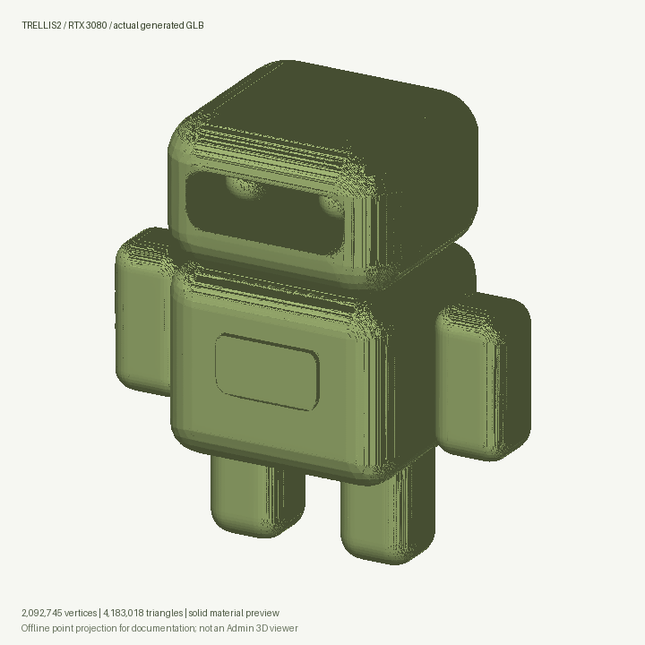
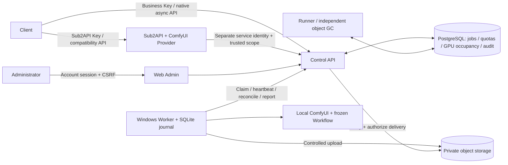

# ComfyUI Aggregator Proxy

The canvas runs static 134.1/backend 132.2. The task page exports, previews and atomically imports journal JSON, preserving original request bytes, idempotency keys and job IDs without Keys or media. Imported records stay unverified until an explicit original-job query; cancellation and artifact reads remain blocked until then. A backup without a job ID can now [look up the original submission](docs/132-画布原提交只读核对.md) without resubmitting generation. Artwork ZIP and journal JSON must be backed up separately; original prompts may contain private information. [Recovery design](docs/studio/13-任务清单备份与只读恢复.md), [original-speed MP4](docs/studio/media/studio-131/studio-task-backup-verified.mp4) and [GIF](docs/studio/media/studio-131/studio-task-backup-verified.gif) use production UI with a synthetic API and injected quota failure, not GPU execution or a physical phone.

All 159 units, type/build, 18 UI groups, 22 storage groups, 25 journal groups, 15 lookup groups, 15 batch groups and 17 GLB groups pass on the frozen source. Historical public v2→v3 retention and current 134.1 preservation/restart checks pass without restarting the original Worker. Browser v3 data cannot be downgraded by static rollback. Managed document/original-reference transactions, save retry and cross-tab conflict protection remain; ordinary image/file collection is paused pending safe ownership checks, and upload-cache cleanup/full quota UI remain pending. [Storage design](docs/studio/12-本机引用事务与保存失败恢复.md).

[131 · Managed creative canvas](docs/131-画布提交发布校验与异步查询契约.md) reuses the existing seven media task types, business Keys, Workflows and durable GPU scheduling. It commits a local journal before POST, reconciles the original request through a read-only lookup, checks the expected release and verifies authenticated artifacts. Missing GLB discovery is fixed. Backend scoped/compatibility checks passed112/1,486 cases; regenerated Admin types passed a separate type/build check. [Public Studio](http://43.165.167.179:39443/studio/) has historical backend/static rollback evidence preserving jobs/content; current publication moves forward for v3 compatibility. Eight GPU modes previously completed on3080/5070, including30-second FLAC and a76.94MB GLB; this update submits no new GPU job. The full fault matrix, phones and capacity remain separately tracked in [all46 requirements](docs/studio/10-开发进度与交付记录.md).

Studio uses `/studio/` on the existing high HTTP port, alongside `/admin/` and `/v1/`. It adds no generation backend and needs no local Docker, WSL or Agent. Reviewed source and lockfiles are mirrored under `app/apps/studio_web/`; all managed pages use the Lime visual system. Images, video, Workflow audio and GLB have distinct handling. Eight-hour cloud retention and offline browser copies are independent. [Usage and recovery](docs/studio/USAGE.en.md), [native deployment runbook](docs/studio/11-线上使用与原生发布运维.md).


[Actual samples and eight call receipts](docs/studio/media/studio-131/README.en.md) · [Original-speed MP4](docs/studio/media/studio-131/studio-focused-tour.mp4) · [Mobile canvas](docs/studio/assets/studio/controls-2026-10-29T22-08-02-756Z/mobile-canvas.png)


[129 · 3D compatibility review](docs/129-三维兼容复查与GLB边界修复.md) fixes POSITION accessor counts, invalid node hierarchies outside the default scene, an incorrect image-permission requirement for 3D-only Keys, and missing .glb download filename extensions. All 339 final scoped checks pass, including least privilege across seven task types, HTTP admission and full/HEAD/Range downloads. See the review for deployment and fresh generation evidence.

Historical cloud **129.3** verification: a Key with only the mesh generation scope successfully ran RTX 3080 TRELLIS2 and returned a 100,424,732-byte GLB. Full SHA, canonical filename, cross-Key isolation and once-only mesh usage pass. Both temporary Keys are disabled. [Fresh real requests and responses](docs/examples/model3d/recheck-129/README.md).

[128 · 3D model support](docs/128-ComfyUI三维模型产物与3080适配.md) adds `image_to_3d`, self-contained GLB 2.0 validation, separate `meshes:create` permission and Tenant/Project/Key `daily_mesh_count` quotas. The RTX 3080 TRELLIS2 example uses the same asynchronous queue, exclusive physical GPU ownership, authenticated content download and eight-hour retention after success. See the increment for actual verification status; only Workflows with real runtime approval are published.

Discover usage at `/v1/models/{alias}`, upload one source image to `/v1/assets` with the same business Key, then submit `task_type=image_to_3d`, `input.source_image.asset_id` and advertised quality/seed to `/v1/jobs`. This workflow accepts neither text prompts nor image dimensions. Download GLB using the completed job's `artifacts[].id`. Admin manages releases/permissions, filters 3D content, displays geometry counts and downloads artifacts. Admin mesh previews remain outside that increment; Studio now has a separate [interactive GLB viewer](docs/134-画布GLB交互预览与资源释放.md). OBJ/multi-file glTF and Sub2API 3D billing remain separate work. [Frozen Workflow, original input and examples](docs/examples/model3d/README.md).

Deployed at **https://gen.sub2share.xyz**: **11 published models across 3 enabled channels**, including the approved `comfy-3080-3d-trellis2`. Its platform validation and separate business API job both succeeded. The 100,424,732-byte business GLB passes complete download/SHA, HEAD/Range, idempotency and cross-Key isolation checks. See [actual requests/responses](docs/examples/model3d/README.md), [implementation and deployment evidence](docs/128-ComfyUI三维模型产物与3080适配.md) and [actual Admin screenshots, original-speed recording and GIFs](docs/media/model3d-128/README.md).



Three devices have a 10-minute idle policy that releases reclaimable RAM/VRAM through ComfyUI HTTP APIs. In Admin, open a model's usage dialog to view capabilities or edit its public description; open a channel's idle-reclamation dialog to configure and inspect execution proof. New channels need explicit policy activation.

The published [Media Gen Skill 1.1.1 Release](https://github.com/copypasteltd/comfyUI-aggregator-proxy/releases/tag/media-gen-skill-v1.1.1) includes a standalone Python 3.10+ client, source manifest and SHA-256 checksum. It aligns with cloud 129.3 mesh-only permissions, GLB downloads and supported boundaries: 3D uses `meshes:create` without requiring `images:create`. Configure a business Key, discover models and parameters, then submit an asynchronous job. Visibility and quotas remain controlled by the Key. [Update and verification](docs/130-MediaGenSkill兼容同步与发布.md).

```sh
export MEDIA_GEN_API_KEY='YOUR_BUSINESS_API_KEY'
python3 scripts/media_gen.py models
python3 scripts/media_gen.py describe comfy-3080-image-lustify-krea2
python3 scripts/media_gen.py generate --model comfy-3080-image-lustify-krea2 --prompt "A green lime beside a ceramic cup" --size 720x1080 --wait --output-dir output
```

[Installation, references, media calls and recovery](docs/126-MediaGenSkill安装与调用.md) explain parameters, uploads and downloads. Native discovery uses `GET /v1/models`, `GET /v1/models/{alias}` and `GET /v1/capabilities`. Submit with `POST /v1/jobs`, poll its `status`, then read/download `artifacts[].id`. Use advertised preset combinations. The current music prompt controls style while lyrics stay fixed in its Workflow. Outputs expire eight hours after success.

[124 · Delivery and evidence](docs/124-模型使用说明与公开Skill交付.md) records four real Skill jobs, automatic reclamation on three devices, deployment/restore checks and exact test scopes. [125 · Reclamation design](docs/125-ComfyUI空闲内存回收与双屏障.md) uses durable exclusion, `/free` and two ordered CPU barriers. Temporary observation failures block release; unknown execution retains protection. Metrics do not promise zero memory. Initial feature sources passed 16 gates/4391 Python cases; later fixes passed 1761 relevant regressions, recorded separately.

[Actual screenshots, original-speed recording, GIF, API responses and samples](docs/media/media-gen-124/README.en.md) come from production and the published Skill Release. Public samples omit embedded Workflow metadata, and the temporary validation Key is disabled. One frozen release can map to multiple verified channels and Workers claim available slots. All 11 current aliases still have one channel; strict round-robin or equal per-device task counts are not implemented.


[123 · Idle memory release and shared model pools](docs/123-空闲资源释放与多设备模型池调度设计.md) records the historical increment-123 audit and design. At that point, jobs released their GPU scheduling slot without a 600-second memory-unload policy; increment 124 above now implements that policy. A public alias can already map one frozen release to multiple channels; at that audit, all ten aliases had one channel, and Worker pull arbitration does not ensure equal device assignments. The design specifies instance-wide idle tracking, maintenance exclusion, conditional cleanup with actual completion acknowledgement, global pool offers and fair device selection. Ten development items and fourteen acceptance groups remain pending. **Design only: no production unload, alias consolidation or multi-device balancing acceptance.**

[122 · RTX 5070 HTTP onboarding and selected packages](docs/122-RTX5070纯HTTP接入与调用验证.md) is deployed. Select and publish only 3 complete Workflows out of 78: text video, first-frame video and two-reference video. Each passes one release-validation job and one independent business API job: 6 actual generations with download hashes, physical specifications, idempotency, HEAD/Range and eight-hour expiry verified. That deployment brought the platform to **3 enabled channels and 10 published aliases**. All 617 related regression cases pass; remaining candidates are not imported or published in bulk.

[Selected packages and English usage](docs/examples/5070/README.en.md) include complete release JSON, actual model options and project-owned reference images. [Actual screenshots, original-speed recording, GIFs and generated samples](docs/media/5070-workflows-122/README.en.md) document this deployment. A native Linux HTTP Worker requires no remote Windows-MCP. API-only declarations and Admin forms distinguish API observations from host-file verification.


[121 · Delete ComfyUI originals after durable handoff](docs/121-ComfyUI原始产物移交即清理设计.md): once copy 01 reaches Worker spool 02 with complete size/SHA-256 verification, fsync and a committed recovery package, request deletion through a dedicated ComfyUI endpoint immediately, without waiting for cloud copy 03. Restrict deletion to the owning task and retry independently. Keep existing spool retention of one hour after cloud acknowledgement and cloud retention of eight hours after success. **Design only: the extension, Worker recovery changes and production activation remain pending; originals are still retained online.** The specification includes eight development items, ten acceptance groups and a machine-readable policy.

[120 · Reference generation and exact dimensions](docs/120-参考能力发布与精确尺寸验证.md) records six real validations, six independent business calls and nine invalid-input/access-isolation checks. Those seven aliases continue to supply image, video and audio generation; the three new 5070 aliases are listed below. Each business Key discovers only its authorized, runnable subset.


| Published alias | Capability / input | Verified specification | Submit endpoint |
| --- | --- | --- | --- |
| `comfy-3080-image-lustify-krea2` | Text image | 720×1080; original default 1024×1024 | `/v1/images/generations/async` |
| `comfy-3080-image-edit-wai` | Image editing, one image | 720×1080 PNG | `/v1/images/edits/async` |
| `comfy-3080-image-refs-wai` | Two reference images | 720×1080 PNG | `/v1/images/edits/async` |
| `comfy-4090-video-h3` | Text video | 720×1080; original default 864×480, about 5.167 s | `/v1/videos` |
| `comfy-4090-video-h3-i2v` | One first-frame image | 720×1080, about 5.167 s | `/v1/videos` |
| `comfy-4090-video-h3-refs` | Two reference images | 720×1080, about 5.167 s | `/v1/videos` |
| `comfy-5070-video-h3` | Text video | 512×288, 1.625 s, 24 fps | `/v1/videos` |
| `comfy-5070-video-h3-i2v` | One first-frame image | 512×288, 1.625 s, 24 fps | `/v1/videos` |
| `comfy-5070-video-h3-refs` | Two reference images | 512×288, 1.625 s, 24 fps | `/v1/videos` |
| `comfy-3080-music-yue2` | Text audio; verified in 118, not rerun here | Up to 30 s, 48 kHz stereo FLAC | `/v1/jobs`, `text_to_audio` |
| `comfy-3080-3d-trellis2` | One source image to 3D | standard, n=1; static triangle GLB 2.0 | `/v1/jobs`, `image_to_3d` |

Usage: grant the Key access to aliases, release IDs, channels and quotas in Admin; upload reference images to `/v1/assets`; submit with the resulting `asset_id`; poll `/v1/jobs/{id}`; download with the same Key. New releases do not automatically expand an existing Key's permissions. Use `source_image` for image editing, `input_reference` for first-frame video, and an ordered two-item `references` array for the selected multi-reference models. See [120](docs/120-参考能力发布与精确尺寸验证.md) for complete JSON and the resumable native [verification CLI](app/scripts/verify_reference_api.py).

The 4090 H3/Krea2 720×1080 paths crop fixed edges from 736×1088, so allow composition margins. Dimensions come from frozen presets; the 5070 releases currently approve only 512×288 at 1.625 seconds. Video-file references, arbitrary dimensions/durations/reference counts and every candidate Workflow remain outside this acceptance. Seven previously validated Workflows are drawn from 241 earlier drafts, with 234 still awaiting preparation; this increment adds only three separate 5070 Workflows. Physical 10–20-device capacity, full Sub2API runtime integration and complete-product acceptance remain open.


[Actual screenshots, original-speed recording, GIFs and samples](docs/media/reference-capabilities-120/README.md) use the deployed platform and original project-owned inputs. Public copies remove embedded generation metadata and retain separate original-delivery/copy digests. Temporary Keys are disabled; both channels remain enabled with no unfinished test jobs.

[119 · Eight-hour retention](docs/119-云端产物八小时保留.md): cloud image/video/audio outputs expire eight hours after successful completion; save files before `expires_at`. Worker spool, raw ComfyUI outputs and client copies follow their separate retention rules. Plain HTTP port 39443 and unrestricted-origin CORS remain deployed, with business Key authorization, independent Admin sessions and CSRF checks.

## Historical release notes

Read the following counts/statuses at their original increment date. The table above and document 122 describe the current published capabilities.

[117 · ZeroTier private-network access](docs/117-ZeroTier原生客户端与私网接入.md): native ZeroTier 1.16.2 is running with startup enabled. After the user's controller authorization, the requested network reports `OK` and assigns an address. Actual HTTP on port 39443 and SSH pass from another Windows member; default routes and DNS remain intact, and all 64 services running before installation remain active. Node/address details are delivered privately; actual ComfyUI and Worker registration remain pending.

[115 · Native Linux deployment](docs/115-Linux服务器部署与磁盘清理.md) and [116 · HTTP / unrestricted origins](docs/116-HTTP高位入口与任意来源访问.md) are deployed: isolated PostgreSQL 18, private versioned S3, Admin/API, Runner, GC and scheduled database backups are running. The requested entry uses plain HTTP on high port `39443`, ready for the user's reverse proxy. `GEN_ALLOW_HTTP=true` and `GEN_ALLOW_ANY_ORIGIN=true` permit arbitrary origins, standard methods and request headers while retaining API Key authorization and Admin CSRF. Validation passes 309 related Python tests, two HTTP UUID tests, 55 final public checks and six browser page/viewport checks. Cleanup reclaimed about 3.43 GiB across two passes; about 10.24 GiB remains available after installation. All 49 previously running services checked remain active. Real Windows nodes and all six Workflows remain pending; the host's existing Sub2API is not connected to this project's custom Provider.


The [live deployment screenshots, original-speed MP4 and GIF](docs/media/linux-deployment-116/README.md) use the deployed database; earlier demonstrations below retain their synthetic-data labels. Start at `/admin/`, manage tenant/project scopes and multiple API Keys, then register Windows Workers, GPUs and ComfyUI channels when available. Import and synchronize image/video/audio Workflows, verify and publish model aliases, and use a Key to submit asynchronous jobs, poll status and download content. Actual text-to-image, text-to-video and text-to-audio models are now available through the two onboarded Windows GPUs; remaining candidates and fleet acceptance are still pending. The initial administrator password is delivered privately and excluded from Git.

[113 · Provider status and candidate closeout](docs/113-Provider实现状态与真实运行验收边界.md) Corrected Provider implementation status and scope while retaining runtime_integration_verified=false for unaccepted real dependencies. Source 7935b7d passes all 16 gates/4280 Python tests and 29 installation/10 browser checks of rc-20261026.113.1. All 649/525 inputs and embedded metadata match; actual Provider sources, patches and binary pass provenance guards. Reuse 30 native scenarios from 112 after all 275 inputs match; no new native execution is claimed. Local V01/V02/R05 exits from audit 114 are closed; real capabilities remain accepted at 0/6, with 69 stable exits, 98 complete gates and historical root causes open.

[114 · Current workspace and goal audit](docs/114-当前工作区系统审计与完整目标差距.md) rehashes 649 inputs, the last executed increment-112 reports and every candidate payload. Core/Admin implementations exist; 69 exits remain open (67 first-release, 2 optional), real capabilities are accepted at 0/6, and 98 complete gates remain pending. A pre-existing uncommitted Provider metadata correction still needs current-source CI and a new candidate/install; all 275 native inputs are unchanged and reusable only within their stated scope. This audit does not rerun suites or promote acceptance.

[112 · Inflight input publication and cleanup](docs/112-输入素材发布未决事务与清理保护.md) Input cleanup waits for the API Key lock already held by publication before checking the exact object version; external deletion holds no database connection. Source e12f604 passes 122 focused cases (six new), all 16 gates/4280 Python tests, 30 native scenarios, and 29 installation/10 browser checks of rc-20261026.112.1. All 649/275/525 source inputs and actual content.py wheel bytes match. Preserve two valid pre-fix missing-byte reproductions and four ID-parsing test failures, which are not behavioral evidence. Owned temporary resources are closed; six real Workflows, 69 stable exits, 98 complete gates and historical database root causes remain open.

[111 · Current project and complete goal gaps](docs/111-当前项目完整目标与逐项差距.md) Reaudit current source c20b765: all 16 gates/4274 Python tests, 30 native scenarios and 29 installation/10 browser checks of rc-20261026.110.1 match current sources and actual payloads. Publish all 69 open exits (67 V1, two optional); real Workflow acceptance remains 0/6, with 98 complete gates and historical root causes open. Core/Admin implementation does not establish production acceptance.

[110 · Uncertain output publication and object cleanup](docs/110-输出发布提交不确定与对象清理.md) Protect published outputs when a durable database commit loses its acknowledgement: wait for the same upload publication lock, verify the exact object version, and delete only after a successful absence check. Query or deletion failures preserve bytes and the original error; deletion runs after the database transaction ends. Source c20b765 passes 116 focused cases (nine new), all 16 gates/4274 Python tests, 30 native scenarios, and 29 installation/10 browser checks of rc-20261026.110.1. All 648/275/525 source inputs and the installed output-publication wheel bytes match. Keep both original failed reproductions. Owned temporary resources are closed; all 69 stable exits, six real Workflows, 98 complete gates and historical database root causes remain open.

[109 · Current-source regression and candidate verification](docs/109-当前源码全量验证与安装候选收口.md) closes audit 108 subtasks V01–V03: all 16 gates/4265 Python tests, 30 native scenarios and 29 installation/10 browser checks of rc-20261026.107.1 pass for 75db9a0. All 647/275/525 source inputs and actual Worker wheel bytes match, and owned temporary resources are cleaned up. Audit 108 retains its original historical source drift; current local validation is now complete while all 69 stable exits, zero of six real Workflow acceptances, 98 complete gates and historical database causes remain open.

[108 · Current workspace versus the complete goal](docs/108-当前工作区与完整目标差距复核.md) rehashes all 647 application inputs and the actual previous candidate. The 248 focused checks cover current increment 107; two Worker sources differ from the 106 full CI/native/candidate, so a current full regression, native run and rebuilt installation remain pending. The numbered inventory retains 69 open exits (67 V1, two optional), zero of six real Workflow acceptances and 98 pending complete gates. Local implementation, historical tests and production acceptance are distinct.

**Turn ComfyUI installations on multiple Windows machines into managed, queued and traceable image, video and audio APIs.**

[中文](README.md) · English · [Documentation](docs/README.en.md) · [Changelog](CHANGELOG.md) · [Contributing and synchronization](CONTRIBUTING.md)


The internal service name is **Render Control**. The system combines a visual Admin, a durable generation control plane, Windows Workers and a Sub2API integration. Images, videos and audio all come from ComfyUI Workflows; audio uses the same execution and management system.

**Status: in development; Linux control services and three ComfyUI devices (3080, 4090 and 5070) are connected.** Image, video, audio and the published reference capabilities have actual calling evidence. The 5070 is served by a native Linux HTTP Worker without device-management access. Specialized Workflows, high-resolution/long video, model quality, 10–20 physical machines, custom Sub2API integration and complete disaster recovery remain open. Historical records retain their original scope; increment 122 describes the current deployment.

[107 · Final output metadata and Worker isolation](docs/107-ComfyUI最终产物结构与Worker隔离.md) fixes controlled rejection of malformed history and recovery quarantine races, including failed tasks still cleaning up. All 248 strengthened focused cases, 16 gates/4265 Python tests, 30 native scenarios and 29 installation/10 browser checks of rc-20261026.107.1 pass. All 647 CI/275 native/525 candidate inputs and actual Worker metadata/runtime wheel bytes match 75db9a0. Preserve the 90/12/1 failed reproductions and clean up owned temporary resources. Real-resource exits 17/23/43/55/60, all 69 remaining items and full production acceptance stay open.

[106 · Interrupted Worker output-copy recovery](docs/106-Worker产物中断复制与恢复.md) fixes existing spool files blocking recovery through full-prefix verification and bounded append/exact-copy reuse. Different, longer, hardlinked or reparse targets stay isolated without truncation, overwrite or regeneration. All 115 focused cases, 16 gates/4137 Python tests, 30 native scenarios and 29 installation/10 browser checks of rc-20261026.106.1 pass. All 644 CI/275 native/525 candidate inputs and actual Worker wheel bytes match application commit 1f62868. Initial failures and the native Windows timestamp diagnostic remain intact, and owned temporary resources are cleaned up. Real-device exits 42/55/61, all six real Workflows, 69 remaining items and complete production acceptance stay open.

[105 · Current project and goal gaps](docs/105-当前项目检查与目标差距清单.md) rehashes 640 CI, 274 native and 524 candidate inputs plus all 169 ZIP payloads against current HEAD 316c540. Existing 16 gates/4074 Python, 30 native and 29 installation/10 browser results match the application source; complete tests were not rerun. The current in-memory compiler probe preserves six valid graphs and rejects 24 unsafe phase checks, confirming the 104 fix. All 69 remaining exits (67 V1, two optional), 0/6 real Workflows and 98 pending full gates remain explicit in numbered tables; historical database causes and strict Video SDK limits stay open.

[104 · Workflow graph-edge protection](docs/104-Workflow标量绑定与连线保护.md) fixes audit 103/F01: bindings and presets may write only original scalar inputs, enforced at release validation and Worker compilation before submission intent or ComfyUI POST. Drafts remain editable and unsafe imports are unpublishable. All 173 focused cases, 16 gates/4074 Python tests, 30 native scenarios and 29 installation/10 browser checks of candidate rc-20261026.104.1 pass. All 640 CI/274 native/524 candidate inputs match application commit d2d53ff. Pre-fix and harness failures are retained; temporary resources are cleaned up. The local defect is addressed while all 69 complete exits, real-resource/production acceptance and historical database causes remain open.

[103 · Current-source goal audit](docs/103-当前版本系统检查与目标产物差距.md) rehashes all 637 CI, 274 native and 524 candidate inputs plus the actual ZIP; they match the completed increment 101. There are still 69 open items (67 required, 2 optional), 0/6 accepted real Workflows and 98 pending full-acceptance gates. A new core validation defect was reproduced with all six synthetic capabilities: parameter bindings or presets can overwrite graph edges (12 unsafe variants accepted). It is prioritized under existing items 24/46. This audit changes no application code or acceptance state; passing engineering tests does not establish product readiness.

[Increment 101: dependency errors and safe recovery](docs/101-依赖不可用错误与安全重试边界.md) completes redacted API/Provider 503 responses, request correlation and uncertain-write protection. The 148-case Python component, 178 top-level/356 Go subtests, all 16 gates/4013 Python tests and 30 native scenarios pass; 637 CI/274 native inputs match application commit 6e4b78f. Candidate rc-20261026.101.1 binds 524 sources and 169 payloads/58 wheels/67 contracts, passes 29 exact-installation/10 browser checks, and cleans up its temporary resources. The local Go/evidence/current-regression/candidate gaps recorded in [audit 102](docs/102-当前工作区系统检查与目标差距.md) are addressed; its historical scope is retained. Actual Workflows, physical machines, real Redis/S3, production and historical database causes remain pending, with all 69 complete exits open.

For `503/dependency_unavailable`, `Retry-After: 2` is a waiting hint and does not prove that a write was rolled back. Query the original task or recover using the original `Idempotency-Key` and request semantics. The Provider retains the durable intent and reservation; a 503 does not trigger blind generation resubmission or release funds. Responses contain no SQL, driver text or remote diagnostics.

[Increment 99: database wait classification](docs/99-原生数据库等待分类与并发复验.md) preserves allowlisted I/O and IPC events in the native test observer while retaining legacy lock fields, scope, capacity and redaction limits. Seventy-three focused checks and all 16 gates/3938 Python tests pass. The complete 29-case native run fits inside the Python gate; 1585 samples have no capacity truncation and all owned processes/databases/threads/media/credentials are cleaned up. All 633 CI and 273 runtime inputs match application commit 21d6ac2. No slow I/O or historical 502 is reproduced. Rate limits, budgets and generation behavior remain unchanged; historical causes and real-resource acceptance stay open. Candidate 97 is not rebuilt: its source manifest retains the prior observer script, so its installation evidence is not promoted to this increment.

The [historical systematic recheck (98)](docs/95-项目现状审计与目标产物差距.md) verifies all 632 CI inputs, 521 candidate inputs and the actual archive digest against application commit 31f3798. It does not rerun the complete tests or promote acceptance. All 69 exits remain open (67 first-release, two optional), with 0/6 actual Workflows accepted. A 500-call authentication baseline and cleanup on a clone of the preserved test database pass, but neither reproduces the original failure or closes historical 502/503/timeout causes. Audit sections 4 and 8 and [checklist 78](docs/78-完整待办与首版收口清单.md) retain every numbered exit condition.

[Increment 97: release provenance and audit readability](docs/97-发行来源绑定与审计状态可读性.md) binds new builds to an actual Git commit and committed source bytes, rejecting changes during packaging. Commit application/CI changes before building; documentation may follow. Audit policy status appears immediately with readable padding and mobile wrapping in the original Lime system. Ninety release checks, 19 UI checks across three widths and all 16 gates/3915 Python tests pass. Candidate rc-20261026.97.1 embeds actual source commit 31f3798, contains 169 payload files, 58 wheels and 66 contracts, and passes 29 installation and ten installed-browser checks. Original-speed recordings and evidence are documented; actual resources and production remain pending.


[Current-source verification and candidate 96](docs/96-当前源码完整验证与原生发行候选.md) pass all 16 gates and 3899 Python tests with zero failures, errors or skips; all 628 application inputs remain identical. Python takes 595.039 seconds within the unchanged 1200-second budget. Candidate rc-20261026.96.1 contains 169 payload files, 58 wheels and 66 runtime contracts and passes 29 fresh isolated-installation checks and ten installed-browser checks. Temporary resources are cleaned up. Actual resources, production and historical failure root causes remain pending; the Git-revision and status-display follow-ups recorded there are addressed by increment 97 above.

The [2026-10-26 project audit](docs/95-项目现状审计与目标产物差距.md) details all 69 open items: 67 for the first release and two optional. Of 73 mapped requirements, 67 have local implementations and six capability entries remain frameworks; all 98 complete acceptance gates remain pending. At that audit, current inputs matched increment 94 focused evidence while the full CI and candidate belonged to increment 92; verification 96/97 fills that local delivery gap. Audit section 7 records current source commit 31f3798, 632 CI inputs, 3915 Python tests and the unchanged 69 full-acceptance items. Historical concurrent 502s, audit 503s, test-database/CI timeouts and strict Video type limits remain explicit. None of the 98 full acceptance gates is promoted.

The Chinese [tracking checklist](docs/78-完整待办与首版收口清单.md) retains 76 stable IDs: local implementation/traceability items 01–05, 10 and 12 are complete, leaving 69 open items (67 first-release and two optional). [Provider consumption](docs/80-Provider目录消费与版本快照.md), [Admin mapping management](docs/81-Admin网关目录映射与发布核对.md), [confirmed failure retries](docs/82-确认失败重试分类与跨GPU约束.md) and [monitoring](docs/84-监控指标与脱敏请求关联.md) have implementations and separate verification evidence. Actual Workflows, joint gateway behavior, failures and production still require acceptance.

The latest functional [increment 94](docs/94-队列等待估算与运行样本.md) adds on-demand queue estimates to Admin job details. A consistent snapshot combines physical GPU occupancy, scheduling policy and matching runtime samples from the last 24 hours. It shows a conditional allocation-wait interval, sample counts and a 15-second validity window. Missing samples, stale devices or uncertain execution produce unknown; actual-device calibration remains open.

Previous [increment 93](docs/93-真实Workflow离线发布包构建.md) prepares importable packages for all six capabilities from existing local ComfyUI dependencies, including model hashes, Git revisions and drift verification. [Focused evidence](docs/evidence/2026-10-26/workflow-package-python-93.json) is separate from historical full CI. Actual generation, quality and production approval remain pending.

Previous [increment 92](docs/92-直接视频接口冻结投影与权限边界.md) aligns direct job_ video creation, original-key replay and detail reads with frozen specifications, exact millisecond durations and safe terminal errors. It preserves current scopes, revocation, sensitive-input controls, cross-key/tenant isolation and bounded list queries. Verification passes 28 source-bound video cases, 74 release-security cases, all 16 gates/3790 Python tests, 39 actual SDK checks within 24 native scenarios, 29 exact-candidate installation checks and ten browser checks. See [verification 92](docs/evidence/2026-10-26/direct-video-verification-92.json). Preserve both CI timeouts, the bounded statistics experiment and other failures; the original 1200-second budget stays fixed. Original Lime sources and all 69 remaining full-acceptance items are preserved.

The Admin directly reuses the downloaded [original 04 Lime CSS](app/apps/admin_web/src/theme/reference/lime.css) and local original fonts. Future screens use the same shared theme and component adapter. See [source provenance and reuse rules](docs/87-青柠视觉系统与组件复用.md) and [this direct retrieval check](docs/evidence/2026-10-26/lime-direct-source-retrieval-92.json).

<details>
<summary>Historical verification (increments 84–91; results apply to those versions)</summary>

Previous [increment 91](docs/91-多媒体SDK与视频冻结规格.md) preserves frozen Provider video seconds/size and safe terminal errors using forward migration 258 and immutable metadata. Go/PostgreSQL checks pass 176 top-level tests and 342 subtests; actual Python/Node clients pass 39 SDK checks (including the expected strict Video-type rejection) within 24 native scenarios, creating exactly 12 jobs/intents/usage records. Differences from the strict official Video type remain explicit. See the topic for results and limitations.

[Final verification 91](docs/evidence/2026-10-26/multimedia-sdk-verification-91.json) passes all 16 gates/3713 Python cases, 28 exact-candidate installation checks and ten installed-browser checks. All 611 CI, 274 native-runtime and 505 candidate inputs match that revision. Candidate `rc-20261026.91.1` contains 169 payload files, 58 wheels and 64 runtime contracts. The original CI budget failure and controlled statistics experiment remain recorded; the successful Python gate takes 954.897 seconds within the unchanged 1200-second budget. Owned test browsers, processes and temporary databases are cleaned up; actual-resource and production acceptance remain pending.

Previous [increment 90: pinned SDK clients](docs/90-固定SDK客户端兼容矩阵.md) uses actual Python 3.37.0 and Node 7.43.0 SDKs to verify model discovery, image generation/editing, error correlation, idempotency/retries and explicit asynchronous extensions. Strict decoding exposed missing standard metadata in ordinary upstream models. The Provider now fills absent fields, preserves existing values and extensions, and rejects invalid metadata. [Local protocol evidence](docs/evidence/2026-10-25/openai-sdk-native-90-fifth/openai-sdk-native-protocol.json) passes 20 SDK checks within 24 native scenarios, creating only the expected six jobs and usage records. Actual Workflows, the complete client matrix and all 69 remaining items stay open.

[Final verification 90](docs/evidence/2026-10-25/openai-sdk-verification-90.json) passes 206 focused checks, 173 top-level/331 subtests in the Go component suite, all 16 gates/3696 Python cases, 28 exact-candidate installation checks and ten installed-browser checks. All 606 CI, 271 native-runtime and 501 candidate source inputs match. SDK failures, the CI budget failure and controlled test-database statistics experiments remain recorded; the original 1200-second budget is preserved. Candidate `rc-20261025.90.1` contains 169 payload files, 58 wheels and 63 runtime contracts. Actual-resource and production acceptance remain pending.

The earlier [increment 89: bounded audit projections](docs/89-审计分页投影上限与版本化复验.md) selects at most 51 page rows before converting audit details, enforcing the existing 16 KiB SQL projection limit within that page. Empty pages perform no detail conversion. Counts, permissions, snapshot consistency and timeout budgets are preserved. New executions bind current inputs through separate versioned evidence; historical authentication/audit timeout causes and all 69 remaining items stay open.

[Verification 89](docs/evidence/2026-10-25/audit-page-projection-verification.json) passes 179 focused checks, all 16 gates/3671 Python cases, 28 exact-candidate installation checks and ten installed-browser checks. All 600 CI inputs and 499 candidate source inputs match. Owned test browsers, processes, temporary database and directory are cleaned up; the development preview is updated. Candidate `rc-20261025.89.1` retains pending production and physical-resource acceptance.

The earlier [increment 88: requirement evidence](docs/88-需求实现与分层证据追踪.md) maps all 73 requirements and 98 acceptance scenarios to implementation, 99 named tests, six historical reports and remaining items. Its offline gate verified 141 referenced code/test inputs and report hashes, rejecting drift, missing links, unsafe paths and promotion of local checks to complete acceptance. Run `app/.venv/Scripts/python.exe docs/tools/development_evidence.py --write-report`; the documentation gate runs the same audit. Counts in the following earlier increments describe their historical revisions.

The preceding increment, [84: monitoring and request correlation](docs/84-监控指标与脱敏请求关联.md), adds an isolated read-only identity, bounded metrics, read-only PG snapshots, sanitized streaming observation and ten alert rules. [Verification](docs/evidence/2026-10-25/monitoring-verification.json) passed all 16 gates/3399 Python checks, 87 monitoring checks, 27 native scenarios, 50 PromQL assertions, 26 candidate installation checks and eight installed-browser checks. Candidate rc-20261025.84.1 has 476 verified source inputs, 159 payload files and 58 wheels. Production collection and notification remain open under item 68.

Increment 85 adds [native Windows service deployment tools](docs/85-原生系统服务封装与受控生命周期.md): fixed API/Runner/GC/Worker/Sub2API roles, verifiable deployment plans, separate virtual accounts, explicit installation/control/removal and bounded recovery. Non-admin mutations fail without UAC; startup defaults to manual. The tools do not alter firewall rules or ComfyUI. Tool/application-entry verification and actual WinSW/SCM lifecycle acceptance remain separate; item 66 stays open.

[Increment 85 verification](docs/evidence/2026-10-25/native-services-verification.json) passes all 16 gates, 3524 Python checks with zero failures/errors/skips, 161 service/release checks, 40 frontend units, 28 exact-candidate installation checks and eight installed-browser checks. Candidate `rc-20261025.85.3` matches 484 source inputs and contains 166 payload files, 58 wheels and 61 runtime contracts; all 581 CI inputs match. Four application roles exit cleanly with journals preserved and private resources removed. Actual WinSW/SCM and new gateway-supervisor lifecycles remain open.

The [native CI](docs/83-原生CI门禁与失败证据.md) provides 16 serial gates, isolated test directories, backup before test-database migration and sanitized public summaries. Raw logs/JUnit remain private. A dedicated physical Runner, repository enablement and actual GitHub success/failure artifacts still require acceptance; item 11 remains open.

The [native evidence](docs/evidence/2026-10-25/monitoring-native-final/confirmed-retry-native-protocol.json) uses actual Sub2API/API/Runner/Worker/PostgreSQL processes, with explicitly synthetic ComfyUI, Redis and storage protocol fixtures. [Increment 82](docs/82-确认失败重试分类与跨GPU约束.md) retains a gateway authentication row-lock timeout/502 observed during concurrent checks. Its cause remains unresolved; an isolated pass does not establish concurrent capacity. Physical devices, production Workflows and model quality still require later resource acceptance.

Increment 86 adds [sanitized database failure diagnostics and concurrency observation](docs/86-数据库故障脱敏诊断与并发观测.md). Request logs retain only a fixed operation, allowlisted SQLSTATE/reason and connection-invalidated flag; a dedicated handler prevents database SQL/driver tracebacks from reaching the ASGI server. Focused checks cover real PostgreSQL lock waits, rollback and recovery; native protocol runs add bounded, read-only blocker sampling. A deterministic PostgreSQL regression also exposed and fixed a job-detail read race: status, revision and artifacts now use one read-only snapshot, preventing an old nonterminal status from being combined with newly published artifacts. Existing 500/503 responses, timeouts and retry limits remain unchanged. Full attribution of the historical failures and the 70 backlog items remain open. Included-router log templates cover nested prefixes and hidden endpoints. Native CI handles small flushed log excess promptly, gives the reader ownership of stream closure, and retains failures and private stack diagnostics.

[Increment 86 verification](docs/evidence/2026-10-25/database-diagnostics-final-ci-verification.json) passes all 16 gates/3593 Python checks, 29 native protocol cases within the complete concurrent CI window, 28 exact-candidate installation checks and eight installed-browser checks. Candidate `rc-20261025.86.1` matches 488 build inputs and contains 166 payload files, 58 wheels and 62 runtime contracts; 59 schemas/947 fixtures agree. [86](docs/86-数据库故障脱敏诊断与并发观测.md) retains failed attempts, the one-time test-database maintenance and unresolved historical roots.

Increment 87 imports the user-selected [original 04 Lime source](docs/87-青柠视觉系统与组件复用.md). Seventeen routes, 390px/320px layouts and all demonstration media are refreshed. Forty frontend tests, 71 release security tests, 28 final-candidate installation checks and ten installed-browser checks pass. Full backend/native protocol suites were not rerun; [verification 87](docs/evidence/2026-10-25/lime-source-visual-verification.json) records scope and evidence.

</details>

## Contents

- [Capabilities and boundaries](#capabilities-and-boundaries)
- [Architecture and request flow](#architecture-and-request-flow)
- [Admin and demonstrations](#admin-and-demonstrations)
- [Native Windows quick start](#native-windows-quick-start)
- [Onboarding devices and Workflows](#onboarding-devices-and-workflows)
- [Using the APIs](#using-the-apis)
- [API Keys, content and quotas](#api-keys-content-and-quotas)
- [Scheduling, idempotency and recovery](#scheduling-idempotency-and-recovery)
- [Configuration, deployment and operations](#configuration-deployment-and-operations)
- [Repository structure and verification](#repository-structure-and-verification)
- [Documentation and future updates](#documentation-and-future-updates)

## Capabilities and boundaries

| Capability | Interface and behavior |
| --- | --- |
| Text to image | `text_to_image`: frozen Workflow, public model alias and controlled presets |
| Image to image | `image_to_image`: uploaded `asset_id`, with a mask when declared |
| Multiple references to image | `references_to_image`: ordered uploaded references with controlled roles/weights |
| Text to video | `text_to_video`: asynchronous task, bounded size/duration and result download |
| References to video | `references_to_video`: text and uploaded reference assets |
| Audio generation | `text_to_audio`: ComfyUI Workflow output, including speech, music or other sounds |
| Windows integration | Separate nodes, physical GPUs and ComfyUI channels; designed for 10–20 machines |
| Visual Admin | Channels, nodes, Workflows, model routing, global/channel queues, jobs, content, Keys, audit and alerts |
| Multiple business Keys | Separate operations, model/release/channel scopes, content scopes, rates, concurrency and daily limits |
| Sub2API first | Pinned upstream and narrow Provider overlay, with OpenAI-style compatibility and native asynchronous APIs |

Current generation constraints include one final artifact per task, declared input bindings and explicit output nodes. Clients cannot submit arbitrary execution graphs, set arbitrary node inputs, access server paths or instruct arbitrary URL downloads. Initial audio input is text; actual sound capabilities depend on the onboarded and accepted Workflow. Controlled audio presets cover WAV, FLAC, MP3 and Ogg Opus. The service verifies the actual format, sample rate, channel count and decoded duration. See the [audio contract](docs/55-音频契约与兼容迁移.md).

## Architecture and request flow



1. A client submits a model alias, standardized input, parameters and a stable `Idempotency-Key`. Sub2API authenticates its customer before forwarding through a trusted service identity; the native API verifies a control-plane business Key directly.
2. The control plane checks tenant/project/Key authorization, model publication, Workflow, channels and specification. It reserves quota and persists the task transactionally.
3. Runner and Worker coordinate through durable states, leases and physical GPU fencing. Several ComfyUI channels sharing one GPU still share its generation occupancy.
4. The Worker persists its local journal **before** submitting to ComfyUI, then executes the frozen Workflow. It accepts no arbitrary remote shell.
5. After controlled upload to private storage, the service verifies content, size, digest, immutable object version and actual media properties before success and settlement.
6. The client polls jobs and accesses artifacts through authorized preview/download APIs. Generation occupancy, result submission authority, quota and file cleanup have separate lifecycles.

PostgreSQL is authoritative for jobs and resources. SQLite is only a single Worker's journal. The pinned integration coordinates with Sub2API's existing ledger instead of introducing another independent billing ledger.

## Admin and demonstrations

Open a job under Tasks and select “估算等待” (Estimate wait). The interval ends when a GPU slot can be allocated; preparation, generation and upload follow separately. Elapsed queue time remains a separate measurement. Each runtime group needs at least ten successful matching samples; legacy attempts are not backfilled. Refresh after 15 seconds. New arrivals, polling, network or device changes affect actual allocation. This read action requires an Admin session; business API Keys cannot call it.

[Estimate screenshot](docs/media/wait-estimates/wait-estimate-1440.png) · [Mobile unknown state](docs/media/wait-estimates/wait-unknown-390.png) · [Continuous MP4](docs/media/wait-estimates/wait-estimates.mp4) · [GIF](docs/media/wait-estimates/wait-estimates.gif). Captures use actual UI/API calls with synthetic runtime observations.

The Admin follows the user-selected [04 · Lime source](https://html.cafe/x5b381ea1?c=lime). It imports the pulled original CSS and reuses its warm white/black/lime palette, ticket/card components and Anton/Manrope fonts. [87: visual system](docs/87-青柠视觉系统与组件复用.md) records the source files, hashes and shared component adapters, including teleported overlays. Original font bytes are decoded into local assets with bundled SIL OFL 1.1 notices. Future pages and components use the same system. Seventeen routes pass desktop and 390px/320px layout checks; all 20 screenshots and four MP4/GIF pairs are refreshed. Run `app/scripts/pull-lime-reference.py` for a local hash check, or add `--pull` to retrieve the fixed source again.

Open **网关接入 → 模型目录** (gateway catalog) or **模型与路由 → 网关模型目录** (model-page catalog entry). `models:read` permits state, mapping differences, failure receipts and paginated history; `models:publish` permits editing, publication, retry and rollback. The model-page read entry does not require gateway credential-management permission.

For the first publication, enter the same logical instance as the Provider startup file, select published models, and enter existing Sub2API usage-account/group IDs, price versions and unit prices. IDs remain decimal strings to preserve 64-bit precision. Publish the complete desired catalog after confirmation. The Provider polls, validates and persists candidates, then activates new-request rules only after a valid applied receipt. Desired and confirmed versions remain separate. After first activation, startup rules are no longer an automatic fallback; an empty catalog withdraws new tasks. Existing tasks and idempotent recovery retain their original model, Workflow, target and price. Rejection preserves the previous catalog; retry/rollback creates a new revision. Back up, drain and independently migrate Sub2API through migration 257 before deployment; startup only probes the schema. See the [publication protocol](docs/79-网关模型目录持久发布协议.md), [Provider recovery](docs/80-Provider目录消费与版本快照.md) and [Admin behavior](docs/81-Admin网关目录映射与发布核对.md).


[Catalog MP4](docs/media/gateway-catalog/gateway-catalog.mp4) · [Editor](docs/media/gateway-catalog/catalog-editor.png) · [Desired/confirmed versions](docs/media/gateway-catalog/catalog-confirmed.png) · [History](docs/media/gateway-catalog/catalog-history.png) · [Mobile](docs/media/gateway-catalog/catalog-mobile.png) · [Sanitized requests/responses](docs/media/gateway-catalog/api-responses.json). Provider receipts in this UI recording are explicitly labeled protocol fixtures. Actual Provider consumption has separate cross-process evidence; neither establishes physical GPU acceptance.


[Full tour MP4](docs/media/admin-tour.mp4) · [Workflow operations MP4](docs/media/workflow-lifecycle.mp4) · [Media, recording method and response examples](docs/media/README.md)

| Page | Operating logic |
| --- | --- |
| Overview and jobs | Inspect queued, running, abnormal and completed work; filter by scope/state and inspect phases, cancellation and controlled retries |
| Windows channels and nodes | Maintain ComfyUI addresses/configuration, node credentials and physical GPU links; inspect desired/applied/verified state and channel queues |
| Workflows | Import API-format Workflows, edit parameter forms, freeze releases, synchronize channels, inspect history and restore a release into a new draft |
| Models and routing | Bind a frozen, synchronized and runtime-approved release to an alias and eligible channels; configure defaults and publish |
| API Keys, tenants and projects | Create multiple business Keys, assign operations/resource scopes, configure hierarchical quotas and inspect access records |
| Content | Filter assets/artifacts by ownership, job, type and tags; authorize preview/download, edit tags and request deletion |
| Operations, alerts and audit | Track durable synchronization commands, reconcile/retry failures, inspect administrator actions and runtime abnormalities |


Workflow archival requires confirmation, revision CAS and an idempotent request. Published model references or unfinished synchronization commands block it. An archived Workflow rejects new edits, freezes, synchronization, approvals and task admission while retaining history, export and already accepted jobs. Unarchiving restores maintenance access; publishing, synchronization and approval remain explicit operations. Restoring history creates a new draft revision and preserves the immutable release.

If a response is lost, the UI offers reconciliation using the original body, key and revision. It does not replace the key to overwrite another administrator's change. See [Workflow lifecycle](docs/76-Workflow归档与恢复管理.md).

More screenshots: [login](docs/media/login.png), [mobile queue](docs/media/mobile-queue.png), [channels](docs/media/channels.png), [job queue](docs/media/queue.png), [model routing](docs/media/models.png), [API Keys](docs/media/api-keys.png), [content](docs/media/content.png), [release history](docs/media/workflow-history.png), [mobile](docs/media/mobile-overview.png). The current Admin UI is in Chinese.

## Native Windows quick start

### Prerequisites

- Native Windows, Git and Python **3.13** on PATH.
- Node.js **24.22.1** and PostgreSQL **18.6**, pinned in `app/config/native-toolchains.lock.json`; bootstrap can download and verify both.
- Native FFmpeg/ffprobe tools matching `app/config/media-tools.lock.json`, placed under `app/.local/toolchains/ffmpeg-8.1/`: `bin/ffmpeg.exe`, `bin/ffprobe.exe`, `LICENSE` and `README.txt`. Bootstrap does not install these files; release construction checks the pinned sizes and hashes.
- For actual generation: an independently working ComfyUI installation, models, custom nodes and Workflows on each Windows device. Worker Python is separate from ComfyUI's torch environment.

Docker, WSL and virtual machines are prohibited for this project's development and verification. Run the following in PowerShell. Installation scripts prepare project dependencies; they do not install models, open firewall rules or register system services automatically.

```powershell
git clone git@github.com:copypasteltd/comfyUI-aggregator-proxy.git
Set-Location comfyUI-aggregator-proxy/app

./scripts/bootstrap.ps1 -WithPostgresToolchain

# First-time initialization only: writes private .env, creates and starts native dev/test databases.
./.venv/Scripts/python.exe scripts/dev-db.py init

# Backs up and validates the archive before migration; restoration rehearsal is separate.
./scripts/db-migrate.ps1
./.venv/Scripts/python.exe -m control_api.cli bootstrap-project
./.venv/Scripts/python.exe -m control_api.cli bootstrap-admin --username admin

$taskNode = '.local/toolchains/node-24.22.1/node-v24.22.1-win-x64'
./.venv/Scripts/python.exe scripts/export-openapi.py
& "$taskNode/npm.cmd" --prefix apps/admin_web run generate:api
& "$taskNode/npm.cmd" --prefix apps/admin_web run build

# Prepare the pinned media tools described above first.
./scripts/dev-start.ps1
```

Open **https://127.0.0.1:8443/admin/** and sign in with the account just created. The loopback development certificate is under ignored `.local/tls/`; production requires its own HTTPS certificate. A fresh installation contains no accepted production models or channels. Complete onboarding below before generation.

Do not initialize an existing database again. To resume development, run `python scripts/dev-db.py start`, then `scripts/dev-start.ps1`; inspect status first if already running. Use `scripts/dev-stop.ps1` to stop this project's registered API/Runner/GC processes, and `python scripts/dev-db.py stop` for its PostgreSQL instance. Scripts verify PID, executable and creation time, excluding older unrelated processes after PID reuse.

### Development and production configuration

The `.env` created by `dev-db.py init` uses `development` and local storage. It is for development only. The production template is [environment.example](app/config/environment.example). Explicitly configure the database, pepper, Fernet key, trusted HTTPS origin, private S3 bucket and credentials. **Do not copy the development `.env` into production.** Production migrations, recovery and service hosting are covered by [native deployment and operations](docs/15-原生部署配置与运维.md).

## Onboarding devices and Workflows

Prepare an existing local Workflow draft with the [offline package tool](docs/93-真实Workflow离线发布包构建.md). It hashes declared model files, locks local ComfyUI/custom-node revisions and produces an importable `manifest.json` for all six capabilities. Previous runtime approvals are cleared; actual generation and channel approval follow the steps below.

```powershell
# Run from app/. The parent must exist; the output package directory must be new.
./.venv/Scripts/python.exe -X utf8 scripts/workflow-package.py build --manifest .local/my-workflow-draft.json --comfy-root C:/ComfyUI --output .local/workflow-packages/my-workflow-v1
./.venv/Scripts/python.exe -X utf8 scripts/workflow-package.py verify --package .local/workflow-packages/my-workflow-v1 --comfy-root C:/ComfyUI
```

1. **Establish scope.** Create/select a tenant and project in Admin and set limits. Their limits and the business Key's limits all apply. Default daily audio quota can be zero; explicitly configure every applicable layer before enabling audio.
2. **Register Windows nodes.** Issue a one-time Worker credential, save it to a private device file and verify the physical GPU identity. Start from [worker.example.json](app/config/worker.example.json).
3. **Register channels.** Configure the node's ComfyUI address, GPU association and allowed targets. Channel credentials are encrypted; browsers never connect directly to ComfyUI. Address/configuration changes require Worker application and verification.
4. **Prepare a Workflow.** Export ComfyUI's API-format graph and declare parameter bindings, approved presets, dependency locks, output adapter and final nodes. An editor-format Workflow is not directly an API execution graph. Inspect imported candidates before applying them.
5. **Freeze, synchronize and validate.** Freeze an immutable release, synchronize selected channels, reconcile desired/applied/verified digests, and obtain actual runtime evidence for the relevant model/specification before approval. A successful import is insufficient evidence of runtime support.
6. **Publish an alias.** Select the task type, release, channels and defaults, satisfy publication gates and publish. Clients call aliases rather than arbitrary Workflow graphs.
7. **Create business Keys.** Configure generation/content scopes, resource selections, specification limits and quotas. Plaintext appears only once when issued; save it securely.
8. **Configure and verify the gateway.** Follow [Sub2API ingress](docs/32-Sub2API公开任务接入.md) for the pinned Provider, service credentials and external identity mappings. Exercise generation, polling, download, cancellation, quota and ledger recovery.

The Worker entry point is `python -m windows_worker.main --config C:/render-worker/config.json`. Add `--validate-config` first to validate local configuration. Credentials and journal require restricted persistent directories. Include the node/GPU/channel information required by the current startup protocol. See [node registration](docs/56-Windows节点登记与凭证管理.md) and [Worker startup protection](docs/57-Worker启动身份与原生进程保护.md).

## Using the APIs

### Native asynchronous API

The native API supports all six task types. Run this from `app/` after placing an Admin-issued business Key in the process environment variable `COMFY_API_KEY`. Replace the example `demo-*` aliases with your published aliases.

```powershell
curl.exe --cacert .local/tls/localhost.crt `
  -H "Authorization: Bearer $env:COMFY_API_KEY" `
  -H "Content-Type: application/json" `
  -H "Idempotency-Key: example-image-0001" `
  --data-binary '@../docs/examples/create-image.json' `
  https://127.0.0.1:8443/v1/jobs
```

Complete JSON examples: [image](docs/examples/create-image.json), [video](docs/examples/create-video.json), [audio](docs/examples/create-audio.json). Audio example:

```json
{
  "model": "demo-text-to-audio",
  "task_type": "text_to_audio",
  "input": {"prompt": "A short, calm instrumental cue"},
  "parameters": {"quality": "standard", "seconds": 2}
}
```

| Operation | Control API path | Behavior |
| --- | --- | --- |
| Discover models | `GET /v1/models` | Only published models available to the current identity |
| Upload input | `POST /v1/assets` | Bounded upload returning an asset ID to reference in generation |
| Submit | `POST /v1/jobs` | `202`, stable job ID, Location and polling guidance |
| Query/list | `GET /v1/jobs/{id}`, `GET /v1/jobs` | Key/scope authorization and cursor pagination |
| Cancel | `POST /v1/jobs/{id}/cancel` | Requests cancellation; running work requires safe stopping/reconciliation |
| Artifacts | `GET /v1/content`, `GET /v1/content/{id}/download` | Scoped listing and authenticated download; no public bucket |

After `202`, retain the ID and poll with the same business identity until `succeeded`, `failed`, `cancelled` or `expired`. Retrieve artifacts through job/content responses only after success. HTTP acceptance does not mean generation completed. On an uncertain submission, reuse the original idempotency key and body instead of creating a duplicate task with a new key.

### Sub2API / OpenAI-style endpoints

These paths belong to a **Sub2API origin configured with this project's Provider**, and use a Sub2API customer Key. They are not the direct Control API origin.

| Path | Compatibility behavior |
| --- | --- |
| `POST /v1/images/generations` | Bounded synchronous images, returning OpenAI-style `created/data` after completion |
| `POST /v1/images/generations/async` | Image task and polling URL for longer operations |
| `GET /v1/images/tasks/{id}` | Image task query |
| `POST /v1/images/edits` and `/async` | Controlled image edits, uploaded assets and standardized inputs |
| `POST /v1/videos`, `GET /v1/videos/{id}` | Asynchronous video creation and query |
| `GET /v1/models` | Model discovery filtered by identity and publication scope |

Compatibility is an explicit OpenAI-format subset. Frozen contracts define accepted fields, file inputs, URL/binary delivery and errors. `n=1`; arbitrary SDK features and OpenAI parameters are not implied. **Audio currently uses native `/v1/jobs`; the synchronous binary `/v1/audio/speech` protocol is not implemented.** See [generation compatibility](docs/34-Sub2API生成兼容与产物访问.md), [assets and image edits](docs/35-Sub2API素材与图片编辑接入.md) and [audio migration](docs/55-音频契约与兼容迁移.md).

Direct `/v1/videos` uses job_ IDs; the Provider uses rc_ IDs. Follow the returned `Location` / `poll_url`. Known `seconds` and `size` come from the original frozen job, including after alias/default changes. Unknown legacy values and progress stay absent; failed/cancelled/expired jobs expose fixed safe errors. Direct responses retain scoped native extensions and use [their own contract](docs/contracts/control-video-response.schema.json). Neither response claims complete strict official Video-type compatibility. See [92](docs/92-直接视频接口冻结投影与权限边界.md).

### Pinned SDK clients

[Topic 90](docs/90-固定SDK客户端兼容矩阵.md) documents the pinned client matrix: Python `openai==3.37.0` and Node `openai@7.43.0`. Set the API address explicitly to this service's `/v1`, use a published model and business Key, and persist the `Idempotency-Key` before the first submission. Examples disable automatic retries and reuse the same key for recovery. Encode the multipart `workflow_options` extension as JSON form text.

See [topic 91](docs/91-多媒体SDK与视频冻结规格.md) for video and audio. Provider video responses retain frozen `seconds` / `size` and omit unknown `progress`; validate against the [project video contract](docs/contracts/sdk-video-response.schema.json). The strict Python official `Video` type differs in progress and allowed sizes. Use generic SDK JSON methods to recover or poll the original job, then the video content method to download. Audio uses asynchronous `/jobs` with `text_to_audio`, followed by the original artifact’s `/content/{id}/download`; it does not use `/audio/speech`.

Before running the repository's SDK rehearsal, explicitly install the sdk-compat dependency group and isolated locked Node dependencies as described in topic 90. These client verification tools do not enter the Admin or production runtime bundle.

```python
import os
from openai import OpenAI

with OpenAI(api_key=os.environ['GENERATION_API_KEY'],
            base_url=os.environ['GENERATION_BASE_URL'],
            max_retries=0, timeout=70) as client:
    result = client.images.generate(
        model=os.environ['GENERATION_MODEL'], prompt='A small green robot',
        n=1, size='1024x1024', quality='standard', response_format='b64_json',
        extra_headers={'Idempotency-Key': os.environ['GENERATION_REQUEST_ID']},
    )
    encoded_image = result.data[0].b64_json
```

When stock catalog entries lack a creation time, the merged response uses `created=0` to mean unknown and supplies the standard model fields. Existing valid values and extensions are preserved. A generation timeout does not cancel the job: query its original ID or recover using the original idempotency key. Pinned clients and local protocol verification do not establish acceptance of real Workflows.

## API Keys, content and quotas

- **Business Keys** protect public generation/content APIs. Admin accounts/sessions, Worker credentials and gateway service identities are separate. A business Key cannot sign in to Admin or call management APIs.
- A Key is bound to trusted tenant/project identity. Restrict scopes, models, Workflow releases, channels, specifications, content ownership/explicit sharing, expiry and enablement. Client-supplied tenant headers are not trusted.
- Hierarchical policies limit rates, unfinished jobs, actual generation concurrency and daily image/video/audio usage. `bounded: 0` prohibits use; unlimited access requires an explicit policy.
- Admission reserves quota; terminal processing settles/refunds under defined rules. Audio uses verified decoded duration; video follows its frozen duration semantics. Metering does not accumulate monetary values with floating-point arithmetic.
- Assets and artifacts use opaque IDs. Every query, aggregation, preview and download checks scope. Content deletion is audited logical deletion followed by controlled asynchronous collection, not direct database edits or bucket deletion.

Details: [Key authorization](docs/08-APIKey鉴权与访问控制.md), [content management](docs/48-内容检索标签与受控预览.md), [database transactions](docs/11-数据字典与数据库事务.md).

## Scheduling, idempotency and recovery

A disconnected Worker, expired lease or HTTP timeout does not prove a GPU is free. Unknown submissions are reconciled against journal and ComfyUI state before further action. Do not blindly resubmit, reroute to another machine or release a physical slot without evidence. Late reports require valid attempt/fencing identity and cannot overwrite a newer execution authority.

Cancellation, draining, specification isolation, management synchronization and retries have separate state and audit. Upload and media verification may continue independently of generation occupancy. Durable management commands use fixed allowed actions; they cannot run arbitrary commands, install custom nodes or download model weights automatically.

Internal retries share a maximum of two retries with 5/15-second backoffs. A preparation transport failure must be proven never submitted. A whitelisted OOM additionally requires current-prompt stop evidence and another approved physical GPU within the original frozen routes; each job may retry OOM once. The job, seed, Workflow, specification, inputs, deadline and price remain frozen, and later attempts continue excluding its failed OOM GPU. Unknown submissions reconcile the original execution; upload failures recover the existing file. Final metering and settlement occur once. An older Worker without OOM evidence retains the prior confirmed-failure behavior. See [confirmed failure retry rules](docs/82-确认失败重试分类与跨GPU约束.md).


[Retry MP4](docs/media/confirmed-retry/confirmed-retry.mp4) · [Desktop details](docs/media/confirmed-retry/retry-desktop.png) · [375px mobile](docs/media/confirmed-retry/retry-mobile.png) · [Cancellation result](docs/media/confirmed-retry/retry-mobile-cancelled.png) · [Sanitized responses](docs/media/confirmed-retry/api-responses.json). Admin shows the cause, budget and earliest dispatch time. Backoff retains unfinished quota and allows priority changes or cancellation. This recording uses the actual API/database with synthetic faults; physical GPU OOM acceptance remains separate.

See [task mechanisms](docs/02-系统架构与任务机制.md), [Worker protocol](docs/12-接口契约与Worker协议.md), and [joint recovery](docs/60-数据库对象与密钥联合恢复校验.md).

## Configuration, deployment and operations

Within one deployment, start API → Worker → GC → Runner → Gateway and stop in reverse so the API remains available during Worker shutdown. First use `install` to register stopped services, apply each account's read/modify permissions from `acl-plan.json`, then `start` and separately check SCM, HTTPS readiness and Worker registration. Drain and reconcile unknown work before an upgrade; uninstall preserves state and configuration.

| Setting | Purpose |
| --- | --- |
| `GEN_DATABASE_URL` | PostgreSQL connection; keep production and development separate |
| `GEN_CREDENTIAL_PEPPER`, `GEN_ENCRYPTION_KEY` | Credential verification and recoverable channel-secret encryption; distinct responsibilities |
| `GEN_PUBLIC_ORIGIN` | Trusted external HTTPS origin for delivery links and origin checks |
| `GEN_STORAGE_BACKEND`, `GEN_S3_*` | Local development storage or private production S3; real S3 requires separate acceptance |
| `GEN_SESSION_SECONDS`, `GEN_SESSION_IDLE_SECONDS` | Absolute and idle lifetimes of Admin sessions |
| `GEN_AUDIT_RETENTION_DAYS` | Explicitly approved audit retention; management audit is not automatically pruned by default |
| `GEN_MONITORING_TOKEN_SHA256` | SHA-256 JSON array for a dedicated read-only monitoring identity; disabled by default, two rotation slots |
| `GEN_MONITORING_ALLOWED_NETWORKS` | Actual connection-source CIDRs; loopback by default, arbitrary forwarding headers are ignored |
| `GEN_MONITORING_THRESHOLDS` | Strict queue, admission, settlement, heartbeat and HTTP-error alert thresholds |

See [monitoring and request correlation](docs/84-监控指标与脱敏请求关联.md). `GET /internal/monitoring/v1/metrics` exports Prometheus metrics; `GET /internal/monitoring/v1/configuration` returns a safe configuration projection. Both require a dedicated Bearer token and permitted connection source. Business Keys, Admin sessions, Workers and gateways cannot substitute their credentials. With no configured token digest, both routes return 404. Monitoring cannot change business configuration or read customer files.

From the native environment under `app/`, provision a one-time token and generate rules:

```powershell
.\.venv\Scripts\gen-monitoring.exe issue-token --output .local\monitoring.token
# Configure the printed sha256 in GEN_MONITORING_TOKEN_SHA256, restart API, and protect the token file ACL.
.\.venv\Scripts\gen-monitoring.exe configuration
.\.venv\Scripts\gen-monitoring.exe rules --output .local\render-control.rules.json
```

Only the specified new file receives the token; stdout contains its digest. Existing files cannot be overwritten. Isolated installations and external state directories use `configuration --env-file <private-env-file>` and `rules --env-file <private-env-file> --output <new-file>`; these commands do not connect to the database. The [native Prometheus example](app/deploy/observability/prometheus.example.yml) uses a credentials file and trusted CA. Generated rules cover ten anomaly classes; actual collection and notification still require deployment. Scrape each API process separately. Deduplicate global database gauges across instances with `max`; collect HTTP counters per instance before aggregation.

Metrics cover task backlogs, valid duration samples, physical GPU occupancy, node capacity coverage, settlement backlog and pending object deletion. A separate read-only database pool and five-second cache isolate observation from business traffic. Failed observation emits `snapshot_success=0` and omits database gauges. Uploads, downloads and SSE remain streaming. Sanitized JSON request logs correlate through server-generated request IDs and exclude prompts, credentials, query strings and path parameters. External monitoring thresholds and existing Admin-derived alerts remain separate.

See [native service tools](docs/85-原生系统服务封装与受控生命周期.md). Before building, explicitly prepare the pinned wrapper from `app/`:

```powershell
.\.venv\Scripts\python.exe scripts/prepare-service-tools.py --download
# Offline preparation: --source <local directory with pinned WinSW.NET461.exe and LICENSE.txt>.
```

New-candidate installation prepares `venv/Scripts/python-service.exe` and verifies its venv prefix, installed dependencies and file digests. Services use this interpreter to avoid an extra venv launcher process. Fill in the [closed deployment example](app/deploy/native-windows/services.example.json) with the installation, external secret/state paths, roles and API TLS. From the installed environment:

```powershell
& 'C:/render/install/venv/Scripts/python.exe' -I 'C:/render/install/payload/scripts/service-deploy.py' render --spec 'C:/render/private/services.json' --output 'C:/render/services/edge-a'
& 'C:/render/install/venv/Scripts/python.exe' -I 'C:/render/install/payload/scripts/service-deploy.py' validate --deployment 'C:/render/services/edge-a'
& 'C:/render/install/venv/Scripts/python.exe' -I 'C:/render/install/payload/scripts/service-deploy.py' status --deployment 'C:/render/services/edge-a'
```

The plan includes per-role XML, wrapper digests and an unapplied ACL requirements file. It does not prove production permissions or application readiness. Explicit deployment uses `install` to register stopped services, `start`, `stop` after draining, and `uninstall` only when stopped. Each takes `--deployment`; optional `--service` selects one exact plan member. Mutations require an already elevated administrator session and never trigger UAC. Removal preserves configuration, journals, databases and files. Actual SCM, service-account permissions, boot recovery and gateway supervision remain under items 66/67/73.

Before production migration, stop/drain affected services, back up and verify the archive, then migrate separately. A database backup is not joint recovery: object versions, Worker journals, Sub2API ledger/idempotency facts and credentials require consistent restoration and reconciliation. Windows service ACLs, Linux/systemd, production proxies, real Redis/S3 and joint recovery remain independent acceptance items. Development launchers are not verified production service wrappers.

Candidate construction and offline installation tools are `app/scripts/build-release.py`, `test-release-install.py` and `release-entrypoint.py`. Built archives, native runtimes and wheels stay in ignored `.local/`, outside the source repository. Commands and gates are documented in [deployment operations](docs/15-原生部署配置与运维.md).

## Repository structure and verification

```text
comfyUI-aggregator-proxy/
├─ README.md / README.en.md       Chinese and English solution/user entry points
├─ CHANGELOG.md / CONTRIBUTING.md Update records and contribution rules
├─ AGENTS.md                     Environment, development and synchronization constraints
├─ app/
│  ├─ apps/                      Control API / Runner / Windows Worker / Vue Admin
│  ├─ packages/                  domain / application / contracts / infrastructure
│  ├─ integrations/sub2api/      Pinned upstream, Go client and narrow overlay
│  ├─ integrations/openai-clients/ Isolated pinned Node SDK rehearsal client
│  ├─ migrations/                Alembic migrations
│  ├─ scripts/                   Native development, checks, builds, recordings and publication audit
│  ├─ config/                    Example settings, toolchain and contract hashes
│  ├─ tests/                     Contract, database, protocol, fault and unit checks
│  └─ pyproject.toml / uv.lock    Python workspace and exact dependency lock
└─ docs/                         Design, protocols, machine contracts, evidence and demonstration media
```

Run from `app/`:

```powershell
./scripts/check.ps1 -Suite Docs
./scripts/check.ps1 -Suite Python
./scripts/check.ps1 -Suite Frontend
./scripts/check.ps1 -Suite CI
./scripts/check.ps1 -Suite Sub2API
./scripts/check.ps1 -Suite Sub2APILedger
./scripts/check.ps1 -Suite Sub2APINative
./.venv/Scripts/python.exe scripts/audit-repository.py
```

Python integration tests require the project's native PostgreSQL and separate `render_control_test` database. In-memory/SQLite substitutes do not satisfy that gate. Go and full Sub2API checks require the pinned native Go toolchain and corresponding upstream cache. Browser tests/recordings must close their own page/context/browser in `finally`.

Run the native CI driver with `./scripts/ci.ps1 -Action Verify`. It serially checks documentation, locks/static analysis, generated files without overwriting them, frontend units/build, test-database backup/migration, full Python tests, seven wheels, README/media and publication candidates. Private logs/JUnit stay in `.local/`; public JSON contains only status, counts, hashes and cleanup facts. A dedicated native Windows self-hosted Runner uses fixed labels and `NATIVE_CI_ENABLED=true`; only trusted main-branch pushes/manual runs execute, with Actions pinned to complete commits. `./scripts/ci.ps1 -Action Bootstrap` prepares locked dependencies; an administrator prepares the database/private configuration separately. See [native CI](docs/83-原生CI门禁与失败证据.md) for commands, media provisioning and the separate remote-activation gate.

| Increment 83: local native CI | Result and scope |
| --- | --- |
| Complete gates | 16 serial gates passed; 558 app/platform source hashes match |
| Python/frontend | 3275 Python checks including 43 CI checks, zero failures/errors/skips; 40 frontend units, generated-type comparison/checking and production build |
| Engineering/database | Ruff, mypy on 157 files, 75-package lock, seven wheels; backup verified before test migration, both databases retain 45 business tables/head 2c9f1d6a4830 |
| Failures and boundaries | Preserve the initial CI lock collision and its fix; whitelist all five public JSON reports, retain raw logs/JUnit privately; actual GitHub Runner acceptance remains pending |

| Historical runtime/installation verification: increment 82 | Result and scope |
| --- | --- |
| Python | Full 3232 checks; 2156 contract/unit checks; full regression includes 58 confirmed-failure and catalog backend checks |
| Frontend | 40 unit checks, generated API types, type checking and production build |
| Admin browser | Eight retry checks at desktop/375px and eight installed-candidate checks; 18 screenshots/four MP4/four GIF verified |
| Provider components | Unchanged Go source/binary hashes verified; reuse historical client 48 top-level/222 subtests and Provider 172 top-level/325 subtests |
| Native integration | 26 scenarios/11 synthetic jobs, one OOM for each task type, shared preparation-failure budget, frozen inputs and single settlement |
| Candidate installation | 24 isolated offline installation checks, `rc-20261025.82.3`, 460 source inputs/155 payload files/57 wheels |
| Database/contracts | Consistent snapshot restore of 45 tables/758 rows; head 2c9f1d6a4830; 58 runtime contracts, 56 schemas/865 fixtures, 188 design endpoints, 154 OpenAPI paths/195 methods |

Fresh execution and historical evidence reused after hash verification are identified separately. The [summary](docs/evidence/2026-10-25/confirmed-retry-verification.json) and [retry/candidate topic](docs/82-确认失败重试分类与跨GPU约束.md) record source hashes, failures, cleanup and scope. Actual GPUs, dependencies, a fresh host, production and complete capacity acceptance remain open.

## Documentation and future updates

- [中文文档索引](docs/README.md) / [English documentation index](docs/README.en.md): requirements, architecture, contracts and implementation topics.
- [Development rules](docs/09-开发总纲与强制约束.md), [engineering structure](docs/10-技术栈与工程结构.md), [delivery checklist](docs/16-开发任务分解与交付清单.md): constraints and remaining gates.
- [Machine contracts](docs/contracts/README.md): JSON Schemas, state machine, endpoint inventory and traceability.
- [Demonstration media](docs/media/README.md): screenshots, MP4, GIF, actual responses and reproduction.
- [Repository preparation](docs/77-仓库整理与双语文档交付.md): publication scope and checks for this delivery.

Every completed update must include corresponding Chinese/English user-facing changes and a `CHANGELOG.md` entry. Refresh relevant screenshots/demos after UI changes, run applicable checks, commit and push to the same remote. Use ordinary pushes; do not force-push or rewrite shared history. See [CONTRIBUTING](CONTRIBUTING.md).

An overall open-source license has not been selected for this repository. Pinned upstream [Sub2API](https://github.com/Wei-Shaw/sub2api), dependencies and media tools retain their respective licenses. Model weights, full third-party upstream copies and native binaries are not included. See [upstream-lock.json](app/integrations/sub2api/upstream-lock.json) and toolchain locks.

## Read-only submission recovery (132.2 deployed)

After a lost response or journal import, `POST /v1/jobs/lookup` matches the original business Key, frozen body, idempotency key and release digest to restore the original job ID. It requires only `jobs:read` and never generates, uploads or charges again. A not-observed result stays unknown; older services fail clearly without falling back to creation. An IDB write transaction also claims the first send across pages.

[Operation and development contract](docs/studio/14-原提交只读核对与恢复.md) · [Original-speed MP4](docs/studio/media/studio-131/studio-submission-lookup.mp4) · [390px view](docs/studio/assets/studio/submission-lookup-2026-10-30T00-27-20-776Z/mobile-original-job-restored.png). This recording uses the production build with synthetic HTTP, not a GPU run or physical phone.


See current progress for all 46 requirements, failures and rollback. Current evidence covers 159 frontend units, type/build and 112 native-browser groups: 18 UI, 22 storage, 25 journal, 15 lookup, 15 batch and 17 GLB groups. All 555 backend runtime sources match deployed 132.2 and its frozen Git, retaining the previous 112/1,486 results; regenerated Admin types have separate type/build evidence. Public GLB checks (four), preservation/restart checks (three) and all four health endpoints pass. The [current evidence index](docs/studio/research/studio-implementation/model3d-validation-notes-1341.json) preserves failures and corrections. This increment renders an existing real GLB without new GPU generation or Keys. The historical eight modes mean one UI and seven API submissions, not all eleven aliases retested. Audio duration is 30,000ms versus 29,952ms decoder-progress metadata, a recorded 48ms difference within the existing 100ms tolerance; exact metering remains follow-up.

## Independent batches (static133.1 deployed)

Choose 1–15 jobs, default one. All members commit in one strict local transaction before sequential calls to the existing n=1 API. Each owns an independent job, idempotency key and canvas branch, using the same inputs/preset/references/fixed seed. An error or unknown response stops that invocation. Explicitly continue only native never-sent members; accepted, terminal, unknown and imported records are skipped. Unknown submissions use read-only lookup, and failed members never rerun successful siblings.

Batch archives use v2; ordinary archives remain v1. Importing any member, even prepared, never authorizes generation. Browser DB stays v3. Loading/failed task cards expose original-job query controls. [Contract and limits](docs/studio/15-批量创作与部分失败恢复.md) · [Original-speed MP4](docs/studio/media/studio-131/studio-batch.mp4) · [GIF](docs/studio/media/studio-131/studio-batch.gif). The 15 batch groups use production UI with synthetic HTTP; real GPU batch faults, phones and fleet capacity remain open.


## Interactive GLB preview (static 134.1)

Choose Interactive Preview on a model card or in the local library. Drag to orbit, scroll to zoom, use single/two-finger touch gestures, reset the view or save the unchanged original. The component loads on demand and releases WebGL, textures, bitmaps and listeners on close. Service originals retain their original-Key boundary; offline snapshot copies can preview independently.

Three.js 0.186.1 / MIT is bundled locally. External resources and unsupported required extensions/decoders are refused. Corrupt files, missing components and unsupported browsers show a reason while preserving original saving. An existing real 76.94 MB ComfyUI GLB passes rendering and original-hash checks. Separate public HTTP checks cover embedded textures, reload and cleanup with no new GPU generation, business Key or database migration. Animation and physical-phone peak memory remain open.

[Design and 14 bound receipts](docs/studio/16-GLB交互预览与资源释放.md) · [Original-speed MP4](docs/studio/media/studio-131/studio-model3d.mp4) · [GIF](docs/studio/media/studio-131/studio-model3d.gif) · [Public screenshot](docs/studio/assets/studio/public-model3d-2026-10-30T02-27-32-469Z/public-offline-textured-glb.png)


