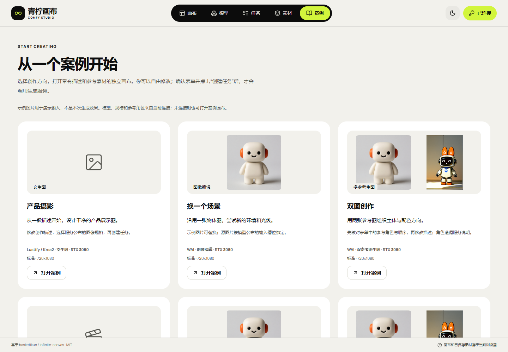
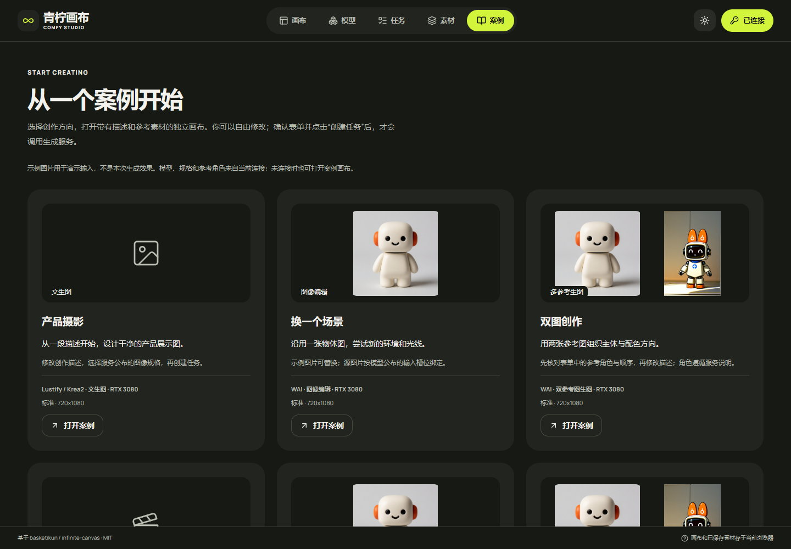
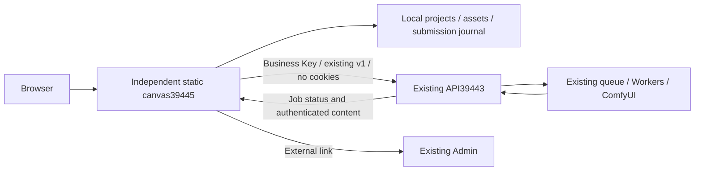

# ComfyUI Creative Canvas

<!-- independent151:start -->
**Web static 153.1 is deployed:** [Light/dark themes and eight editable examples](docs/studio/36-明暗主题与预设创作案例.md). The header toggle saves the browser's theme; pages, overlays, canvas nodes and GLB previews share the Lime palette. A same-origin startup script restores it on reload under the existing CSP. Examples create independent editable local canvases, match the current Key's published task type/reference slots/complete allowed preset, and upload or generate only after explicit confirmation. Reopened examples retain their original inputs without adding generated images automatically.

218 units, types and production build passed, with 69 complete UI groups and 43 screenshots. Local Firefox passed. [Full MP4](docs/studio/media/studio-151/themes-and-examples-public.mp4) / [GIF](docs/studio/media/studio-151/themes-and-examples-public.gif) use a synthetic API and do not prove GPU generation. Only independent frontend static files changed. Full Web acceptance remains **HOLD**; the earlier real video preparation failure and public Firefox gap remain open.

| Light | Dark |
| --- | --- |
|  |  |
<!-- independent151:end -->

<!-- independent150:start -->
**Historical 150.1 delivery:** [Canvas reference creation](docs/studio/35-画布参考创作与生成表单.md). The existing open-source canvas now populates published slots from selected images, shows original previews, chooses an allowed complete preset, initializes once after catalog restoration, validates all inputs before upload and links actual sources. 207 units/type/build and 69 synthetic UI groups passed on local/public Chromium and local Firefox, with 15 screenshots. Public Firefox remains unaccepted after two incomplete runs. [Complete selected page MP4](docs/studio/media/studio-150/canvas-reference-creation-public.mp4) / [GIF](docs/studio/media/studio-150/canvas-reference-creation-public.gif). The one real two-reference video was accepted but ended with `preparation_transport_failure`; no GPU output was produced, and the temporary Key is disabled. Only independent static files changed, compatible 150.0 recovery is prepared, original API/services/configuration unchanged. Full Web acceptance remains **HOLD**.


Use: connect the original API and business Key → select canvas images → create → check the model, complete preset and each reference → submit and follow the original job → load/save the successful original. Video, Workflow audio and 3D follow their published schemas; no generation backend is added. The 149 and earlier evidence below is historical.
<!-- independent150:end -->


<!-- independent149:start -->
**Historical Web149.1 delivery:** [Original downloads and native playback errors](docs/studio/34-Web媒体原件下载与播放失败处理.md). General WebM and main/alternate JPEG/WebP downloads now preserve the stored original format. Native decode failures show an original-download action; missing keyed originals are refused, and real file replacement resets source-specific errors. Layer focus keeps the correct action bar and downloads do not open an editor. Three engines passed 36 local plus 36 public groups, 78 actual downloads and 18 screenshots; 203 units/type/build and related regressions passed. Windows WebKit decoding/Cookie isolation, actual Safari and full Web acceptance remain **HOLD**. Only independent static files were promoted, with compatible 149.0 recovery prepared; the original API and all services/configuration stay unchanged.


[Actual download/replacement MP4](docs/studio/media/studio-149/Chromium-original-download-and-replacement.mp4) / [GIF](docs/studio/media/studio-149/Chromium-original-download-and-replacement.gif) · [WebKit failure-handling MP4](docs/studio/media/studio-149/WebKit-native-failure-and-original-download.mp4) / [GIF](docs/studio/media/studio-149/WebKit-native-failure-and-original-download.gif). Complete selected pages, small synthetic fixtures, no GPU generation. Download success does not establish WebKit playback. The 146/147/148 evidence below is historical.
<!-- independent149:end -->


[中文](README.md) · [Documentation](docs/studio/README.md) · [Deployment and usage](docs/studio/21-独立画布部署与使用.md) · [All 46 tracked items](docs/studio/10-开发进度与交付记录.md)

**An independently deployed static canvas that calls the existing ComfyUI API directly.** Built on [basketikun/infinite-canvas](https://github.com/basketikun/infinite-canvas), with the downloaded 04 Lime design. The canvas has its own build, release and rollback. The original API owns models, Workflows, business API Keys, queues, GPUs and content retention.

| Entry | Address |
| --- | --- |
| Independent canvas150.1 | [Open canvas](http://43.165.167.179:39445/studio/) |
| Existing business API | `http://43.165.167.179:39443` |
| Existing management UI | [Admin](http://43.165.167.179:39443/admin/) |

Earlier146.1 delivered a **Web application**: an independent website, browser interactions and responsive layouts. Cleanup keeps the newest snapshot authoritative. Release manifests bind the full storage contract; compatible recovery146.0 retains old and new page assets. Eight actual public rollback/restore checks preserve projects, original bytes and frozen tasks; v4-only targets are refused. Native clients and app stores are outside scope. [Architecture, operations and evidence](docs/studio/31-Web交付范围与兼容静态回退.md).

**Mixed-media migration supplement (evidence148, application still146.1):** [Document33](docs/studio/33-Web混合媒体跨浏览器备份恢复.md) records actual ZIP hand-offs Firefox→Chromium→Windows WebKit→Firefox:34 checks passed, preserving nine nodes, five edges, eight byte-identical originals and duplicate references, with reload and actual GLB downloads. No tasks are replayed. Windows WebKit reports media error4 for all four audio/video samples; playback remains unaccepted. The final Firefox recipient loads all four. The general WebM save filename still needs correction; the full ZIP preserves its proper type. [Final Firefox MP4](docs/studio/media/studio-148/Firefox-mixed-originals-recovery.mp4) / [GIF](docs/studio/media/studio-148/Firefox-mixed-originals-recovery.gif) · [WebKit migration MP4](docs/studio/media/studio-148/WebKit-mixed-originals-migration.mp4) / [GIF](docs/studio/media/studio-148/WebKit-mixed-originals-migration.gif). Small synthetic files, complete selected page recordings, no production generation, rebuild, deployment or API/service changes. Full Web acceptance remains HOLD.


[Latest snapshot](docs/studio/media/studio-146/refresh-2026-10-30T14-40-06-009Z/latest-snapshot-ready.png) · [Synthetic two-node project on recovery](docs/studio/media/studio-146/rollback-2026-10-30T14-37-15-637Z/compatible-recovery-renders-saved-Web-project.png) · [390px Web viewport](docs/studio/media/studio-146/cleanup-2026-10-30T14-38-50-017Z/public-390-bottom-original-controls.png) · [Cleanup MP4](docs/studio/media/studio-146/synthetic-Web-local-cleanup.mp4) / [GIF](docs/studio/media/studio-146/synthetic-Web-local-cleanup.gif) · [Recovery-page MP4](docs/studio/media/studio-146/synthetic-Web-compatible-recovery.mp4) / [GIF](docs/studio/media/studio-146/synthetic-Web-compatible-recovery.gif). Complete selected page recordings with synthetic files, zero business API/GPU requests. Evidence147 adds38 passed Firefox groups and27 Windows WebKit local-original/project groups. WebKit Cookie isolation remains unaccepted; actual Safari is untested.390px is viewport emulation.203 units/type/build,12 release guards,18 native protocol groups and114 current/688 retained files passed. Full Web manual/fault acceptance remains **HOLD/pending-test**.

**Web compatibility supplement (application still146.1):** [Document32](docs/studio/32-Web浏览器兼容性与验证边界.md) covers native file inputs/downloads, ZIP keys/references, reloads, concurrent editor protection and the Cookie difference. [WebKit cleanup](docs/studio/media/studio-147/cleanup-webkit-2026-10-30T15-16-15-025Z/public-desktop-cleaned-and-retained.png) and [390px Web viewport](docs/studio/media/studio-147/cleanup-webkit-2026-10-30T15-16-15-025Z/public-390-bottom-original-controls.png) accompany [Firefox restore MP4](docs/studio/media/studio-147/Firefox-Web-project-restore.mp4) / [GIF](docs/studio/media/studio-147/Firefox-Web-project-restore.gif) and [WebKit cleanup MP4](docs/studio/media/studio-147/WebKit-Web-local-cleanup.mp4) / [GIF](docs/studio/media/studio-147/WebKit-Web-local-cleanup.gif). These complete selected page recordings use synthetic files and no production business API/GPU requests. Valid PNGs restore in both engines; minimal native fetch without product code still sends Cookies under omit in Windows WebKit. Full WebKit/Safari support is therefore unaccepted. No product/API deployment or restart.

The following actual generation evidence comes from earlier139.2/evidence140, with no new generation this turn:


[Desktop terminal states](docs/studio/media/studio-140/verified-actual-batch-terminal-desktop.png) · [390px view](docs/studio/media/studio-140/verified-actual-batch-result-390.png) · [Metadata-free display sample](docs/studio/media/studio-140/actual-batch-first-display.png) · [Actual recovery MP4](docs/studio/media/studio-140/actual-batch-recovery.mp4). The two actual members succeeded/cancelled independently. The720×1080 original is720,638 bytes and took1,458 seconds (24m18s) end to end; length/SHA and eight-hour expiry passed. The recording shows original-batch recovery and saving;390px is emulation. The temporary Key is disabled with401 confirmed.


Evidence140 keeps static139.2:14 native fault groups,6 frozen-UI polling groups,4 real backup/recovery checks and original-batch delivery are recorded separately. Each member was generated once and recovered its original ID after lost responses. Draft stays disabled by the unchanged Key policy. Desktop/390px single cold-page FCP704/716ms observations are diagnostics, not an SLA. [Current batch, pages, clips and preserved failures](docs/studio/25-轮询取消与真实批次验收.md) · [Earlier actual edit and offline recovery](docs/studio/24-真实故障恢复与离线素材验收.md).

## Architecture and capabilities



- Discover the current Key's model catalog, descriptions, JSON Schema, complete presets and reference slots. Create images, video, Workflow audio and image-to-3D using capabilities already published by the API.
- Organize references and outputs on a canvas, with a local media library, task history, batches, image/video/audio nodes and on-demand GLB interaction and embedded animation controls.
- Persist the original request before submission. Query a known job ID; reconcile an unknown submission before further action. Support recovery, explicit remote cancellation and verified per-job Key adoption without resubmitting unknown jobs under a different identity.
- Validate media type, length and SHA-256 before local saving. Project ZIPs include canvas assets; task JSON backs up request records and IDs. These are separate from cloud synchronization.

The canvas adds no generation backend or second queue. It does not modify the original forwarding, protocol, Workers, scheduling, database or Admin, and does not contact ComfyUI directly. Business requests use existing `/v1/` endpoints. API/Admin/Worker paths on the canvas port return404. The original API137.1 source baseline, configuration, release pointer and service PIDs remained unchanged across deployment. [Architecture boundaries and23-part assessment](docs/studio/20-独立画布与既有API融合最终边界.md).

## Quick start

1. Open the independent canvas. Enter the **existing API address on39443** and a business Key issued by its administrator. Choose whether to remember it locally; do not use the canvas39445, `/admin/` or ComfyUI8188 address as the API.
2. Read the model usage and select an authorized complete preset, dimensions/duration and reference slots. Catalog presence does not mean a device is idle. First-frame and multiple-reference video are different capabilities; audio is a Workflow output.
3. Create a canvas and a generation request. Preserve the original job; use submission reconciliation after a lost response. Stopping local polling does not cancel GPU work.
4. Validate and load completed assets, preview GLB or save originals. Cloud outputs expire eight hours after completion. The original Key can read already-saved local copies while the API is unavailable; generation still requires online authorization. Memory-only Keys must be entered again after refresh; only explicitly remembered Keys restore automatically. Export important copies separately.
5. Open the original Admin to manage models, Workflows, channels, Keys and queues. Missing backend capabilities remain external dependencies; the canvas will not bypass the API.

In Storage, explicitly scan references and download the report. Keep documents with missing originals and restore from a complete backup. In a GLB preview, select a clip and press Play; playback starts paused, suspends while hidden and releases resources on close. The inventory contains no media bytes and does not replace a project ZIP.

**Changing port or domain does not migrate browser data.** Export project ZIPs, required originals and task JSON from the old39443 canvas, import them at39445 and re-enter the business Key. Keep old data until verified. Project import does not generate again; task records require an explicit original-ID query. Do not downgrade journalv5 or return upgraded clients to v4-only144.1. Compatible recovery146.0 and actual rollback/restore are verified; other versions require separate full-contract verification.

## Native development and deployment

Verified with Node22.14.0/npm10.9.2. From this repository's `web/` directory, in PowerShell:

```powershell
npm ci
$env:VITE_BASE='/studio/'
$env:VITE_STUDIO_MODE='managed'
$env:VITE_AGGREGATOR_ORIGIN='http://43.165.167.179:39443'
npm run typecheck
npm run build
```

Deploy only `web/dist/` to an independent static host with `/studio/` and SPA fallback. Keep `managed` mode: deployment independence does not mean the upstream `standalone` mode, which enables optional scripts/Agents. The default API address is public; never embed a Key. Without a default API, the connection field stays empty.

Current service: `infinite-canvas-static.service`; release: `/opt/infinite-canvas/releases/canvas-20261031.149.1/`; pointer: `/opt/infinite-canvas/current`; port39445. Verify the full compatible storage contract and retain hashed assets required by both page versions before switching. The assets page has explicit SPA locations separate from static resources. Releases and rollbacks affect only this canvas; the original API is neither redeployed nor restarted. HTTP on a high port is intentional; the user handles domain reverse proxying. No local Docker, WSL or virtual machines. [Deployment and migration details](docs/studio/21-独立画布部署与使用.md).

## Validation and limits

Current146.1 passes203 units/typecheck/build,18 native protocol groups,12 release guards,10 local+10 public cleanup groups,14 local+14 public ZIP groups,11 dual-origin groups,14 media regression groups and8 actual Web rollback/restore checks. All114 current/688 retained resources and15 routes are verified. Screenshots/complete selected page MP4/GIF recordings are synchronized and owned browsers/fixtures closed. Both API trees, API pointer/config/services and static service/config remain unchanged. Full Web acceptance: HOLD.

Full acceptance remains **HOLD/pending-test**: complete Web manual/fault coverage, more browser engines and large-file peak/leaks are unverified. More animation tracks/3D formats, legacy-original migration, preview cleanup and recovery of uncertain editor claims remain incomplete. Native clients and app stores are outside scope. Cloud sync/text assistance may use only existing API capabilities; otherwise they remain external dependencies. ComfyUI-original transfer deletion, heterogeneous pools,10–20-device capacity and GPU optimization also belong to the original API. The canvas adds no other backend connection or forwarding changes. [Implemented items and complete backlog](docs/studio/10-开发进度与交付记录.md).

## Documentation and license

Application source lives in `web/`; independent design, evidence and media are linked from the [documentation index](docs/studio/README.md). See the [independent canvas update notes](docs/studio/23-独立画布更新记录.md). Earlier fusion/backend reports remain historical; documents20/21/31 define current Web architecture, deployment and rollback.

The upstream [MIT license](LICENSE) and author notices remain. Original04 Lime style/font attribution is retained in the project and static package. Work is maintained on an independent feature branch; neither the basketikun upstream nor the existing API branch is updated.

Use Storage → save and enter safe cleanup. Back up newly controlled unreferenced originals before explicit deletion. Other live editors, legacy originals, previews and uncertain records remain protected. See document30.
