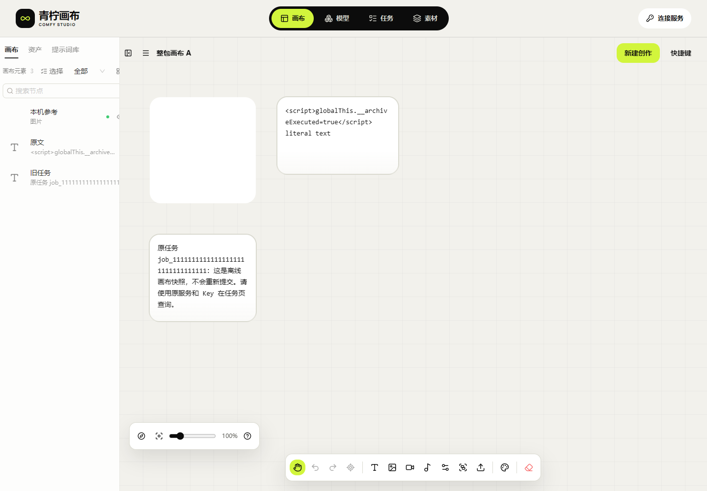
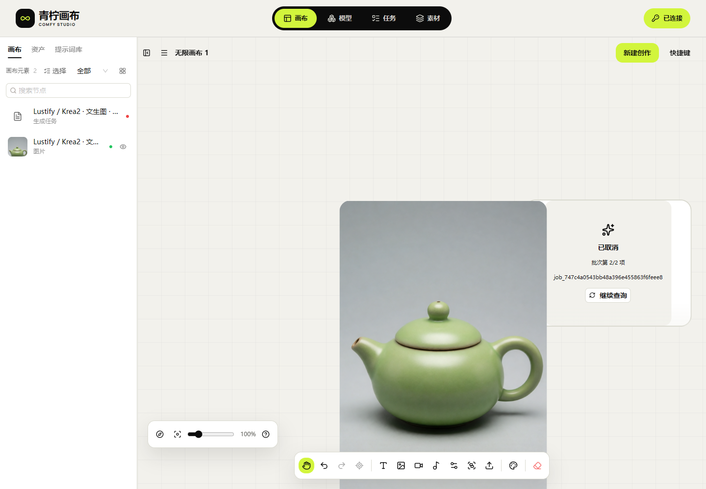
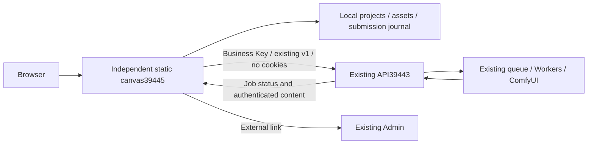

# ComfyUI Creative Canvas

[中文](README.md) · [Documentation](docs/studio/README.md) · [Deployment and usage](docs/studio/21-独立画布部署与使用.md) · [All 46 tracked items](docs/studio/10-开发进度与交付记录.md)

**An independently deployed static canvas that calls the existing ComfyUI API directly.** Built on [basketikun/infinite-canvas](https://github.com/basketikun/infinite-canvas), with the downloaded 04 Lime design. The canvas has its own build, release and rollback. The original API owns models, Workflows, business API Keys, queues, GPUs and content retention.

| Entry | Address |
| --- | --- |
| Independent canvas141.1 | [Open canvas](http://43.165.167.179:39445/studio/) |
| Existing business API | `http://43.165.167.179:39443` |
| Existing management UI | [Admin](http://43.165.167.179:39443/admin/) |

Current141.1 fixes whole-batch project ZIP import, file/document failure recovery, top-level/nested image hydration and credential filtering. All originals are staged before the project batch is added; imported tasks become offline notes without generation. Failed imports may retain newly staged unreferenced files pending safe cleanup. [Usage and failure boundaries](docs/studio/26-画布ZIP整包导入与备份边界.md).



[Imported projects](docs/studio/media/studio-141/archive-2026-10-30T11-07-33-852Z/public-archive-imported-library-desktop.png) · [Unsaved batch](docs/studio/media/studio-141/archive-2026-10-30T11-07-33-852Z/public-archive-document-aborted.png) · [390px](docs/studio/media/studio-141/archive-2026-10-30T11-07-33-852Z/public-archive-restored-canvas-390.png) · [Synthetic demo MP4](docs/studio/media/studio-141/synthetic-archive-recovery.mp4) · [GIF](docs/studio/media/studio-141/synthetic-archive-recovery.gif). The ZIP demo uses no business Key or API/GPU request. Release verification only reads existing API health/CORS. Native-IDB fault injection and390px emulation do not establish actual disk exhaustion or physical-phone acceptance.

The following actual generation evidence comes from earlier139.2/evidence140, with no new generation this turn:



[Desktop terminal states](docs/studio/media/studio-140/verified-actual-batch-terminal-desktop.png) · [390px view](docs/studio/media/studio-140/verified-actual-batch-result-390.png) · [Metadata-free display sample](docs/studio/media/studio-140/actual-batch-first-display.png) · [Actual recovery MP4](docs/studio/media/studio-140/actual-batch-recovery.mp4). The two actual members succeeded/cancelled independently. The720×1080 original is720,638 bytes and took1,458 seconds (24m18s) end to end; length/SHA and eight-hour expiry passed. The recording shows original-batch recovery and saving;390px is emulation. The temporary Key is disabled with401 confirmed.


Evidence140 keeps static139.2:14 native fault groups,6 frozen-UI polling groups,4 real backup/recovery checks and original-batch delivery are recorded separately. Each member was generated once and recovered its original ID after lost responses. Draft stays disabled by the unchanged Key policy. Desktop/390px single cold-page FCP704/716ms observations are diagnostics, not an SLA. [Current batch, pages, clips and preserved failures](docs/studio/25-轮询取消与真实批次验收.md) · [Earlier actual edit and offline recovery](docs/studio/24-真实故障恢复与离线素材验收.md).

## Architecture and capabilities



- Discover the current Key's model catalog, descriptions, JSON Schema, complete presets and reference slots. Create images, video, Workflow audio and image-to-3D using capabilities already published by the API.
- Organize references and outputs on a canvas, with a local media library, task history, batches, image/video/audio nodes and on-demand static GLB interaction.
- Persist the original request before submission. Query a known job ID; reconcile an unknown submission before further action. Support recovery, explicit remote cancellation and verified per-job Key adoption without resubmitting unknown jobs under a different identity.
- Validate media type, length and SHA-256 before local saving. Project ZIPs include canvas assets; task JSON backs up request records and IDs. These are separate from cloud synchronization.

The canvas adds no generation backend or second queue. It does not modify the original forwarding, protocol, Workers, scheduling, database or Admin, and does not contact ComfyUI directly. Business requests use existing `/v1/` endpoints. API/Admin/Worker paths on the canvas port return404. The original API137.1 source baseline, configuration, release pointer and service PIDs remained unchanged across deployment. [Architecture boundaries and23-part assessment](docs/studio/20-独立画布与既有API融合最终边界.md).

## Quick start

1. Open the independent canvas. Enter the **existing API address on39443** and a business Key issued by its administrator. Choose whether to remember it locally; do not use the canvas39445, `/admin/` or ComfyUI8188 address as the API.
2. Read the model usage and select an authorized complete preset, dimensions/duration and reference slots. Catalog presence does not mean a device is idle. First-frame and multiple-reference video are different capabilities; audio is a Workflow output.
3. Create a canvas and a generation request. Preserve the original job; use submission reconciliation after a lost response. Stopping local polling does not cancel GPU work.
4. Validate and load completed assets, preview GLB or save originals. Cloud outputs expire eight hours after completion. The original Key can read already-saved local copies while the API is unavailable; generation still requires online authorization. Memory-only Keys must be entered again after refresh; only explicitly remembered Keys restore automatically. Export important copies separately.
5. Open the original Admin to manage models, Workflows, channels, Keys and queues. Missing backend capabilities remain external dependencies; the canvas will not bypass the API.

**Changing port or domain does not migrate browser data.** Export project ZIPs, required originals and task JSON from the old39443 canvas, import them at39445 and re-enter the business Key. Keep old data until verified. Project import does not generate again; task records require an explicit original-ID query. Static rollback must not downgrade IndexedDBv4.

## Native development and deployment

Verified with Node22.14.0/npm10.9.2. From this repository's `web/` directory, in PowerShell:

```powershell
npm ci
$env:VITE_BASE='/studio/'
$env:VITE_STUDIO_MODE='managed'
$env:VITE_AGGREGATOR_ORIGIN='http://43.165.167.179:39443'
npm run typecheck
npm run build
```

Deploy only `web/dist/` to an independent static host with `/studio/` and SPA fallback. Keep `managed` mode: deployment independence does not mean the upstream `standalone` mode, which enables optional scripts/Agents. The default API address is public; never embed a Key. Without a default API, the connection field stays empty.

Current service: `infinite-canvas-static.service`; release: `/opt/infinite-canvas/releases/canvas-20261030.141.1/`; pointer: `/opt/infinite-canvas/current`; port39445. Retained hashed files support already-open pages. The assets page has explicit SPA locations separate from static resources. Releases and rollbacks affect only this canvas; the original API is neither redeployed nor restarted. HTTP on a high port is intentional; the user handles domain reverse proxying. No local Docker, WSL or virtual machines. [Deployment and migration details](docs/studio/21-独立画布部署与使用.md).

## Validation and limits

Current141.1 passes182 unit tests, typecheck/build and11 synthetic dual-origin groups, plus10 local and10 actual-public-UI native-IDB groups covering10 malformed archives, whole-batch file failure, document abort/explicit retry and both image forms after refresh. All107 current/255 retained files and14 routes were verified publicly. Both API workspaces, deployed API configuration/pointer/services and the static service/configuration stayed unchanged, with no restarts. The synthetic MP4/GIF fully decode; owned browsers/fixtures are closed. No business Key or GPU job was created. Earlier failures and139.2/evidence140 actual-GPU/offline/batch results remain historical rather than being counted as current retests.

Full acceptance remains **HOLD/pending-test**: the complete fault matrix, physical Android/iOS, large-file peak/leaks and10–20-device capacity are unverified; animation and more3D formats are incomplete. Cloud sync/text assistance may use only existing API capabilities; otherwise they remain external dependencies. ComfyUI-original transfer deletion, heterogeneous pools and GPU optimization also belong to the API. The canvas adds no other backend connection or forwarding changes. [Implemented items and complete backlog](docs/studio/10-开发进度与交付记录.md).

## Documentation and license

Application source lives in `web/`; independent design, evidence and media are linked from the [documentation index](docs/studio/README.md). See the [independent canvas update notes](docs/studio/23-独立画布更新记录.md). Earlier fusion/backend reports remain historical; documents20/21 define current architecture and deployment.

The upstream [MIT license](LICENSE) and author notices remain. Original04 Lime style/font attribution is retained in the project and static package. Work is maintained on an independent feature branch; neither the basketikun upstream nor the existing API branch is updated.
