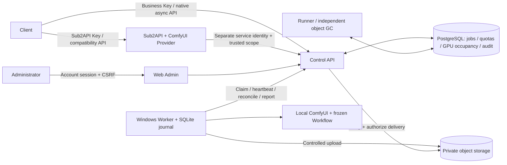

# ComfyUI Aggregator Proxy

**Turn ComfyUI installations on multiple Windows machines into managed, queued and traceable image, video and audio APIs.**

[中文](README.md) · English · [Documentation](docs/README.en.md) · [Changelog](CHANGELOG.md) · [Contributing and synchronization](CONTRIBUTING.md)


The internal service name is **Render Control**. The system combines a visual Admin, a durable generation control plane, Windows Workers and a Sub2API integration. Images, videos and audio all come from ComfyUI Workflows; audio uses the same execution and management system.

**Status: in development.** Native Windows implementation, protocol tests and isolated candidate installation have recorded verification. Actual Workflows, model quality, real S3/Redis, production system services and capacity on 10–20 physical machines still require acceptance. Screenshots and recordings show the real UI and API backed by isolated PostgreSQL and explicitly synthetic fixtures. They demonstrate neither real GPU generation nor production throughput.

The Chinese [tracking checklist](docs/78-完整待办与首版收口清单.md) retains 76 stable IDs: implementation items 01–05 are complete, with 71 still open (69 first-release and two optional). [Provider consumption](docs/80-Provider目录消费与版本快照.md), [Admin mapping management](docs/81-Admin网关目录映射与发布核对.md) and [confirmed failure retries](docs/82-确认失败重试分类与跨GPU约束.md) have local implementations and separate verification evidence. Actual Workflows, joint gateway behavior, failures and production still require acceptance.

The latest [verification record](docs/evidence/2026-10-25/confirmed-retry-verification.json) reports 3232 full Python checks, 2156 contract/unit checks, 40 frontend unit checks, eight retry browser checks, 24 candidate installation checks and eight installed browser checks. Actual service processes passed 26 scenarios covering six task types, OOM rerouting and single settlement. ComfyUI/Redis/storage remain protocol fixtures. A gateway authentication row-lock timeout/502 observed during concurrent checks remains unresolved; an isolated pass does not establish concurrent capacity.

## Contents

- [Capabilities and boundaries](#capabilities-and-boundaries)
- [Architecture and request flow](#architecture-and-request-flow)
- [Admin and demonstrations](#admin-and-demonstrations)
- [Native Windows quick start](#native-windows-quick-start)
- [Onboarding devices and Workflows](#onboarding-devices-and-workflows)
- [Using the APIs](#using-the-apis)
- [API Keys, content and quotas](#api-keys-content-and-quotas)
- [Scheduling, idempotency and recovery](#scheduling-idempotency-and-recovery)
- [Configuration, deployment and operations](#configuration-deployment-and-operations)
- [Repository structure and verification](#repository-structure-and-verification)
- [Documentation and future updates](#documentation-and-future-updates)

## Capabilities and boundaries

| Capability | Interface and behavior |
| --- | --- |
| Text to image | `text_to_image`: frozen Workflow, public model alias and controlled presets |
| Image to image | `image_to_image`: uploaded `asset_id`, with a mask when declared |
| Multiple references to image | `references_to_image`: ordered uploaded references with controlled roles/weights |
| Text to video | `text_to_video`: asynchronous task, bounded size/duration and result download |
| References to video | `references_to_video`: text and uploaded reference assets |
| Audio generation | `text_to_audio`: ComfyUI Workflow output, including speech, music or other sounds |
| Windows integration | Separate nodes, physical GPUs and ComfyUI channels; designed for 10–20 machines |
| Visual Admin | Channels, nodes, Workflows, model routing, global/channel queues, jobs, content, Keys, audit and alerts |
| Multiple business Keys | Separate operations, model/release/channel scopes, content scopes, rates, concurrency and daily limits |
| Sub2API first | Pinned upstream and narrow Provider overlay, with OpenAI-style compatibility and native asynchronous APIs |

Current generation constraints include one final artifact per task, declared input bindings and explicit output nodes. Clients cannot submit arbitrary execution graphs, set arbitrary node inputs, access server paths or instruct arbitrary URL downloads. Initial audio input is text; actual sound capabilities depend on the onboarded and accepted Workflow. Controlled audio presets cover WAV, FLAC, MP3 and Ogg Opus. The service verifies the actual format, sample rate, channel count and decoded duration. See the [audio contract](docs/55-音频契约与兼容迁移.md).

## Architecture and request flow



1. A client submits a model alias, standardized input, parameters and a stable `Idempotency-Key`. Sub2API authenticates its customer before forwarding through a trusted service identity; the native API verifies a control-plane business Key directly.
2. The control plane checks tenant/project/Key authorization, model publication, Workflow, channels and specification. It reserves quota and persists the task transactionally.
3. Runner and Worker coordinate through durable states, leases and physical GPU fencing. Several ComfyUI channels sharing one GPU still share its generation occupancy.
4. The Worker persists its local journal **before** submitting to ComfyUI, then executes the frozen Workflow. It accepts no arbitrary remote shell.
5. After controlled upload to private storage, the service verifies content, size, digest, immutable object version and actual media properties before success and settlement.
6. The client polls jobs and accesses artifacts through authorized preview/download APIs. Generation occupancy, result submission authority, quota and file cleanup have separate lifecycles.

PostgreSQL is authoritative for jobs and resources. SQLite is only a single Worker's journal. The pinned integration coordinates with Sub2API's existing ledger instead of introducing another independent billing ledger.

## Admin and demonstrations

Open **网关接入 → 模型目录** (gateway catalog) or **模型与路由 → 网关模型目录** (model-page catalog entry). `models:read` permits state, mapping differences, failure receipts and paginated history; `models:publish` permits editing, publication, retry and rollback. The model-page read entry does not require gateway credential-management permission.

For the first publication, enter the same logical instance as the Provider startup file, select published models, and enter existing Sub2API usage-account/group IDs, price versions and unit prices. IDs remain decimal strings to preserve 64-bit precision. Publish the complete desired catalog after confirmation. The Provider polls, validates and persists candidates, then activates new-request rules only after a valid applied receipt. Desired and confirmed versions remain separate. After first activation, startup rules are no longer an automatic fallback; an empty catalog withdraws new tasks. Existing tasks and idempotent recovery retain their original model, Workflow, target and price. Rejection preserves the previous catalog; retry/rollback creates a new revision. Back up, drain and independently migrate Sub2API through migration 257 before deployment; startup only probes the schema. See the [publication protocol](docs/79-网关模型目录持久发布协议.md), [Provider recovery](docs/80-Provider目录消费与版本快照.md) and [Admin behavior](docs/81-Admin网关目录映射与发布核对.md).


[Catalog MP4](docs/media/gateway-catalog/gateway-catalog.mp4) · [Editor](docs/media/gateway-catalog/catalog-editor.png) · [Desired/confirmed versions](docs/media/gateway-catalog/catalog-confirmed.png) · [History](docs/media/gateway-catalog/catalog-history.png) · [Mobile](docs/media/gateway-catalog/catalog-mobile.png) · [Sanitized requests/responses](docs/media/gateway-catalog/api-responses.json). Provider receipts in this UI recording are explicitly labeled protocol fixtures. Actual Provider consumption has separate cross-process evidence; neither establishes physical GPU acceptance.


[Full tour MP4](docs/media/admin-tour.mp4) · [Workflow operations MP4](docs/media/workflow-lifecycle.mp4) · [Media, recording method and response examples](docs/media/README.md)

| Page | Operating logic |
| --- | --- |
| Overview and jobs | Inspect queued, running, abnormal and completed work; filter by scope/state and inspect phases, cancellation and controlled retries |
| Windows channels and nodes | Maintain ComfyUI addresses/configuration, node credentials and physical GPU links; inspect desired/applied/verified state and channel queues |
| Workflows | Import API-format Workflows, edit parameter forms, freeze releases, synchronize channels, inspect history and restore a release into a new draft |
| Models and routing | Bind a frozen, synchronized and runtime-approved release to an alias and eligible channels; configure defaults and publish |
| API Keys, tenants and projects | Create multiple business Keys, assign operations/resource scopes, configure hierarchical quotas and inspect access records |
| Content | Filter assets/artifacts by ownership, job, type and tags; authorize preview/download, edit tags and request deletion |
| Operations, alerts and audit | Track durable synchronization commands, reconcile/retry failures, inspect administrator actions and runtime abnormalities |


Workflow archival requires confirmation, revision CAS and an idempotent request. Published model references or unfinished synchronization commands block it. An archived Workflow rejects new edits, freezes, synchronization, approvals and task admission while retaining history, export and already accepted jobs. Unarchiving restores maintenance access; publishing, synchronization and approval remain explicit operations. Restoring history creates a new draft revision and preserves the immutable release.

If a response is lost, the UI offers reconciliation using the original body, key and revision. It does not replace the key to overwrite another administrator's change. See [Workflow lifecycle](docs/76-Workflow归档与恢复管理.md).

More screenshots: [channels](docs/media/channels.png), [job queue](docs/media/queue.png), [model routing](docs/media/models.png), [API Keys](docs/media/api-keys.png), [content](docs/media/content.png), [release history](docs/media/workflow-history.png), [mobile](docs/media/mobile-overview.png). The current Admin UI is in Chinese.

## Native Windows quick start

### Prerequisites

- Native Windows, Git and Python **3.13** on PATH.
- Node.js **24.22.1** and PostgreSQL **18.6**, pinned in `app/config/native-toolchains.lock.json`; bootstrap can download and verify both.
- Native FFmpeg/ffprobe tools matching `app/config/media-tools.lock.json`, placed under `app/.local/toolchains/ffmpeg-8.1/`: `bin/ffmpeg.exe`, `bin/ffprobe.exe`, `LICENSE` and `README.txt`. Bootstrap does not install these files; release construction checks the pinned sizes and hashes.
- For actual generation: an independently working ComfyUI installation, models, custom nodes and Workflows on each Windows device. Worker Python is separate from ComfyUI's torch environment.

Docker, WSL and virtual machines are prohibited for this project's development and verification. Run the following in PowerShell. Installation scripts prepare project dependencies; they do not install models, open firewall rules or register system services automatically.

```powershell
git clone git@github.com:copypasteltd/comfyUI-aggregator-proxy.git
Set-Location comfyUI-aggregator-proxy/app

./scripts/bootstrap.ps1 -WithPostgresToolchain

# First-time initialization only: writes private .env, creates and starts native dev/test databases.
./.venv/Scripts/python.exe scripts/dev-db.py init

# Backs up and validates the archive before migration; restoration rehearsal is separate.
./scripts/db-migrate.ps1
./.venv/Scripts/python.exe -m control_api.cli bootstrap-project
./.venv/Scripts/python.exe -m control_api.cli bootstrap-admin --username admin

$taskNode = '.local/toolchains/node-24.22.1/node-v24.22.1-win-x64'
./.venv/Scripts/python.exe scripts/export-openapi.py
& "$taskNode/npm.cmd" --prefix apps/admin_web run generate:api
& "$taskNode/npm.cmd" --prefix apps/admin_web run build

# Prepare the pinned media tools described above first.
./scripts/dev-start.ps1
```

Open **https://127.0.0.1:8443/admin/** and sign in with the account just created. The loopback development certificate is under ignored `.local/tls/`; production requires its own HTTPS certificate. A fresh installation contains no accepted production models or channels. Complete onboarding below before generation.

Do not initialize an existing database again. To resume development, run `python scripts/dev-db.py start`, then `scripts/dev-start.ps1`; inspect status first if already running. Use `scripts/dev-stop.ps1` to stop this project's registered API/Runner/GC processes, and `python scripts/dev-db.py stop` for its PostgreSQL instance. Scripts verify PID, executable and creation time, excluding older unrelated processes after PID reuse.

### Development and production configuration

The `.env` created by `dev-db.py init` uses `development` and local storage. It is for development only. The production template is [environment.example](app/config/environment.example). Explicitly configure the database, pepper, Fernet key, trusted HTTPS origin, private S3 bucket and credentials. **Do not copy the development `.env` into production.** Production migrations, recovery and service hosting are covered by [native deployment and operations](docs/15-原生部署配置与运维.md).

## Onboarding devices and Workflows

1. **Establish scope.** Create/select a tenant and project in Admin and set limits. Their limits and the business Key's limits all apply. Default daily audio quota can be zero; explicitly configure every applicable layer before enabling audio.
2. **Register Windows nodes.** Issue a one-time Worker credential, save it to a private device file and verify the physical GPU identity. Start from [worker.example.json](app/config/worker.example.json).
3. **Register channels.** Configure the node's ComfyUI address, GPU association and allowed targets. Channel credentials are encrypted; browsers never connect directly to ComfyUI. Address/configuration changes require Worker application and verification.
4. **Prepare a Workflow.** Export ComfyUI's API-format graph and declare parameter bindings, approved presets, dependency locks, output adapter and final nodes. An editor-format Workflow is not directly an API execution graph. Inspect imported candidates before applying them.
5. **Freeze, synchronize and validate.** Freeze an immutable release, synchronize selected channels, reconcile desired/applied/verified digests, and obtain actual runtime evidence for the relevant model/specification before approval. A successful import is insufficient evidence of runtime support.
6. **Publish an alias.** Select the task type, release, channels and defaults, satisfy publication gates and publish. Clients call aliases rather than arbitrary Workflow graphs.
7. **Create business Keys.** Configure generation/content scopes, resource selections, specification limits and quotas. Plaintext appears only once when issued; save it securely.
8. **Configure and verify the gateway.** Follow [Sub2API ingress](docs/32-Sub2API公开任务接入.md) for the pinned Provider, service credentials and external identity mappings. Exercise generation, polling, download, cancellation, quota and ledger recovery.

The Worker entry point is `python -m windows_worker.main --config C:/render-worker/config.json`. Add `--validate-config` first to validate local configuration. Credentials and journal require restricted persistent directories. Include the node/GPU/channel information required by the current startup protocol. See [node registration](docs/56-Windows节点登记与凭证管理.md) and [Worker startup protection](docs/57-Worker启动身份与原生进程保护.md).

## Using the APIs

### Native asynchronous API

The native API supports all six task types. Run this from `app/` after placing an Admin-issued business Key in the process environment variable `COMFY_API_KEY`. Replace the example `demo-*` aliases with your published aliases.

```powershell
curl.exe --cacert .local/tls/localhost.crt `
  -H "Authorization: Bearer $env:COMFY_API_KEY" `
  -H "Content-Type: application/json" `
  -H "Idempotency-Key: example-image-0001" `
  --data-binary '@../docs/examples/create-image.json' `
  https://127.0.0.1:8443/v1/jobs
```

Complete JSON examples: [image](docs/examples/create-image.json), [video](docs/examples/create-video.json), [audio](docs/examples/create-audio.json). Audio example:

```json
{
  "model": "demo-text-to-audio",
  "task_type": "text_to_audio",
  "input": {"prompt": "A short, calm instrumental cue"},
  "parameters": {"quality": "standard", "seconds": 2}
}
```

| Operation | Control API path | Behavior |
| --- | --- | --- |
| Discover models | `GET /v1/models` | Only published models available to the current identity |
| Upload input | `POST /v1/assets` | Bounded upload returning an asset ID to reference in generation |
| Submit | `POST /v1/jobs` | `202`, stable job ID, Location and polling guidance |
| Query/list | `GET /v1/jobs/{id}`, `GET /v1/jobs` | Key/scope authorization and cursor pagination |
| Cancel | `POST /v1/jobs/{id}/cancel` | Requests cancellation; running work requires safe stopping/reconciliation |
| Artifacts | `GET /v1/content`, `GET /v1/content/{id}/download` | Scoped listing and authenticated download; no public bucket |

After `202`, retain the ID and poll with the same business identity until `succeeded`, `failed`, `cancelled` or `expired`. Retrieve artifacts through job/content responses only after success. HTTP acceptance does not mean generation completed. On an uncertain submission, reuse the original idempotency key and body instead of creating a duplicate task with a new key.

### Sub2API / OpenAI-style endpoints

These paths belong to a **Sub2API origin configured with this project's Provider**, and use a Sub2API customer Key. They are not the direct Control API origin.

| Path | Compatibility behavior |
| --- | --- |
| `POST /v1/images/generations` | Bounded synchronous images, returning OpenAI-style `created/data` after completion |
| `POST /v1/images/generations/async` | Image task and polling URL for longer operations |
| `GET /v1/images/tasks/{id}` | Image task query |
| `POST /v1/images/edits` and `/async` | Controlled image edits, uploaded assets and standardized inputs |
| `POST /v1/videos`, `GET /v1/videos/{id}` | Asynchronous video creation and query |
| `GET /v1/models` | Model discovery filtered by identity and publication scope |

Compatibility is an explicit OpenAI-format subset. Frozen contracts define accepted fields, file inputs, URL/binary delivery and errors. `n=1`; arbitrary SDK features and OpenAI parameters are not implied. **Audio currently uses native `/v1/jobs`; the synchronous binary `/v1/audio/speech` protocol is not implemented.** See [generation compatibility](docs/34-Sub2API生成兼容与产物访问.md), [assets and image edits](docs/35-Sub2API素材与图片编辑接入.md) and [audio migration](docs/55-音频契约与兼容迁移.md).

## API Keys, content and quotas

- **Business Keys** protect public generation/content APIs. Admin accounts/sessions, Worker credentials and gateway service identities are separate. A business Key cannot sign in to Admin or call management APIs.
- A Key is bound to trusted tenant/project identity. Restrict scopes, models, Workflow releases, channels, specifications, content ownership/explicit sharing, expiry and enablement. Client-supplied tenant headers are not trusted.
- Hierarchical policies limit rates, unfinished jobs, actual generation concurrency and daily image/video/audio usage. `bounded: 0` prohibits use; unlimited access requires an explicit policy.
- Admission reserves quota; terminal processing settles/refunds under defined rules. Audio uses verified decoded duration; video follows its frozen duration semantics. Metering does not accumulate monetary values with floating-point arithmetic.
- Assets and artifacts use opaque IDs. Every query, aggregation, preview and download checks scope. Content deletion is audited logical deletion followed by controlled asynchronous collection, not direct database edits or bucket deletion.

Details: [Key authorization](docs/08-APIKey鉴权与访问控制.md), [content management](docs/48-内容检索标签与受控预览.md), [database transactions](docs/11-数据字典与数据库事务.md).

## Scheduling, idempotency and recovery

A disconnected Worker, expired lease or HTTP timeout does not prove a GPU is free. Unknown submissions are reconciled against journal and ComfyUI state before further action. Do not blindly resubmit, reroute to another machine or release a physical slot without evidence. Late reports require valid attempt/fencing identity and cannot overwrite a newer execution authority.

Cancellation, draining, specification isolation, management synchronization and retries have separate state and audit. Upload and media verification may continue independently of generation occupancy. Durable management commands use fixed allowed actions; they cannot run arbitrary commands, install custom nodes or download model weights automatically.

Internal retries share a maximum of two retries with 5/15-second backoffs. A preparation transport failure must be proven never submitted. A whitelisted OOM additionally requires current-prompt stop evidence and another approved physical GPU within the original frozen routes; each job may retry OOM once. The job, seed, Workflow, specification, inputs, deadline and price remain frozen, and later attempts continue excluding its failed OOM GPU. Unknown submissions reconcile the original execution; upload failures recover the existing file. Final metering and settlement occur once. An older Worker without OOM evidence retains the prior confirmed-failure behavior. See [confirmed failure retry rules](docs/82-确认失败重试分类与跨GPU约束.md).


[Retry MP4](docs/media/confirmed-retry/confirmed-retry.mp4) · [Desktop details](docs/media/confirmed-retry/retry-desktop.png) · [375px mobile](docs/media/confirmed-retry/retry-mobile.png) · [Cancellation result](docs/media/confirmed-retry/retry-mobile-cancelled.png) · [Sanitized responses](docs/media/confirmed-retry/api-responses.json). Admin shows the cause, budget and earliest dispatch time. Backoff retains unfinished quota and allows priority changes or cancellation. This recording uses the actual API/database with synthetic faults; physical GPU OOM acceptance remains separate.

See [task mechanisms](docs/02-系统架构与任务机制.md), [Worker protocol](docs/12-接口契约与Worker协议.md), and [joint recovery](docs/60-数据库对象与密钥联合恢复校验.md).

## Configuration, deployment and operations

| Setting | Purpose |
| --- | --- |
| `GEN_DATABASE_URL` | PostgreSQL connection; keep production and development separate |
| `GEN_CREDENTIAL_PEPPER`, `GEN_ENCRYPTION_KEY` | Credential verification and recoverable channel-secret encryption; distinct responsibilities |
| `GEN_PUBLIC_ORIGIN` | Trusted external HTTPS origin for delivery links and origin checks |
| `GEN_STORAGE_BACKEND`, `GEN_S3_*` | Local development storage or private production S3; real S3 requires separate acceptance |
| `GEN_SESSION_SECONDS`, `GEN_SESSION_IDLE_SECONDS` | Absolute and idle lifetimes of Admin sessions |
| `GEN_AUDIT_RETENTION_DAYS` | Explicitly approved audit retention; management audit is not automatically pruned by default |

Before production migration, stop/drain affected services, back up and verify the archive, then migrate separately. A database backup is not joint recovery: object versions, Worker journals, Sub2API ledger/idempotency facts and credentials require consistent restoration and reconciliation. Windows service ACLs, Linux/systemd, production proxies, real Redis/S3 and joint recovery remain independent acceptance items. Development launchers are not verified production service wrappers.

Candidate construction and offline installation tools are `app/scripts/build-release.py`, `test-release-install.py` and `release-entrypoint.py`. Built archives, native runtimes and wheels stay in ignored `.local/`, outside the source repository. Commands and gates are documented in [deployment operations](docs/15-原生部署配置与运维.md).

## Repository structure and verification

```text
comfyUI-aggregator-proxy/
├─ README.md / README.en.md       Chinese and English solution/user entry points
├─ CHANGELOG.md / CONTRIBUTING.md Update records and contribution rules
├─ AGENTS.md                     Environment, development and synchronization constraints
├─ app/
│  ├─ apps/                      Control API / Runner / Windows Worker / Vue Admin
│  ├─ packages/                  domain / application / contracts / infrastructure
│  ├─ integrations/sub2api/      Pinned upstream, Go client and narrow overlay
│  ├─ migrations/                Alembic migrations
│  ├─ scripts/                   Native development, checks, builds, recordings and publication audit
│  ├─ config/                    Example settings, toolchain and contract hashes
│  ├─ tests/                     Contract, database, protocol, fault and unit checks
│  └─ pyproject.toml / uv.lock    Python workspace and exact dependency lock
└─ docs/                         Design, protocols, machine contracts, evidence and demonstration media
```

Run from `app/`:

```powershell
./scripts/check.ps1 -Suite Docs
./scripts/check.ps1 -Suite Python
./scripts/check.ps1 -Suite Frontend
./scripts/check.ps1 -Suite Sub2API
./scripts/check.ps1 -Suite Sub2APILedger
./scripts/check.ps1 -Suite Sub2APINative
./.venv/Scripts/python.exe scripts/audit-repository.py
```

Python integration tests require the project's native PostgreSQL and separate `render_control_test` database. In-memory/SQLite substitutes do not satisfy that gate. Go and full Sub2API checks require the pinned native Go toolchain and corresponding upstream cache. Browser tests/recordings must close their own page/context/browser in `finally`.

| Recent verification: increment 82 | Result and scope |
| --- | --- |
| Python | Full 3232 checks; 2156 contract/unit checks; full regression includes 58 confirmed-failure and catalog backend checks |
| Frontend | 40 unit checks, generated API types, type checking and production build |
| Admin browser | Eight retry checks at desktop/375px and eight installed-candidate checks; 18 screenshots/four MP4/four GIF verified |
| Provider components | Unchanged Go source/binary hashes verified; reuse historical client 48 top-level/222 subtests and Provider 172 top-level/325 subtests |
| Native integration | 26 scenarios/11 synthetic jobs, one OOM for each task type, shared preparation-failure budget, frozen inputs and single settlement |
| Candidate installation | 24 isolated offline installation checks, `rc-20261025.82.3`, 460 source inputs/155 payload files/57 wheels |
| Database/contracts | Consistent snapshot restore of 45 tables/758 rows; head 2c9f1d6a4830; 58 runtime contracts, 56 schemas/865 fixtures, 188 design endpoints, 154 OpenAPI paths/195 methods |

Fresh execution and historical evidence reused after hash verification are identified separately. The [summary](docs/evidence/2026-10-25/confirmed-retry-verification.json) and [retry/candidate topic](docs/82-确认失败重试分类与跨GPU约束.md) record source hashes, failures, cleanup and scope. Actual GPUs, dependencies, a fresh host, production and complete capacity acceptance remain open.

## Documentation and future updates

- [中文文档索引](docs/README.md) / [English documentation index](docs/README.en.md): requirements, architecture, contracts and implementation topics.
- [Development rules](docs/09-开发总纲与强制约束.md), [engineering structure](docs/10-技术栈与工程结构.md), [delivery checklist](docs/16-开发任务分解与交付清单.md): constraints and remaining gates.
- [Machine contracts](docs/contracts/README.md): JSON Schemas, state machine, endpoint inventory and traceability.
- [Demonstration media](docs/media/README.md): screenshots, MP4, GIF, actual responses and reproduction.
- [Repository preparation](docs/77-仓库整理与双语文档交付.md): publication scope and checks for this delivery.

Every completed update must include corresponding Chinese/English user-facing changes and a `CHANGELOG.md` entry. Refresh relevant screenshots/demos after UI changes, run applicable checks, commit and push to the same remote. Use ordinary pushes; do not force-push or rewrite shared history. See [CONTRIBUTING](CONTRIBUTING.md).

An overall open-source license has not been selected for this repository. Pinned upstream [Sub2API](https://github.com/Wei-Shaw/sub2api), dependencies and media tools retain their respective licenses. Model weights, full third-party upstream copies and native binaries are not included. See [upstream-lock.json](app/integrations/sub2api/upstream-lock.json) and toolchain locks.
