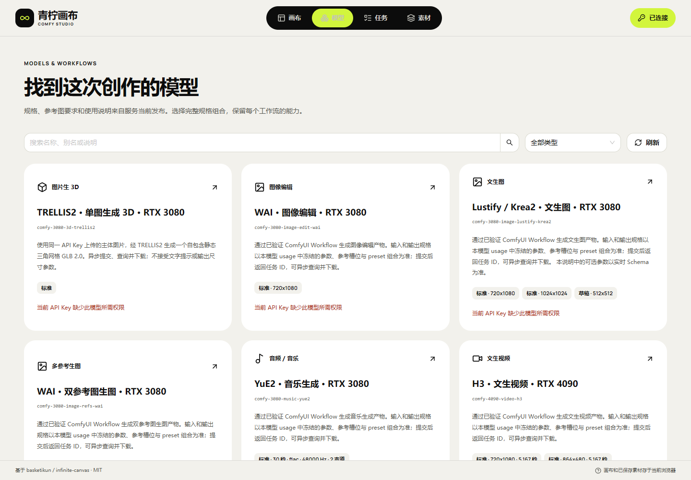
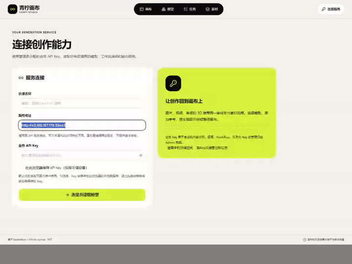
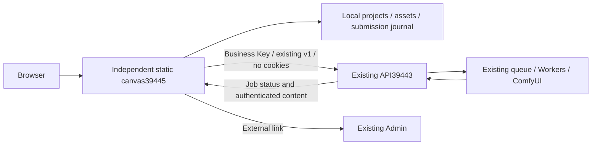

# ComfyUI Creative Canvas

[中文](README.md) · [Documentation](docs/studio/README.md) · [Deployment and usage](docs/studio/21-独立画布部署与使用.md) · [All 46 tracked items](docs/studio/10-开发进度与交付记录.md)

**An independently deployed static canvas that calls the existing ComfyUI API directly.** Built on [basketikun/infinite-canvas](https://github.com/basketikun/infinite-canvas), with the downloaded 04 Lime design. The canvas has its own build, release and rollback. The original API owns models, Workflows, business API Keys, queues, GPUs and content retention.

| Entry | Address |
| --- | --- |
| Independent canvas138.1 | [Open canvas](http://43.165.167.179:39445/studio/) |
| Existing business API | `http://43.165.167.179:39443` |
| Existing management UI | [Admin](http://43.165.167.179:39443/admin/) |



[390px view](docs/studio/media/studio-138/public-independent-models-390.png) · [MP4 tour](docs/studio/media/studio-138/independent-desktop.mp4). Actual screenshots used a read-only verification Key, now disabled; generation permission warnings are expected. The tour uses a synthetic API fixture and does not demonstrate a new GPU run or physical-phone acceptance.



## Architecture and capabilities



- Discover the current Key's model catalog, descriptions, JSON Schema, complete presets and reference slots. Create images, video, Workflow audio and image-to-3D using capabilities already published by the API.
- Organize references and outputs on a canvas, with a local media library, task history, batches, image/video/audio nodes and on-demand static GLB interaction.
- Persist the original request before submission. Query a known job ID; reconcile an unknown submission before further action. Support recovery, explicit remote cancellation and verified per-job Key adoption without resubmitting unknown jobs under a different identity.
- Validate media type, length and SHA-256 before local saving. Project ZIPs include canvas assets; task JSON backs up request records and IDs. These are separate from cloud synchronization.

The canvas adds no generation backend or second queue. It does not modify the original forwarding, protocol, Workers, scheduling, database or Admin, and does not contact ComfyUI directly. Business requests use existing `/v1/` endpoints. API/Admin/Worker paths on the canvas port return404. The original API137.1 source baseline, configuration, release pointer and service PIDs remained unchanged across deployment. [Architecture boundaries and23-part assessment](docs/studio/20-独立画布与既有API融合最终边界.md).

## Quick start

1. Open the independent canvas. Enter the **existing API address on39443** and a business Key issued by its administrator. Choose whether to remember it locally; do not use the canvas39445, `/admin/` or ComfyUI8188 address as the API.
2. Read the model usage and select an authorized complete preset, dimensions/duration and reference slots. Catalog presence does not mean a device is idle. First-frame and multiple-reference video are different capabilities; audio is a Workflow output.
3. Create a canvas and a generation request. Preserve the original job; use submission reconciliation after a lost response. Stopping local polling does not cancel GPU work.
4. Validate and load completed assets, continue creating, preview GLB or save originals. Existing cloud outputs expire eight hours after completion. Browser copies depend on local quota and user cleanup; export a ZIP or save originals separately.
5. Open the original Admin to manage models, Workflows, channels, Keys and queues. Missing backend capabilities remain external dependencies; the canvas will not bypass the API.

**Changing port or domain does not migrate browser data.** Export project ZIPs, required originals and task JSON from the old39443 canvas, import them at39445 and re-enter the business Key. Keep old data until verified. Project import does not generate again; task records require an explicit original-ID query. Static rollback must not downgrade IndexedDBv4.

## Native development and deployment

Verified with Node22.14.0/npm10.9.2. From this repository's `web/` directory, in PowerShell:

```powershell
npm ci
$env:VITE_BASE='/studio/'
$env:VITE_STUDIO_MODE='managed'
$env:VITE_AGGREGATOR_ORIGIN='http://43.165.167.179:39443'
npm run typecheck
npm run build
```

Deploy only `web/dist/` to an independent static host with `/studio/` and SPA fallback. Keep `managed` mode: deployment independence does not mean the upstream `standalone` mode, which enables optional scripts/Agents. The default API address is public; never embed a Key. Without a default API, the connection field stays empty.

Current service: `infinite-canvas-static.service`; release: `/opt/infinite-canvas/releases/canvas-20261030.138.1/`; pointer: `/opt/infinite-canvas/current`; port39445. Releases and rollbacks affect only this static canvas. The original API is neither redeployed nor restarted. HTTP on a high port is intentional; the user will handle domain reverse proxying. No local Docker, WSL or virtual machines. [Deployment and migration details](docs/studio/21-独立画布部署与使用.md).

## Validation and limits

This increment passed179 frontend unit tests, type checking/production build,11 synthetic cross-origin browser groups, public hashes for107 static files and2 actual API-catalog browser groups. Dependencies reuse an earlier native clean locked installation; they were not installed again in this increment. The temporary read-only Key is disabled; owned browsers, fixtures and test PostgreSQL are closed. Eight real image/video/audio/GLB modes are historical evidence, not new GPU runs.

Full acceptance remains **HOLD/pending-test**. The complete fault matrix, physical Android/iOS, large-file peak memory/leaks and10–20-device capacity remain unverified. WebDAV/cloud sync, optional text assistant, animation and additional3D formats are incomplete. Transfer-triggered ComfyUI-original deletion, heterogeneous-device merging and GPU optimization belong to the existing API and are outside canvas implementation. [Implemented items and complete backlog](docs/studio/10-开发进度与交付记录.md).

## Documentation and license

Application source lives in `web/`; independent design, evidence and media are linked from the [documentation index](docs/studio/README.md). See the [independent canvas update notes](docs/studio/23-独立画布更新记录.md). Earlier fusion/backend reports remain historical; documents20/21 define current architecture and deployment.

The upstream [MIT license](LICENSE) and author notices remain. Original04 Lime style/font attribution is retained in the project and static package. Work is maintained on an independent feature branch; neither the basketikun upstream nor the existing API branch is updated.
