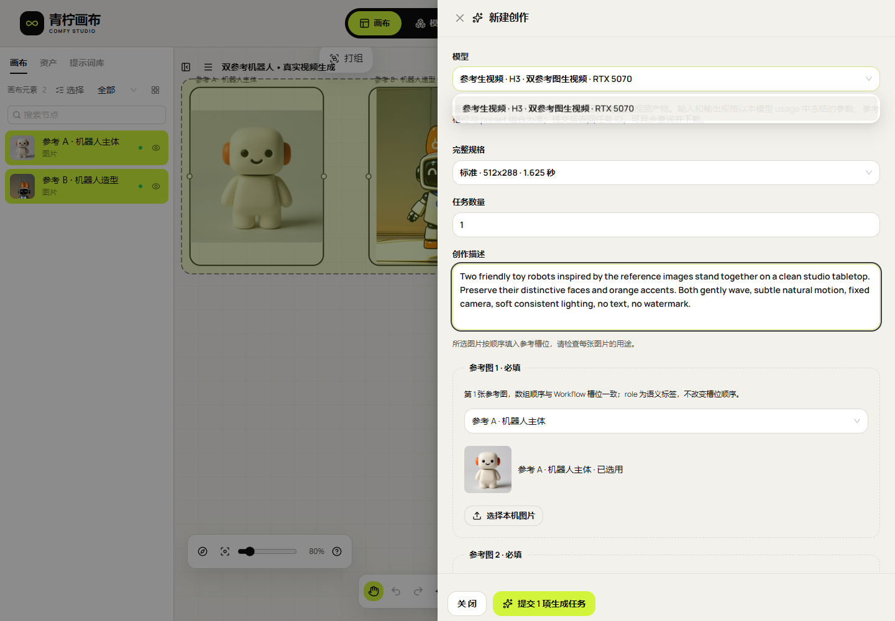
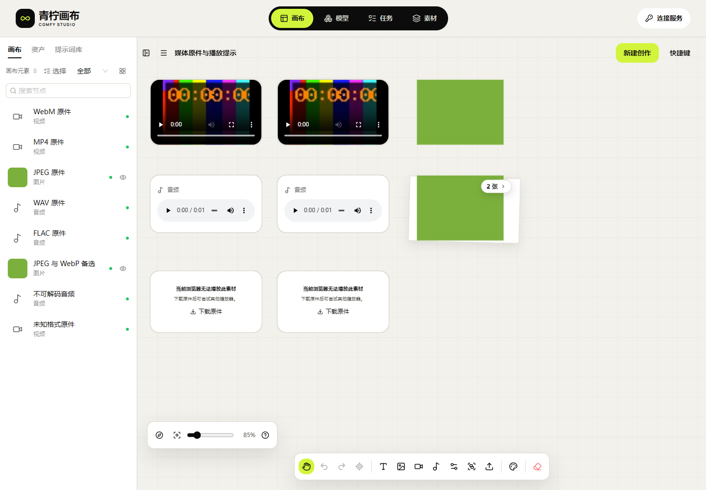
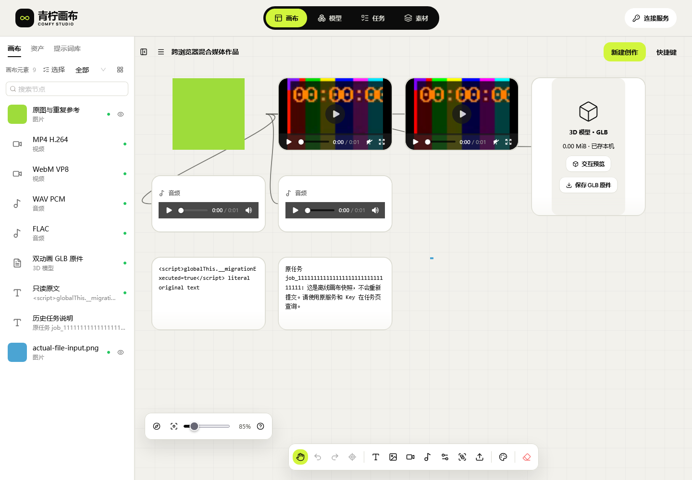
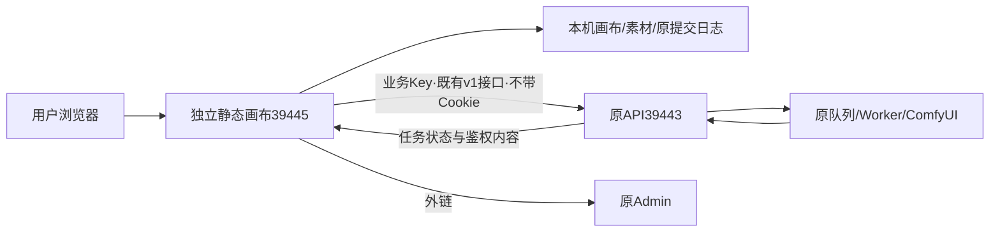

# ComfyUI 创作画布

<!-- independent150:start -->
**Web静态150.1已部署**：[画布参考创作与生成表单](docs/studio/35-画布参考创作与生成表单.md)。直接改造既有开源画布：选图自动填槽位、缩略图、合法完整规格、目录恢复、全输入预检及实际来源连线。207单元/类型/构建、Chromium本机/公网与Firefox本机共69组表单、15截图通过；Firefox公网未完成，单列待验；[完整所选页MP4](docs/studio/media/studio-150/canvas-reference-creation-public.mp4) / [GIF](docs/studio/media/studio-150/canvas-reference-creation-public.gif)展示合成接口流程。一次真实双参考视频受理后由原服务返回 `preparation_transport_failure`，没有生成结果；测试Key已禁用。仅发布画布静态文件及兼容150.0恢复包，原API/服务/配置不改。完整Web验收仍 **HOLD**。



操作：连接原API和业务Key → 在画布选择图片 → 新建创作 → 核对模型、完整规格和每张参考图 → 提交并查询原任务 → 成功后载入/另存原件。视频、音频和3D使用各自已发布Schema；不新建生成后端。下方149及更早证据保留原时点。
<!-- independent150:end -->


<!-- independent149:start -->
**历史149.1交付**：[原件下载与播放失败处理](docs/studio/34-Web媒体原件下载与播放失败处理.md)。普通WebM、JPEG/WebP批次原件后缀已修复；原生解码失败显示原件下载，缺件明确拒绝，替换后重新判断。图层操作栏跟随当前节点，下载不误开编辑面板。三引擎本机/公网各36组、78次实际下载、18截图，203单元/类型/构建及相关回归通过。Windows WebKit解码与Cookie、实际Safari及完整Web签收仍 **HOLD**。仅切独立静态目录，兼容149.0恢复包准备完成，原API与全部服务/配置不变。



[实际下载/替换MP4](docs/studio/media/studio-149/Chromium-original-download-and-replacement.mp4) / [GIF](docs/studio/media/studio-149/Chromium-original-download-and-replacement.gif) · [WebKit失败提示MP4](docs/studio/media/studio-149/WebKit-native-failure-and-original-download.mp4) / [GIF](docs/studio/media/studio-149/WebKit-native-failure-and-original-download.gif)。完整所选页面录像、合成小文件，本轮没有GPU生成；下载通过不代表WebKit播放通过。下方146/147/148是历史证据。
<!-- independent149:end -->


[English](README.en.md) · [文档索引](docs/studio/README.md) · [部署与使用](docs/studio/21-独立画布部署与使用.md) · [全部46项状态](docs/studio/10-开发进度与交付记录.md)

**独立静态画布，只调用现有 ComfyUI API。** 前端基于 [basketikun/infinite-canvas](https://github.com/basketikun/infinite-canvas)，全面采用已拉取的 04·青柠样式。画布独立构建、发布与回滚；模型、Workflow、业务 Key、队列、GPU 和内容生命周期由原 API 系统管理。

| 入口 | 地址 |
| --- | --- |
| 独立画布150.1 | [打开画布](http://43.165.167.179:39445/studio/) |
| 原业务API | `http://43.165.167.179:39443` |
| 原管理后台 | [Admin](http://43.165.167.179:39443/admin/) |

此前146.1交付 **Web端**：独立网页、浏览器操作与响应式布局。清理页已修复旧快照覆盖新状态；发布清单绑定完整存储契约，兼容恢复包146.0保留新旧页面资源。实际公网回退与恢复8项通过，作品/原件/原任务完整保留；只支持v4的旧版被拒绝切换。原生客户端与应用商店不在范围。[完整方案、操作与证据](docs/studio/31-Web交付范围与兼容静态回退.md)。

**混合媒体迁移补充（证据148，产品仍146.1）**：[文档33](docs/studio/33-Web混合媒体跨浏览器备份恢复.md)记录Firefox→Chromium→Windows WebKit→Firefox的实际ZIP互导，共34组通过；九节点、五连线、八原件及重复参考完整保留，刷新和GLB原件下载摘要一致，任务不重提。Windows WebKit四份音视频code=4，播放未签收；回到Firefox后均正常载入。普通WebM另存后缀仍需完善，完整ZIP已保留正确类型。[最终恢复MP4](docs/studio/media/studio-148/Firefox-mixed-originals-recovery.mp4) / [GIF](docs/studio/media/studio-148/Firefox-mixed-originals-recovery.gif) · [WebKit迁移MP4](docs/studio/media/studio-148/WebKit-mixed-originals-migration.mp4) / [GIF](docs/studio/media/studio-148/WebKit-mixed-originals-migration.gif)。小型合成文件、完整所选页录像，零生产生成请求；原API和静态服务未修改或重启。完整Web验收仍HOLD。



[最新快照](docs/studio/media/studio-146/refresh-2026-10-30T14-40-06-009Z/latest-snapshot-ready.png) · [兼容恢复的两节点合成作品](docs/studio/media/studio-146/rollback-2026-10-30T14-37-15-637Z/compatible-recovery-renders-saved-Web-project.png) · [390px网页](docs/studio/media/studio-146/cleanup-2026-10-30T14-38-50-017Z/public-390-bottom-original-controls.png) · [清理MP4](docs/studio/media/studio-146/synthetic-Web-local-cleanup.mp4) / [GIF](docs/studio/media/studio-146/synthetic-Web-local-cleanup.gif) · [恢复页面MP4](docs/studio/media/studio-146/synthetic-Web-compatible-recovery.mp4) / [GIF](docs/studio/media/studio-146/synthetic-Web-compatible-recovery.gif)。合成文件，完整所选页面录像，零业务API/GPU请求。补充证据147新增Firefox38组、Windows WebKit本机功能27组通过；WebKit Cookie隔离未签收，实际Safari未验，390px仅视口模拟。203单元/类型/构建、12发布守卫、18原生协议及当前114/保留688文件验证通过；完整Web人工/故障签收仍 **HOLD/pending-test**。

**Web兼容性补充（产品仍146.1）**：[文档32](docs/studio/32-Web浏览器兼容性与验证边界.md)记录实际文件输入/下载、ZIP新键与引用、刷新、双页保护和Cookie差异。Firefox/[WebKit清理页面](docs/studio/media/studio-147/cleanup-webkit-2026-10-30T15-16-15-025Z/public-desktop-cleaned-and-retained.png)及[390px网页](docs/studio/media/studio-147/cleanup-webkit-2026-10-30T15-16-15-025Z/public-390-bottom-original-controls.png)分别留证。[Firefox恢复MP4](docs/studio/media/studio-147/Firefox-Web-project-restore.mp4) / [GIF](docs/studio/media/studio-147/Firefox-Web-project-restore.gif) · [WebKit清理MP4](docs/studio/media/studio-147/WebKit-Web-local-cleanup.mp4) / [GIF](docs/studio/media/studio-147/WebKit-Web-local-cleanup.gif)。合成文件，完整所选页面录像，零生产业务API/GPU请求。修正损坏测试PNG后两引擎原件恢复通过；Windows WebKit无产品代码的最小omit测试仍带Cookie，因此不宣称完整WebKit/Safari支持。原API及静态产品均未重新部署。

下面为先前139.2/证据140的真实生成记录，本轮没有重新生成：


[批次终态桌面](docs/studio/media/studio-140/verified-actual-batch-terminal-desktop.png) · [390px页面](docs/studio/media/studio-140/verified-actual-batch-result-390.png) · [去元数据样片](docs/studio/media/studio-140/actual-batch-first-display.png) · [实际恢复MP4](docs/studio/media/studio-140/actual-batch-recovery.mp4)。两项真实批次分别成功/取消；成功原件720×1080、720,638字节，端到端1,458秒（24分18秒），长度/SHA及完成后八小时时限通过。录像展示原批次恢复和另存，390px是视口模拟。验收Key已禁用并确认401。


证据140继续使用同一139.2静态版本：14组原生故障、6组冻结页面轮询、4项真实备份恢复和原批次原件复查分别留证；两项各一次生成POST，丢响应仍恢复原ID。draft被原Key策略禁用，未改额度或并发。空画布桌面/390px单次FCP704/716ms是诊断数据，非SLA。[当前批次、页面、GIF与失败回执](docs/studio/25-轮询取消与真实批次验收.md) · [前次实际编辑与离线恢复](docs/studio/24-真实故障恢复与离线素材验收.md)。

## 方案与功能



- 动态读取当前 Key 的模型目录、注释、Schema、完整 preset 与参考槽位；按原 API 已发布能力创作图片、视频、Workflow 音频及图片生3D。
- 画布组织参考素材和结果分支，支持本机媒体库、任务历史、批量任务、图片/视频/音频节点与按需 GLB 交互预览及内嵌动画控制。
- 先持久化原请求再提交；已知任务查询原ID，未知提交先核对。支持离开恢复、显式远程取消、已知任务的逐项Key接管；不通过换Key或改参数重发未知任务。
- 下载核对类型/长度/SHA-256，再保存本机。作品ZIP备份画布和原件，任务JSON备份原请求与编号；均不替代云同步。

画布不增加生成后端或第二套队列，不改原转发、协议、Worker、调度、数据库或Admin，不直接调用ComfyUI。业务请求只有既有`/v1/`；画布39445上的API/管理/Worker路径返回404。原API137.1的源码基线、配置、指针及服务PID在部署前后相同。[23项架构边界与可用性评估](docs/studio/20-独立画布与既有API融合最终边界.md)。

## 快速使用

1. 打开独立画布，在连接页填写**原API地址39443**和管理员发放的业务Key，按需选择是否在本机记住Key。地址不要填写画布39445、`/admin/`或ComfyUI8188。
2. 连接后查看模型用法，按授权选择完整规格、尺寸/时长及参考槽位。目录列出模型不代表设备当前空闲；首帧视频与多参考视频是不同能力，音频是Workflow产物。
3. 新建画布并新建创作，提交后保留原任务。响应丢失使用核对原提交；停止本页等待不等于取消GPU任务。
4. 完成后校验并载入素材，可继续创作、预览GLB或另存原件。云端完成后8小时到期；原Key可在API不可用时读取已保存的本机副本，生成仍需在线鉴权。默认内存Key刷新需重输，明确保存后才自动恢复。本机受配额和清理影响，请另存或导出ZIP。
5. 需要管理模型、Workflow、渠道、Key或排队时，打开原Admin。原系统缺少的功能属于外部依赖，画布不会绕过API实现。

在“存储空间”主动检查本机引用并导出清单；遇到缺件保留原文档，使用已有完整备份恢复。GLB预览有动画时手动选择片段并播放，隐藏时停止更新，关闭后释放资源；默认不播放。核对清单不含媒体正文，不能替代作品ZIP。

**换端口/域名不会自动迁移本机数据。** 先在旧39443画布导出作品ZIP、必要原件和任务JSON，到新39445入口导入并重新填写业务Key；确认可用前保留旧数据。导入作品不会重新生成；任务清单需主动查询原ID。日志v5不得降级，不能回退仅支持v4的144.1；兼容146.0恢复包及实际回退/恢复已验，其他版本须另核对完整契约。

## 原生开发与部署

已验证Node22.14.0/npm10.9.2。进入本仓库`web/`执行：

```powershell
npm ci
$env:VITE_BASE='/studio/'
$env:VITE_STUDIO_MODE='managed'
$env:VITE_AGGREGATOR_ORIGIN='http://43.165.167.179:39443'
npm run typecheck
npm run build
```

仅发布`web/dist/`，由独立静态服务提供`/studio/`和SPA回退。`managed`是功能约束模式，与是否独立部署无关；不要换成启用上游脚本/Agent的`standalone`模式。默认API是公开地址，Key不进入构建。没有默认API时连接页留空。

当前独立服务为`infinite-canvas-static.service`，目录`/opt/infinite-canvas/releases/canvas-20261031.149.1/`，指针`/opt/infinite-canvas/current`，监听39445。只切换画布自己的发布目录，先校验兼容契约并保留新旧页面所需哈希资源。素材库路径与静态assets目录分别处理，深链可刷新；配置样本见[部署详情与迁移](docs/studio/21-独立画布部署与使用.md)。原API不随画布部署或回退。HTTP高位端口供用户自行反代，不设HTTPS门槛，本地禁止Docker、WSL和虚拟机。

## 验证与限制

当前146.1通过203单元/类型/构建、18原生协议、12发布守卫、10本机+10公网清理、14本机+14公网ZIP、11双源、14媒体回归及实际Web回退/恢复8项。114当前/688旧资源和15路由逐项核对，截图及完整所选页面MP4/GIF同步，浏览器/夹具关闭。原API两个工作区、线上指针/配置/服务及独立静态服务/配置不变。完整Web验收HOLD。

完整首期仍为**HOLD/pending-test**：完整Web人工/故障、更多浏览器、大文件峰值/泄漏待验；更多动画轨道/3D格式、旧原件迁移、缩略图回收与不确定占用恢复待完成。原生客户端与应用商店不在范围。云同步/文本助手只可使用原API既有能力，暂无则保留外部依赖；ComfyUI移交即删、异构设备合并、10～20台容量及GPU优化属原API外部事项，画布不另接后端或修改转发。[已实现编号与全部待办](docs/studio/10-开发进度与交付记录.md)。

## 文档与许可

源代码在`web/`；独立文档、公开证据和页面资料从[文档索引](docs/studio/README.md)进入。更新说明见[独立画布更新记录](docs/studio/23-独立画布更新记录.md)，旧融合/中转报告保留历史标记；文档20/21/31为当前Web架构、部署和回退依据。

保留上游[MIT许可](LICENSE)与作者声明，04·青柠源样式/字体说明随项目和静态包保留。功能分支独立维护，不向basketikun上游推送，也不更新原API分支。

在存储页保存并进入安全清理；新版未引用原件可备份后手动回收，其他编辑页、旧原件、缩略图和无法核对的记录继续保留。完整说明见文档30。
