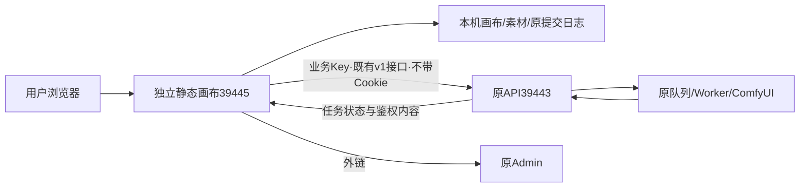

# ComfyUI 创作画布

[English](README.en.md) · [文档索引](docs/studio/README.md) · [部署与使用](docs/studio/21-独立画布部署与使用.md) · [全部46项状态](docs/studio/10-开发进度与交付记录.md)

**独立静态画布，只调用现有 ComfyUI API。** 前端基于 [basketikun/infinite-canvas](https://github.com/basketikun/infinite-canvas)，全面采用已拉取的 04·青柠样式。画布独立构建、发布与回滚；模型、Workflow、业务 Key、队列、GPU 和内容生命周期由原 API 系统管理。

| 入口 | 地址 |
| --- | --- |
| 独立画布142.1 | [打开画布](http://43.165.167.179:39445/studio/) |
| 原业务API | `http://43.165.167.179:39443` |
| 原管理后台 | [Admin](http://43.165.167.179:39443/admin/) |

当前142.1补齐仅存在于历史参考列表的原件备份，导入时同步替换本机键，保持顺序、重复项和提示词原文。缺少参考原件会拒绝残缺ZIP；双页冲突时保留先提交的版本，未保存作品可先完整导出再重新载入。[操作逻辑与全部证据](docs/studio/27-历史素材引用备份与跨页面冲突.md)。


[双页冲突提示](docs/studio/media/studio-142/archive-2026-10-30T11-27-51-775Z/public-archive-cross-page-conflict.png) · [390px](docs/studio/media/studio-142/archive-2026-10-30T11-27-51-775Z/public-archive-restored-canvas-390.png) · [引用恢复MP4](docs/studio/media/studio-142/synthetic-archive-recovery.mp4) · [GIF](docs/studio/media/studio-142/synthetic-archive-recovery.gif) · [冲突MP4](docs/studio/media/studio-142/synthetic-cross-page-conflict.mp4) · [GIF](docs/studio/media/studio-142/synthetic-cross-page-conflict.gif)。本轮演示使用合成PNG与原生IndexedDB，不请求业务API/GPU；发布仅读原API健康/CORS，没有创建Key或任务。390px非真机。

下面为先前139.2/证据140的真实生成记录，本轮没有重新生成：


[批次终态桌面](docs/studio/media/studio-140/verified-actual-batch-terminal-desktop.png) · [390px页面](docs/studio/media/studio-140/verified-actual-batch-result-390.png) · [去元数据样片](docs/studio/media/studio-140/actual-batch-first-display.png) · [实际恢复MP4](docs/studio/media/studio-140/actual-batch-recovery.mp4)。两项真实批次分别成功/取消；成功原件720×1080、720,638字节，端到端1,458秒（24分18秒），长度/SHA及完成后八小时时限通过。录像展示原批次恢复和另存，390px是视口模拟。验收Key已禁用并确认401。


证据140继续使用同一139.2静态版本：14组原生故障、6组冻结页面轮询、4项真实备份恢复和原批次原件复查分别留证；两项各一次生成POST，丢响应仍恢复原ID。draft被原Key策略禁用，未改额度或并发。空画布桌面/390px单次FCP704/716ms是诊断数据，非SLA。[当前批次、页面、GIF与失败回执](docs/studio/25-轮询取消与真实批次验收.md) · [前次实际编辑与离线恢复](docs/studio/24-真实故障恢复与离线素材验收.md)。

## 方案与功能



- 动态读取当前 Key 的模型目录、注释、Schema、完整 preset 与参考槽位；按原 API 已发布能力创作图片、视频、Workflow 音频及图片生3D。
- 画布组织参考素材和结果分支，支持本机媒体库、任务历史、批量任务、图片/视频/音频节点与按需 GLB 静态交互预览。
- 先持久化原请求再提交；已知任务查询原ID，未知提交先核对。支持离开恢复、显式远程取消、已知任务的逐项Key接管；不通过换Key或改参数重发未知任务。
- 下载核对类型/长度/SHA-256，再保存本机。作品ZIP备份画布和原件，任务JSON备份原请求与编号；均不替代云同步。

画布不增加生成后端或第二套队列，不改原转发、协议、Worker、调度、数据库或Admin，不直接调用ComfyUI。业务请求只有既有`/v1/`；画布39445上的API/管理/Worker路径返回404。原API137.1的源码基线、配置、指针及服务PID在部署前后相同。[23项架构边界与可用性评估](docs/studio/20-独立画布与既有API融合最终边界.md)。

## 快速使用

1. 打开独立画布，在连接页填写**原API地址39443**和管理员发放的业务Key，按需选择是否在本机记住Key。地址不要填写画布39445、`/admin/`或ComfyUI8188。
2. 连接后查看模型用法，按授权选择完整规格、尺寸/时长及参考槽位。目录列出模型不代表设备当前空闲；首帧视频与多参考视频是不同能力，音频是Workflow产物。
3. 新建画布并新建创作，提交后保留原任务。响应丢失使用核对原提交；停止本页等待不等于取消GPU任务。
4. 完成后校验并载入素材，可继续创作、预览GLB或另存原件。云端完成后8小时到期；原Key可在API不可用时读取已保存的本机副本，生成仍需在线鉴权。默认内存Key刷新需重输，明确保存后才自动恢复。本机受配额和清理影响，请另存或导出ZIP。
5. 需要管理模型、Workflow、渠道、Key或排队时，打开原Admin。原系统缺少的功能属于外部依赖，画布不会绕过API实现。

**换端口/域名不会自动迁移本机数据。** 先在旧39443画布导出作品ZIP、必要原件和任务JSON，到新39445入口导入并重新填写业务Key；确认可用前保留旧数据。导入作品不会重新生成；任务清单需主动查询原ID。数据库v4不得被静态回退降级。

## 原生开发与部署

已验证Node22.14.0/npm10.9.2。进入本仓库`web/`执行：

```powershell
npm ci
$env:VITE_BASE='/studio/'
$env:VITE_STUDIO_MODE='managed'
$env:VITE_AGGREGATOR_ORIGIN='http://43.165.167.179:39443'
npm run typecheck
npm run build
```

仅发布`web/dist/`，由独立静态服务提供`/studio/`和SPA回退。`managed`是功能约束模式，与是否独立部署无关；不要换成启用上游脚本/Agent的`standalone`模式。默认API是公开地址，Key不进入构建。没有默认API时连接页留空。

当前独立服务为`infinite-canvas-static.service`，目录`/opt/infinite-canvas/releases/canvas-20261030.142.1/`，指针`/opt/infinite-canvas/current`，监听39445。只切换画布自己的发布目录，并保留旧页面所需哈希资源。素材库路径与静态assets目录分别处理，深链可刷新；配置样本见[部署详情与迁移](docs/studio/21-独立画布部署与使用.md)。原API不随画布部署或回退。HTTP高位端口供用户自行反代，不设HTTPS门槛，本地禁止Docker、WSL和虚拟机。

## 验证与限制

当前142.1通过184单元、类型/生产构建和11组合成双源检查；14组本机与14组实际公网页面/IndexedDB检查覆盖12类坏档、参考原件、失败导出、重映射/再导出、文档故障及双页冲突。107当前/340旧资源、14路由逐项公网核对。两个API工作区、线上API配置/指针/进程、画布服务/配置均不变，无重启。两MP4两GIF完整解码，自有浏览器/夹具已关闭；回归前2项失败→修复后0失败有具名记录。旧GPU/离线/批次证据保留，不冒充本轮重测。

完整首期仍为**HOLD/pending-test**：完整故障、实际Android/iOS、大文件峰值/泄漏及10～20台容量待验；动画/更多3D格式未完成。云同步/文本助手只可使用原API既有能力，暂无则保留外部依赖；ComfyUI移交即删、异构设备合并及GPU优化也由原API负责，画布不另接后端或修改转发。[已实现编号与全部待办](docs/studio/10-开发进度与交付记录.md)。

## 文档与许可

源代码在`web/`；独立文档、公开证据和页面资料从[文档索引](docs/studio/README.md)进入。更新说明见[独立画布更新记录](docs/studio/23-独立画布更新记录.md)，旧融合/中转报告保留历史标记；文档20/21为当前架构和部署依据。

保留上游[MIT许可](LICENSE)与作者声明，04·青柠源样式/字体说明随项目和静态包保留。功能分支独立维护，不向basketikun上游推送，也不更新原API分支。
