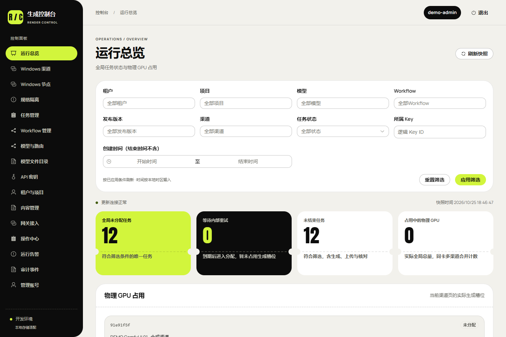
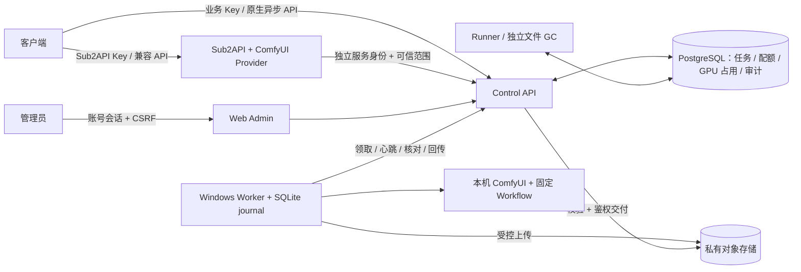

# ComfyUI Aggregator Proxy

[118 · 双 GPU 真实接入](docs/118-双GPU真实ComfyUI接入.md) 已完成两台 Windows 的 ComfyUI / Worker 接入：2 条启用渠道、241 个候选 Workflow 草稿、51 个模型文件登记，3 个模型经实际生成、S3 回传和鉴权下载后批准发布。588 项相关回归、8 个后台页面/尺寸检查通过；第三台设备仍连接超时。图生图、参考生成、专用 Workflow、10～20 台容量与完整首版验收继续开放。


管理入口使用已部署的普通 HTTP 高位端口，后续域名反代由部署者配置。Admin 可编辑渠道、浏览 Windows 导出目录、维护草稿/冻结版本/模型路由、观察排队并管理多个业务 API Key。业务流程为：选择下表模型 → 给 Key 授权模型/发布版本/渠道与额度 → 异步提交 → 查询任务 → 带同一 Key 下载。具体请求和启动配置见 [118 使用说明](docs/118-双GPU真实ComfyUI接入.md)，[真实截图、录屏与生成样本](docs/media/comfy-onboarding-118/README.md) 与历史合成演示分别标记。

| 已发布模型 | 实际设备 | 验证规格 | API |
| --- | --- | --- | --- |
| `comfy-3080-image-lustify-krea2` | RTX 3080 | 1024×1024 PNG | `/v1/images/generations/async` 或 `/v1/jobs` |
| `comfy-4090-video-h3` | RTX 4090 | 864×480、约 5.167 秒 MP4 | `/v1/videos` 或 `/v1/jobs` |
| `comfy-3080-music-yue2` | RTX 3080 | 最长 30 秒、48 kHz 双声道 FLAC | `/v1/jobs`，`text_to_audio` |

以上是三个规格的真实链路样本，不是全部 Workflow、所有质量规格或完整产品验收。295 个既有文件已导出 API 图；241 个可整理为候选草稿，54 个仍缺模型、专用输入/绑定或属于未支持的 3D 输出。除三个已验证冻结版本外，其余 238 个候选不对外发布。

[117 · ZeroTier 私网接入](docs/117-ZeroTier原生客户端与私网接入.md)：服务器已原生安装 ZeroTier 1.16.2 并设为开机启动；用户授权后，指定网络状态 `OK`、已分配地址。已从同网 Windows 实测私网 HTTP 39443 与 SSH，默认路由和 DNS 保持，安装前 64 个运行服务均 active。节点与地址单独交付，不公开网络拓扑；真实 ComfyUI / Worker 接入仍待后续配置。

[115 · Linux 原生部署](docs/115-Linux服务器部署与磁盘清理.md) 与 [116 · HTTP / 任意来源访问](docs/116-HTTP高位入口与任意来源访问.md) 已落地：独立 PostgreSQL 18、私有版本化 S3、Admin/API、Runner、GC 和定时数据库备份已运行。按要求提供普通 HTTP 高位端口 `39443`，由用户自行反代；`GEN_ALLOW_HTTP=true`、`GEN_ALLOW_ANY_ORIGIN=true` 允许任意来源、标准方法和请求头，保留 Key 鉴权与 Admin CSRF。309 项相关 Python 回归、2 项 HTTP UUID 检查、55 项最终公网检查和 6 个实际浏览器页面/尺寸检查通过。清理累计约 3.43 GiB，部署后根盘可用约 10.24 GiB；核对原有 49 个运行服务均 active。真实 Windows / 六类 Workflow 继续等待提供，服务器现有 Sub2API 尚未接入本项目定制 Provider。


这组 [实际部署截图、原速 MP4 与 GIF](docs/media/linux-deployment-116/README.md) 使用已部署数据库；下方原有演示素材继续明确标记为合成数据。入口使用逻辑：先通过 `/admin/` 登录，按需管理租户/项目和多个业务 API Key；取得 Windows 测试资源后登记 Worker、GPU 与 ComfyUI 渠道，导入并同步图像/视频/音频 Workflow，验证并发布模型别名，再用 Key 提交异步任务、查询状态和下载内容。当前可以使用管理面与内容/鉴权接口，生成服务须待真实节点和 Workflow 接入验证。初始管理员密码由受限文件交付，不放入仓库。

[113 · Provider 状态与候选收口](docs/113-Provider实现状态与真实运行验收边界.md) 已更正 Provider 实现状态及范围，保留 runtime_integration_verified=false 的真实依赖验收边界。当前 7935b7d 的完整 16 门禁/4280 Python 与 rc-20261026.113.1 的 29 安装/10 浏览器通过；649/525 来源及包内元数据逐字节一致，实际 Provider 源码/补丁/exe 守卫一致。112 的 30 原生场景经 275 输入一致后复用，没有重新执行。114 审计的 V01/V02/R05 本地出口已收口；真实六类 0/6、69 稳定出口、98 完整门禁及历史根因仍开放。

[114 · 当前工作区系统审计](docs/114-当前工作区系统审计与完整目标差距.md) 核对当前 649 输入、最近 112 的实际报告和候选全部载荷：核心/Admin 已实现，仍有 69 项开放出口（首版 67、可选 2）、真实六类 0/6、98 完整门禁待签收。审计前已有未提交的 Provider 元数据修正，完整 CI/新候选安装须另补；275 个原生输入不变可按范围复用。本轮仅审计，不重跑或提升完整验收。

[112 · 输入素材发布未决事务与清理保护](docs/112-输入素材发布未决事务与清理保护.md) 输入素材清理先等待原发布持有的 API Key 行锁，再核对精确版本，外部删除不持有数据库连接。当前 e12f604 的 122 专项（6 新场景）、完整 16 门禁/4280 Python、30 原生及 rc-20261026.112.1 的 29 安装/10 浏览器通过；649/275/525 来源与实际 content.py wheel 字节一致。保留 2 次有效误删复现及 4 次测试 ID 解析错误记录，后者不计行为证据。所属临时资源清理；真实六类 0/6、69 稳定出口、98 完整门禁及历史数据库根因继续开放。

[111 · 当前项目完整目标与逐项差距](docs/111-当前项目完整目标与逐项差距.md) 重新核对当前 c20b765：完整 16 门禁/4274 Python、30 原生及 rc-20261026.110.1 的 29 安装/10 浏览器均与当前来源和实际载荷一致。完整表格保留 69 个开放出口（首版 67、可选 2），六类真实 0/6、98 完整门禁和历史根因仍开放；主要核心/Admin 已实现不等于生产签收。

[110 · 输出发布提交不确定与对象清理](docs/110-输出发布提交不确定与对象清理.md) 修复数据库提交确认丢失时误删已发布产物的问题：新的短事务等待同上传记录的发布锁，再核对精确版本；未引用才能删除，查询/删除失败保留对象及原错误，删除不跨数据库事务。当前 c20b765 的 116 专项（9 新场景）、完整 16 门禁/4274 Python、30 原生，以及 rc-20261026.110.1 的 29 安装/10 浏览器全部通过；648/275/525 来源和实际输出发布 wheel 字节一致。原两次误删失败保留，所属临时资源清理；真实六类 0/6、69 待办、98 完整门禁和历史数据库根因继续开放。

[109 · 当前源码全量验证与候选收口](docs/109-当前源码全量验证与安装候选收口.md) 已补齐 108 审计的 V01～V03：当前 75db9a0 完整 16 门禁/4265 Python、30 原生、候选 rc-20261026.107.1 的 29 安装/10 浏览器通过；647/275/525 来源和实际 Worker wheel 一致，临时资源清理。108 中“旧候选不覆盖当前修改”按原审计时点保留；当前本地验证缺口已补，69 稳定待办、真实 Workflow 0/6、98 完整首版门禁及历史数据库根因仍开放。

[108 · 当前工作区与完整目标差距](docs/108-当前工作区与完整目标差距复核.md) 核对当前 647 个应用输入及实际旧候选：107 的 248 专项有效，但 106 全量 CI/原生/候选各有两个 Worker 来源已变化，当前完整回归、新原生通路和新候选/安装待补。保留完整 69 项编号表（首版 67、可选 2），真实 Workflow 0/6、98 完整门禁待签收；不能把已实现、旧测试通过和完整生产交付混为一谈。

**把多台 Windows 上的 ComfyUI，统一封装为可管理、可排队、可追踪的图片、视频与音频 API。**

中文 · [English](README.en.md) · [开发文档](docs/README.md) · [更新日志](CHANGELOG.md) · [贡献与同步约定](CONTRIBUTING.md)



本项目内部服务名为 **Render Control**。它由可视化 Admin、持久化任务控制面、Windows Worker 和 Sub2API 集成组成。图像、视频、音频均来自 ComfyUI Workflow；音频不另接一套外部生成服务。

**当前状态：持续开发，Linux 服务及两台 Windows GPU 已部署。** 三类文生图/视频/音频真实链路已通过；多参考与图生图的真实验收、全部专用 Workflow、模型质量、10～20 台容量、定制 Sub2API 联合运行及完整灾备继续开放。历史记录按其时点阅读，当前结果以上方 118 为准。

[107 · 最终产物结构与 Worker 隔离](docs/107-ComfyUI最终产物结构与Worker隔离.md) 已完成错误 history 的受控拒绝及恢复隔离竞争修复，包含失败任务仍在清理的时序窗口。248 加强专项、完整 16 门禁/4265 Python、30 原生场景及 rc-20261026.107.1 的 29 安装/10 浏览器检查通过；647 CI/275 原生/525 候选来源匹配 75db9a0，实际 Worker 元数据/运行时 wheel 字节一致。90/12/1 原失败保留，所属临时资源已清理；17/23/43/55/60 的真实环境出口、69 待办及完整生产验收保持开放。

[106 · Worker 产物中断复制恢复](docs/106-Worker产物中断复制与恢复.md) 修复已有暂存文件阻塞恢复的问题：同源完整前缀核对后有界续写/复用，不匹配、超长、硬链接和重解析路径保留隔离，不截断、覆盖或重生成。115 专项、完整 16 门禁/4137 Python、30 原生场景及新候选 rc-20261026.106.1 的 29 安装/10 浏览器检查通过；644 CI/275 原生/525 候选来源匹配应用提交 1f62868，实际 Worker wheel 字节一致。原失败与本机 Windows 时间戳诊断保留，临时资源已清理；42/55/61 的真实设备出口、六类 Workflow、69 待办及完整生产验收保持开放。

[105 · 当前项目与目标差距](docs/105-当前项目检查与目标差距清单.md) 按当前 316c540 重新核对：640 CI/274 原生/524 候选来源及实际 ZIP 169 载荷一致；既有 16 门禁/4074 Python、30 原生、29 安装/10 浏览器证据有效于当前应用来源，本次未重跑全套。104 的连线保护经 6 个合法编译和 24 个非法阶段检查再次确认。仍有 69 项开放（67 首版、2 可选），真实 Workflow 0/6、98 完整门禁待签收；详细表保留原编号，列明已有实现、剩余工作与退出条件，历史数据库根因及严格 Video SDK 边界继续开放。

[104 · Workflow 连线保护](docs/104-Workflow标量绑定与连线保护.md) 修复 103/F01：绑定和预设仅能覆盖原图标量输入，冻结与 Worker 编译共用检查；非法旧包在 journal 提交意图及 ComfyUI POST 前拒绝。草稿仍可编辑导入，预览不可发布。173 项专项、完整 16 门禁/4074 Python、30 原生场景及新候选 rc-20261026.104.1 的 29 安装/10 浏览器检查通过；640 CI/274 原生/524 候选来源匹配应用提交 d2d53ff。修复前和夹具失败保留，临时资源已清理。该本地缺口已补，69 项整体待办与真实六类/实机/生产及历史数据库根因继续开放。

[103 · 当前版本系统检查](docs/103-当前版本系统检查与目标产物差距.md) 重新核对 637 CI/274 原生/524 候选来源及实际 ZIP，均与 101 最终版本一致，旧验证缺口已补。当前仍有 69 项开放（67 首版、2 可选），真实六类 Workflow 为 0/6、98 完整门禁待签收；本次另以六类合成图复现绑定/预设覆盖连线的核心校验缺口（12 个不安全变体被接受），归入 24/46 优先修复，不能把测试通过解释为完整产品已就绪。本次仅审计，未改应用或提高验收状态。

[101 · 依赖错误与安全恢复](docs/101-依赖不可用错误与安全重试边界.md) 完成控制 API/Provider 的脱敏 503、请求关联和未知写入保护。148 专项 Python、178 顶层/356 子 Go、完整 16 门禁/4013 Python 及 30 原生场景通过；637 CI/274 原生输入匹配应用提交 6e4b78f。新候选 rc-20261026.101.1 的 524 来源、169 载荷/58 wheels/67 契约一致，通过 29 项精确安装/10 项浏览器检查并清理临时资源。102 中的 Go/证据/当前回归/候选缺口已补齐；[历史审计](docs/102-当前工作区系统检查与目标差距.md) 保留原时点。真实 Workflow、实机、Redis/S3、生产及数据库历史根因继续待验收，69 项完整待办不提升。

遇到 `503/dependency_unavailable` 时，`Retry-After: 2` 是等待提示，并不证明写入未提交。优先查询原任务，或使用原 `Idempotency-Key` 和原请求语义恢复；Provider 保留原持久意图和资金预留，不因 503 盲目重提生成或释放额度。固定依赖错误不包含 SQL、驱动文本或远端诊断。

[99 · 数据库等待分类](docs/99-原生数据库等待分类与并发复验.md) 修复原生测试观测器把不同 I/O 等待合并为 other 的取证缺口，新增固定白名单 wait_event 并保留旧锁字段及原有范围/容量/脱敏限制。73 项专项及完整 16 门禁/3938 Python 通过；29 场景原生协议运行完整包含在 Python 门禁内，1585 次采样无容量截断，所属进程/双库/线程/媒体凭证清理。633 CI/273 原生输入匹配应用提交 21d6ac2。未观测到慢 I/O，未复现历史 502；不改变限流、预算或生成行为，历史根因和真实环境验收保持开放。本轮未重建 97 候选，其来源清单中的观测脚本与当前不同，不把旧安装验证提升为本轮。

[历史系统复核（98）](docs/95-项目现状审计与目标产物差距.md) 已重新核对当前 632 个 CI 输入、521 个候选输入及实际归档摘要，应用仍为提交 31f3798；本次没有重跑完整测试或改变验收状态。差距仍为 69 项（67 首版、2 可选），六类真实 Workflow 为 0/6。并发鉴权 500 次基线与旧测试库克隆清理通过，但均未复现原故障，不能关闭历史 502/503/超时根因；完整编号与完成条件见审计第 4、8 节及 [78](docs/78-完整待办与首版收口清单.md)。

[97 · 发行来源与审计状态](docs/97-发行来源绑定与审计状态可读性.md) 补齐新构建的真实 Git commit、提交字节及构建前后来源核对；应用/CI 改动须先提交，文档可后补。审计策略状态立即完整显示，正文留白和窄屏换行沿用原青柠。90 项发行专项、19 项三宽度 UI 检查及完整 16 门禁/3915 Python 通过；候选 rc-20261026.97.1 写入真实 Git 31f3798，包含 169 载荷、58 wheels、66 契约，并通过 29 项安装及 10 项安装后浏览器检查。原速 MP4/GIF 和证据见专题；真实资源与生产继续待验收。


[96 · 当前源码验证与新候选](docs/96-当前源码完整验证与原生发行候选.md) 已通过完整 16 门禁/3899 Python（零失败、错误、跳过），628 个应用输入前后相同。Python 用时 595.039 秒，原预算仍为 1200 秒；新候选 rc-20261026.96.1 包含 169 载荷、58 wheels、66 运行契约，并通过 29 项全新隔离安装及 10 项安装后浏览器检查。临时资源已清理；真实资源、生产、历史故障根因继续待验收。该轮记录的 Git 字段和状态显示问题由 97 继续处理，详见上方最新结果。

[2026-10-26 系统审计](docs/95-项目现状审计与目标产物差距.md) 逐项展开全部 69 项剩余工作（首版 67、可选 2），区分实现、局部验证和真实验收。73 条需求中 67 条有本地实现映射、六类能力为框架状态；98 项完整门禁均未签收。该审计时点的当前源码匹配第 94 增量专项、完整 CI/安装候选属于第 92 增量；后续 96/97 已补齐当前源码完整 CI、新候选和精确安装；审计第 7 节更新 632 输入、3915 Python、实际 Git 来源及剩余 69 项。并发 502、审计 503、旧测试库/CI 超时及严格 Video 类型限制继续独立追踪，98 项完整验收状态保持。

[完整跟踪清单](docs/78-完整待办与首版收口清单.md) 保留 76 个编号：01～05、10、12 共 7 项本地实现/追踪出口已收口，69 项仍开放（67 项首版、2 项可选增强）。[Provider 自动消费](docs/80-Provider目录消费与版本快照.md)、[Admin 映射管理](docs/81-Admin网关目录映射与发布核对.md)、[确认失败重试](docs/82-确认失败重试分类与跨GPU约束.md) 及 [监控接线](docs/84-监控指标与脱敏请求关联.md) 已有实现和分层证据。真实 Workflow、网关联合、故障与生产验收继续独立。

最近功能增量 [94 · 队列等待估算](docs/94-队列等待估算与运行样本.md) 在 Admin 任务详情加入按需估算：读取一致的实时队列、物理 GPU 占用和最近 24 小时同依据运行样本，展示可分配槽位的等待区间、样本数及 15 秒有效期。样本不足、设备失联或执行待核对时显示未知；这不是完成时间承诺。真实设备校准继续列入待办。

此前 [93 · Workflow 离线发布包](docs/93-真实Workflow离线发布包构建.md) 提供六类能力的本机依赖锁定、模型哈希、可导入 manifest 与漂移复验，接续现有 Admin 发布链路。[专项验证](docs/evidence/2026-10-26/workflow-package-python-93.json) 与历史全量 CI 分开记录；真实生成、质量和生产批准仍待实机完成。

此前 [92 · 直接视频接口](docs/92-直接视频接口冻结投影与权限边界.md) 将 job_ 视频的创建、原键恢复和详情对齐到原冻结规格，返回精确毫秒时长、尺寸和固定安全终态错误。跨 Key/租户、敏感输入、当前 scope 与撤销继续校验；分页列表保持一次有界查询。28 项源码绑定视频回归、74 项发行安全回归、完整 16 门禁/3790 Python、39 项实际 SDK 检查/24 原生场景、29 项精确候选安装及 10 浏览器检查通过。见 [92 验证](docs/evidence/2026-10-26/direct-video-verification-92.json)。两轮 CI 超时、统计实验与其他失败独立保留，复验未提高 1200 秒预算。原始青柠源码继续直接引用，69 项完整待办保持开放。

Admin 全面复用直接拉取的 [04 · 青柠原始 CSS](app/apps/admin_web/src/theme/reference/lime.css) 与本地原字体；后续界面继续使用同一共享主题与组件适配。[来源、源码和复用规则](docs/87-青柠视觉系统与组件复用.md) · [本次直接拉取核对](docs/evidence/2026-10-26/lime-direct-source-retrieval-92.json)。

<details>
<summary>历史验证记录（增量 84～91，各结果仅代表当时版本）</summary>

此前 [91 · 多媒体 SDK 与视频冻结规格](docs/91-多媒体SDK与视频冻结规格.md) 修复 Provider 视频响应的冻结 seconds/size 和安全终态错误，通过向前迁移 258 原子保存不可变元数据。Go/PostgreSQL 组件复验通过 176 顶层/342 子测试；实际 Python/Node 通过 39 项多媒体 SDK 检查（包含严格 Video 类型预期拒绝）及 24 个原生场景，新增任务/意图/用量各 12 条。严格官方 Video 类型与项目规格的差异明确保留。

[91 最终验证](docs/evidence/2026-10-26/multimedia-sdk-verification-91.json) 通过完整 16 门禁/3713 Python、28 项精确候选安装和 10 项安装后浏览器检查。611 CI、274 原生及 505 候选源输入与当时源码一致；候选 `rc-20261026.91.1` 含 169 载荷、58 wheels、64 运行契约。原 CI 预算失败与受控统计实验保留；复验沿用 1200 秒预算，Python 为 954.897 秒。所有本轮测试浏览器、进程和临时库已清理，真实资源与生产验收继续开放。

此前 [90 · 固定 SDK 客户端](docs/90-固定SDK客户端兼容矩阵.md) 使用真实 Python 3.37.0 / Node 7.43.0 SDK，验证模型发现、图片生成/编辑、错误关联、幂等与重试及明确的异步扩展。严格解析发现上游普通模型缺少标准元数据，现仅补齐缺省字段，保留已有字段和扩展；无效元数据继续拒绝。[本机协议](docs/evidence/2026-10-25/openai-sdk-native-90-fifth/openai-sdk-native-protocol.json) 通过 20 项 SDK / 24 项原生场景，仅新增预期的 6 个任务与计量记录。真实 Workflow、客户端完整矩阵和 69 项待办继续开放。

[90 最终验证](docs/evidence/2026-10-25/openai-sdk-verification-90.json)：206 项专项、173 顶层/331 子测试的 Go 组件、完整 16 门禁/3696 Python、28 项精确候选安装及 10 项安装后浏览器检查通过。606 项 CI、271 项原生运行及 501 项候选源输入核对一致；保留 SDK 失败、CI 预算失败及受控测试库统计实验，原有 1200 秒预算保持。候选 `rc-20261025.90.1` 含 169 载荷、58 wheels 和 63 运行契约，实际资源及生产仍待验收。

此前 [89 · 审计分页计算上限](docs/89-审计分页投影上限与版本化复验.md) 修复分页前对跳过记录转换详情的问题：先固定本页最多 51 条，再在 SQL 内执行 16 KiB 检查与脱敏；空页不再转换详情。计数、权限、一致快照及原有超时预算保持。新测试与当前源码单独绑定版本化证据，历史鉴权/审计超时的完整根因和 69 项完整待办继续开放。

[89 验证](docs/evidence/2026-10-25/audit-page-projection-verification.json)：179 项专项、完整 16 门禁/3671 Python、28 项精确候选安装及 10 项安装后浏览器检查通过；600 项 CI 输入与候选 499 项源输入核对一致，测试浏览器/进程/临时数据库和目录已清理。开发预览已受控更新；候选 `rc-20261025.89.1` 保持未签收生产和真实资源的状态。

此前 [88 · 需求与分层证据追踪](docs/88-需求实现与分层证据追踪.md) 将全部 73 条需求、98 项验收逐项关联到实现、99 个具名测试、6 份历史报告及剩余待办。离线门禁核对当时 141 个被引用代码/测试文件及报告摘要，拒绝源码漂移、遗漏、越界输入或把局部通过提升为整体验收。可运行 `app/.venv/Scripts/python.exe docs/tools/development_evidence.py --write-report`；文档主门禁也会执行。以下各增量数量是其历史记录，不覆盖当前追踪表。

此前增量 [84 · 监控与请求关联](docs/84-监控指标与脱敏请求关联.md) 增加独立只读身份、固定标签指标、只读 PG 快照、流式脱敏日志和十条告警规则。[84 验证](docs/evidence/2026-10-25/monitoring-verification.json) 通过完整 16 门禁/3399 项 Python、87 项监控专项、27 组原生协议、50 个 PromQL 断言、26 项候选安装及安装后 8 项浏览器检查。候选 rc-20261025.84.1 的 476 项源输入已核对，包含 159 个载荷文件、58 个 wheel；生产采集和通知仍按第 68 项验收。

第 85 增量提供 [Windows 原生服务部署工具](docs/85-原生系统服务封装与受控生命周期.md)：固定 API/Runner/GC/Worker/Sub2API 角色、可核对的服务计划、独立虚拟账户、显式安装/启停/卸载和有界恢复。非管理员拒绝变更且不弹 UAC；默认手动启动，不修改防火墙或 ComfyUI。部署工具及应用入口验证与真实 WinSW/SCM 生命周期分别记录，第 66 项继续开放。

[85 验证汇总](docs/evidence/2026-10-25/native-services-verification.json)：完整 16 门禁、3524 项 Python（零失败/错误/跳过）、161 项服务/发行专项、40 项前端单元、28 项精确候选安装及 8 项安装后浏览器检查通过。最终候选 `rc-20261025.85.3` 的 484 源输入与代码一致，包含 166 载荷、58 wheels 和 61 运行契约；581 项 CI 输入一致。四个应用角色正常退出、journal 保留与私有资源清理已核对；WinSW/SCM 和新网关监督器的真实生命周期继续待验收。

仓库 [原生 CI](docs/83-原生CI门禁与失败证据.md) 固定 16 项串行门禁、独立测试目录、测试库备份后迁移，仅公开脱敏摘要，原始日志/JUnit 留在私有目录。专用物理 Runner、仓库变量启用及实际 GitHub 成功/失败 artifact 仍待验收，第 11 项继续开放。

[原生链路证据](docs/evidence/2026-10-25/monitoring-native-final/confirmed-retry-native-protocol.json) 使用实际 Sub2API/API/Runner/Worker/PostgreSQL 进程，ComfyUI、Redis 和存储仍为明确的协议夹具。[82 的历史记录](docs/82-确认失败重试分类与跨GPU约束.md) 保留并行检查中出现的鉴权行锁超时/502；该问题尚未定位，隔离通过不代替并发容量验收。真实设备、生产 Workflow 和模型质量仍待后续资源验证。

第 86 增量新增 [数据库故障脱敏诊断与并发观测](docs/86-数据库故障脱敏诊断与并发观测.md)：请求日志仅记录固定来源、SQLSTATE 白名单、原因和连接失效标志；数据库错误使用专门的处理器，避免 SQL/驱动堆栈传播到服务器日志。真实 PostgreSQL 的锁等待、回滚与恢复已有专项覆盖；原生协议增加有界只读阻塞链采样。已稳定复现并修复任务详情的跨语句读取竞争：状态、revision 与产物使用同一个只读快照，避免返回旧非终态和新产物。既有 500/503、锁/语句预算和重试规则不变；历史 502/503 的完整根因及 70 项待办仍独立追踪。包含路由的日志模板覆盖嵌套、前缀及隐藏接口；原生 CI 及时处理小块超额日志并由读取线程关闭资源，保留失败及私有栈诊断。

[第 86 增量验证](docs/evidence/2026-10-25/database-diagnostics-final-ci-verification.json)：完整 16 门禁/3593 Python、29 项完整窗口并发原生协议、28 项精确候选安装及 8 项安装后浏览器检查通过。候选 `rc-20261025.86.1` 的 488 个构建输入与源码一致，含 166 载荷、58 wheels、62 运行契约；59 schema/947 fixture 同步。原失败、一次性测试库维护和未关闭的根因均保留于 [86](docs/86-数据库故障脱敏诊断与并发观测.md)。

第 87 增量直接接入用户指定的 [原始青柠样式](docs/87-青柠视觉系统与组件复用.md)。17 个页面、390px / 320px 布局及全部演示素材已刷新；前端 40 项、发布安全 71 项、最终候选 28 项安装和 10 项安装后浏览器检查通过。完整后端与原生协议套件未重跑，变更范围及证据见 [87 验证](docs/evidence/2026-10-25/lime-source-visual-verification.json)。

</details>

## 目录

- [功能与边界](#功能与边界)
- [架构与请求流转](#架构与请求流转)
- [Admin 操作与演示](#admin-操作与演示)
- [原生 Windows 快速开始](#原生-windows-快速开始)
- [从零接入设备与 Workflow](#从零接入设备与-workflow)
- [API 使用](#api-使用)
- [API Key、内容与额度](#api-key内容与额度)
- [调度、幂等与故障恢复](#调度幂等与故障恢复)
- [配置、部署与运维](#配置部署与运维)
- [工程结构与验证](#工程结构与验证)
- [文档与后续更新](#文档与后续更新)

## 功能与边界

| 能力 | 接入方式与行为 |
| --- | --- |
| 文生图 | `text_to_image`，冻结 Workflow、公开模型别名与受控预设 |
| 图生图 | `image_to_image`，先上传素材，再引用 `asset_id`；可声明蒙版 |
| 多参考图生图 | `references_to_image`，有序参考素材及受控角色/权重 |
| 文生视频 | `text_to_video`，异步任务、受控尺寸/时长与结果下载 |
| 参考图生视频 | `references_to_video`，文本与已上传参考素材 |
| 音频生成 | `text_to_audio`，同一 ComfyUI Workflow 体系，可承载语音、音乐或其他声音 |
| Windows 接入 | 节点、物理 GPU、ComfyUI 渠道分别管理；面向 10～20 台设备设计 |
| 图形 Admin | 渠道、节点、Workflow、模型路由、全局/渠道队列、任务、内容、Key、审计与告警 |
| 多业务 Key | 独立权限、模型/版本/渠道范围、内容范围、速率、并发与日额度 |
| Sub2API 优先 | 固定上游版本与 Provider overlay，提供 OpenAI 风格兼容入口及原生异步入口 |

当前生成约束包含单任务单最终产物、声明式参数绑定和明确输出节点。客户不能上传任意执行图、指定任意节点参数、访问服务器路径或令服务随意下载 URL。音频首批输入是文本；具体声音能力取决于接入并验收的 Workflow。音频输出覆盖受控 WAV、FLAC、MP3、Ogg Opus 预设，服务验证实际格式、采样率、声道和解码时长。详见 [音频契约](docs/55-音频契约与兼容迁移.md)。

## 架构与请求流转



1. 客户提交模型别名、标准输入、参数和稳定的 `Idempotency-Key`。Sub2API 路径先验证其客户身份，再由受信服务身份转发；原生路径直接验证本系统业务 Key。
2. 控制面检查租户/项目/Key 权限、模型发布状态、Workflow、渠道和规格，事务性预留额度并持久化任务。
3. Runner 与 Worker 围绕数据库中的状态、租约和物理 GPU 栅栏协调。多个 ComfyUI 渠道共享同一 GPU 时，生成占用仍按物理 GPU 计算。
4. Worker 在提交 ComfyUI **之前**持久化本机 journal，然后执行固定版本的 Workflow；不接受任意远程 shell。
5. 结果进入私有存储后，服务检查内容、大小、摘要、不可变对象版本及媒体实际属性，再将任务置为成功并结算。
6. 客户查询任务与产物，通过鉴权接口预览或下载。生成槽位、结果提交权、配额和文件清理分别管理。

PostgreSQL 是任务和资源权威源；SQLite 仅是单机 Worker journal。Sub2API 自己的账本通过固定集成协同，本项目不复制一套独立收费账本。

## Admin 操作与演示

在“任务管理”打开任务详情，点击“估算等待”。预计时间到可分配 GPU 槽位为止，不含领取后的准备、生成和上传；实际已等待时长另外显示。每组至少 10 条同发布、规格、GPU、渠道配置及批准的成功样本；旧记录不回填。超过 15 秒需要重新估算，新增任务、网络与设备变化会改变结果。只读管理会话可使用此功能，业务 API Key 不能调用管理接口。

[等待估算截图](docs/media/wait-estimates/wait-estimate-1440.png) · [移动端未知提示](docs/media/wait-estimates/wait-unknown-390.png) · [连续录屏 MP4](docs/media/wait-estimates/wait-estimates.mp4) · [GIF](docs/media/wait-estimates/wait-estimates.gif)。均为真实页面与 API、合成运行样本。

Admin 统一采用用户指定的 [04 · 青柠](https://html.cafe/x5b381ea1?c=lime)：直接拉取并引用原始 CSS，复用暖白/黑/青柠、原票根与卡片组件和 Anton / Manrope 字体。原始文件与来源摘要见 [87 · 视觉系统](docs/87-青柠视觉系统与组件复用.md)；管理组件和弹层共用适配层。字体从原声明原样解码到本地，并随包附带 SIL OFL 1.1 许可。后续页面与组件继续遵循同一规范。17 个页面已通过桌面、390px / 320px 布局检查，20 张截图及 4 组 MP4/GIF 已重新拍摄。原始文件可用 `app/scripts/pull-lime-reference.py` 默认只读校验；加 `--pull` 可重新从固定来源提取。

模型目录可从“网关接入 → 模型目录”或“模型与路由 → 网关模型目录”管理。`models:read` 可以核对期望/确认版本、映射差异、失败回执和分页历史；`models:publish` 才能编辑、发布、重试或回滚。模型页的只读入口不要求网关凭证管理权限。

首次填写与 Provider 启动文件相同的逻辑 instance，选择已发布模型并填写既有 Sub2API 用量账户、分组、价格版本及单位价格；账户/分组 ID 使用十进制字符串，避免 64 位精度丢失。确认后发布完整期望目录。Provider 自动拉取、校验并持久保存候选，取得有效 applied 回执后切换新请求；后台分别展示期望和已确认版本。首次确认后不自动回退启动规则；空目录表示下架该网关的新任务，旧在途任务和幂等重放保留原模型、Workflow、目标与价格。失败保留上一有效目录，历史重试/回滚创建新版本。部署前须备份、排空并独立迁移 Sub2API 至 257；启动只读探测结构。详见 [持久发布协议](docs/79-网关模型目录持久发布协议.md)、[Provider 应用与恢复](docs/80-Provider目录消费与版本快照.md) 和 [Admin 操作约束](docs/81-Admin网关目录映射与发布核对.md)。


[目录演示 MP4](docs/media/gateway-catalog/gateway-catalog.mp4) · [映射编辑](docs/media/gateway-catalog/catalog-editor.png) · [期望/确认版本](docs/media/gateway-catalog/catalog-confirmed.png) · [版本历史](docs/media/gateway-catalog/catalog-history.png) · [移动端](docs/media/gateway-catalog/catalog-mobile.png) · [脱敏请求与响应](docs/media/gateway-catalog/api-responses.json)。界面演示中的 Provider 回执是明确标记的协议夹具；实际 Provider 自动消费另有跨进程验证，均不代表真实 GPU 验收。


[完整巡览 MP4](docs/media/admin-tour.mp4) · [Workflow 操作 MP4](docs/media/workflow-lifecycle.mp4) · [演示素材、拍摄方法与响应记录](docs/media/README.md)

| 页面 | 使用逻辑 |
| --- | --- |
| 运行总览、任务管理 | 查看排队、运行、异常与完成情况，按范围和状态筛选；查看任务阶段、取消与受控重试 |
| Windows 渠道、节点 | 管理 ComfyUI 地址和配置、节点凭证与物理 GPU 关联，核对期望/应用/验证状态及各渠道队列 |
| Workflow 管理 | 导入 API-format Workflow、编辑参数表单、冻结版本、同步渠道、检查发布历史及恢复历史为新草稿 |
| 模型与路由 | 将已冻结、已同步并具有运行证据的版本绑定到公开别名和可用渠道，设置默认值后发布 |
| API 密钥、租户与项目 | 创建多个业务 Key，分配操作和资源范围，配置上层与 Key 额度并查看访问记录 |
| 内容管理 | 按所有者、任务、类型与标签查找素材/产物，鉴权预览、下载、标签维护与受控删除 |
| 操作中心、告警、审计 | 跟踪同步等持久管理指令、核对失败与重试，查看管理员动作和运行异常 |


Workflow 归档使用二次确认、revision CAS 和幂等请求。仍有已发布模型引用或未完成同步指令时会拒绝归档。归档后停止新增编辑、冻结、同步、批准和任务准入，保留历史、导出及已接收任务。解除归档恢复维护能力；发布、同步和运行批准仍须显式执行。历史恢复会生成新的草稿 revision，保留原冻结版本。

界面发生响应丢失时提供“使用原请求核对”，继续使用原正文、幂等键和 revision；不会自动换键覆盖其他管理员的修改。操作行为见 [Workflow 生命周期](docs/76-Workflow归档与恢复管理.md)。

更多截图：[登录](docs/media/login.png)、[移动队列](docs/media/mobile-queue.png)、[渠道](docs/media/channels.png)、[任务队列](docs/media/queue.png)、[模型路由](docs/media/models.png)、[API Key](docs/media/api-keys.png)、[内容](docs/media/content.png)、[版本历史](docs/media/workflow-history.png)、[移动端](docs/media/mobile-overview.png)。当前 Admin 界面语言为中文。

## 原生 Windows 快速开始

### 依赖

- 原生 Windows、Git、PATH 中的 Python **3.13**。
- `app/config/native-toolchains.lock.json` 固定的 Node.js **24.22.1**、PostgreSQL **18.6**；bootstrap 可下载并验证这两项。
- FFmpeg/ffprobe 原生媒体工具：按 `app/config/media-tools.lock.json` 准备 `app/.local/toolchains/ffmpeg-8.1/`，其中包含 `bin/ffmpeg.exe`、`bin/ffprobe.exe`、`LICENSE` 和 `README.txt`。bootstrap 不安装这部分；发布构建会检查锁定的字节数与摘要。
- 使用真实渠道时，Windows 上已安装并可独立工作的 ComfyUI、模型、自定义节点与 Workflow。Worker 使用独立 Python 环境，不复用 ComfyUI 的 torch 环境。

本项目开发与验证禁止 Docker、WSL、虚拟机。下面的命令在 PowerShell 中运行。安装脚本只安装工程依赖；不安装模型、不开放防火墙、不自动注册系统服务。

```powershell
git clone git@github.com:copypasteltd/comfyUI-aggregator-proxy.git
Set-Location comfyUI-aggregator-proxy/app

./scripts/bootstrap.ps1 -WithPostgresToolchain

# 只对全新目录执行 init：生成私有 .env，创建原生开发/测试库并启动 PostgreSQL。
./.venv/Scripts/python.exe scripts/dev-db.py init

# 迁移前自动备份并校验归档；真实恢复演练另行执行。
./scripts/db-migrate.ps1
./.venv/Scripts/python.exe -m control_api.cli bootstrap-project
./.venv/Scripts/python.exe -m control_api.cli bootstrap-admin --username admin

$taskNode = '.local/toolchains/node-24.22.1/node-v24.22.1-win-x64'
./.venv/Scripts/python.exe scripts/export-openapi.py
& "$taskNode/npm.cmd" --prefix apps/admin_web run generate:api
& "$taskNode/npm.cmd" --prefix apps/admin_web run build

# 先按上方说明准备锁定的媒体工具。
./scripts/dev-start.ps1
```

打开 **https://127.0.0.1:8443/admin/**，使用刚创建的账号登录。本地证书位于忽略目录 `.local/tls/`，用于回环开发；生产部署使用自己的 HTTPS 证书。首次系统没有已验收的真实模型或渠道，需要完成下一节接入步骤才能生成。

已有环境不要重新初始化数据库。恢复开发时执行 `python scripts/dev-db.py start`，再执行 `scripts/dev-start.ps1`；若已在运行则先核对状态。停止本项目注册的 API/Runner/GC 使用 `scripts/dev-stop.ps1`；停止所属 PostgreSQL 使用 `python scripts/dev-db.py stop`。脚本核对 PID、可执行文件和创建时间，排除 PID 复用造成的旧进程误认。

### 开发配置与生产配置

`dev-db.py init` 生成的 `.env` 使用 `development` 与本地存储，仅供开发。生产配置示例为 [environment.example](app/config/environment.example)：数据库、pepper、Fernet 密钥、可信 HTTPS origin、S3 私有桶与访问凭证均须显式设置。**不能直接把开发 `.env` 复制到生产。** 生产迁移、恢复和服务托管见 [原生部署与运维](docs/15-原生部署配置与运维.md)。

## 从零接入设备与 Workflow

已有本机 Workflow 草稿时，可先用[离线发布包工具](docs/93-真实Workflow离线发布包构建.md)计算模型哈希、锁定 ComfyUI/节点版本，生成可导入的 `manifest.json`。支持全部六类能力；工具清除旧运行批准，实机生成与渠道批准仍按以下流程完成。

```powershell
# 在 app/ 下执行；输出父目录须已存在，输出包目录必须全新。
./.venv/Scripts/python.exe -X utf8 scripts/workflow-package.py build --manifest .local/my-workflow-draft.json --comfy-root C:/ComfyUI --output .local/workflow-packages/my-workflow-v1
./.venv/Scripts/python.exe -X utf8 scripts/workflow-package.py verify --package .local/workflow-packages/my-workflow-v1 --comfy-root C:/ComfyUI
```

1. **建立范围。** 在 Admin 创建或选择租户和项目，配置额度。它们与业务 Key 的限制共同生效；默认音频日额度可能为零，启用音频时需要明确配置各层额度。
2. **登记 Windows 节点。** 在节点页面登记、发放一次性 Worker 凭证并保存到设备私有文件，核对物理 GPU 身份。配置参考 [worker.example.json](app/config/worker.example.json)。
3. **登记渠道。** 设置该节点上的 ComfyUI 地址、GPU 关联与允许访问范围。渠道凭证加密保存；浏览器不直接连接 ComfyUI。地址可维护，变更必须等待 Worker 应用并验证。
4. **准备 Workflow。** 在 ComfyUI 导出 API 格式图，声明参数到节点输入的绑定、允许预设、依赖锁、输出适配器与最终节点。UI 格式工作流不能直接当成 API 执行图。导入候选须检查后提交。
5. **冻结、同步、验证。** 冻结不可变版本，同步到指定渠道，核对 desired/applied/verified digest；使用实际模型与样例取得相应规格的运行证据并批准。仅导入成功不能证明可运行。
6. **发布模型别名。** 配置别名、任务类型、冻结版本、渠道与默认规格，满足门禁后发布。客户通过别名调用，不直接选择任意 Workflow 图。
7. **创建业务 Key。** 配置生成和内容 scopes、资源选择范围、规格限制及额度；只在创建时显示明文，妥善保存。
8. **配置网关并联调。** 按 [Sub2API 接入](docs/32-Sub2API公开任务接入.md) 配置固定 Provider、服务凭证和外部身份映射，验证生成、查询、下载、取消、额度与账本恢复。

Worker 的入口为 `python -m windows_worker.main --config C:/render-worker/config.json`；可先加 `--validate-config` 校验本地配置。凭证与 journal 必须位于受限、持久目录，配置必须包含当前启动协议要求的节点/GPU/渠道信息。详见 [节点登记](docs/56-Windows节点登记与凭证管理.md) 和 [Worker 启动保护](docs/57-Worker启动身份与原生进程保护.md)。

## API 使用

### 原生异步入口

适用于全部六类任务。下面在 `app/` 目录执行，先将 Admin 创建的业务 Key 保存到进程环境变量 `COMFY_API_KEY`。示例中的 `demo-*` 是演示别名，使用时换成自己已发布的模型。

```powershell
curl.exe --cacert .local/tls/localhost.crt `
  -H "Authorization: Bearer $env:COMFY_API_KEY" `
  -H "Content-Type: application/json" `
  -H "Idempotency-Key: example-image-0001" `
  --data-binary '@../docs/examples/create-image.json' `
  https://127.0.0.1:8443/v1/jobs
```

[图片请求](docs/examples/create-image.json)、[视频请求](docs/examples/create-video.json)、[音频请求](docs/examples/create-audio.json) 均为完整 JSON。音频请求示例：

```json
{
  "model": "demo-text-to-audio",
  "task_type": "text_to_audio",
  "input": {"prompt": "A short, calm instrumental cue"},
  "parameters": {"quality": "standard", "seconds": 2}
}
```

| 操作 | Control API 路径 | 行为 |
| --- | --- | --- |
| 发现模型 | `GET /v1/models` | 只返回当前身份有权使用的已发布模型 |
| 上传输入 | `POST /v1/assets` | 受限上传，返回素材 ID；生成时引用它 |
| 提交任务 | `POST /v1/jobs` | `202`、稳定任务 ID、Location 和重查提示 |
| 查询与列表 | `GET /v1/jobs/{id}`、`GET /v1/jobs` | 按 Key/范围鉴权，使用游标分页 |
| 取消 | `POST /v1/jobs/{id}/cancel` | 请求取消；运行中的任务须等安全停止/核对 |
| 产物 | `GET /v1/content`、`GET /v1/content/{id}/download` | 范围过滤与鉴权下载；不公开桶 |

收到 `202` 后保存任务 ID，用同一业务身份查询直到 `succeeded`、`failed`、`cancelled` 或 `expired`。只在成功后按任务/内容响应取得产物；HTTP 成功接收不等于生成完成。网络超时重试提交时保留原幂等键和正文；不要生成新键创建重复任务。

### Sub2API / OpenAI 风格入口

下列路径位于配置了本项目 Provider 的 **Sub2API origin**，使用 Sub2API 客户 Key；不能把它当成直接 Control API 地址。

| 路径 | 兼容行为 |
| --- | --- |
| `POST /v1/images/generations` | 受限同步图片入口，完成后返回 OpenAI 风格 `created/data` |
| `POST /v1/images/generations/async` | 返回图片任务及查询地址，适合长任务 |
| `GET /v1/images/tasks/{id}` | 图片任务查询 |
| `POST /v1/images/edits` 及 `/async` | 受限图片编辑、上传素材与标准输入归一化 |
| `POST /v1/videos`、`GET /v1/videos/{id}` | 异步视频创建及查询 |
| `GET /v1/models` | 经过身份和发布范围过滤的模型发现 |

本项目追求 OpenAI 格式兼容的明确子集，支持的字段、文件输入、URL/二进制交付及错误行为由冻结契约定义。`n=1`；不支持任意 SDK 功能或任意 OpenAI 参数。**音频当前走原生 `/v1/jobs`，并未实现 `/v1/audio/speech` 的同步二进制协议。** 详见 [兼容与交付](docs/34-Sub2API生成兼容与产物访问.md)、[素材与图片编辑](docs/35-Sub2API素材与图片编辑接入.md)、[音频迁移](docs/55-音频契约与兼容迁移.md)。

直接 `/v1/videos` 使用 job_ ID，Provider 使用 rc_ ID；按响应的 `Location` / `poll_url` 查询。已知 `seconds`、`size` 来自原任务冻结规格，别名/默认值改变后的原键恢复也返回同一规格。历史未知字段与未知进度省略，失败/取消/到期只返回固定安全错误。直接接口保留按当前权限过滤的原生扩展，使用[独立响应契约](docs/contracts/control-video-response.schema.json)，严格官方 Video 类型的完整兼容仍待完成。详见 [92](docs/92-直接视频接口冻结投影与权限边界.md)。

### 固定 SDK 客户端

固定 SDK 客户端的用法与兼容矩阵见 [90](docs/90-固定SDK客户端兼容矩阵.md)：Python `openai==3.37.0`、Node `openai@7.43.0`。API 地址必须显式指向本服务的 `/v1`；使用已发布模型和业务 Key。自动重试默认在示例中关闭，调用方在首次提交前保存 `Idempotency-Key`，恢复时重用同一值。multipart 的 `workflow_options` 扩展传 JSON 字符串。

视频与音频用法见 [91](docs/91-多媒体SDK与视频冻结规格.md)。Provider 视频响应使用冻结的 `seconds` / `size`，未知 `progress` 省略；须按[项目视频契约](docs/contracts/sdk-video-response.schema.json)校验。严格 Python 官方 `Video` 类型与项目进度/尺寸存在差异，使用 SDK 通用 JSON 方法恢复或查询原任务，完成后用视频内容方法下载。音频通过 `/jobs` 的 `text_to_audio` 异步提交，再从原任务产物访问 `/content/{id}/download`，不使用 `/audio/speech`。

在本仓库运行 SDK 演练前，按专题 90 显式安装 sdk-compat 依赖组及独立 Node 锁依赖。SDK 是客户端验证工具，不进入 Admin 或生产运行包。

```python
import os
from openai import OpenAI

with OpenAI(api_key=os.environ['GENERATION_API_KEY'],
            base_url=os.environ['GENERATION_BASE_URL'],
            max_retries=0, timeout=70) as client:
    result = client.images.generate(
        model=os.environ['GENERATION_MODEL'], prompt='A small green robot',
        n=1, size='1024x1024', quality='standard', response_format='b64_json',
        extra_headers={'Idempotency-Key': os.environ['GENERATION_REQUEST_ID']},
    )
    encoded_image = result.data[0].b64_json
```

上游模型目录缺少创建时间时，合并响应以 `created=0` 明示未知，并补齐标准模型对象字段；原有正确值和扩展字段保留。生成超时不表示任务取消，按原任务 ID 查询或原幂等键恢复。SDK 版本固定及本机协议验证均不替代真实 Workflow 的最终验收。

## API Key、内容与额度

- **业务 Key** 保护对外生成及内容 API；管理账号/会话、Worker 凭证、网关服务身份分别独立。业务 Key 不能登录 Admin 或调用管理 API。
- Key 绑定可信租户和项目；可限制 scopes、公开模型、Workflow 版本、渠道、规格、内容所有权/显式共享范围、到期和启停状态。服务不信任客户自报租户头。
- 速率、未完成任务数、实际生成并发与每日图片/视频/音频额度按各层策略约束；`bounded: 0` 表示禁止，不等于无限。不限额必须显式声明。
- 任务准入预留额度；终态按规则结算/返还。音频按实际验证解码时长结算，视频遵守冻结的时长语义；数字计量不使用浮点数累加费用。
- 素材与产物使用不透明 ID。每次查询、聚合、预览和下载都核对范围。内容删除是受控、可审计的逻辑删除与异步物理回收，不能直接改表或删桶文件。

详情：[Key 访问控制](docs/08-APIKey鉴权与访问控制.md)、[内容管理](docs/48-内容检索标签与受控预览.md)、[数据库事务](docs/11-数据字典与数据库事务.md)。

## 调度、幂等与故障恢复

Worker 离线、租约到期或 HTTP 超时都不证明 GPU 已空闲。提交结果未知时先以 journal 和 ComfyUI 状态核对；不盲目再次提交、不自动换机器重跑、不无证据释放物理槽位。迟到的回执需要有效 attempt/fencing 身份，不能覆盖新执行权。

取消、排空、规格隔离、管理同步和重试都有独立状态与审计。运行态文件回传和媒体校验可以继续处理，生成槽位释放与上传槽位不是同一件事。所有持久管理动作只有固定的允许操作，不远程执行任意命令、不自动安装自定义节点或下载权重。

内部重试最多安排 2 次，依次退避 5/15 秒。明确未提交的准备传输失败可重试；当前 prompt 的白名单 OOM 还须有停止证明、原冻结渠道内另一已批准物理 GPU，且每任务最多重试一次 OOM。所有重试保持原 job、seed、Workflow、规格、输入、deadline 与价格，原 OOM GPU 在后续尝试中继续排除。未知提交继续核对；上传失败恢复原文件；最终只计量和结算一次。旧 Worker 缺少 OOM 证明时沿用原确认失败行为。详见 [安全重试分类](docs/82-确认失败重试分类与跨GPU约束.md)。


[重试演示 MP4](docs/media/confirmed-retry/confirmed-retry.mp4) · [桌面详情](docs/media/confirmed-retry/retry-desktop.png) · [375px 手机](docs/media/confirmed-retry/retry-mobile.png) · [取消结果](docs/media/confirmed-retry/retry-mobile-cancelled.png) · [脱敏响应](docs/media/confirmed-retry/api-responses.json)。后台显示原因、预算与最早可分配时间；退避中仍占未完成配额，可调序或取消。演示使用实际 API/数据库，不代表真实 GPU OOM 验收。

关键说明：[任务机制](docs/02-系统架构与任务机制.md)、[Worker 协议](docs/12-接口契约与Worker协议.md)、[恢复演练](docs/60-数据库对象与密钥联合恢复校验.md)。

## 配置、部署与运维

同一部署按 API → Worker → GC → Runner → Gateway 启动，反向停止，使 Worker 停止时 API 仍可接收回报。先 `install` 登记未启动的服务，再按生成的 `acl-plan.json` 落实各角色读取/修改权限，最后 `start` 并分别核对 SCM、HTTPS readiness 和 Worker 登记；服务状态不能代替业务健康。升级前先排空并核对未知任务，卸载保留状态和配置。

| 配置 | 用途 |
| --- | --- |
| `GEN_DATABASE_URL` | PostgreSQL 连接，生产与开发库分离 |
| `GEN_CREDENTIAL_PEPPER`、`GEN_ENCRYPTION_KEY` | Key/凭证校验及可恢复渠道秘密的加密；不能互相替代 |
| `GEN_PUBLIC_ORIGIN` | 可信外部 HTTPS origin，用于交付链接与请求来源检查 |
| `GEN_STORAGE_BACKEND`、`GEN_S3_*` | 开发本地存储或生产私有 S3；真实 S3 需独立验收 |
| `GEN_SESSION_SECONDS`、`GEN_SESSION_IDLE_SECONDS` | 管理会话绝对寿命和空闲时间 |
| `GEN_AUDIT_RETENTION_DAYS` | 显式批准后启用审计保留期；缺省不自动删除管理审计 |
| `GEN_MONITORING_TOKEN_SHA256` | 独立只读监控凭证的 SHA-256 JSON 数组，缺省关闭，最多两把轮换 |
| `GEN_MONITORING_ALLOWED_NETWORKS` | 监控连接来源 CIDR，缺省仅回环；不相信任意转发头 |
| `GEN_MONITORING_THRESHOLDS` | 严格校验的队列、准入、结算、心跳及 HTTP 错误告警阈值 |

监控接入见 [84 · 指标与请求关联](docs/84-监控指标与脱敏请求关联.md)。`GET /internal/monitoring/v1/metrics` 导出 Prometheus 指标，`GET /internal/monitoring/v1/configuration` 读取安全配置；两者均要求专用 Bearer 和来源校验。业务 Key、Admin 会话、Worker 和网关凭证不能代用。没有配置监控摘要时返回 404。配置 API 不提供修改业务或读取客户文件的能力。

在 `app/` 原生环境中生成一次性令牌和规则：

```powershell
.\.venv\Scripts\gen-monitoring.exe issue-token --output .local\monitoring.token
# 把输出的 sha256 配入 GEN_MONITORING_TOKEN_SHA256 后重启 API；保护令牌文件 ACL。
.\.venv\Scripts\gen-monitoring.exe configuration
.\.venv\Scripts\gen-monitoring.exe rules --output .local\render-control.rules.json
```

令牌只写入指定的新文件，控制台只显示摘要；已有文件拒绝覆盖。隔离安装或外部状态目录使用 `configuration --env-file <private-env-file>` 和 `rules --env-file <private-env-file> --output <new-file>`；这些命令不连接数据库。采集端配置参考 [原生 Prometheus 示例](app/deploy/observability/prometheus.example.yml)，使用凭证文件和可信 CA。规则涵盖十类异常，宿主仍需自行部署采集和通知。API 多实例须逐进程抓取，全局数据库指标使用 `max` 去重，HTTP counter 按实例采集后聚合。

指标包括任务积压、有效耗时样本、物理 GPU 占用、节点容量覆盖、结算积压和待删对象。数据库使用独立只读连接池及五秒缓存；观测失败时输出 `snapshot_success=0` 并省略数据库指标。上传、下载与 SSE 持续流式传递，脱敏请求 JSON 日志通过服务端请求 ID 关联；不记录提示词、凭证、查询串或路径参数。外部监控阈值与 Admin 现有派生告警分别管理。

Windows 系统服务工具见 [85](docs/85-原生系统服务封装与受控生命周期.md)。构建前在 `app/` 显式准备固定 wrapper：

```powershell
.\.venv\Scripts\python.exe scripts/prepare-service-tools.py --download
# 离线准备可改用 --source <含固定 WinSW.NET461.exe 与 LICENSE.txt 的本地目录>。
```

新候选的安装器会准备专用 `venv/Scripts/python-service.exe` 并校验前缀、依赖和文件摘要；服务使用该解释器以避免 venv 启动器额外进程。参考 [封闭配置示例](app/deploy/native-windows/services.example.json) 填写安装目录、外部秘密/状态路径、角色和 API TLS，然后使用安装环境生成新计划：

```powershell
& 'C:/render/install/venv/Scripts/python.exe' -I 'C:/render/install/payload/scripts/service-deploy.py' render --spec 'C:/render/private/services.json' --output 'C:/render/services/edge-a'
& 'C:/render/install/venv/Scripts/python.exe' -I 'C:/render/install/payload/scripts/service-deploy.py' validate --deployment 'C:/render/services/edge-a'
& 'C:/render/install/venv/Scripts/python.exe' -I 'C:/render/install/payload/scripts/service-deploy.py' status --deployment 'C:/render/services/edge-a'
```

计划内含各角色 XML、wrapper 摘要和未执行的 ACL 需求；它不验证生产权限或应用 ready。明确部署时用 `install` 注册 STOPPED 服务、`start` 启动、排空后 `stop`、STOPPED 后 `uninstall`，参数均为 `--deployment`，可用 `--service` 精确选定本计划中的一项。四种变更要求已提升的管理员会话，不自动提权；卸载保留配置、journal、数据库及文件。真实 SCM、服务账户权限、开机恢复和网关监督仍须按 66/67/73 验收。

生产迁移前先停止/排空对应服务、备份并验证归档，再单独执行迁移。数据库备份不等于联合恢复：对象版本、Worker journal、Sub2API 账本/幂等事实及凭证也必须一致恢复和核对。Windows 服务 ACL、Linux/systemd、生产反向代理、真实 Redis/S3 和联合恢复仍是独立验收项。不要把开发启动脚本注册成已经验收的生产服务。

候选构建和离线安装工具位于 `app/scripts/build-release.py`、`test-release-install.py`、`release-entrypoint.py`。构建产物、原生运行时和 wheels 位于忽略目录 `.local/`，不提交到源码仓库；具体命令与门禁见 [部署文档](docs/15-原生部署配置与运维.md)。

## 工程结构与验证

```text
comfyUI-aggregator-proxy/
├─ README.md / README.en.md       中英文使用与方案入口
├─ CHANGELOG.md / CONTRIBUTING.md 更新说明与协作规则
├─ AGENTS.md                     环境、开发与同步约束
├─ app/
│  ├─ apps/                      Control API / Runner / Windows Worker / Vue Admin
│  ├─ packages/                  domain / application / contracts / infrastructure
│  ├─ integrations/sub2api/      固定上游、Go 客户端与窄范围 overlay
│  ├─ integrations/openai-clients/ 固定 Node SDK 的独立演练客户端
│  ├─ migrations/                Alembic 迁移
│  ├─ scripts/                   原生开发、验证、构建、录屏与发布审查
│  ├─ config/                    配置示例、工具链与契约摘要
│  ├─ tests/                     契约、数据库、协议、故障与单元测试
│  └─ pyproject.toml / uv.lock    Python workspace 与精确依赖锁
└─ docs/                         设计、协议、机器契约、运行记录与演示素材
```

在 `app/` 执行：

```powershell
./scripts/check.ps1 -Suite Docs
./scripts/check.ps1 -Suite Python
./scripts/check.ps1 -Suite Frontend
./scripts/check.ps1 -Suite CI
./scripts/check.ps1 -Suite Sub2API
./scripts/check.ps1 -Suite Sub2APILedger
./scripts/check.ps1 -Suite Sub2APINative
./.venv/Scripts/python.exe scripts/audit-repository.py
```

Python 集成测试要求本项目的原生 PostgreSQL 与独立 `render_control_test` 库，不以进程内或 SQLite 替代。Go 和完整 Sub2API 检查要求锁定的原生 Go 工具链与对应上游缓存。浏览器检查和录屏必须在 `finally` 中关闭自己创建的 page/context/browser。

原生 CI 的统一入口为 `./scripts/ci.ps1 -Action Verify`。它串行核对文档、依赖锁、静态、只读生成物、前端单元/构建、测试库备份/迁移、完整 Python、七个 wheel、README/媒体及发布审查；日志有字节/时间上限，原始日志和 JUnit 留在 `.local/`，公开 JSON 仅含状态、计数、摘要及清理事实。专用 Windows 自托管 Runner 使用固定标签，并由 `NATIVE_CI_ENABLED=true` 启用；只运行受信主分支 push/手动触发，Action 固定提交。锁定依赖准备可执行 `./scripts/ci.ps1 -Action Bootstrap`，数据库和私有配置由管理员事先准备。详细命令、媒体来源与远端验收边界见 [原生 CI](docs/83-原生CI门禁与失败证据.md)。

| 第 83 增量：本地原生 CI | 结果及范围 |
| --- | --- |
| 完整门禁 | 16 项串行通过，558 项 app/平台入口源摘要一致 |
| Python/前端 | Python 3275 项（含 CI 专项 43），零失败/错误/跳过；前端 40 单元、类型比对/检查和生产构建 |
| 工程/数据库 | Ruff、157 文件 mypy、75 包锁、七个 wheel；测试库先备份验证再迁移，两库保持 45 业务表/head 2c9f1d6a4830 |
| 失败与边界 | 保留首轮 CI 锁冲突及修复证据；五份公开 JSON 白名单通过，原始日志/JUnit 私有；实际 GitHub Runner 仍待验收 |

| 历史运行/安装验证：第 82 增量 | 结果及范围 |
| --- | --- |
| Python | 完整 3232 项；契约/单元 2156 项；完整回归含确认失败与目录后端 58 项 |
| 前端 | 40 项单元、类型生成/检查和生产构建 |
| Admin 图形检查 | 重试 8 项桌面/375px；候选安装后另有 8 项；18 张截图/4 MP4/4 GIF 已核验 |
| Provider 组件 | 未变 Go 源码/二进制摘要复核，复用客户端 48 顶层/222 子测试及 Provider 172 顶层/325 子测试历史证据 |
| 原生集成 | 26 场景/11 合成任务，六类各一次 OOM；准备失败共享预算、冻结参数与唯一结算 |
| 候选安装 | 24 项隔离离线安装检查，候选 `rc-20261025.82.3`，460 源输入/155 载荷/57 wheels |
| 数据库与契约 | 45 表/758 行一致快照恢复；head 2c9f1d6a4830；58 运行契约，56 schema/865 fixture，188 设计端点，154 OpenAPI 路径/195 方法 |

本轮执行与按摘要复用的历史证据分别标明；其他页面不冒充本轮重测。[汇总](docs/evidence/2026-10-25/confirmed-retry-verification.json) 和 [重试/候选](docs/82-确认失败重试分类与跨GPU约束.md) 记录源码摘要、失败、清理和范围。真实 GPU、真实依赖、全新宿主、生产与完整容量仍待验收。

## 文档与后续更新

- [中文文档索引](docs/README.md) / [English documentation index](docs/README.en.md)：从需求、架构到协议与专题实现。
- [开发总纲](docs/09-开发总纲与强制约束.md)、[工程结构](docs/10-技术栈与工程结构.md)、[开发任务](docs/16-开发任务分解与交付清单.md)：开发约束和未完成门禁。
- [机器契约](docs/contracts/README.md)：JSON Schema、状态机、端点清单与追踪关系。
- [演示素材](docs/media/README.md)：截图、MP4、GIF、实际响应及复现方式。
- [仓库整理与交付](docs/77-仓库整理与双语文档交付.md)：本次发布范围和检查记录。

后续每次完成修改，都要更新对应中英文说明及 `CHANGELOG.md`，界面变化同步截图/演示，运行适用检查后提交并推送同一远端。默认只普通推送，不强推或改写共享历史。步骤见 [CONTRIBUTING](CONTRIBUTING.md)。

本仓库尚未指定项目整体的开源许可证。固定上游 [Sub2API](https://github.com/Wei-Shaw/sub2api) 及其依赖、媒体工具保留各自许可；仓库不包含 ComfyUI 模型权重、第三方完整上游副本或原生二进制。依赖固定信息见 [upstream-lock.json](app/integrations/sub2api/upstream-lock.json) 和工具链锁。
