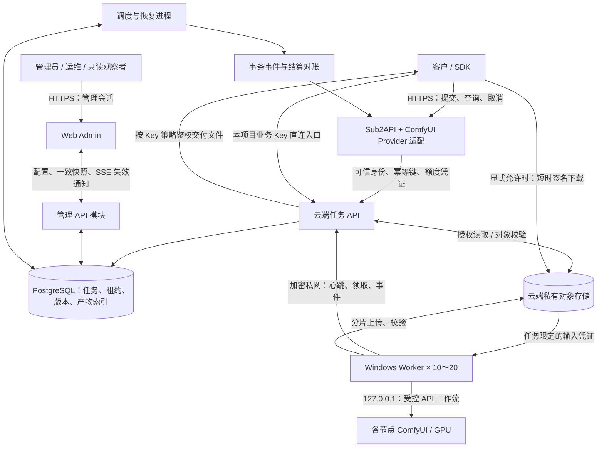

# 02 · 系统架构与任务机制

## 1. 总体架构

建议采用单云端控制服务、持久化关系数据库、云端对象存储，以及 10～20 台主动领取任务的 Windows Worker。Sub2API 保留客户接入与账户能力，通过受控的 ComfyUI Provider 适配调用任务服务。

首版同时交付中文 Web Admin。管理界面通过独立鉴权的管理 API 操作同一配置、任务和调度模型，不能另建一套只供展示的状态来源；详细设计见 [Admin 专项设计](./07-Admin可视化管理后台.md)。

首版 Admin 管理多个对外业务 Key。云端任务服务内置统一鉴权/策略模块，校验直连 Key，或验证网关服务身份与可信客户映射，再处理资源范围、配额和内容授权；详细边界见 [API Key 专项设计](./08-APIKey鉴权与访问控制.md)。



图中“Provider 适配”是本项目需要实现和联调的接入模块，不表示所查 Sub2API 已提供一个通用 ComfyUI 插件插槽。可作为固定版本的窄范围改动实现；不把 GPU 调度写进 Sub2API 核心。

任务全局排在云端数据库。Windows 仅保存自身执行日志和少量已领取任务，ComfyUI 默认不积压第二个生产任务。这样可以统一公平性、取消和离线处理，避免任务被分散在 20 台机器的隐藏队列里。

## 2. 组件责任

| 组件 | 责任 | 不应承载的内容 |
| --- | --- | --- |
| Sub2API 接入层 | 客户鉴权、客户余额/价格、模型入口、公共任务 ID 投影 | Windows 远程桌面操作、显存抢占、ComfyUI 细节 |
| 任务 API | 请求规范化、幂等、任务权威记录、资产归属、租约与事件提交 | 模型推理 |
| 统一鉴权/策略模块 | 本地 Key 校验、网关身份映射、scopes/内容过滤、Key/项目资源额度与策略版本 | 用业务 Key 登录后台、第二套客户货币账本 |
| Web Admin 与管理 API | 渠道地址/凭证、Workflow/模型、全局/渠道队列、任务操作、权限与审计 | 绕过租约直接操作 ComfyUI、第二套客户余额账本 |
| 调度器 | 公平队列、能力匹配、GPU 锁、租约、排队到期 | 将长工作流塞入自己的内存队列 |
| 恢复与对账进程 | 失联核对、上传重试、终态事件、额度释放与账单对账 | 无证据地反复重跑未知任务 |
| Windows Worker | 本机探测、素材准备、编译工作流、提交/观察 ComfyUI、上传与日志恢复 | 接受外部任意工作流或任意系统命令 |
| ComfyUI | 模型加载、节点执行、生成产物 | 多租户鉴权、客户账本、长期任务数据库 |
| 对象存储 | 输入/输出对象、校验、生命周期、授权下载 | 保存唯一任务状态 |

## 3. 组网选择与访问边界

用户提出的“VLAN 类组网”建议实现为跨互联网的加密三层 Overlay/VPN。对 ComfyUI 远程执行不需要二层广播网络；Windows 原生网络客户端即可，不需要 WSL 或本地虚拟机。

| 选项 | 适用情况 | 必须验证 |
| --- | --- | --- |
| Tailscale 类管理型 Overlay | 希望快速管理 10～20 台设备、权限与 NAT 穿透 | 实际直连还是中继、套餐与设备策略、长视频文件吞吐 |
| 原生 WireGuard 星形网络 | 有固定云服务器入口，希望自行管理密钥和路由 | 每节点独立密钥、路由/ACL、重连、云端总带宽 |

建议先用现有组网设施；尚无设施时，优先比较管理型 Overlay 的实际维护成本与 WireGuard 的自管成本。Tailscale 官方资料说明连接可能直连或经过中继，不能把“能 ping 通”当成大文件吞吐达标。[连接类型说明](https://tailscale.com/docs/reference/connection-types)。WireGuard 有原生 Windows 安装包。[官方安装说明](https://www.wireguard.com/install/)。

| 来源 → 目的 | 放行原则 |
| --- | --- |
| 客户 → 云端公共入口 | HTTPS 443，只开放客户 API 与受控下载 |
| Worker → 云端内部 API | 经私网 HTTPS，独立 Worker 凭证或 mTLS，按节点授权 |
| Worker → 云端对象存储 | HTTPS，仅允许任务签发的对象与操作 |
| Worker → 本机 ComfyUI | 默认 `127.0.0.1` 上的实际配置端口 |
| 管理浏览器 → Web Admin/管理 API | HTTPS、独立管理会话与角色授权；不透传 Windows 凭证给浏览器 |
| 运维 → Windows | 限定运维身份、指定私网设备及端口 |
| 客户 → Windows / ComfyUI | 不开放 |
| Worker → PostgreSQL / Redis | 不开放；Worker 不直接读写数据库 |
| Windows 节点之间 | 默认不互访，按确切需求开通 |

控制通信走私网，产物默认直接上传云存储的 HTTPS 端点；两者不必走同一路径。若文件也要求强制经过私网，必须单独测试 VPN 路由、云端转发与存储入口。默认采用分流路由，不把客户/办公所有互联网流量绕经云端。

## 4. 核心数据模型

| 实体 | 最少字段与不变量 |
| --- | --- |
| `jobs` | job/tenant/project/逻辑 owner_key_id、鉴权来源/凭证与准入策略版本、冻结路由、公开模型、规范请求、工作流/价格版本、状态/阶段、deadline、幂等键与请求哈希；准入未确认不可调度 |
| `attempts` | job、attempt 编号、node/GPU/channel、渠道配置版本、租约代数、租约截止、ComfyUI prompt_id、提交/开始/结束时间、错误类别；不能覆盖旧尝试 |
| `nodes` / `gpu_resources` | 节点身份、物理 GPU 唯一标识、boot_id、版本、心跳、健康、能力画像、维护状态、资源锁 |
| `channels` | 稳定渠道 ID、节点/GPU/实例、Base URL、凭证引用、desired/applied 配置版本、启停/排空、探测与逻辑删除状态；多渠道共享 GPU 资源锁 |
| `workflow_releases` | 不可变工作流与依赖摘要、参数 schema、公开能力、输出适配器、测量画像 |
| `model_artifacts` / `channel_inventories` | 模型类型/哈希/来源、各渠道模型与自定义节点清单、扫描时间和验证状态；文件同名不能代替身份校验 |
| `channel_workflow_bindings` | 渠道、发布版本、模型依赖、配置/环境摘要、批准画像、验证与启用状态；环境变化使旧验证失效 |
| `public_models` / `gateway_model_bindings` | 公开别名、能力、活动发布版本、允许渠道、规格/价格引用、Sub2API 期望/确认版本和同步结果 |
| `management_operations` / `admin_audit` | 管理身份、动作、幂等键、目标配置版本、逐渠道操作状态、Worker 回执、前后版本与脱敏结果；持久化异步管理任务 |
| `api_keys` / `api_key_credentials` | 稳定逻辑 Key、issuer、租户/默认项目、用途、状态/有效期、策略版本；可轮换凭证的不可还原摘要/展示前缀和失效时间，不保存明文 |
| `access_policies` / `content_grants` | 操作/模型/Workflow/渠道/规格范围、同租户内容共享范围、IP/额度/下载策略；配置版本和管理员授权上限 |
| `external_identity_bindings` | 可信 issuer/外部租户与 Key 引用 → 本地项目/逻辑主体；不能由客户自填或按名称自动合并 |
| `key_usage_counters` / `resource_reservations` | Key/项目/租户、账期、频率/任务/资源计数、job/幂等预留、结算或释放状态；与准入协调，重启/轮换不重置 |
| `assets` / `artifacts` / 内容索引 | tenant/project/owner_key_id、来源 job、标签、对象 key/version、字节数/SHA-256、媒体信息、生命周期与引用关系；内容目录沿用源对象授权 |
| `gateway_task_bindings` | Sub2API 公共任务 ID、内部 job_id、tenant/key、冻结模型/价格/额度凭证、准入意图与确认进度；唯一绑定 |
| `job_events` | 单调事件序号、节点事件 ID、attempt、状态变化与脱敏原因；重复事件去重 |
| `outbox_events` | 与本地业务事务同时写入的结果、退款、通知待发送事件；发送失败可恢复 |
| `usage_ledger` | job、事件类型、计量与外部结算引用；结算事件唯一约束，不存第二套客户余额 |

请求记录必须区分原始公开参数、归一化有效参数和实际输出。随机种子在接收时确定并保存；自动重试沿用同一输入和版本。相同 seed 不承诺不同 GPU、驱动和精度下逐像素一致。

数据库只存索引与元数据；图片、视频和完整预览不放入队列记录、Redis 或结构化日志。

## 5. 为什么先用数据库队列

20 个 Worker 每 5 秒心跳约 4 次/秒，控制规模并不要求先引入复杂消息平台。建议任务服务用 PostgreSQL 保存权威任务，同时以行锁、条件更新和租约完成领取；Sub2API 如需 Redis，作为其自身依赖单独使用。

`FOR UPDATE SKIP LOCKED` 可用于多个领取者跳过已锁定行，但官方也说明这种结果不是一般一致性查询；队列选择必须配合短事务和明确状态更新。[PostgreSQL SELECT 文档](https://www.postgresql.org/docs/18/sql-select.html)。

领取事务必须同时校验任务仍可执行、节点仍健康、GPU 无有效占用，再建立 attempt 和租约；不能先取任务、提交事务后再无保护地抢 GPU。数据库约束保护“一个物理 GPU 一个生成槽位”和“一个 job 一个当前有效 attempt”。公平队列选择在该事务边界外计算候选，在边界内重新校验，避免并发领取绕过配额。

通知或 Redis 可作为唤醒优化，丢失时通过扫描恢复，不构成唯一消息源。高并发或长历史查询确有瓶颈后，再基于实测增加独立 Broker，保留当前任务模型。

## 6. 任务状态与阶段

推荐内部状态集合：

```text
admission_pending → queued → leased → preparing → submitting → running → collecting → uploading → verifying → succeeded
                    ↓             ↓          ↓             ↓          ↓
                 retry_wait / reconciling / cancel_requested → failed / cancelled
queued / retry_wait → expired（超过总排队/任务预算）
```

示意图未列出每条分支；开发时应将允许转换固化为状态表，所有转换用版本条件更新。

| 状态 | 语义与退出条件 |
| --- | --- |
| `admission_pending` | 仅用于跨服务准入的内部暂存；额度/公共映射尚未全部确认，不能执行，超时安全释放 |
| `queued` | 请求和所需素材已就绪、额度处理已完成，等待匹配资源 |
| `leased` | 有唯一有效 Worker 租约；尚未占用实际模型执行 |
| `preparing` | 下载/校验素材、解析参数和环境检查；失败可分类处理 |
| `submitting` | 已持久化提交意图，准备或正在向 ComfyUI 发出请求 |
| `running` | ComfyUI 已证实接收/执行；stage 可为 loading、sampling、encoding |
| `collecting` | 推理完成，核对输出节点、文件写入结束与媒体元数据 |
| `uploading` | 输出已存在本地，上传或恢复上传；生成通常不再占用 GPU |
| `verifying` | 云端核查对象与媒体信息，并准备提交最终产物清单 |
| `reconciling` | 提交或执行结果不确定，核查原节点；不能立即换机重跑 |
| `retry_wait` | 已证实旧执行结束，且失败可重试，等待退避或新资源 |
| `cancel_requested` | 请求取消，正在确认执行停止；不立即释放 GPU |
| `succeeded` | 产物云端可交付、清单提交完成，结算事件已持久化 |
| `failed` | 确定无法完成，错误原因、历史尝试和额度处置可追踪 |
| `cancelled` | 取消已确认；结果不再发布给客户 |
| `expired` | 尚未执行的排队任务超过预算，或明确无活动执行后到期终止 |

运行中的 deadline 到达后先停止/隔离并确认，再进入 failed 或 cancelled；不能仅靠时间到达进入 expired 并释放 GPU。终态不可被迟到事件倒退修改。文件过期是 artifact 状态，不新增一个“生成过期失败”。

进度优先返回真实 stage、节点局部步数和是否可估计。采样达到 100% 仍可能编码、收集或上传；只有 succeeded 对外呈现整体 100%。无法测量整体进度时返回 null，不编造匀速百分比。

## 7. 调度规则

先过滤，后排序。硬过滤包括公开模型授权、工作流版本、节点健康/维护、模型哈希、节点包版本、资源画像、GPU 锁、主机内存与磁盘、上传积压、租户额度。

显存要求使用工作流在指定 GPU/精度/尺寸/帧数下的峰值与余量，不能仅比较此刻“空闲显存”。同一能力可发布高显存与量化档，但不得由调度器静默降低客户购买的质量规格。

排序建议使用“租户公平份额 + 等待老化 + 有界模型热驻留偏好 + 预计完工时间”。图片和视频划分资源池或保留一定可配置的图片能力，避免所有设备都被长视频占满。模型热驻留只作为优化，不能让冷模型任务无限等待。

队列压力按预计 GPU 秒数和文件回传预算评估，不只按任务个数。无任何合格节点的已发布能力应暂停准入；短时节点繁忙可排队，队列或预计等待超过限额时返回容量错误和重试建议。

Worker 拉取接口只提供自身已验证画像；是否允许执行由服务端登记数据决定，不能由 Worker 任意申报后取得高权限任务。

Admin 改动渠道/能力绑定必须进入同一硬过滤逻辑。desired 配置尚未被 Worker 应用、同步未验证或处于排空的渠道不接新任务。停止新派单不会自动取消已有任务，也不能消除未知 GPU 占用。

## 8. Worker 执行协议

1. 启动读取本地 journal，登记新 `boot_id`，核查 ComfyUI 的实际 queue/history；先恢复旧任务，再申领新任务。
2. 心跳并领取唯一租约；记录 job、attempt、fencing token、规范请求和素材哈希。
3. 通过任务限定链接下载输入，校验哈希并放入隔离任务目录；检查节点和权重仍匹配冻结版本。
4. 将参数绑定到已发布的 API-format 工作流；在发送前持久化“提交意图”和预期关联信息。
5. 向本机 `/prompt` 提交，记录 prompt_id；观察 `/ws`，以 `/queue` 和 `/history/{prompt_id}` 辅助核对。
6. 根据专用输出适配器收集最终文件；视频、自定义节点输出与图片的字段可能不同，不能硬编码只读 `outputs.images`。
7. 输出写入稳定、ComfyUI 已退出相关 GPU 计算后释放生成槽位；文件编码仍用 GPU 时继续持有 GPU 锁。
8. 在独立的上传并发预算内回传、校验、提交清单，等待云端完成回执，再进入本地清理窗口。

Worker 的上传任务仍受任务所有权和独立租约控制；释放 GPU 不等于释放 job 的结果提交权。上传积压超过磁盘预算时暂停领取新生成任务。

所查 ComfyUI 快照支持调用者提交 prompt UUID 以及按任务取消，旧版设备不一定支持。Worker 应按版本和能力探测分支实现；指定 prompt_id 仅提供关联便利，本身不等价于重复 POST 的幂等保证。[源码快照](https://github.com/Comfy-Org/ComfyUI/blob/5841c187a76ffdb565c14d9565aacbdb9a54b056/server.py)。

## 9. 幂等、租约与未知结果

### 9.1 三个层面的幂等

| 层面 | 规则 |
| --- | --- |
| 客户请求 | 同租户、同 Key/调用主体、同操作、同 Idempotency-Key 与同请求哈希返回原任务；请求不同则 409 |
| Worker/ComfyUI 提交 | Worker journal + 单 GPU 控制 + 提交意图 + prompt 关联与恢复核查；不以业务幂等替代执行核查 |
| 产物和费用 | 只允许当前有效 attempt 提交；job+结算类型唯一，重复上报返回既有结果 |

实现使用两种摘要：`request_fingerprint` 比较客户公开语义、参数是否提供、输入内容哈希/角色/顺序，排除首次自动 seed 和别名解析出的发布目标；`execution_fingerprint` 则包含冻结版本和实际 seed，用于复现执行。幂等重放先按已有映射的规范化版本比较，不因别名切换或重新抽 seed 误报冲突。不能对 multipart 随机边界或短时签名 URL 字符串求哈希。自动 seed 只在首次接收时确定，再次重试复用原值；详细事务见 [11](./11-数据字典与数据库事务.md)。

### 9.2 fencing 的实际范围

租约包含单调递增的代数。服务端拒绝旧代数的续约、状态和结果提交。租约到期只能阻止旧执行改变权威状态，不能隔空停止旧 ComfyUI 的 GPU 运算。

因此离线节点的 GPU 先标记未知占用；恢复时核对旧进程/队列。跨节点重新执行前，要么证实原执行未提交或已停止，要么由明确的灾难恢复策略隔离旧节点并接受可能重复计算的成本，且结果与费用仍只提交一次。后者不能宣传为“绝对不会重复生成”。

### 9.3 `/prompt` 已接收但响应丢失

- Worker 在 journal 保留提交意图与 attempt 标识，不直接再次 POST。
- 新版可用预定 prompt UUID 查 queue/history；旧版使用经过验证能回读的客户端关联标识和 journal 核查。
- 能找到原任务则继续观察；能证明尚未接收才允许重提。
- 历史为空、连接超时或 journal 缺少 prompt_id 都不能单独证明未执行；进入 reconciling 并暂停该 GPU 的新派单。
- ComfyUI 重启后历史丢失时，结合进程重启证据、本地输出清单和任务目录判断，不能把空 history 当成重新生成的充分条件。

## 10. 故障与取消

| 场景 | 处理 |
| --- | --- |
| 素材读取短暂失败 | 在准备预算内重试；哈希不符则拒绝，避免错误输入生成 |
| 业务参数/缺失节点/模型版本错误 | 不盲目重试；下线对应工作流或隔离该节点 |
| OOM | 释放/检查环境，隔离失败规格；只有同一购买规格存在合格资源时才换机 |
| WebSocket 断开 | 重连并轮询核查原 prompt，不自动重新提交 |
| Worker 心跳中断 | 停止新派单、租约进入核对；不立即让另一台重复执行 |
| 产物上传断开或凭证过期 | 续传/重新签发；保留原生成文件 |
| 上传完成但回执丢失 | 查询对象 key/version/hash，幂等提交清单 |
| 云端 API/调度进程重启 | 从 DB 扫描活动任务、租约与 outbox；Worker 原执行不依赖原 HTTP 连接 |
| 节点磁盘接近预算 | 停止新任务；优先完成上传，不能删除尚未确认的唯一产物 |
| 客户不再轮询 | 任务继续；后台结算与生命周期照常进行 |

取消排队任务可原子进入 cancelled。取消已提交任务时，新版优先使用已验证的按任务取消接口；旧版只能在独占实例中核对当前 prompt 后使用 interrupt。禁止盲目发全局中断或清空整个队列。确认旧计算停止前保持 GPU 隔离。

成功与取消竞态通过数据库版本决定唯一终态：成功清单先提交则取消返回已完成；取消先被接受则禁止发布迟到结果，待停止或收尾后标记 cancelled。首版不向客户收取取消成功任务的生成费。

## 11. 产物发布与通知

1. 上传到包含 tenant/job/attempt 的临时对象 key，禁止覆盖其他任务对象。
2. 验证对象字节、哈希和必要媒体信息；ETag 不保证是文件 MD5，尤其分片上传时。
3. 云端在一次数据库事务中写入最终产物引用、succeeded 与待发送结算/通知事件。
4. 对象本身与数据库没有跨系统原子事务；采用“先完整对象、后提交引用”，未被引用对象由延迟清理回收。
5. 外部结算、通知和缓存刷新按 outbox 重试，消费端按事件 ID 幂等；任务成功与账本完成分别可观测。

允许 signed_url 的客户查询时可刷新下载签名，不把即将过期的 URL 永久写作唯一结果。结果对象已到保留期时返回成果过期信息，历史任务仍显示真实生成终态。Webhook 若增加，需签名、event_id、重复投递语义、重试和目标 URL 访问限制；首版有轮询即可。

上述签名刷新仅适用于显式允许 signed_url 的 Key。默认 authenticated_proxy 返回需携带业务凭证的云端文件地址，服务端每次校验当前 Key、内容归属与下载权限后流式读取对象；不能再重定向到可绕过鉴权的存储 URL。Key 撤销阻止后续鉴权与签名刷新，但既有签名 URL 和已开始的文件流具有独立失效边界。该模式增加云端文件流量，控制服务器和网关带宽需纳入压测。

## 12. 原生部署建议

| 位置 | 建议 |
| --- | --- |
| 云服务器 | 原生 Linux 服务进程运行 HTTPS 入口、Sub2API、任务 API、调度/恢复进程；不依赖容器方案 |
| Admin | 云端原生 HTTPS 入口托管 Web 静态资源，管理 API 作为任务服务模块；同源管理会话，独立于客户 Key 与 Worker 身份 |
| 数据库 | 优先托管 PostgreSQL；自建则原生服务、独立数据目录和可恢复备份 |
| Redis | 若固定 Sub2API 版本要求，则原生云端服务或托管实例；不作为 GPU 任务唯一持久层 |
| 存储 | 云端私有 S3 兼容对象存储；可与控制服务器分离，不在本机启动对象存储容器 |
| Windows | 独立 Worker 虚拟环境/可分发程序，以原生 Windows 服务或任务计划运行；ComfyUI 维持锁定环境 |
| 本地开发 | 原生解释器/进程；需要数据库时用原生服务或开发云库，禁止 Docker/WSL/虚拟机 |

建议任务服务与 Worker 优先使用 Python 以复用 ComfyUI 生态；Sub2API 接入改动沿用其 Go 代码。Worker 依赖环境与 ComfyUI 的 Python 环境分开锁定。先做模块化服务和独立调度进程，避免过早拆为大量微服务。

控制服务器可从 4 vCPU / 8 GiB 作为预算估算起点；若同机承载 Sub2API、数据库、Redis 和监控，可先评估 8 vCPU / 16 GiB。以上不是容量承诺，最终规格由控制面压测、文件是否直传和数据库部署方式决定。

单台控制主机可用于试运营，整机故障仍会影响接入。至少要完成数据库备份恢复和配置恢复演练；有连续服务或严格 RPO/RTO 要求时，再引入第二控制节点与高可用数据库。Windows 禁止休眠、服务开机恢复、日志轮转、磁盘预算和受控升级应进入节点运维手册。

## 13. 管理配置与实时视图

渠道地址按绑定 Worker 的访问视角配置。后台写入期望版本和受控操作，Worker 从内部协议领取固定类型的探测/清单扫描/工作流同步/配置应用动作，回报实际版本与结果；管理 API 不提供任意 shell 执行。影响活动实例的配置应用先排空，Worker 确认并复测后才恢复调度，旧版本按活动任务引用保留。

全局队列和渠道视图从 jobs、当前有效 attempts、渠道/绑定与事件投影生成。待分配任务仍在中央队列，渠道“共享候选”按能力和路由规则匹配；领取成功后才产生唯一渠道归属。候选匹配包含忙碌但能力合格的资源，槽位占用另行显示；不能把多个渠道的候选数相加，或把历史重试尝试混入当前队列。

管理 API 提供一致快照和 SSE 失效通知。客户端先建立订阅再取快照，期间通知合并触发补拉，重连/缺口/5秒安全检查均重新获取；不以事件 delta 直接增减计数，也不把数据库序列分配顺序误当事务提交顺序。聚合计数与首屏列表在同一只读事务取得并声明过滤/采样时间；Worker 的 ComfyUI pending/running 是带采样时间的辅助观测，失联保留最后值并标未知。实现约束见 [11](./11-数据字典与数据库事务.md) 与 [13](./13-Admin前端开发规范.md)。

管理取消、终态重试和调序复用任务准入、状态机和计量规则；公开模型发布通过可恢复的 Sub2API 映射操作确认生效。管理事件与审计可持久恢复，前端订阅不成为唯一配置或状态来源。实时目标、页面资源预算与浏览器验收详见文档 07 和文档 05。

## 14. 业务 Key、内容归属与额度

直连请求按本地业务 Key 的逻辑身份归属；Sub2API 请求同时验证网关业务身份、可信客户声明及经批准的本地映射，原始客户 Key 不转存。两者归一化为 tenant/project/owner_key_id、策略版本和允许能力的请求上下文，不能把所有网关任务归给一个共享服务 Key。

准入在持久化 job/幂等记录时协调 Key、项目和租户的未完成任务/资源预留；发出租约时再原子检查当前生成并发上限，收紧上限不会抢占已开始任务，但会延后新启动。请求频率与新任务/资源额度分别计数，同一幂等重放仍受 HTTP 频率约束但不产生第二份任务预留。每日账期、预留与释放记录可恢复，Key 轮换只替换凭证而不改逻辑主体和计数。资源额度不作为第二份货币余额。

当前 Key 决定新调用和内容可见范围，准入冻结版本决定已接收任务的执行约束。停用/撤销默认阻止后续调用，不隐式取消已有 GPU 工作；任务租约、产物回传与后台结算继续处理。管理员显式阻止旧队列或取消时仍沿用既有状态机，未知执行不能通过改 Key 策略解除隔离。

内容目录、源对象接口、列表计数、预览/下载、删除和网关投影使用同一资源授权检查，不能只在创建任务时校验 Key。权限版本与凭证状态在授权点复核；无法读取权威策略/额度时拒绝新授权操作，Worker 按既有租约继续收尾，不开放匿名或无限额降级。

## 正式范围补充：ComfyUI 音频产物

音频同样来自 ComfyUI Workflow，进入现有受理、任务状态机、GPU/租约、Worker、产物上传与私有内容交付链路。输出媒体类型正式扩充为图片、视频、音频；音频使用独立媒体探测、时长计量和限额，共享四类身份和当前内容授权。当前候选已完成音频本地实现与协议验证，真实 Workflow/设备仍待验收；范围见 [54](./54-ComfyUI音频产物范围与开发约束.md)，冻结契约和实际证据见 [55](./55-音频契约与兼容迁移.md)。
