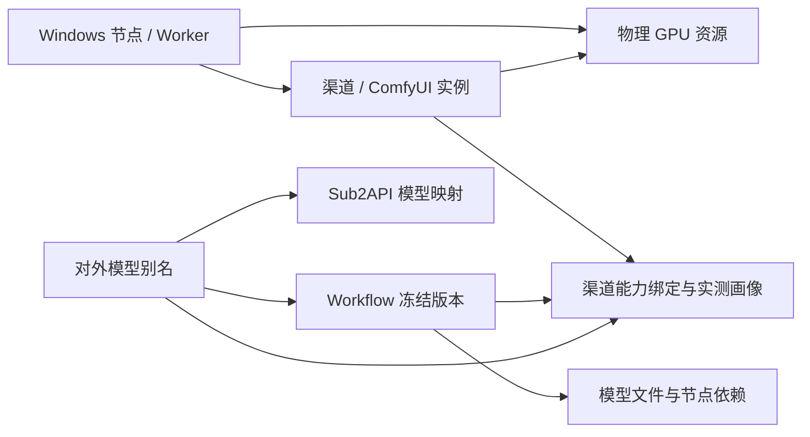

# 07 · Admin 可视化管理后台

运行统计与阶段耗时见 [58](./58-运行趋势与任务阶段耗时.md)：总览按 1 小时/24 小时/7 天窗口展示受理、终态、成功率、图片/视频/音频分布、失败分类与 P50/P95；验证任务默认不计入。任务详情显示持久记录的阶段跨度，缺失、尚未结束及未测量分别标注。统计筛选、快照、权限及只读事务不改变当前队列和 GPU 占用；本地验证不代表实机首版验收。

容量告警增量见 [44](./44-Worker容量保护与本地产物保留.md)：新增磁盘/暂存压力、可用内存不足、上传积压及容量观测不可用四类，沿用权限、筛选/分页和每 5 秒刷新；显示数值、预算与采样时间，不显示本机路径。心跳过期节点仅报告失联，不把旧数值当作当前容量；容量观测缺失也暂停新生成。

状态：开发设计基线 v0.4；2026-10-22 用户要求首版可视化 Admin，并确认加入多业务 API Key 与内容访问控制。本文定义必交付功能、交互与管理契约，前端工程规范见 [13](./13-Admin前端开发规范.md)。当前本地实现与分层验证见 [17](./17-开发记录与运行说明.md)，不能据此认定真实设备与完整首版已验收。节点图形登记、凭证与生命周期管理见 [56](./56-Windows节点登记与凭证管理.md)。

## 1. 首版交付约束

首版必须提供可登录、可实际操作的中文 Web Admin，覆盖渠道地址、Windows/ComfyUI 接入、Workflow、模型、全局队列、各渠道队列和任务处置。管理 API、配置文件和日志是配套能力，不能替代图形界面交付。

首版必须提供“API Key 管理”和“内容管理”页面。Key 用于对外生成及内容 API，由 Admin 独立管理会话设置多 Key 和各自限制；专项需求与验收映射见 [API Key 鉴权与访问控制](./08-APIKey鉴权与访问控制.md)。

后台由本项目提供，管理自身控制服务中的配置和运行状态。Sub2API 继续负责客户入口与客户账本；本后台显示公开模型在 Sub2API 的映射与同步结果，不假定 Sub2API 现有后台已能管理 Windows ComfyUI。

后台前端与管理 API 可随云端任务服务一起原生部署。首版不额外引入独立管理微服务，不使用 Docker、WSL 或虚拟机。

## 2. 管理对象与关系

| 对象 | 定义 | 关系与约束 |
| --- | --- | --- |
| Windows 节点 | 一个持有独立 Worker 身份的 Windows 主机 | 一个节点可有多个 GPU 和 ComfyUI 实例 |
| 渠道 | 本项目登记的一个 ComfyUI 执行接入实例 | 绑定节点、实际 GPU 资源、接入地址和受控认证配置；不等同于 Sub2API 的上游账户 |
| Workflow 发布版本 | API-format 工作流、参数绑定、依赖、输出适配和运行画像的冻结版本 | 可分发给多个渠道；更新形成新版本 |
| 模型文件登记 | checkpoint、UNet、VAE、文本编码器、LoRA 等依赖的身份与版本 | 用文件类型、哈希、来源和依赖关系识别；同名不代表相同权重 |
| 对外模型 | 客户在 `model` 中选择的公开别名 | 绑定一个活动 Workflow 发布版本及允许渠道集合；与底层模型文件分开管理 |
| 渠道能力绑定 | 渠道、Workflow 版本、模型依赖与硬件画像的验证结果 | 探测通过、管理员批准、配置生效且渠道健康后才可调度 |
| 业务 API Key | 对外应用/客户的独立逻辑访问主体与可轮换凭证 | 绑定租户/项目、操作与内容范围、模型/Workflow/渠道及额度；不能访问管理 API |
| 内容条目 | 任务输入素材和生成产物的统一索引 | 保存项目/创建 Key/标签和源对象关联；检索、预览、下载和删除按当前授权过滤 |

同一 GPU 上登记多个渠道仍共享 GPU 锁，不能通过增加渠道数绕过单 GPU 默认一个生成槽位。

## 3. 首版页面

| 页面 | 必须可见的信息 | 必须可执行的操作 |
| --- | --- | --- |
| 总览 | 全局待分配、退避等待、执行、回传、核对中数量；渠道在线/可调度数；等待时长、成功/失败趋势与告警 | 选择时间范围、刷新、进入异常渠道或任务 |
| 渠道管理 | 名称、地址、节点/GPU、连接/维护状态、配置版本、支持能力、心跳和各阶段任务数 | 新增、编辑、测试连接、同步能力、启用、禁用、排空、恢复、删除登记 |
| Windows 节点 | 节点名称、GPU、最近上报、活动尝试、未知占用、管理保留及渠道关联 | 登记并仅一次显示凭证、改名、空闲停用/恢复/轮换、无渠道后逻辑归档；nodes:manage 默认只授予 administrator |
| 渠道详情 | 当前与待生效配置；Workflow/模型矩阵；执行、回传与本机 ComfyUI 队列；探测和变更记录 | 调整绑定、查看同步差异、进入任务详情、执行受控维护动作 |
| Workflow 管理 | 名称、能力、版本、依赖、输入/输出、参数档位、样本、渠道分布与同步状态 | 导入、编辑草稿、创建版本、校验、同步、验证、发布、停用与回滚 |
| 模型管理 | 模型文件清单、各渠道已安装/缺失/冲突情况；公开别名与 Workflow 映射；Sub2API 同步结果 | 新增/编辑/删除模型登记、扫描清单、绑定依赖、管理公开别名与上下架 |
| 全局队列 | 全部非终态任务及分阶段计数，按租户、渠道、模型、Workflow、状态和时间检索 | 查看详情、取消、对可重试终态创建重试任务、调整有权限的待分配任务优先级 |
| 渠道队列 | 该渠道的候选待分配、已分配待执行、生成、收集/回传、核对中任务，以及本机队列映射 | 筛选渠道、查看阻塞原因、进入任务详情、排空或恢复渠道 |
| 任务详情 | 请求标识、冻结版本、阶段/真实进度、等待/执行/上传时间、尝试链、渠道/GPU、错误、产物及结算状态 | 按权限查看脱敏请求、下载产物、取消或重试、跳转相关日志 |
| 操作与告警 | 连接失败、能力缺失、同步失败、长时间排队、OOM、磁盘/上传积压、失联和结算异常 | 检索操作结果、查看原因与处理记录、按受控动作重新探测或同步 |
| 账号与审计 | 管理账号角色、会话及配置/任务操作记录 | 管理员分配角色、退出登录、检索操作前后版本 |
| API Key 管理 | 用途、前缀/指纹、项目、权限摘要、模型/Workflow/渠道、有效期/IP、额度/用量、最近访问与状态 | 创建多个 Key、配置/比较策略、停用/恢复、轮换、撤销/归档、查询调用和拒绝记录 |
| 内容管理 | 项目/创建 Key、任务/模型/Workflow、标签/时间、素材/产物状态与保留期 | 按授权筛选、查看详情/预览、下载/删除、查看关联任务与 Key，用显式共享范围授权内容系统 |

页面中的列表必须提供加载、空数据、失败、无权限和数据过期状态。地址、Workflow 版本、模型名、任务 ID 均可检索；列表分页，任务详情与渠道详情可直接跳转定位。

## 4. 渠道地址与接入配置

### 4.1 可编辑字段

| 分组 | 字段与行为 |
| --- | --- |
| 标识 | `channel_id` 稳定且不复用；名称、说明、标签、所属节点、ComfyUI 实例标识 |
| 接入 | HTTP/HTTPS Base URL、端口、必要的路径前缀、TLS 校验和请求超时；WebSocket 地址按配置派生或显式登记 |
| 认证 | ComfyUI/接入代理所需的受控认证方式和凭证引用；Worker 注册与轮换使用独立节点凭证 |
| 资源 | 实际物理 GPU 标识、允许执行的 Workflow/公开模型、已批准运行画像；默认并发受共享 GPU 锁约束 |
| 运行策略 | 启停、排空、维护、队列准入上限和上传积压阈值；影响资源预算的调整受权限与实测画像约束 |

Base URL 是从绑定 Worker 视角访问的地址，默认可为 `http://127.0.0.1:8188`。云端通过已认证 Worker 管理配置并请求探测；不能用“云端可访问/不可访问该地址”替代 Worker 的实际探测结果。地址只允许指向该节点登记的本机或授权私网 ComfyUI 实例，不能成为任意地址代理。

### 4.2 新增与修改

1. 管理员在表单新增渠道，选择已登记 Worker/GPU，填写地址和认证配置，保存为未启用草稿。
2. 后台创建异步探测操作，由绑定 Worker 检查连接、ComfyUI 接口、GPU、队列状态和能力清单；页面显示进行中、结果、采样时间与失败原因。
3. 完成 Workflow/模型绑定和验证后显式启用。新建渠道不能仅因填写了一个地址就开始接单。
4. 修改地址、凭证、节点/GPU 归属或执行依赖时生成新配置版本；有活动执行时先排空。旧任务收尾前仍能使用旧配置完成核对和产物回传。
5. 页面同时显示 `desired_config_revision` 与 `applied_config_revision`。只有 Worker 确认应用且探测通过后新版本才可调度，超时或失败保留可诊断状态。

名称、说明等展示字段可直接更新，其元数据修订与需 Worker 应用的执行配置版本分别管理。修改采用版本条件，避免两个管理员互相覆盖。凭证提交后只显示已配置、指纹与更新时间，编辑表单不回填明文；空值不能意外清除既有凭证。

### 4.3 禁用、排空与删除

- 禁用立即停止新领取，已有执行按原任务协议继续收尾；禁用不等于确认 GPU 已停止。
- 排空拒绝新任务，显示仍在执行、回传和核对中的任务，完成后进入维护；恢复前重新检查配置与能力。
- 删除采用逻辑删除，保留任务、尝试、审计和历史统计的渠道引用。有活动任务、待完成核对或有效公开模型绑定时返回冲突，并在页面列出处理入口。
- 删除登记不删除 Windows 上的模型、Workflow 文件或产物。只有解除生效绑定并完成排空后才能删除；取消任务必须单独明确操作。
- 失联渠道保持最后观测信息和未知占用提示。不能通过删除渠道、重新登记同一 GPU 来解除旧执行的隔离。

## 5. Workflow 与模型同步

### 5.1 两个方向

| 方向 | 首版行为 | 完成条件 |
| --- | --- | --- |
| 渠道 → 中央目录 | 管理员选择渠道，Worker 从预先授权的 Workflow 目录或发布清单列出 API-format 图与摘要；选择导入并比较差异 | 导入为草稿，保存来源/哈希；依赖、参数绑定和输出未验证前不发布 |
| 中央发布版本 → 渠道 | 管理员选择一个冻结版本与目标渠道，分发工作流模板、清单、参数绑定和受控输出适配配置 | Worker 确认收到的版本/哈希及暂存/应用状态；依赖、样本和画像批准作为后续独立门禁 |
| 渠道模型/节点 → 中央清单 | 扫描模型登记和自定义节点/ComfyUI 版本，与发布依赖对照 | 区分已验证、未校验、缺失、哈希冲突和版本不符，展示每渠道结果 |

不能假设所有 ComfyUI 版本都有统一的“列出全部 Workflow”接口。后台必须显示该渠道实际采用的读取来源；未配置授权目录/清单时显示未配置，并仍允许管理员通过文件导入 API-format JSON 或发布包。普通 UI-format JSON 不直接视作可执行 API 模板。

当前实现见 [41](./41-Workflow渠道拉取与草稿导入.md) 与 [42](./42-Workflow目录浏览与来源状态.md)：管理员可预先查看当前来源状态，浏览授权目录、进入子目录及逐页选择文件，核对所选摘要后预览差异并确认导入草稿。未配置、不可用或旧 Worker 状态会明确显示，UI 格式和过大文件不可选择。已通过本地原生 Windows、真实 PG/HTTP 与合成响应浏览器检查；真实 ComfyUI 文件和设备的反向同步验收仍待完成。

导入后提供参数/元数据表单、API JSON 编辑和版本差异查看。对已发布内容的编辑生成新版本，不能直接覆盖活动版本。

### 5.2 同步不是立即可执行

同步操作使用 `operation_id`，按目标渠道分别记录 pending、running、succeeded、failed、cancelled，整体可为 partial。页面展示进度、差异、缺失项、失败原因、开始/结束时间，失败可对指定渠道幂等重试。向忙碌渠道分发只能暂存，应用执行环境变更必须等待排空。

模型文件清单扫描先读取已有清单/元信息；完整哈希校验作为有并发和磁盘预算的操作。文件名相同而哈希不同必须显示冲突，不能静默覆盖或复用旧验证。依赖和环境变更会使原验证失效，对应绑定停止新派单，直至重新验证。

首版同步范围是工作流发布包、配置与依赖清单的同步和验证。模型权重的大文件下载/复制、自定义节点安装和 Python 环境升级另列实施任务；缺失时后台明确显示阻塞项。任务执行期间不自动安装插件、下载权重或执行任意脚本。

“同步成功”“依赖完整”“画像已测”“允许调度”分别展示。只有版本、依赖、实测画像、批准和渠道健康均满足条件时，能力才显示可调度。

### 5.3 公开模型与 Sub2API 映射

后台可管理公开模型名称、能力类型、Workflow 发布版本、允许渠道集合、规格和价格版本引用，支持启用、暂停、下架与回滚。底层模型文件登记的删除与公开模型下架是不同操作；被发布版本或任务引用的模型登记不能物理移除。

发布时先验证至少存在一个合格渠道，再建立可恢复的 Sub2API 模型映射操作。页面展示待同步、同步中、已生效、失败与差异。网关未确认时不将新版本显示为对外生效；保留上一有效映射或维持未发布状态。回滚同样经过映射确认，不直接改写 Sub2API 数据库。

已接收任务冻结 Workflow、依赖与价格版本；下架和别名切换影响后续准入。禁用/失联会降低旧排队任务的可调度资源，页面应显示阻塞原因、剩余合格渠道与到期规则，不能静默更换质量或依赖。

## 6. 全局与渠道队列口径

### 6.1 全局权威队列

全局任务状态与排队依据以云端数据库为准。总览与队列列表使用一致快照，显示统计口径、筛选条件、`snapshot_id` 和采样时间。非终态总数按互斥任务状态汇总；阶段、渠道、模型等维度是同一任务的投影，不能直接相加作总数。

| 展示项 | 口径 |
| --- | --- |
| 待分配 | 已准入的 queued，以及已到重试时刻且满足安全重试条件的 retry_wait；每个 job 只计一次 |
| 退避等待 | 未到重试时刻的 retry_wait，单独计数 |
| 已分配待执行 | 已有有效 attempt/渠道归属，尚未证实进入生成的任务 |
| 正在生成 | 有实际执行证据的任务；显示 loading/sampling/encoding 等可测阶段 |
| 收集/回传/验证 | collecting、uploading、verifying，不能当作 GPU 正忙 |
| 核对/取消中 | reconciling、cancel_requested，显示未知占用或等待确认的原因 |
| 准入未完成 | admission_pending，单列，不计入可执行等待队列 |
| 历史结果 | 时间范围内的 succeeded/failed/cancelled/expired；任务结果和执行尝试统计分开 |

状态与阶段交叉时以任务行的真实状态为准，汇总字段必须声明采用状态还是阶段。无法可靠估计的进度/剩余时间显示未知；等待时长可以精确显示，预计等待区间需标注估算依据和更新时间。

### 6.2 各渠道队列

渠道详情必须同时显示云端归属和 Worker 采样的 ComfyUI pending/running，按 prompt_id、attempt_id 与 job_id 关联。同一任务出现在两种视图时仍只算一次；未能关联的本机 prompt 显示为未登记执行并触发维护提示，不能自动取消。

| 展示项 | 口径与交互 |
| --- | --- |
| 候选待分配 | 该渠道在能力、版本、路由授权与健康策略上可以执行的全局待分配任务；忙碌 GPU 不因此失去能力匹配，单独显示槽位占用 |
| 已分配待执行 | 当前有效 attempt 已分配给该渠道，尚未进入实际生成；不能把共享候选当成已经下发 |
| 当前生成 | 该渠道已证实运行的任务与本机 prompt 对照、阶段及已用时间 |
| 收集与回传 | 由该渠道负责产物收尾的任务与上传积压；与生成槽位分开统计 |
| 核对/阻塞 | 失联、旧租约、环境不符、磁盘不足、待应用配置等原因与最后观测时间 |
| 本机 ComfyUI 队列 | 最近采样的 pending/running 与来源时间；采样过期显示未知，不能显示为零 |

一个待分配任务可能同时是多个渠道的候选。因此各渠道的候选数**不可相加**得到全局排队数。首版页面应显示“共享候选”标识，默认按云端候选顺序展示，不承诺固定归属或精确名次。

示例：50 个全局待分配任务同时匹配渠道 A 和 B，全局显示 50，A/B 各显示 50 个共享候选；A 领取一个后，该任务从共享候选移除并出现在 A 的已分配列表，全局待分配变为 49。

每物理 GPU 默认只有一个生成任务，ComfyUI 不预塞长队列。各渠道排队视图来自云端匹配与实际执行投影，无需为展示队列而把所有等待任务预先提交到 Windows。

## 7. 实时刷新与资源预算

- 登录后先建立 SSE 订阅，再取得一致快照；首版通知触发合并刷新，不以事件 delta 在前端累计计数。通知与快照并发时补拉，SSE 正常时也保留5秒安全检查，故障退回5秒轮询。正常联网、Worker 心跳正常时，目标是后台状态提交或 Worker 可观测变化至页面更新 P95 不超过 10 秒，分别记录采样和传输耗时。
- 每次快照/事件返回服务端时间、事件游标和数据更新时间。断线显示重连中；游标过期或发现缺口时重新拉取全量快照，不能悄悄漏掉状态转换。
- 节点/本机队列观测超过建议初值 15 秒显示过期/未知，保留最后值和时间；云端队列仍按云端快照展示，不能将失联渠道的旧值作为实时结果。
- 页面失去可见性时暂停轮询/实时订阅；离开页面或退出登录释放连接。恢复可见后重新获取快照；历史日志、事件和任务列表有长度/分页上限。
- 首版任务列表默认每页 50、最大 100 条。20 渠道/Worker、500 个未完成任务、3 个同时查看的管理会话作为初始控制面验收负载，记录 API、数据库和前端资源使用。

## 8. 任务操作、权限与审计

管理会话独立于客户 API Key 和 Worker 凭证。首版有管理员、运维/工作流维护者、只读观察者权限组合；仅管理员管理账号和凭证授权。服务端逐动作检查权限，界面隐藏按钮不能替代鉴权。Cookie 会话使用 HttpOnly/Secure 并校验防 CSRF 令牌，退出后订阅与会话失效。

Key 页面由具备 Key 管理权限的账号操作，不允许业务 Key 自助扩权。创建/轮换只显示一次新秘密值，后续列表/详情显示脱敏标识；页面显示继承和自定义额度、空授权/冲突提示以及停用影响。内容默认按创建 Key 隔离，项目共享或指定创建 Key 范围必须显式设置；标签不能决定访问权限。

内容管理使用后台角色授权，业务内容目录使用对应 Key 授权。下载策略需显示 authenticated_proxy 与 signed_url 的撤销区别；Key 停用默认不取消既有任务，界面提供单独查看关联任务并按状态机处置的入口。

取消任务沿用文档 02 的状态机和独占实例限制，页面显示“请求已接受”和“已确认取消”的区别。批量取消明确目标列表并逐项显示结果，不能清空整个 ComfyUI 队列。重试仅对允许重试的已确认终态创建关联新任务，重新校验额度与准入；原记录不可改回排队。reconciling 或旧执行未证实停止时不提供绕过核对的重试。

待分配任务的优先级调整受角色、租户公平性与幅度边界限制，已执行任务不能通过调序实现抢占。管理写入使用幂等键和配置版本条件；重复点击不能重复发布、重复同步或产生第二个重试任务。

审计至少记录管理身份、时间、目标、动作、原因、操作 ID、配置前后版本、结果和请求 ID；凭证明文不进入审计。默认不展示完整客户提示词/素材，按单独权限访问。删除、覆盖绑定、下架和批量取消在界面列出影响范围并二次确认，这是产品交互要求。

## 9. 首版验收门禁

验收详见文档 05 的 `ADMIN-TEST-01～16`，必须包含：通过浏览器完成渠道增删改与连接探测、Workflow 双向同步和模型绑定、Sub2API 映射、全局/渠道队列核对、实时断线恢复、任务处置与权限审计。不得以接口调通、静态页面或人工修改数据库代替完整验收。

多 Key 与内容页面同时必须通过 `KEY-TEST-01～12`：后台创建/配置多 Key，使用真实业务 HTTP 调用验证权限/限额/隔离，验证轮换撤销、下载与 Sub2API 映射。完整追踪见文档 08，属于同一首版交付门禁。

| 首版需求 | 对应验收 |
| --- | --- |
| ADMIN-01 登录与角色 | ADMIN-TEST-01 |
| ADMIN-02 渠道增删改 | ADMIN-TEST-02、04 |
| ADMIN-03 接入探测与配置生效 | ADMIN-TEST-03、04 |
| ADMIN-04 Workflow 版本管理 | ADMIN-TEST-05、08 |
| ADMIN-05 Workflow 同步 | ADMIN-TEST-06、07 |
| ADMIN-06 模型与公开映射 | ADMIN-TEST-07、08 |
| ADMIN-07 全局实时队列 | ADMIN-TEST-09、12 |
| ADMIN-08 各渠道队列 | ADMIN-TEST-10、11 |
| ADMIN-09 任务详情与处置 | ADMIN-TEST-13 |
| ADMIN-10 实时更新与失联提示 | ADMIN-TEST-11、12 |
| ADMIN-11 写入约束与审计 | ADMIN-TEST-01、14 |
| ADMIN-12 持久恢复与负载 | ADMIN-TEST-15、16 |

首版整体仍未完成；已实现功能与本地 PG/HTTP/浏览器验证见 [16](./16-开发任务分解与交付清单.md)、[17](./17-开发记录与运行说明.md) 和 [42](./42-Workflow目录浏览与来源状态.md)。完整告警规则、真实 Windows/Workflow 及完整跨服务业务验收继续按出口要求交付。

渠道详情的模型管理流程见 [45](./45-渠道模型清单与受控登记.md)：使用“扫描渠道资源”获取本机模型元信息，分页对照中央登记，选中文件检查哈希，再确认登记。页面必须区别目录发现、已有但未核验的登记、检查失败与来源过期；只读角色仅查看。检查是持久管理操作，可按操作编号恢复查询；隐藏页面、关闭详情和离页时停止本次轮询。

规格隔离图形流程见 [46](./46-生成失败归因与规格隔离.md)。首版新增独立页面，按状态分页、5 秒刷新并展示 GPU/发布/公开规格、失败原因和关联任务；任务详情可由有 channels:write 权限的管理账号提交受控调查编号发起隔离。恢复必须引用隔离后同规格的成功验证任务，不能以按钮确认或任意文字替代证明。业务 Key 不参与这些管理操作；只读角色没有写控件，隐藏/离页停止轮询，读取失败保留标明时间的最后成功快照。

## 队列筛选与等待时长增量

[47](./47-队列筛选与实时负载验收.md) 实现租户/项目、历史模型别名、Workflow/发布、渠道、逻辑 Key、状态及创建时间交集筛选；总览与任务页提供名称选择、显式应用、重置和分页。未领取候选与当前分配渠道使用统一口径，GPU/ComfyUI 实际总量单独说明。任务显示准入至首次分配的实际等待时长，缺失证据显示未知；旧版持久幂等回放可缺少新增元数据。

渠道分页每页 50 条；其他任务条件不隐藏零任务渠道。物理 GPU 卡片按当前渠道页去重，顶层占用卡片仍是全局实际值。渠道候选不能相加作为唯一任务数；过期 ComfyUI 观测保持未知。

## 内容管理第 48 增量约束

[48](./48-内容检索标签与受控预览.md) 将 ADMIN-14 的内容筛选、标签和主动预览落实为接口及图形页面：输入/产物分栏，租户、项目、创建 Key、冻结模型/Workflow/发布按名称分页选择；关联任务、单个标签、图片/视频、生命周期与创建时间取交集，每页最多 50 条。输入按同归属任务引用匹配且不重复，历史模型别名保留可检索。服务端状态优先级为已回收、等待回收、已到期、未验证、可用；列表快照不代替每次读取鉴权。

标签使用独立 metadata_revision、If-Match、CSRF 和稳定幂等键；旧版本冲突保留草稿，重新加载后由用户核对并再次保存。新管理权限 content:manage 仅赋给 administrator；标签不能扩大共享范围、改变素材/归属/保留期或调度状态。预览要求 content:download，输入另需 content:sensitive。只有明确点击才加载固定同源 img/video；关闭、隐藏、切页和会话失效释放播放器与 src，恢复可见重新检查会话。具体证据和剩余边界统一见文档 48。
## 等待内部重试的任务处置

第 50 增量在运行总览显示等待内部重试数，在任务列表/详情展示次数、原因和可再次分配时间，并允许按现有权限取消或调整优先级。时间到达仅表示允许重新分配，实际开始仍取决于资源和健康条件；这一状态计入未结束任务，退避期间不计入可立即领取的共享候选。内部重试保持同任务归属和原准入，不是终态“重试”按钮创建的关联新任务，规则与证据见 [50](./50-有证据内部重试与计量保全.md)。

## 租户、项目与父级配额

首版 Admin 增加“租户与项目”目录：管理员创建租户/项目，修改名称、启停和七类限制；所有既有管理角色可查看当日已用与预留、当前未结束和生成占用。只读角色没有写入口。项目所属租户与实体 ID 固定，保留历史引用，不提供物理删除或迁移归属。停用拒绝新的业务调用，已经接收的任务继续按冻结授权处理，不清零计数或释放未知 GPU。

渠道、Workflow、模型文件、公开模型、Key 和网关绑定的“所属项目”统一使用分页选择器，支持名称/完整 ID 搜索，不依赖旧会话 100 项快照。第 53 增量已将 Key 内容共享项目与创建者改为独立分页查询和各 1,000 项批量解析；包含历史主体且不依赖旧会话或当前 Key 页。解析失败/移除项目时保留旧选择并阻止保存，重开表单先按未核对处理；详见 [53](./53-Key内容授权目录与分页选择.md)。明确的父级上限、当前用量、版本冲突保留输入及重新读取见 [52](./52-租户项目与分层配额管理.md)。

## 正式范围补充：ComfyUI 音频产物

最终后台必须同级管理图片、视频和 ComfyUI Workflow 音频。音频 Workflow/模型/渠道能力、全局和渠道排队、任务详情、音频限额及内容筛选/播放/下载均须有真实操作页面。播放器离开页面时释放播放、对象 URL 和请求；桌面/手机浏览器验收纳入 AUDIO-07。当前候选已完成音频本地实现与桌面/手机图形验证，真实 Workflow/设备仍待验收；范围见 [54](./54-ComfyUI音频产物范围与开发约束.md)，配置和分层证据见 [55](./55-音频契约与兼容迁移.md)。

## 第 61 增量：审计检索与详情

Admin 的审计页现提供主体、动作、资源、请求和半开时间窗的精确交集检索，展示当前主体名、稳定 ID、前后版本和关联操作；详情只含受限安全字段，历史缺失显示未记录。批量同步按渠道记录版本，画像批准的新事件以渠道为版本资源。只授予 audit:read 的现有管理员可读取，业务 Key/观察者不能访问。具体边界和 19 组图形证据见 [61](./61-管理审计检索与详情.md)；自动清理和生产验收保持待完成。

## 第 62 增量：管理会话空闲与交互

管理会话空闲规则已转为第 62 增量实现：根组件统一识别真实交互，自动刷新和 SSE 不续期；隐藏、注销和过期清理连接与待续期请求。后台仍采用独立账号会话，业务 API Key 不能登录后台。协议与验证见 [62](./62-管理会话空闲超时与交互续期.md)。

## 第 63 增量：管理审计保留

审计页新增当前保留配置和最近已提交清理批次。缺省不自动删除；配置状态不等同于 Runner 存活，当前策略与历史批次天数分别展示。状态与列表独立读取，失败保留带时间的旧状态，隐藏/注销/离页取消；不增加浏览器直接删除入口。见 [63](./63-管理审计保留与有界清理.md)。

## 第 64 增量：渠道检索与详情直达

渠道页按名称/地址字面子串、项目、节点、状态与精确渠道 ID 取交集检索，显式应用/重置并分页。安全站内链接可直达详情，已删除登记仅显示历史。查询及图形约束见 [64](./64-渠道检索与详情直达.md)。

## 第 65 增量：渠道删除保护

删除前查询有界阻断观测，DELETE 仍在 Node/GPU/Channel 锁内检查当前任务、未关闭尝试、在途命令、已发布模型和物理 GPU 占用/管理保留。图形入口列出公开 ID 和处理入口，失败不自动重试或释放资源。冻结契约与验证边界见 [65](./65-渠道删除约束与并发保护.md)。

## 第 66 增量：管理指令核对

完成结果与未知执行分开处理，过期/旧 boot 的已完成指令只关闭旧操作并要求重验证，未知不释放占用、不重跑；Admin 显示状态并允许明确重应用当前渠道配置。事务、兼容、预算与验证边界见 [66](./66-管理指令持久结果与恢复核对.md)。

## 第 68 增量补充

任务页已支持当前页明确勾选最多 50 个任务，列出范围和固定原因后确认受理为持久操作；操作中心恢复逐项结果，区分取消意图与当前任务状态。运行/核对中的 GPU 和结果权继续由既有协议确认，不清空 ComfyUI 队列。ADMIN-TEST-13/14 的本地证据与实际资源边界见 [68](./68-任务批量取消与持久逐项结果.md)。

## 第 69 增量补充

运行告警页已增加最近 24 小时已确认 OOM/产物不合格，支持类型、级别、完整资源 ID 的明确交集筛选及任务/渠道定位。图片、视频、Workflow 音频共用固定证据；保留未知 GPU 占用，重试成功不删除窗口内原失败。查询和页面资源预算的本地验证见 [69](./69-已确认生成失败告警与定位筛选.md)，实机 OOM/产物质量仍独立验收。

## 第 70 增量补充

模型页已实现明确目录筛选、服务端搜索/分页，以及 Workflow/冻结版本/规格/渠道的按项目选择和已选项精确解析。图片、视频、Workflow 音频均使用冻结预设；音频显示格式/采样率/声道。验证样本渠道限定实际模型映射且可翻后续页；未知写入保留原请求核对。详见 [70](./70-模型目录分页与冻结规格选择.md)。

## 第 72 增量补充

Workflow 六类能力统一筛选、版本/目标渠道分页选择与原请求核对已实现。 详见 [72](./72-Workflow检索与分页同步选择.md)。

## 第 73 增量补充

新增可视化发布历史、冻结版本/草稿差异、前后值预览与原包导出。 详见 [73](./73-Workflow发布历史与版本差异.md)。

## 第 74 增量补充

第 5.1 节参数/元数据配置已加入现有草稿抽屉。提供绑定、音频规格、输出、依赖、运行画像、允许参数及 API 图；显式载入/应用/保存，未知字段和跨页数据保留。 详见 [74](./74-Workflow参数与元数据表单.md)。

## 第 75 增量补充

发布历史允许持有 workflows:write 的管理员选择同 Workflow、已校验的冻结版本，明确确认来源 ID/摘要和目标草稿 revision 后替换整个已保存草稿。六类产物共用入口；观察者无恢复按钮。恢复后继续独立编辑、冻结、验证/批准与公开模型发布。 详见 [75](./75-Workflow历史版本恢复草稿.md)。

## 第 76 增量补充

Workflow 行内支持归档/解除归档，以名称、ID、当前 revision、目标状态二次确认。归档前须下架全部引用模型并核对非终态同步。归档后保留只读草稿、发布历史与导出，禁用编辑/冻结/同步/从渠道更新/历史恢复草稿。解除归档不自动发布、同步或运行批准；已接收任务保留。 详见 [76](./76-Workflow归档与恢复管理.md)。
