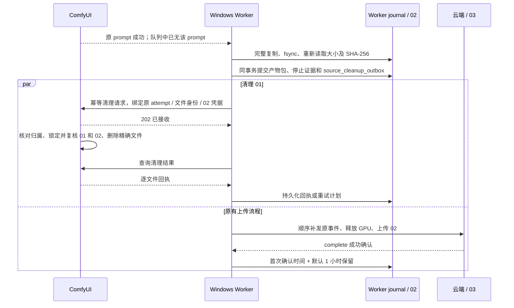

# 121 · ComfyUI 原始产物移交即清理设计

2026-10-28（Asia/Taipei）。用户要求：**01 完整移交到 02 后，立即向 ComfyUI 请求删除 01，无需等待上传到 03。** 本增量完成开发设计、边界及待开发清单；清理接口、Worker 改动和生产启用均尚未实现。当前线上仍保留 ComfyUI 原文件，不能把本文当作已开启自动删除的记录。

设计涉及 DEV-07～11、14、18～21、23、25～27、29～32；机器可读决策见 [清理策略](contracts/comfy-source-cleanup-policy.json)，现有实现依据见 [源码核对记录](evidence/2026-10-28/comfy-source-cleanup-design-121.json)。

## 1. 清理时点与副本定义

| 编号 | 所在位置 | 规则 |
| --- | --- | --- |
| 01 | Windows ComfyUI 的 output；最终适配器允许时也可能在 temp | 全部必需最终文件已复制到 02、校验并持久化恢复记录，确认执行及编码结束后，立即请求删除该任务登记的原文件 |
| 02 | 同机 Worker 的 state_root/outputs/attempt_id | 上传失败仍从这里恢复；收到云端 complete 成功确认后默认保留 1 小时，未确认不自动删除，沿用 [44](44-Worker容量保护与本地产物保留.md) |
| 03 | 云端私有对象存储 | 任务成功完成后保留 8 小时，沿用 [119](119-云端产物八小时保留.md) |
| 04 | 调用方自行下载的位置 | 由调用方管理 |

“到了 02”必须同时满足：完整数量、每个文件大小及 SHA-256 一致、flush/fsync 成功、最终副本重新读取校验通过、产物清单与删除意图在 SQLite 同一事务提交。文件刚出现、仅 HTTP 200、部分副本或仅在内存计算出摘要均不满足条件。现行发布包 expected_count=1；实现不得因此跳过完整数量检查，后续多产物也要整包校验后才能首次删除。

01 与 02 位于同一台设备，通常也在同一块盘。按此次要求，03 尚未上传成功时可以只剩 02；这会节省原文件占用，但 02 不是异机备份。上传和源清理是两个独立进度，源清理失败不能把已经交付成功的任务改为失败。

## 2. ComfyUI 接口选择

已核对固定标签 [v0.42.1 的 server.py](https://github.com/Comfy-Org/ComfyUI/blob/v0.42.1/server.py)：POST /history 删除执行记录，POST /free 设置释放内存或卸载模型标志。两者均不实现此次所需的原文件磁盘删除，不能用它们的成功响应报称释放磁盘。

同版本的 [Assets 删除路由](https://github.com/Comfy-Org/ComfyUI/blob/v0.42.1/app/assets/api/routes.py) 及 [服务实现](https://github.com/Comfy-Org/ComfyUI/blob/v0.42.1/app/assets/services/asset_management.py) 对普通素材删除记录、另行回收特定预览；不能将其作为任意生成原文件的删除保证，也不以开启 Assets 系统作为前提。

采用本项目维护、锁版本及摘要的 **ComfyUI 服务扩展**，使用官方支持的 [custom routes](https://docs.comfy.org/development/comfyui-server/comms_routes) 注册固定清理动作。它只提供文件移交后的清理，不提供执行图节点、任意脚本、目录删除或安装功能。不改官方 server.py，不从网络自动安装第三方节点。扩展、Worker 与依赖/环境批准必须一起进入原生发行和受控部署流程。

拟定协议名 comfy-source-cleanup-v1；以下路径均为设计，当前没有部署：

| 方法与路径 | 用途 |
| --- | --- |
| GET /render-control/v1/source-cleanup/capabilities | 返回固定协议、安装实例 ID、扩展版本/摘要及当前可用性，不返回磁盘路径 |
| POST /render-control/v1/source-cleanups | 幂等接收指定任务的清理意图，202 仅表示持久化接收，不表示文件已删除 |
| GET /render-control/v1/source-cleanups/{cleanup_id} | 查询整包和逐文件结果；Worker 持久化最终回执 |

删除是异步操作：请求接收后由独立且有界的磁盘作业处理，不能在 ComfyUI HTTP 主循环里同步哈希数 GiB 文件。现有业务 API、任务状态、计费、GPU 释放事件和云端 OpenAPI 不因这套内部协议新增业务权限。

## 3. 正常时序及崩溃恢复

1. 只在原 prompt 成功、从 running/pending 均消失、最终编码已结束且文件稳定后移交。保存 prompt_id、association_id、attempt_id、execution/workflow 摘要及停止证明；失联或超时不生成删除许可。
2. 修改 collect，使其除原文件清单外生成可信的源定位与文件身份；copy_output 的前缀恢复、大小限制、最终重读及 fsync 规则继续适用。
3. 增加本地 source_cleanup_outbox，与 output_packages 在同一 SQLite FULL/WAL 事务写入；磁盘提交失败不调用清理端点。删除意图不依赖云端 outputs_collected 回执、上传进度或新任务租约。
4. **先补恢复通路再允许删除。** 当前 runtime 仅 resume_state=uploading 分支直接重用 02，其他阶段仍可能重新 collect。新实现须在所有已有持久产物包的恢复分支优先验证并使用 02，即使云端尚停留在 submitted、事件回执丢失或 Worker stage 尚未改为 uploading，也不能强制依赖已删除的 01。原事件按 journal 顺序幂等补发；GPU 仍按停止证据及云端权威规则释放。
5. 在产物包提交后立即唤醒清理作业，与原事件/上传并行；云端断网不能推迟首次源清理。清理网络错误不得进入现行 run 的生成失败/未知占用异常分支，也不得重新 POST /prompt。
6. 请求响应丢失时沿用原 cleanup_id 和内容摘要查询/重放；同 ID 不同内容拒绝。ComfyUI 扩展在删除前保存逐文件意图，删除后保存回执；在两者之间崩溃时，只复核原文件身份或安全确认原路径缺失，不能重新生成。
7. Worker、ComfyUI 分别重启后都从各自本地 journal 继续。原 history 不随本功能删除，不能全局 wipe_history；这份元数据也不能成为已有 02 恢复的必需条件。

## 4. 文件归属与删除许可

| 检查 | 必须满足的条件 |
| --- | --- |
| 本地服务身份 | Worker 直连本机回环地址，固定端口和安装实例 ID；扩展检查真实连接源为 loopback，不信任转发头；生产 API 的任意源 CORS 规则不改变 |
| 专用认证 | 新建仅本机使用的清理 HMAC 密钥；不复用业务 Key、Admin 会话、Worker 云端凭证或渠道 Authorization；秘密只放受 ACL 保护的本地配置 |
| 任务绑定 | 请求绑定 node、channel、attempt、association、prompt、冻结发布摘要和整包摘要；扩展验证成功 history 的关联及最终节点，首次接收保存不可变归属记录 |
| 源目录 | 只允许固定本地 ComfyUI 根下 output/render-control/attempt_id 或 temp/render-control/attempt_id；必须证明源文件属于该 attempt。仅因为路径在 output 下不授权删除 |
| 目标 02 | 由固定 spool 根和 attempt/position/扩展名推导目标；Worker 出示已提交的产物包凭据。扩展独立打开 02、核对身份并重算大小/SHA-256，在删除期间保持不可写/不可删句柄，避免与 02 GC 竞争 |
| 精确源文件 | 复核卷/文件 ID、大小、mtime 和 SHA-256；与复制时记录不一致就保留。拒绝路径穿越、绝对/UNC/设备路径、ADS、大小写别名冲突、目录、重解析点和多硬链接 |
| 句柄与并发 | 原生 Windows 使用禁止并发写/替换的源句柄，经同一文件句柄执行删除；逐层校验/锁定父目录，不能检查完路径后对可能被替换的字符串路径 unlink。文件占用则稍后重试 |
| 来源可信 | 业务请求不能提交源路径或清理目标；内部相对定位只从本地可信 history 和发布包派生，不能接受客户端传入的清理路径 |

HMAC 对实际发送的字节签名：方法、固定路径、Unix 秒、请求 UUID、原始 body 的 SHA-256 以换行拼接；时间偏差最多 120 秒。重放时使用新的请求时间/UUID及相同业务 cleanup_id/body。扩展记录请求防重放信息，比较签名使用常量时间。请求携带有界有效期，过期不启动新删除；终态幂等记录至少保留 30 天，过期旧请求不能因记录压缩变成新删除。

请求包含 protocol、cleanup_id、installation_id、任务绑定、package_digest、manifest_digest、expires_at、Worker 的 durable_receipt，以及逐文件的 final/cache 角色、节点/字段/位置、受限相对定位、01/02 文件身份、bytes 和 sha256。cache 项绑定完整最终包的 02 凭据及独立的执行归属，不能冒充最终产物而省略整包验证。durable_receipt 证明由可信 Worker 按协议提交，不能把签名本身当成独立磁盘审计；扩展仍须复核 02 的真实内容。首次接受请求时在扩展自己的 journal 保存授权对象，后续 history 被淘汰时按该记录恢复；没有历史归属也没有既存授权时拒绝删除。

任何既有 Workflow 若未将输出写入 attempt 专属命名空间，则标记 not_supported，先通过正常草稿/冻结/验证发布流程补齐输出前缀再启用；不能扩大为全盘搜索。原生文件句柄实现和各发布 Workflow 的前缀行为必须实测，不能仅凭字面路径宣称安全。

## 5. 缓存边界

第一层必须覆盖此次请求的 **01 最终原文件**，包括图片、视频及 ComfyUI 音频；最终文件在 temp 时也按最终产物处理，先验证 02 再删。

同任务的预览、中间图片、编码临时文件可在整包移交后清理，但必须由冻结发布包登记具体缓存节点/角色，并由 ComfyUI 扩展记录该次执行产生的确切文件身份；只在该 attempt 专属 output/temp 目录内处理。中间缓存不要求逐个复制到 02，但必需最终包必须已完整持久化，且确认无编码/任务再引用。未登记或归属不明文件继续保留并报告未覆盖，不能用递归清空目录补足覆盖率。

输入参考素材、模型、LoRA、Workflow、其他用户/任务文件、全局 temp、GPU/模型常驻缓存不在删除范围；不调用全局 /free 或清空队列。仅允许尝试移除已清空的该 attempt 专属目录，目录中有未知文件就保留。旧 output 不做首次启动全盘补删；缺少 02 和完整归属证据的历史文件不进入自动删除队列。

## 6. 状态、预算和失败处理

清理状态独立于业务任务：pending → accepted → deleting → deleted；暂时故障转 retry_wait 后重试，证据冲突/不支持/预算耗尽转 blocked。多文件按项记录，已删项不重删；整包只在所有授权文件均为 deleted 或安全确认 already_absent 时结束。路径已不存在只记 already_absent，不能虚报本次释放字节；Windows 删除待关闭句柄时记录 delete_pending，不提前宣称物理磁盘已回收。

| 预算/故障 | 决策 |
| --- | --- |
| 首次触发 | 02 与 journal 同事务提交后立即唤醒，不等固定 60 秒扫描，不等上传或 complete |
| 兜底调度 | 每 15 秒扫描到期意图，每轮最多 20 条，轮转游标；独立调度预算 5 秒，不阻塞心跳/租约/上传 |
| 网络 | 仅本机固定地址，禁止重定向/环境代理；连接 2 秒、单次 HTTP 10 秒；状态轮询合并且不快于 5 秒 |
| 请求 | body ≤128 KiB；每包 ≤64 个登记文件且总量 ≤8 GiB；单文件不高于原发布限制，图片 ≤32 MiB、视频/音频 ≤2 GiB；超限保留并报错 |
| 后台作业 | 每个 ComfyUI 同时 1 个磁盘清理作业；有界队列 128；1 MiB 分块，单文件 300 秒、整包 600 秒上限；超时退出本次操作并关闭句柄，不留下不可取消的后台线程 |
| journal | Worker 意图和扩展记录各有 10000 条活动上限/256 MiB 预算；达到预算停止接受新源清理并告警，不能丢弃未决记录；完成记录按期限有界压缩 |
| 文件占用/ComfyUI 重启/网络失败 | 10、60、300、1800 秒退避，之后上限 1800 秒，加 ±20% 抖动；最多 24 次失败或 24 小时，先到即 blocked，记录下一次时间和固定原因 |
| 02 缺失或哈希错误 | 禁止发出新的删除请求；扩展也拒绝执行。进入 blocked，保留现存 01，不自动重算或删除坏副本 |
| 02 已按一小时规则清理 | 不延长 02 保留来等待源清理；可查询已有清理结果，但不再启动新的磁盘删除。源清理中持有的 02 句柄会让本轮 02 GC 安全重试 |
| 协议未安装/版本不匹配/密钥错误 | 保留 01，标明 not_supported 或 authentication_failed；不能回退到 shell 删除或全目录清空 |
| 删除失败但 03 已成功 | 业务保持成功，继续独立清理/告警；不回滚发布、重新结算或占住 GPU |

各预算为开发默认值，真实大视频/音频的哈希耗时与磁盘竞争待校准。时钟回拨不能绕过退避/有效期；运行内超时用单调时钟，重启后重新验证时间和所有删除条件。blocked 的人工重试也必须重新校验 02 与原归属，不能用“强制清理”绕过保护。

## 7. Admin 展示与开发清单

后续 Admin 在任务详情显示源清理状态、逻辑已删字节、未覆盖缓存数、最近回执/原因及下次重试；渠道/节点页汇总待清理条数、积压逻辑字节和最老等待时间。未收到回执显示 unknown，不能仅因发出请求就显示已清空。普通业务 API 不暴露本地路径、prompt 图、文件身份或密钥；Admin 展示沿用既有青柠组件及独立权限，具体 DTO/事件迁移在实现增量同步冻结。

| 编号 | 待开发项 | 完成条件 |
| --- | --- | --- |
| SRC-01 | collect 扩展源/目标身份与停止证据；save_outputs + source_cleanup_outbox 原子持久化 | 提交失败不请求删除；完整 02 可脱离 01 重启恢复 |
| SRC-02 | 补齐所有事件边界的 02 优先恢复和顺序补报 | 云端尚未 outputs_collected、已删 01、进程重启仍只上传同一份 02 |
| SRC-03 | ComfyUI 固定扩展、认证、授权 journal 和原生句柄删除 | 只删除匹配任务/内容/身份的精确文件，接口超时/进程故障可恢复 |
| SRC-04 | Worker 独立清理调度、幂等轮询/退避、积压预算 | 不影响生成上传/租约，未确认 02 不清理，重试有界 |
| SRC-05 | 图片/视频/音频的命名空间及缓存文件登记 | 当前 7 个发布 Workflow 逐个实测；不合规发布版本不默许清理 |
| SRC-06 | Admin 安全状态、渠道汇总和告警 | unknown/failed/blocked 可见；四身份隔离；沿用青柠并补真实媒体 |
| SRC-07 | 原生文件系统/恢复/并发故障与真实设备验证 | 通过下述验收矩阵，逐层保留实际证据 |
| SRC-08 | 固定版本发行、排空升级、回退与启用 | 先观察后开启；回退后 02 可恢复、历史文件不补删 |

这些是本次新增清理需求的 8 个开发子项，关联 DATA-08；全部待开发，不借用现有 DATA-08 的 implemented 状态宣称已实现，也不静默改写历史 69 项待办的统计。

## 8. 必须通过的验收

| 编号 | 场景 | 断言 |
| --- | --- | --- |
| SC-01 | 图片、视频、音频各一次正常移交 | 02/journal 完整后首次清理，01 实际消失，02 hash 不变；再上传并真实下载核验 |
| SC-02 | 复制一半、fsync 或 journal commit 失败；数量不足 | 01 不删，不产生可执行的清理许可 |
| SC-03 | 提交产物包后、事件前、GPU 回执前、stage 更新前分别重启；01 已删 | 从 02 恢复；无新增 prompt、重复发布、计量或错误释放 GPU |
| SC-04 | 删除前/后、回执前/后分别崩溃，重复请求与多项部分完成 | 幂等恢复；same ID 不同 body 拒绝，丢回执不误删新文件 |
| SC-05 | 同名覆盖、源变动、目标损坏、硬链接、junction、路径替换/穿越 | 保留目标；外部与其他任务文件逐字节不变；原生 Windows 证据 |
| SC-06 | 02 GC 与源清理并发，云端延迟/断网及 02 已到期删除 | 有效句柄保护；02 不在时拒绝新删除；断云仍能从已持久 02 触发首次清理 |
| SC-07 | 超时、磁盘满、文件占用、时钟回拨、扩展未安装、错误凭证 | 受控状态及有界重试；业务/上传和 GPU 隔离规则不改变 |
| SC-08 | 假造任务归属、外网调用、转发头、跨渠道/Key/身份调用 | 无删除；不能滥用平台任意源 CORS 或云端 Worker 身份 |
| SC-09 | 未登记缓存、别的 attempt、历史文件、仍在执行/编码 | 不删除；仅登记且无引用的本任务缓存可清理，无全局模型卸载 |
| SC-10 | 大文件/满队列/20 协议节点压力、滚动升级与回退 | 预算真实生效，心跳与上传不被饥饿；协议测试与真实 GPU 结果分开 |

本轮仅完成源码/上游接口核对和文档静态校验，不执行 SC-01～SC-10，不连接生产实施删除，不修改线上清理行为。实现时必须先通过 SRC-01/02 的恢复故障注入，再允许任何真实源文件删除；不能以文档门禁通过替代文件安全或真实设备验收。
