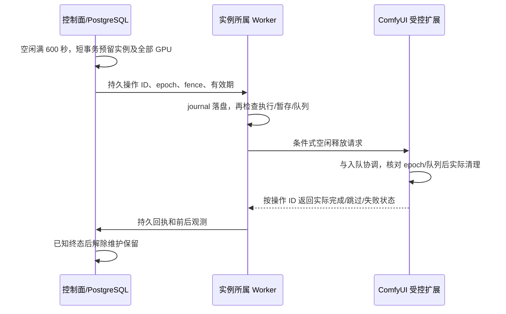

# 123 · 空闲资源释放与多设备模型池调度设计

2026-10-28（Asia/Taipei）。本次检查任务后显存/RAM 释放和同 Workflow 多设备调度，并完成开发设计。**目前没有平台级“空闲 10 分钟自动卸载”；已有单模型多渠道路由结构，但线上 10 个发布别名均为单渠道，现有抢领调度不保证设备分配数量均匀。**

本文、[机器决策](contracts/comfy-idle-and-pool-policy.json)及[只读核对记录](evidence/2026-10-28/runtime-idle-and-pool-audit-123.json)属于审计和设计，不代表自动释放、统一模型池或新管理页面已实现/部署。应用来源为 77b18fc；本轮没有提交生成任务、调用 /free、修改线上模型绑定或重启设备。涉及 DEV-07～11、14、17、20～23、25～32。

## 1. 当前实现与线上配置

| 编号 | 检查项 | 当前结论 | 依据及边界 |
| --- | --- | --- | --- |
| C01 | 成功任务释放调度槽位 | 已实现 | Worker 确认计算/编码停止、收集产物并保存 journal 后发送 gpu_released，随后上传；这不是模型卸载 |
| C02 | 空闲 600 秒卸载模型/缓存 | 未实现 | Worker 配置和运行循环没有此策略；源码检索中的 idle 参数仅属于 Admin 会话 |
| C03 | 任务结束关闭 HTTP 客户端 | 已实现 | 释放连接；不等于释放远端 ComfyUI 的 CUDA、模型或节点缓存 |
| C04 | 单一公开模型绑定多个渠道 | 已实现 | ModelCreate/ModelPatch.channel_ids 可有多项；每个别名仍只对应一个冻结 release_id |
| C05 | 多 Worker 领取及 GPU 互斥 | 已实现 | PostgreSQL 调度事务、GPU 占用、fencing、配置和运行批准检查；先到的合格 Worker 可取得任务 |
| C06 | 每台设备严格轮流/等量分配 | 未实现 | tenant-service-aging-v1 处理租户服务公平与等待老化，不是设备轮询；轮询快、完成快的 Worker 可能获得更多任务 |
| C07 | 已发布多设备统一别名 | 当前没有 | 本次 Admin 只读快照：3 渠道、10 发布别名，全部 channel_count=1，多渠道别名为 0 |
| C08 | 图内显式释放节点 | 未发现命名匹配 | 10 份发布图的节点名未匹配 free/unload/empty-cache/clear-cache；没有审计各自定义节点内部代码，不能推断其内部从不回收 |

源码依据：[任务结束和上传](../app/apps/windows_worker/src/windows_worker/runtime.py)、[Worker 配置](../app/apps/windows_worker/src/windows_worker/configuration.py)、[公开模型契约](../app/packages/contracts/src/generation_contracts/catalog.py)、[模型发布与逐渠道批准](../app/packages/infrastructure/src/generation_infrastructure/admin_catalog.py)、[领取事务](../app/packages/infrastructure/src/generation_infrastructure/leases.py)、[候选过滤及租户公平](../app/packages/infrastructure/src/generation_infrastructure/dispatch.py)。文件摘要保存在核对记录中。

2026-10-28 05:47（UTC+8）直接读取各设备 /system_stats 和 /queue 的一次快照如下。它不代表持续监测，也没有触发回收：

| 设备 | 自报 ComfyUI 版本 | 运行/等待任务 | API 自报可用显存 GiB | API 自报系统可用 RAM GiB | 已发布别名数 |
| --- | --- | --- | --- | --- | --- |
| RTX 3080 | 0.42.1 | 0 / 0 | 5.55 | 35.31 | 4 |
| RTX 4090 | 0.42.1 | 0 / 0 | 39.92 | 55.88 | 3 |
| RTX 5070 | 0.33.1 | 0 / 0 | 0.46 | 1.97 | 3 |

5070 的空队列与较低可用内存值得后续观察；这些是整个设备/系统的指标，不能据此将占用全部归因于 ComfyUI、断言泄漏或承诺卸载可释放上述全部差额。纯 HTTP Worker 在 Linux 上运行，其进程内存不能冒充 5070 的 ComfyUI 进程 RSS。没有通过 Windows-MCP 或主机文件核验推导这些结果。

## 2. 释放什么、以什么范围计时

建议启用后的默认目标为：**同一个 ComfyUI 实例连续空闲 600 秒，卸载可卸载的模型，清理执行缓存和可回收的 CPU/GPU 缓存；下一个生成任务到来时自动重新加载。** 图像、视频及 Workflow 音频共用该规则。

范围必须是 **ComfyUI 实例/进程**，不能给每个 Workflow 各设一个互不知情的定时器。A 已结束但同实例的 B 正在生成、准备输入或编码时，不能卸载。多个渠道、不同 URL 别名或多个 Worker 指向同一实例时合并为同一资源组；同进程服务多张 GPU 时，对所有相关槽位一起互斥。实例标识须由受控注册和运行启动标识确认，不能仅靠 URL 字符串猜测；同一物理 GPU 被重复登记也不能增加可用容量。

| 类型 | 处理目标 | 明确边界 |
| --- | --- | --- |
| 模型占用的显存 | 卸载当前可卸载的模型 | 会增加下一次冷启动时间；不是删除磁盘模型文件 |
| 执行图/节点缓存与无引用 CPU 对象 | 重置可清理的执行缓存并触发回收 | 不能保证第三方节点的全局引用、其他进程占用被释放 |
| GPU 分配器空闲缓存 | 请求归还可回收缓存 | CUDA 上下文、驱动和仍有引用的张量可能保留 |
| Python/ComfyUI 服务 | 维持运行，等待新任务 | 默认不杀进程、不重启、不强制压缩 Windows 工作集 |
| 01/02/03 文件和 history | 不属于本功能 | 01 原件清理见 [121](121-ComfyUI原始产物移交即清理设计.md)，02 暂存和 03 八小时保留各自管理 |

内存回收结果可为 completed 或 partial，不能把 HTTP 成功或 GPU 锁释放写成“内存已清零”。没有可测下降也不自动反复卸载或重启；记录不可归因/无明显变化，交由后续诊断。

## 3. 600 秒如何计算

1. 一次生成获得实例资源前推进 activity_epoch，停止旧空闲计时；准备、提交、执行、编码、取消核对和未知执行均视为活动。
2. 成功任务须确认计算/编码停止，完整产物已复制到 02、完成校验/fsync 并提交可恢复记录，且控制面确认生成槽位释放后，才能记录 idle_since。失败或取消任务也须先确认停止；未知结果不能开启空闲计时。
3. 上传 02→03 可继续进行，只要上传完全读取独立文件且不依赖 ComfyUI 内存。暂存不完整或仍依赖 GPU 编码时继续保留资源。
4. 同实例的新生成活动使计时重新开始；心跳、/models、/capabilities、状态查询、内容下载及 Admin 看板访问不重置计时。模型池中分配到其他设备的任务不重置本实例计时；尚未分配且本实例可接的排队任务暂时阻止回收，分配到其他实例后再判断。
5. 默认 600 秒、扫描周期 15 秒，因此目标是在满足全部条件后的 600～615 秒内尝试，不承诺第 600 秒准时完成。每个 idle epoch 最多一次成功回收；无新活动不每隔十分钟重复清理。
6. idle_since/epoch 使用控制面持久事实及服务端时间。首次登记没有历史活动时，完成全部恢复/状态核对后建立起点，不追认之前已空闲。重启后先恢复 journal、核对占用和实例状态，再续接合法空闲周期；证据不完整时重新建立计时，不能用本地时钟回拨绕过门槛。

这些是待实现的策略默认值，不是当前 WorkerSettings 可使用的配置项。

## 4. 安全释放时序与接口选择

本次核对固定上游 v0.42.1 提交 63be2f9b82ad0dac88a7ceaa28a9cf3154125a18。[/free 的实现](https://github.com/Comfy-Org/ComfyUI/blob/63be2f9b82ad0dac88a7ceaa28a9cf3154125a18/server.py#L1288)只设置标志并返回 200；[后台循环](https://github.com/Comfy-Org/ComfyUI/blob/63be2f9b82ad0dac88a7ceaa28a9cf3154125a18/main.py#L405)之后执行卸载、执行缓存重置与垃圾回收。[模型管理实现](https://github.com/Comfy-Org/ComfyUI/blob/63be2f9b82ad0dac88a7ceaa28a9cf3154125a18/comfy/model_management.py#L2161)也表明卸载作用于多个设备。上游释放意图对应 unload_models=true、free_memory=true；仅将模型挪回 CPU 不等于回收 RAM。

3080/4090 的自报版本与该标签一致，但本轮没有核验安装源文件字节；5070 为另一版本，释放行为尚需分别验证。ComfyUI 自身可能因内存压力或节点逻辑进行回收，这不构成平台已实现 600 秒策略的证据。

不能简单执行“GET /queue 为空 → POST /free → 立即放开领取”：队列检查后可能进入新请求，而且异步标志可能稍后才被消费。对于允许直接访问的共享 ComfyUI，平台数据库锁也无法锁住外部提交。

推荐用受控的 ComfyUI 空闲释放扩展提供 **按 operation_id 幂等请求、实际执行回执和状态查询**。该扩展及其能力发现均待开发，不是现有接口。最小消息包含 instance_id、runtime_boot_id、operation_id、activity_epoch、maintenance_fence、expires_at 和固定释放动作；不能接受任意 Python/shell 或客户指定内存地址。扩展须与全部入队/开始执行路径共用实例级协调机制，在真正执行释放前原子重查活动代数和队列，不只是再包一层 /free HTTP 调用。

| 编号 | 必须满足的保护 | 处理方式 |
| --- | --- | --- |
| G01 | PostgreSQL 中没有生成占用、准备任务、旧启动未知执行或其他管理操作 | 用现有调度互斥协调，按固定顺序锁实例及关联 GPU；新建实例级维护保留，不能只保留一个渠道 |
| G02 | 配置/心跳/实例启动标识新鲜一致，Worker journal 无未知提交 | 不可达、过期、冲突均跳过；超时不证明 GPU 已空闲 |
| G03 | 无本实例可接的未分配任务，ComfyUI running/pending 均为空 | 数据库及 Worker 再检查；扩展在实际动作处处理与直接入队的竞争 |
| G04 | 产物完整独立于执行缓存，且回收不影响其他实例/业务 | 有应收集产物时核对 02 持久包、编码停止及共享实例范围；复制中不释放；确认失败/取消且无应交付产物时不要求虚构 02 |
| G05 | 真正释放之前到达新任务 | 取消/跳过此次操作并推进活动代数，优先生成；扩展拒绝旧 epoch |
| G06 | 释放已经开始才到达新任务 | 本实例先短暂排队，完成确认后加载；其他合格池成员可接新任务，不中断正在进行的清理 |
| G07 | HTTP 回包或完成回执丢失、Worker 崩溃 | 保留维护状态，按同一 operation_id 查询恢复；不盲目重发 /free，不仅凭 TTL 或显存下降解除保留 |
| G08 | 清理过期、实例重启或旧 Worker 迟到 | 过期操作须由执行端拒绝/报告终态，fence 拒绝旧控制写；启动变化先核对旧占用，不自动清空未知状态 |

数据库锁只保护短事务，不跨 HTTP、卸载或采样持有。执行端必须在实际动作开始前检查有效期；晚到的标志不能在维护保留解除后影响新任务。无法取得可信终态时保持 unknown 并提示人工核对，不能为了可用性伪造完成。共享实例的全部相关 GPU、维护保留和领取之间的并发/死锁顺序须一起验证。

没有条件执行/完成回执能力的普通 ComfyUI 先进入 **observe_only**：可以显示“空闲满 10 分钟”，不自动发出释放。5070 当前只有普通 API，不能因此声称已具备安全自动释放能力；后续经用户正常部署扩展后再启用。纯 HTTP 架构能够调用扩展，不要求引入 Windows-MCP；若未来提供不带扩展的专用实例兼容模式，须单独解决排他入口及异步完成确认，不能借本设计默认放行。

## 5. 参数、可观测性与管理界面

| 设计项 | 建议默认值/规则 |
| --- | --- |
| 首次部署开关 | 默认关闭；能力、全部路径协调和设备实测通过后按实例启用 |
| idle_timeout_seconds | 600；未来 Admin 可设 60～86400，按 revision 更新 |
| 扫描及观测新鲜度 | 15 秒扫描；心跳不超过 15 秒；操作前队列样本不超过 5 秒，最终以执行端原子检查为准 |
| 请求/观测预算 | 连接 3 秒，请求 10 秒；完成观测预算 60 秒；超出转 unknown，保留维护状态 |
| 确认未执行后的重试 | 30 / 120 / 600 秒，最多 3 次；未知结果先查询，不能生成新操作反复卸载 |
| 内存观测 | 记录设备/API、实例启动、采样时间和前后可用显存/系统 RAM；进程 RSS 仅在有可信主机观测时提供 |
| 返回状态 | idle_candidate、reserved、requested、running、completed、partial、skipped、retry_wait、unknown、blocked；独立于业务 job 终态 |
| 审计 | 一次操作及其状态转换有界记录；跳过轮询不刷日志；不含提示词、图内容、凭证或主机路径 |

未来 Admin 的渠道/节点详情展示实例归组、启用/禁用、600 秒策略、最近生成时间、维护状态、回收前后观测和最近原因；模型详情展示设备池、各设备生成/排队/维护状态和实际分配统计。继续使用青柠组件。安全手动释放也经过相同条件检查与管理授权，不提供绕过未知占用的“强制”按钮。

管理会话负责配置和手动动作，Worker 身份仅能操作已分配实例；业务 API Key 不得调用释放或管理接口。角色权限、DTO、能力声明、事件和数据库迁移在实现增量共同冻结；本轮不添加可调用管理路由或前端入口。

## 6. 当前如何组成一个多设备模型

当前数据结构为 `公开别名 → 一个冻结 release_id → 多个 channel_ids → 各自的 GPU/Worker`。任务准入冻结 release、执行参数和合格渠道范围；领取再核对当前 Key、配额、配置、依赖批准和物理 GPU 占用。Key 只允许某个渠道时，实际可用池也只有该渠道；后来给模型增加渠道不会追溯扩大旧任务的冻结路由。

已有结构可按以下方式配置真正相同的 Workflow：

1. 准备同一个不可变 Workflow 发布版本，包含目标设备对应的资源画像；两台设备都实际具备相同调用链、模型依赖和公开参数/产物语义。
2. 分别绑定并同步到各渠道，分别运行真实验证，取得该 GPU 的运行批准；批准不是只看冻结 manifest 中的 approved 占位值。
3. 在 Admin 的模型映射中将两个渠道加入同一个公开别名。修改 release/channel/defaults 会自动下架，所有绑定和批准满足后再发布。
4. 给业务 Key 允许这个别名、release 和所需渠道，客户端始终提交同一个 model。平台择取可用设备，客户端不用决定机器地址。
5. 用连续及并发业务请求记录实际 attempt 的目标 GPU、执行/排队时间和结果，再签收多设备池；本次没有执行这项配置或验证。

现有 4090/5070 的 H3 文生视频、首帧视频、双参考视频虽然名称类似，但三对发布的 workflow_api 摘要均不同，release、依赖和输出设置也不同。不能仅去掉显卡名称就合并。应先构建两机都能运行的共同 release 并分别批准；若必须保留不同量化、图或质量档位，则另行设计显式变体路由，冻结业务语义，不能在当前单 release 模型中暗中替换。

## 7. 对“均匀调度”的补全设计

当前抢领策略已经能让空闲的合格 Worker 承接共享别名任务，并排除正在生成的 GPU；它更接近谁准备好谁领取。**这项能力与“两个设备各分到一半”不同。** 当前 [51 · 租户公平](51-租户公平调度与等待老化.md)继续用于先选哪个租户/任务；设备公平是选完任务后的第二层，不能改成简单全局 FIFO 破坏现有公平。

建议新增可配置的 **balanced_ready** 设备选择策略，默认各物理 GPU 权重 1。同一模型、同一池版本维护持久的分配服务量、待接受预留量和轮转序号，在当前任务的合格、空闲设备中，选归一化分配量最少者，平局按轮转顺序。默认服务单位为一次领取成功的生成分配；不同性能设备可另设权重，或在校准后启用估算 GPU 时间模式。失败次数、成功完成次数及占用时长另外统计，不能把它们混成分配计数。

| 约束 | 设计要求 |
| --- | --- |
| 候选集 | 冻结渠道 ∩ 当前授权 ∩ 新鲜健康 ∩ 未排空 ∩ 对应 release/规格批准 ∩ 容量可接 ∩ 无 GPU 占用/实例维护；OOM 和规格隔离继续生效 |
| 去重 | 同一物理 GPU 的多个渠道只算一个设备；实例释放期间全部相关成员不可生成 |
| 均匀含义 | 同权重、持续同等可用且任务可比时，成功分配数量接近轮流；忙、离线或 Key 不可访问的设备不强等份，不为了等它们让其他卡空转 |
| 领取协议 | 不能仅对当前来请求的 Worker 本地排序；须增加控制面的全池目标预留/offer，让选中的 Worker 领取，或采用等价的全局裁决 |
| 预留预算 | 建议 offer 有效期 5 秒、每物理 GPU 最多一个未接受 offer；过期/拒绝只回收未执行预留，不重试已经提交的生成 |
| 原子性 | 建立 offer 时暂计 reserved_share，接受为 attempt 时原子转为 assigned_share、GPU 占用和现有配额；重复领取不重复计数，过期只撤回预留 |
| 重启与加入 | 持久计数与池版本；新增/重新加入成员从当前公平基线开始，不因历史计数为零长期追赶；普通重启不清零公平历史 |
| 高负载 | 同等候选按份额；异构设备推荐显式权重，完成数量不会必然相等。等待时长、失败率和利用率一并观察，不能只看次数 |
| 与冷缓存配合 | 缓存热度只能作为有界次要优化，不能长期把任务全给某台热卡；已释放设备下一次被选中时正常加载 |
| 回退 | 第一个实现增量保留当前策略为默认；按模型、按池版本灰度启用新策略，撤销策略不改已有 attempt 或未知占用 |

推荐后续部署顺序：先登记/核实共同 release 和实例归组，再上线带回执的资源释放与全局目标预留，最后分别启用 600 秒释放和 balanced_ready。两项可以独立灰度；“已有多渠道结构”不能代替这两项新功能验收。

## 8. 待开发与验收约束

| 编号 | 待开发项 | 退出条件 |
| --- | --- | --- |
| R01 | 实例身份、共享渠道/多 GPU 归组 | URL 别名、重复登记和多 Worker 均正确去重，不能跨实例误释放 |
| R02 | 持久活动代数、空闲时间和操作记录 | 600 秒边界、重启及不可靠时间都可恢复；仅生成活动重置 |
| R03 | 实例级维护保留及调度锁协调 | 所有关联 GPU 互斥，准备/领取/卸载无竞争，不跨 HTTP 持锁 |
| R04 | ComfyUI 条件式扩展和完成回执 | 实际动作前原子检查，覆盖直接入队、幂等、过期和启动标识 |
| R05 | Worker journal、恢复与有界重试 | 回包丢失、崩溃、晚到动作保持可核对；unknown 不自动解锁 |
| R06 | 内存观测、partial 归因和 Admin | 标注系统/API与进程指标边界；权限、审计、青柠展示及停用流程完成 |
| R07 | 同 Workflow 共同发布与逐卡批准 | 至少两台真实 GPU 的同一 release 及业务交付验证，Key 范围正确 |
| R08 | 模型池全局预留及公平持久化 | 一份任务只创建一个有效 attempt，同 GPU 不超占，过期 offer 可恢复 |
| R09 | 设备策略与容量/故障回退 | 等权/权重、离线/排空/维护/OOM、多模型共享 GPU 和新成员公平通过 |
| R10 | 协议/迁移/文档与分层实测 | 同步契约、客户端、OpenAPI、安装包、截图/录屏及真实恢复；默认关闭、分实例/模型灰度 |

R01～R10 均待开发/配置/验收，不借用既有需求的 implemented 状态抬高完成率；不改写历史全量待办的统计。

| 验收编号 | 必须覆盖的场景 |
| --- | --- |
| T01 | 599 秒不释放，满足条件后 600～615 秒只发起一次；再次活动重置，查询/下载不重置 |
| T02 | A 完成但 B 准备/运行/编码/排队时不能释放；不同别名同实例和多 GPU 情况一致 |
| T03 | GPU 已释放但 02 不完整、计算停止未知、取消核对未完、旧 boot 占用时阻止回收 |
| T04 | 同时领取与清理、直接 ComfyUI 入队与清理，分别覆盖动作前/后的竞争，不能影响在执行的任务 |
| T05 | /free 风格异步接收不被当成完成；延迟执行、旧 epoch/fence、过期操作不能伤到新任务 |
| T06 | 回包丢失、Worker/控制面/ComfyUI 重启、完成回执丢失；保持同一操作及未知占用，不盲目重发 |
| T07 | 仅普通 API 或共享路径未覆盖时 observe_only；禁用后不新建操作，已开始操作须核对至已知终态 |
| T08 | 图片、视频/音频编码和大文件暂存/上传的实际时序；释放后下一次生成/下载完整可用 |
| T09 | 自定义节点保留内存、CUDA 上下文及无明显下降，正确报告 partial/不可归因；不删文件/history、不自动重启 |
| T10 | 相同 release 至少双设备实际验证与统一别名调用；不同图/质量未批准时拒绝合并 |
| T11 | 等权、同等候选、持续就绪的受控 100 次成功分配，三设备最大计数差不超过 1；声明受控条件，不要求异构实际完成数相等 |
| T12 | 权重、故障/排空、Key 单渠道限制、同 GPU 多渠道、冷缓存及清理中成员；不饥饿、不扩大旧任务路由 |
| T13 | 多 API/Worker 并发、预留过期/拒绝、重复请求、事务回滚及重启；公平/配额唯一计量，未知提交不换机重跑 |
| T14 | 原生 PostgreSQL 迁移/恢复、独立身份及权限、预算/脱敏、Admin 浏览器资源关闭、真实设备回收前后与冷启动观测 |

本轮只执行源码核对、线上目录/队列/系统只读快照和文档门禁；T01～T14 均未执行，不复用既往组件测试作为自动释放或多设备均衡实测。
