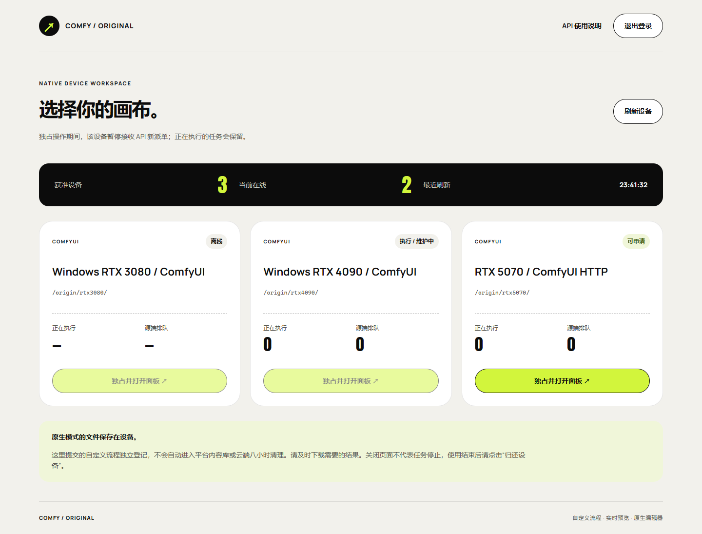
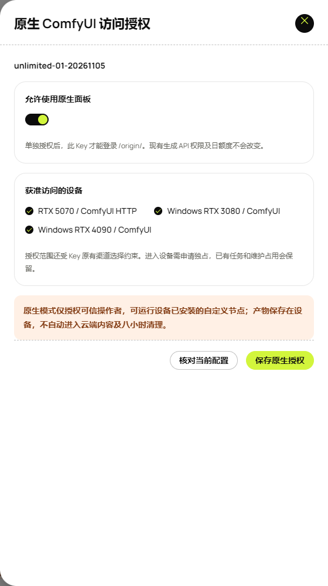

# 146 · 原生 ComfyUI 面板访问与独占操作

2026-11-15，Asia/Taipei。用户已授权本增量完整开发、验证和上线。公网沿用 HTTP 39443，域名与反代由用户管理。本增量是原生设备工作台，不代表其余候选 Workflow、Sub2API 或全项目验收完成。实际安装和验收结果见文末证据。

## 入口与身份

`/origin/` 提供青柠登录及设备选择；`/orgin`、`/orgin/` 兼容跳转，`/list` 跳转 `/origin/list`。API Key 通过 POST 换取独立短期 HttpOnly 会话，不进入 URL、不写浏览器持久存储、不转发源站。每次 HTTP/WS 重新检查原凭证、Key、租户、项目和独立原生权限；撤销及权限收紧对新请求立即生效，长连接定期复核。已有业务 Key 不自动获得原生权限。

Admin 的 Key 页面增加原生访问配置：启停、同项目渠道显式选择、修订与审计。设备列表只返回获准名称、不透明设备代号、状态、观测时间及队列数量，不公开内网地址/凭证。同进程和物理 GPU 的渠道采用统一资源组。

## 资源与恢复

进入设备前显式取得持久独占操作，在与平台领取共用的 PostgreSQL 调度锁及 GPU 行锁内登记 management_hold。已有业务占用、未知占用、维护锁、设备禁用或配置未一致时拒绝，不能抢占/取消旧任务。独占覆盖同 ComfyUI 地址和物理 GPU 的递归资源组，使 API 新派单、空闲回收与其他原生操作者互斥。

取得本地锁后再在事务外核对原生队列及实例快照；已有外部任务时拒绝开放。原生 POST /prompt 先持久化提交意图/关联，后只发送一次；未知响应不重试。关闭页面、退出登录、过期、进程重启不证明任务停止；释放须确认全部本次提交结果和当前源队列。无法确认保留保护，Runner 周期核对。提交前及释放均复核配置和权限，任何外部读写不跨数据库事务持有锁。

原生访问要求登记配置已经应用，再直接检查 ComfyUI 源队列；不依赖 Worker 缓存的工作流 `verified_revision`。普通 API 的冻结工作流验证要求不变，原生源检查也不能充当公开模型发布证明。同一源配置的观测修订变化不会让原生占用失效。

## 原生协议与数据边界

代理包含 HTTP、WebSocket 文本/二进制、上传、静态模块、预览及 Range 下载；处理子路径、重定向及扩展列表。所有上游目标来自已登记渠道，拒绝客户 URL、路径穿越、跨设备跳转及任意代理头；内部凭证只由服务注入。保持用户现有开放 CORS 和 HTTP 高位入口，不要求 HTTPS 或修改用户反代。

原生访问是明确授权的可信自定义 Workflow 能力，不套用公开模型发布白名单。支持设备上已安装节点/模型，不自动安装节点、下载权重、执行 shell、重启设备。Manager/系统维护接口单独封锁，节点/模型清单可读。

队列、历史、客户端编号、工作流/设置和可下载文件按逻辑 Key 归属控制；不能把原生 clientId 当授权。原历史、平台客户文件和其他 Key 文件不因进入设备而公开。任意自定义节点本身具有源主机权限，因此该模式仅授权可信操作者，代理不声明对恶意节点提供执行沙箱。同一浏览器的设备及 Key 保存命名空间隔离。

原生任务独立登记，不伪造 /v1/jobs 或云端内容成功，不应用云端八小时保留。源文件沿设备既有生命周期，必须在 UI 和文档提示。未来云端采集需独立实现和验证。

## 必须验证

验证原生 PostgreSQL 迁移、权限/会话/撤销、并发独占、与领取/回收的互斥、未知提交及重启恢复、跨 Key 数据与路径负测、上传/Range/WS/插件路径、Admin 修订与审计。逐台真实验证页面/节点/实时连接和无模型 CPU 小图提交；不干预 3080 既有未知任务，不强解锁或重启。补齐青柠桌面/移动截图、录屏/GIF、双语 README、更新说明、文档门禁、凭证扫描后同步 GitHub。

涉及 DEV-07～DEV-20、DEV-23、DEV-25～DEV-32。原始面板任意图仅适用于显式原生授权入口；公开生成 API 的冻结 Workflow、journal、配额、隔离和未知执行保护继续适用。部署采用向前兼容迁移、备份、可回退版本及原生服务，不使用本地 Docker/WSL/VM。

## 实际使用

1. 管理员打开 **Admin → API 密钥 → 对应 Key 的「原生面板」**，启用并明确选择设备，保存独立授权。
2. 用户访问 [`/origin/`](http://43.165.167.179:39443/origin/)，输入获准 Key，点击「验证并查看设备」进入 `/origin/list`；`/list` 同样指向该目录。
3. 在设备卡片查看在线、排队与占用状态，点击「独占并打开面板」。核对空闲后新页面打开 `/origin/{设备代号}/`，浏览器拦截新页面时在当前页打开。
4. 使用设备已安装的节点和模型自由构建、上传并运行 Workflow，查看自己的进度及结果。
5. 完成后回到设备列表「归还设备」。仍有任务或结果未知时进入核对状态，确认全部提交结束及源队列空闲后才归还；退出登录或关闭页面不能强制释放。

本次明确开通此前交付的三把 `unlimited-01/02/03-20261105` Key，可发现三台已登记设备；其他 Key 保留原配置，真实凭证不在仓库公开。**设备授权不代表设备当前可用**：5070 用于本轮实际调用及编辑器验证；3080 的 ComfyUI 不可达，4090 原有维护占用保留，不向它提交测试任务。

原生任务独立于业务任务，不计入 `/v1/jobs` 的限额、用量和结算，也不使用公开模型 ID 白名单或冻结参数规格；原生授权仍与 Key 现有渠道范围取交集。管理员应仅向可信操作者开放。同一逻辑 Key 的不同会话共享自己的任务、个人工作流和设备占用。

## 开发与运行约束

| 编号 | 项目 | 首版行为 |
| --- | --- | --- |
| 01 | 会话与撤销 | 默认绝对有效期 8 小时、空闲 30 分钟，服从服务器配置。每次 HTTP/WS 检查原凭证与授权，长连接每 5 秒复核；Key 轮换、停用、过期或授权关闭均阻止后续使用。 |
| 02 | 目录观测 | 可见页面每 15 秒刷新，隐藏页面暂停；并行源检查有总时限，未完成显示未知，不能把失联队列伪装成零。目录不返回内网地址或源凭证。 |
| 03 | 持久独占 | 同 ComfyUI 地址/物理 GPU 的递归资源组共用调度锁。`acquiring → active → closing → closed` 为正常生命周期；未知、配置改变和失联保留保护。 |
| 04 | 提交恢复 | 持久化幂等图摘要及关联号后只发送一次；相同标识不同图拒绝。`intent → submitted → completed` 为正常生命周期；未知回执不重跑，须有正向关联证据才能恢复。 |
| 05 | 实时连接 | 每 Key/设备最多 4 条、全局最多 32 条 WS；单图最多 3,000 节点、正文最多 8 MiB。源 clientId 重写，事件和二进制预览按 Key 归属过滤。 |
| 06 | 原生前端 | 适配子路径、模块、扩展 JS、语言资源、动态 DOM 图标/预览及原生内联/WASM 引擎。原生页面加载策略独立于 Admin，不要求 HTTPS。 |
| 07 | 素材上传 | 图片/视频/音频/常用 3D 文件最多 127 MiB，强制随机文件名及 Key 命名空间，不覆盖旧文件。遮罩使用真正的 `/upload/mask`，其原图引用必须归当前 Key。 |
| 08 | 下载 | 只有已登记归属的文件才能完整/HEAD/Range 下载；禁止路径穿越、跨 Key 文件、任意客户 URL、原源凭证或 Cookie 外泄。 |
| 09 | 工作流与设置 | Key/设备独立的读取、保存、移动、删除、自动保存及设置；个人 UTF-8 文本总量最多 8 MiB，浏览器存储同样命名空间隔离。 |
| 10 | 扩展边界 | 已安装扩展 JS 可加载；未明确开放的私有写接口、Manager、内部日志、`/free`、主机管理及外部云服务不自动开放。不同 ComfyUI/插件版本不能承诺全部兼容。 |
| 11 | 文件生命周期 | 原生输入及结果保存在设备 input/output/temp，不复制到 Worker spool 或云端，不自动套用八小时删除。数据库只保留归属、回执和个人文本；用户自行下载另算一份。 |
| 12 | 审计与维护 | 授权保存使用管理员身份、修订、幂等及审计；原生会话和业务 Key 不能充当管理员。未知占用不得通过清空 GPU 锁或盲目重提收口。 |

## 接口与维护入口

| 接口 | 用途 |
| --- | --- |
| `POST /origin/api/session` | `{ "api_key": "自己的 Key" }` 交换派生 Cookie 与 `csrf_token`。 |
| `GET /origin/api/session` | 恢复当前有效会话。 |
| `DELETE /origin/api/session` | 使用 `X-Origin-CSRF` 退出本会话，不强制停止已有任务。 |
| `GET /origin/api/devices` | 获准设备、源队列、观测时间与当前占用。 |
| `POST /origin/api/devices/{slug}/acquire` | 使用 CSRF 申请独占，返回编辑器 URL；重复进入已有独占不会产生重复占用。 |
| `POST /origin/api/devices/{slug}/release` | 使用 CSRF 请求安全归还，可能等待任务停止或未知结果核对。 |
| `/origin/{slug}/…` | 原生 HTTP/WS；写入需独占，POST prompt 还需 `Idempotency-Key`，面板适配脚本自动补齐。 |
| `GET/PATCH /admin/api/v1/api-keys/{id}/origin` | 管理员独立设备授权；PATCH 使用管理员 CSRF、`If-Match`、`expected_revision` 和 `Idempotency-Key`。 |

设备代号以目录返回的 `slug`/`url` 为准。自动化 Agent 和标准业务继续使用 `/v1/models` 的 usage、异步 API 及已发布 Skill。

实现入口：`origin_access.py` 管理身份及持久占用，`origin_runtime.py` 核对源；`control_api/origin_routes.py` 实现 HTTP/WS/个人数据边界；`OriginApp.vue`、`OriginGrantDrawer.vue` 和 `origin-bootstrap.js` 分别提供青柠目录、Admin 授权和原生适配。禁止在数据库事务中等待源网络、绕开既有调度锁，或把进程重启当作停止证明。

## 验证与发布证据

[具名本地回归与源码快照](evidence/2026-11-15/origin-146-local.json) 覆盖原生 PostgreSQL、权限、并发独占、恢复、HTTP/WS、上传/遮罩、个人数据，以及既有鉴权、调度、内容、保留、CORS 和入口回归。替身不当作实机模型质量证明。类型检查覆盖 193 个 Python 源文件，前端类型检查、正式打包及已有 Node/Vitest 测试通过。

实际安装版本、调用与浏览器结果见[线上部署证明](evidence/2026-11-15/origin-146-production.json)，[截图、原速录屏与 GIF](media/origin-146/README.md) 均记录真实页面。64×64 CPU 图验证实际 ComfyUI 提交、实时事件和结果下载，不代表训练模型画质或三台设备全验收。

| 编号 | 本轮结果 | 范围与限制 |
| --- | --- | --- |
| 01 | 113 项本地相关回归通过，零失败、错误及跳过 | 源码快照 `a8570566`；最终 `8da14ebe` 只增加原生入口 HTML 的青柠主题属性，Python 源文件不变。最终前端重新构建，并在实机浏览器验证。 |
| 02 | 34 项线上 HTTP/WS 检查通过 | 在 `.5` 完成真实提交、幂等重放、实时进度、完整/Range 下载、普通/遮罩上传、归属隔离、CORS 与安全归还；`.6` 仅修改上述主题属性。 |
| 03 | 最终 `.6` 的 12 项原生浏览器检查通过 | 青柠令牌、桌面/移动页面、实际原生图引擎、前端提交、完成预览、归还和退出；未处理页面异常为零。 |
| 04 | 最终 `.6` 的 4 项 Admin 浏览器检查通过 | 实际读取三台授权、表单原值保存、重新打开确认和退出；未处理页面异常为零。后台页面的自动化超时另以置前独立浏览器复验，未把原组合脚本记作全通过。 |
| 05 | 实际媒体与脱敏样例齐备 | 桌面/移动截图、Admin 抽屉、原生图、80.2 秒原速录屏、剪辑导览和 GIF；[实际请求与回执](examples/origin-146/README.md) 保留来源及脱敏说明。全部本次浏览器均已关闭。 |
| 06 | 五个线上服务 active | API/Runner 切版；入口主进程、GC、HTTP Worker 保持。三把既有无限额 Key 开通独立设备授权，测试后九条原生占用全部 closed，零未知提交。 |

当前发布为 `linux-20261115.146.6`，应用源码 `8da14ebe89c9069c596ab466c3e4fcded088bb61`，压缩包 SHA-256 为 `1b72e22b2cad86531d2f9cd50703f18acbc891655a25063492231bc8f82decd4`。包含 180 个载荷文件及清单；文档/媒体提交可以晚于应用源码，不能据此把在线代码误报为尚未部署。详细检查、包摘要和数据库备份摘要分别保存在公开证据中，不包含秘密配置。

向前迁移至 `04d146a00001` 前制作并校验 PostgreSQL 备份。发布包从已提交源码重新构建七个项目 wheel 及 Admin，记录逐文件摘要、源码修订并使用哈希固定的 Linux 依赖；无本地虚拟化。`GEN_ADMIN_DIST` 指向 `/opt/comfyui-aggregator/current/admin`，切版时不再引用旧前端目录。

入口增加 `/origin/` WS Upgrade/代理规则，执行配置摘要保护、备份、语法检查和平滑重载，保留任意来源 CORS、Skill、Studio 及内部监听。API 并发上限 128、内存上限 512 MiB，给实时连接留出业务请求余量；该配置不等同于 10～20 台同时重负载验收。仅 API/Runner 切版，ComfyUI 未重启，3080 不重启，4090 原维护占用保留。

可回指前一个兼容 release 和已备份配置，新增迁移保留占用及提交证据，禁止通过破坏性降级回退。初次验证发现的 Worker 观测依赖、旧前端路径、语言/动态图标及 WASM 加载问题逐项修正复验，原验证记录留在私有目录；全目录候选逐项发布、源文件移交清理和真实 Sub2API 全链路等原有未验收项仍见各自专题。

仅清理本次中间发布目录 `.1`～`.4`，核对实际路径和发布清单后释放 676,646,912 字节（约 645 MiB）；保留当前 `.6`、可回退 `.5`、原有版本、数据库备份与用户素材。清理后曾观测空闲 1,343,651,840 字节，后续日志及数据库写入仍会变化。备份已验证文件摘要和归档可读性，本次未执行完整灾难恢复演练。

普通 `/v1/models` 仍可发现 45 个既有发布模型；本次只读复查发现原有 49 个绑定为已应用、缓存 `verified_revision` 为空，**目录可见不能视作当前普通 API 可调度验收**。原生入口通过源队列直接判断可用性，不修改普通业务验证规则。本增量没有消除文档 144 中其余历史候选、设备服务切换、Sub2API、源文件清理及容量验收缺口。
