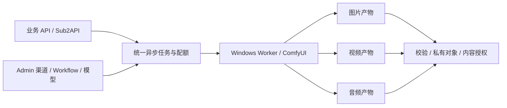

# 54 · ComfyUI 音频产物范围与开发约束

日期：2026-10-24（Asia/Taipei）。用户已确认：最终系统必须支持图片、视频、音频；音频同样是 ComfyUI Workflow 的产物。本文件为正式范围补充，音频已进入实现与分层验证，当前契约与进展见 [55](./55-音频契约与兼容迁移.md)。

## 1. 产品边界与当前状态

保留既有五类图像/视频能力，增加 Workflow 音频产物的完整生成与交付链路。音频沿用 Windows/ComfyUI 渠道、模型、已发布 Workflow、异步任务、API Key、Admin 和内容管理。具体音频能力由发布版本的输入 schema 与验证输出定义；不要求另接独立音频供应商，也不以语音合成或音乐分类限制用户的 Workflow。

范围确认时的 rc-20261024.53.2 及运行契约 0.4 仅实现五类图像/视频任务。当前 rc-20261024.55.3 与运行契约 0.5 已完成音频本地实现、独立计量、图形和原生候选验证，证据见 [55](./55-音频契约与兼容迁移.md)。音频仍须按已批准 Workflow 与明确权限/额度启用，不能仅凭 MIME 白名单或合成协议通过宣称实际设备验收。实际音频 Workflow、模型和 Windows 资源由用户后续提供；真实联调结果单独记录，完整项目完成条件继续包含 AUDIO-01～08。

## 2. 共享架构

任务状态机、幂等、GPU 锁、租约、提交日志、未知执行核对、取消和最终计量继续共享。音频任务不得通过旁路脚本绕过受理、配额、停止证据或内容授权；未知 GPU 执行仍不能因超时自动放锁或重复提交。音频文件从生成、上传、校验到发布遵循同一产物 manifest 与精确版本清理规则。

## 3. 逐层开发约束

| 层面 | 必须落实的约束 | 对应工作包 |
| --- | --- | --- |
| 机器契约与发现 | 显式新增可识别的音频任务/输出能力和 `media_kind=audio`。任务标识、字段、输入模式随实际 Workflow 契约冻结；旧图片/视频枚举和读取保持兼容。发现接口只公布已验证的版本、格式和规格 | WP-01、WP-04 |
| Workflow 与模型 | 草稿、导入预览、冻结、发布、绑定、样本验证和运行批准都覆盖音频。声明允许的输入参数、输出节点、格式和资源画像；客户端不能提交任意图或覆盖模型/输出路径 | WP-07、WP-08 |
| Worker 产物适配 | 从冻结版本声明的输出节点/history 结构取得音频文件；不同节点的结构须实测，不能猜测统一字段名。只读受控输出目录，拒绝越界路径，重试上传复用已确认文件，不再次运行 Workflow | WP-05、WP-06 |
| 媒体真实性 | 以实际文件探测/解码核对容器、codec、可播放性、时长、采样率、声道和大小；禁止仅凭扩展名或节点报告判定成功。允许的首批格式须经样例验证后公布；未知/损坏/空文件应明确失败并保留诊断 | WP-03、WP-05 |
| 计量与限额 | 增加显式音频资源限额与实际音频时长计量，单位采用整数毫秒；预留、终态差额及释放需事务化、唯一且可重放。Tenant/Project/Key 共用父级限制，图片数量和视频时长不能充当音频额度 | WP-02、WP-04、WP-06 |
| 旧数据与权限 | 新字段有明确迁移/默认值/回退方案；旧 Key 不静默获得新生成权限。新增权限与模型/Workflow/渠道交集仍由服务端重查，Admin、业务 Key、Worker、网关服务四种身份保持分离 | WP-01、WP-02、WP-09 |
| 内容与下载 | 音频元数据、列表过滤、授权读取、代理下载、HEAD/Range、到期删除、引用保护和对象 GC 都与图片/视频同级。沿用 owner_only、project_shared、shared_creator_keys 的同租户与项目/创建者交集 | WP-03、WP-09 |
| 图形 Admin | 可管理音频 Workflow/模型/渠道能力，查看全局及渠道排队、音频任务进度和失败原因，筛选并播放/下载音频内容，设置音频限额。媒体播放器离开页面时停止播放并释放对象 URL 和无用请求 | WP-08、WP-09 |
| Sub2API 与兼容接口 | 先保证统一异步提交/查询/下载；音频兼容投影必须逐条核对目标接口的输入、响应和错误语义。网关主体绑定、原账本、预授权与终态结算保持同一可信链路，不能按图片或视频冒报音频计量 | WP-10 |
| 部署和证据 | Windows 原生工具或锁定库完成探测，运行所需二进制随候选包显式校验。迁移前备份/归档验证，安装与回退可演练；不启动 Docker、WSL 或其他虚拟化环境 | WP-00、WP-11、WP-13、WP-14 |

音频属于正式输出媒体类型。带声音的视频继续按视频能力和视频容器验证；独立音频文件必须有自己的媒体元数据和授权交付。输出是否单条、是否含多个文件、时长上限和可用输入由已发布能力声明，未声明的批量输出不得隐式接收。

## 4. 开发顺序与验收门槛

先做当前实现的兼容性盘点与音频契约冻结，再同步 DTO/schema/fixtures/OpenAPI/前端类型和数据库迁移；随后实现音频媒体探测与 Worker 适配、受理/限额/计量、内容交付与 Admin，最后联调 Sub2API 和真实 Workflow。所有阶段保持原五类回归，不把设计文档或合成样例当作真实设备验收。

| 验收编号 | 必须给出的证据 |
| --- | --- |
| AUDIO-01 | 音频 Workflow 的导入、版本冻结、同步绑定、模型与节点依赖声明、样本验证及运行批准；未批准不得派单 |
| AUDIO-02 | 原生异步提交得到稳定任务 ID；状态、取消、错误和结果可查询；重复请求不重复执行或计量 |
| AUDIO-03 | 真实可播放音频文件，按实际 bytes/hash/容器/codec/时长/采样率/声道核对；空文件、损坏、格式冒充、超限和越界路径拒绝 |
| AUDIO-04 | Worker 提交/执行/上传/确认过程的重启恢复、失联和未知结果不重复执行、不错误释放 GPU；输出在云端确认后遵循保留规则 |
| AUDIO-05 | Tenant/Project/Key 音频预留及实际计量、并发/请求限制、终态唯一结算；本地和可信网关调用执行相同授权与限额 |
| AUDIO-06 | 内容管理的音频筛选、播放、HEAD/Range、下载、共享交集、停用/撤销、到期/删除和 GC；旧图片/视频行为保持 |
| AUDIO-07 | 桌面/手机浏览器实际操作音频配置、队列和内容；测试创建的全部 page/context/browser 在 finally 中关闭 |
| AUDIO-08 | Sub2API 固定上游版本的任务和账本联调，以及原生离线候选安装、迁移备份和恢复演练；真实资源结果单列 |

以上均为新增必达出口，分层证据与未完成边界见文档 55；不把本地合成协议通过记作真实 Workflow 验收。音频任务类型、格式清单、限额字段与默认值已在文档 55 冻结，实际音频 Workflow 的性能和硬件画像待实测。

关联：[01 需求](./01-需求规格与约束.md)、[02 架构](./02-系统架构与任务机制.md)、[03 接口](./03-接口与Sub2API接入规范.md)、[04 Workflow](./04-工作流产品化规范.md)、[07 Admin](./07-Admin可视化管理后台.md)、[08 Key](./08-APIKey鉴权与访问控制.md)、[16 开发任务](./16-开发任务分解与交付清单.md)。
