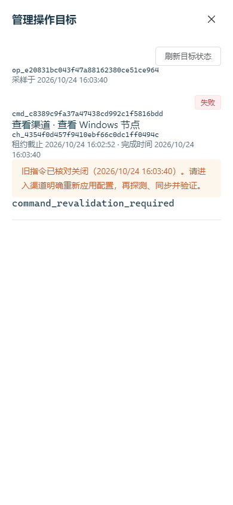
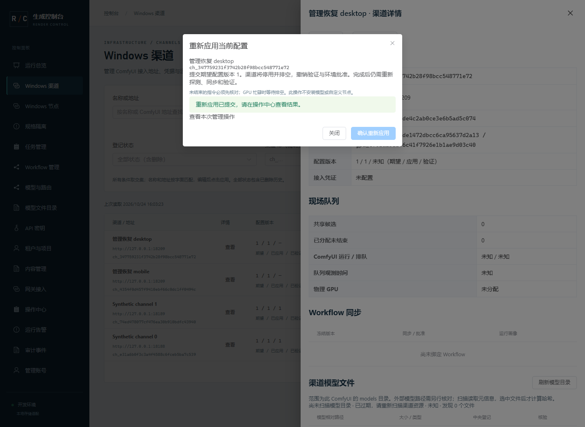

# 66 · 管理指令持久结果与恢复核对

2026-10-24，第 66 增量。设计先冻结；本地实现和下列分层验证已完成；完整首版、五类图像/视频及 ComfyUI Workflow 音频范围不变。

## 问题与恢复语义

原管理循环先领取再投递回执，过期领取会一直拒绝，已完成的本地持久结果无法发送；跨 boot 的 running 指令及 GPU 管理保留没有管理核对出口。普通回执仍拒绝过期或旧 boot，不用放宽旧租约恢复权利。

新增 worker-command-reconciliation.schema.json。POST /internal/v1/commands/{id}/reconciliations 仅接受绑定节点的 Worker 凭证、当前 boot、原指令摘要及 completed/unknown 观测。completed 必须有本地 journal 的持久结果，unknown 不携带结果。成功/失败结果还须通过原指令类型、版本及受控元数据核验。接口与回执均有 8 MiB HTTP 上限，固定错误脱敏。

云端原回执已提交且结果一致时，只确认原终态，不重复应用、不改变当前验证、不产生第二条审计。仍在当前有效租约的指令走普通回执；核对接口不替代租约。过期或跨启动的已完成结果，将旧指令关闭为 failed/command_revalidation_required，仅释放该指令自己的 GPU 管理保留，保留生成占用、fence、其他指令的管理保留、当前配置及验证事实；原始结果不得据此重建环境批准。状态、完成时间、操作汇总、安全证明摘要和审计/outbox 原子提交。没有持久结果时返回 evidence_required，不改状态、不释放占用、不盲目重执行。

恢复证明使用 ManagementOperation.summary 内服务端保留的 _control_recovery 映射，按 command_id 保存固定协议、原/当前 boot、结果摘要、核对时间；该字段不从 Worker receipt 提取，普通 Worker 结果和恢复结果均拒绝客户自报此字段。每操作最多 100 条恢复证明，与首版同步目标上限一致。重复核对按原指令和结果摘要幂等，冲突结果拒绝。不新增 DDL，head 保持 0a7d9b4e2136；旧本地 journal 的 id/digest/result/cloud_ack 格式可直接恢复，无数据库重写或隐式采用其他节点的 journal。

## 领取、Worker 与锁

管理领取按 Node 写锁串行，先检查该节点任一 boot 的 running 指令，不能跳过已锁定的旧指令再发新指令。当前有效租约仍返回原 command；过期/旧 boot 时 command=null 并增加只含 command_id/command_digest/原因的 reconciliation 观测，旧 Worker 忽略扩展后安全等待。普通 Worker 0.4.0、既有命令和成功回执形状兼容；升级控制面在前，Worker 在后。新 Worker 遇旧控制面的缺失恢复接口保留结果并等待，不降级执行。

Worker 每轮优先处理至多一条本地未确认管理记录，按 ID 游标轮转；已完成先投普通回执，仅在 command_expired/stale_boot 后走显式核对。云端已确认后才写本地 cloud_ack。没有完成结果的已有 intent 不自动重新执行；云端发现但本地无记录的旧指令只报告 unknown。原子文件、单 journal writer、本机节点互斥和关闭时等待实际线程结束继续适用，不因协程取消假定线程已停。每轮有界 HTTP、2 秒等待和错误退避，敏感结果不入日志。

核对遵守 Node 共享锁→Command 写锁→GPU 写锁→Channel 写锁→Operation；5 秒语句/1 秒锁预算。不改任务/配额/生成状态，不跨网络持数据库锁。普通回执和恢复以同一行锁裁决，结果丢失/重复及与注册竞争均可重放。

## Admin 处理出口

操作目标增加节点、租约截止、完成时间、待核对原因及已核对状态的安全投影；采样时间明确，旧字段保留。列表和详情有界只读一致快照，最多 50/100 项，读取 10 秒预算，隐藏、关闭、注销取消，旧响应不覆盖新目标。过期、旧 boot 和完成后需重新验证分别显示，不能把未知执行显示为空闲。

新增 POST /admin/api/v1/channels/{id}/reapply，要求 channels:write、Origin/CSRF、Idempotency-Key、If-Match 与 expected_revision。只显式重新提交当前 desired 配置，不增加 desired 版本、不改地址、不自动安装节点/模型。锁定 Node/GPU/Channel 后，任何未结束渠道指令仍拒绝；接受后排空、停用、撤销该渠道验证及关联画像批准并创建新管理操作，所有变更/审计原子且幂等。忙碌 GPU 仍等待排空；恢复后还需探测/同步/审批，不能直接调度。界面明确确认，失败不自动重试写入。

## 验证与边界

真实原生 PG 验证当前/过期/旧 boot、回执丢失、完成/未知、摘要/结果冲突、四身份与角色、同节点领取串行、普通回执/注册/删除/重应用竞争、唯一审计及保留其他 GPU 事实。持久 journal 重开与真实 Worker 管理循环验证先回执、只执行一次及未知 intent 不重跑。桌面/390px 验证状态、处理入口、明确确认、读取失败/超时、隐藏/注销及迟到响应隔离。最后重新验证原生链路、精确候选离线安装及清理，不拿协议替身替代真实设备与 Workflow 质量/容量验收。

DEV-01/02/03/08/10/14/17/21/23/25/26/29/31/32 继续适用；不调用 Docker/WSL/虚拟化、不执行任意远程 shell、不自动下载模型或安装节点。未完成证据后续补充，完整目标保持未验收。

## 实现结果与证据

| 验证层 | 结果与边界 |
| --- | --- |
| 契约与类型 | 新增 28 个恢复 fixture（7 正/21 反），共 30 份 schema/382 个 fixture（105 正/277 反）、32 份运行契约；176 方法/137 路径与 169 设计端点对应。137 个类型源及 75 个锁定依赖通过，旧 Worker 0.4.0 和 journal 表兼容 |
| 真实 PostgreSQL | 过期/旧 boot、完成/未知、原回执确认丢失、结果/摘要冲突、有效租约/错误 boot/跨节点/禁用节点、严格版本类型、并发重复核对只记一次审计、保留其他管理占用与 fence、同节点并发领取同一指令、显式重应用的版本/角色/CSRF/幂等与验证失效通过；原删除与回执锁竞争回归通过 |
| Worker | journal 重开与 ID 游标、结果先于领取投递、过期/旧 boot 后显式核对、无本地记录或未知 intent 不重执行、实际管理循环的回执响应丢失仅执行一次、网络/不支持接口/冲突/未确认结果继续保留通过 |
| 图形 | 15 组桌面/390px：真实过期状态与未知核对、明确确认/取消和未结束阻断、服务端完成结果关闭旧指令、采样/旧结果标记、真实十秒超时、隐藏恢复验证会话、无效链接、迟到目标隔离、退出登录取消读取、重应用只提交一次并跳转新操作、新租约普通回执通过 |
| 原生链路 | 20 组跨进程、11 个合成任务覆盖五类图像/视频及 Workflow 音频。新增实际 Worker 进程启动后发送旧 journal 完成结果、旧批准继续失效，以及跨 boot 未知 intent 多轮仍无结果/不释放保留/不重写配置；服务、临时库与凭证清理通过。ComfyUI/Redis 是明确协议替身 |
| 候选安装 | 精确候选离线隔离安装 24 项、安装后浏览器 8 组通过，新增重应用 If-Match 与恢复接口 Worker 身份边界；当前源码、运行契约、payload 摘要核对。Go 源码/覆盖层/二进制相同，复用既有 45/192 客户端及 491 账本测试证据；Worker 已改动并重新跑原生链路 |
| 数据与环境 | 无新 DDL；两库 42 表/head 0a7d9b4e2136、Alembic 无漂移及三项持久化设置核对。全程原生 Windows，未使用 Docker/WSL/虚拟化，测试浏览器上下文和临时进程最终关闭 |

失败记录保留于 command-failure-notes.json：初次测试文件同名导致收集冲突；新 HTTP 测试使用错误测试主机/Cookie/过短幂等键；类型检查发现局部变量名冲突；浏览器 fixture 的登录等待与 credential pepper 不一致。均按既有契约修复辅助代码或局部名称后重新验证，没有降低鉴权、版本检查或执行未知约束。先通过的 13 组浏览器证据另存，再扩展为 15 组；自动化取消路由产生的 Playwright CancelledError 保留在私有本地日志，页面错误列表为空。

证据：[最终核对](./evidence/2026-10-24/command-closeout.json)、[测试摘要](./evidence/2026-10-24/command-test-summary.json)、[定向测试](./evidence/2026-10-24/command-targeted-tests.xml)、[完整回归](./evidence/2026-10-24/command-full-python-tests.xml)、[原生链路](./evidence/2026-10-24/command-native-protocol.json)、[浏览器](./evidence/2026-10-24/command-browser.json)、[隔离安装](./evidence/2026-10-24/command-release-installation.json)、[发布摘要](./evidence/2026-10-24/command-release-build.json)、[数据状态](./evidence/2026-10-24/command-database-status.json)。

本轮没有真实 GPU/ComfyUI、真实六类 Workflow、模型质量/吞吐、私有 S3、真实 Redis、公网、Linux/系统服务、10/20 台设备容量或生产联合恢复证据，完整首版仍未验收。未知 intent 且无完成证据继续等待真实观测，不把管理按钮作为强制放锁出口。
