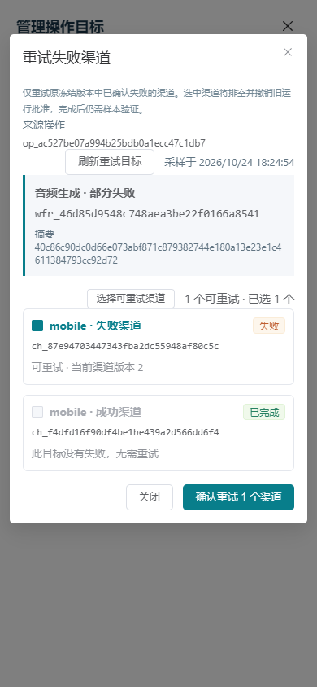
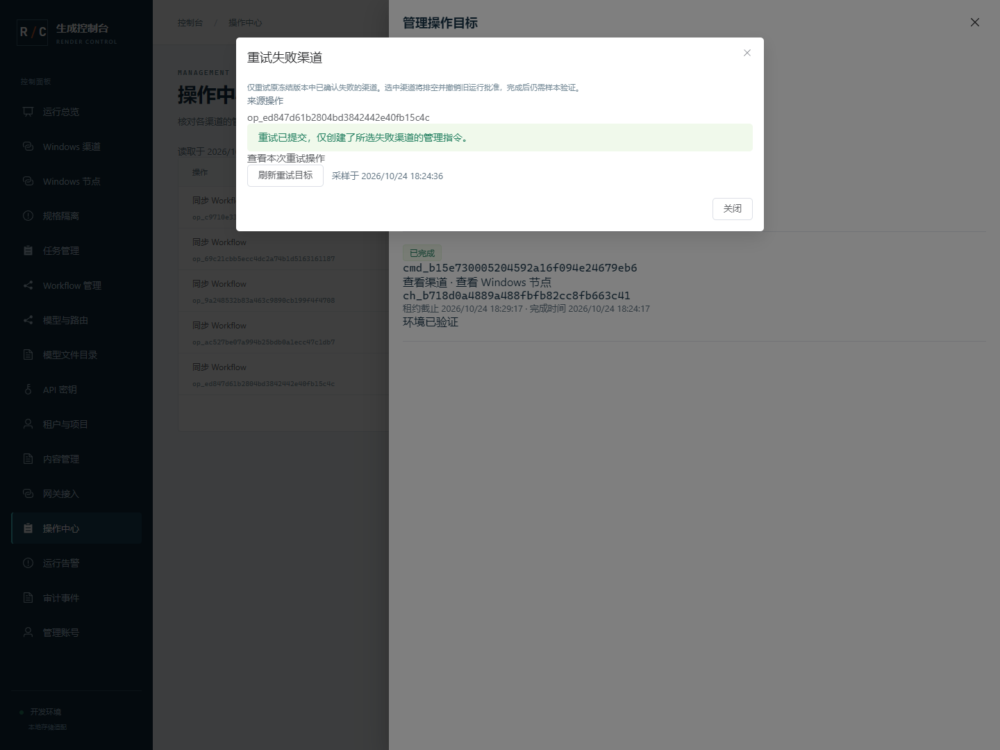

# 67 · Workflow 失败目标重试与操作关联

2026-10-24，第 67 增量。设计与机器契约先冻结；本地实现及下列分层验证已完成。五类图像/视频及 ComfyUI Workflow 音频共享此管理机制，完整首版仍未验收。

## 原问题与入口

批量推送已有逐渠道回执和 partial_failed，但没有落实 ADMIN-TEST-06 的失败目标专用重试。新增 GET /admin/api/v1/workflow-syncs/{id}/retry-options 和 POST /admin/api/v1/workflow-syncs/{id}/retries，均要求 workflows:publish 管理会话，POST 还要求 CSRF 和 Idempotency-Key。业务 Key/Worker 凭证不能调用。请求形状冻结于 [workflow-sync-retry.schema.json](./contracts/workflow-sync-retry.schema.json)；重复渠道/命令另经严格 DTO 校验。

重试不覆盖原操作。仅终态 failed/partial_failed 的 apply_workflow_release 操作可提交，原命令必须有 success=false 的确定失败回执且没有过期结果恢复证明；成功、待执行、执行中、未知结果及需重新验证的旧完成结果均拒绝。来源超过 100 个目标或包含不一致版本拒绝。沿用来源实际签发的不可变 release ID/摘要，不能用此入口改版本或上传图。

## 当前状态与事务

只读预览在一致快照中返回最多 100 个原目标、当前渠道名称/资源 revision、固定阻止原因、已创建的后续操作链接及采样时间，不返回地址、鉴权、manifest、任意 Worker receipt 或私有恢复证明。渠道删除、配置版本变化、较新的 Workflow 命令、仍有管理命令或发布包失效均阻止提交。离线不是失败事实，也不释放 GPU。

POST 原子校验所有选中目标；任一失效整批回滚。遵守 Node 共享锁（UUID 排序）→原 Command 写锁（UUID 排序）→Channel 写锁（UUID 排序）→原 Operation 写锁；不提前锁 Operation，也不拿 Channel 后再等 Command。普通重复回执仍会先锁 Command/GPU 再锁 Channel，终态并不免除锁顺序约束。重试不等待 GPU 锁、不释放 GPU。5 秒语句/1 秒锁预算，数据库错误固定脱敏。事务内不发网络请求。

原 operation.summary 的服务端私有 _workflow_retries 按原命令 ID 保存唯一后续 operation/command ID，最多 100 项；原操作已终态，映射与新操作、命令、revision、审计/outbox、管理幂等结果同事务提交。不同幂等键并发也只能生成一个后继；同键重放先返回原受理结果。原操作状态/回执/完成时间及成功目标保持原事实；后继失败需从后继操作再次预览重试。私有映射不透传普通操作列表。

新操作 summary 提供 retry_of 操作 ID、release ID/摘要和目标数量。仅选中渠道进入排空并撤销该版本运行批准，资源 revision 加一，绑定仍指向原摘要。Worker 使用既有固定指令，等待真实 GPU 无占用再检查依赖与原子保存，沿用 journal 防重和结果恢复；不改变生成占用、fence 或释放 GPU，不自动安装节点/模型。完成同步后仍需真实样本验证与人工批准。本增量不新增 DDL、不改变 Worker 0.4.0 协议。

## 图形操作

操作中心的 Workflow 操作提供“重试失败渠道”。明确列出原版本、各渠道结果、可选目标与阻止原因，默认不选任何渠道；管理员选择后明确确认，展示新操作链接及来源链接。成功目标不能选。提交中禁止重复点击，不自动重发写请求；超时保留同一请求与幂等键供管理员明确“核对提交结果”，不得换键重提。核对按钮只重放完全相同请求；改变选择必须先确认已有结果。

读取采用 10 秒预算；切换来源、关闭、隐藏、会话变化和卸载取消读取并拒绝旧响应。隐藏/注销不等于服务端写回滚；恢复后提示到操作中心核对。小屏使用逐目标列表，状态文字及原因可读，不依赖颜色。沿用 Admin 的字体、蓝灰色面板、等宽 ID、状态色，签名元素是原操作到后继操作的可追溯链接，不另建装饰界面。

## 验证要求

真实 PostgreSQL 验证部分失败仅创建失败目标、同键/异键并发、版本和选择整批回滚、服务重建后防重、成功/未知/恢复完成禁止、已被替代/配置变化/已删除/忙碌拒绝、原证据和 GPU 占用不变、审计幂等与权限。浏览器使用独立原生 PG/HTTPS 实际 API，覆盖桌面及 390px 操作、阻止原因、重试结果、后继链接、读取消及未知提交核对，并 finally 关闭本次浏览器/context/page。模拟渠道不等于真实 ComfyUI 或 10～20 台设备验收。

## 全量回归发现的既有问题

67.1 的串行全量检查实际出现审计保留批次超限：1,003 条过期记录被一个原本应最多删除 500 条的批次删除。旧 DELETE 内嵌带行锁/跳过锁的 LIMIT 子查询，不能将实际执行中的重复求值当成固定候选集合。修复仍在同一事务先选取并锁定最多 500 个 ID，再按该有界 ID 集合删除；保留原截止时间、全局互斥、SKIP LOCKED、两秒语句/250ms 锁预算及原子摘要。增加不同查询计划的真实 PG 回归，不提高批次上限。PostgreSQL 的 [DELETE 文档](https://www.postgresql.org/docs/18/sql-delete.html) 和 [行锁与 LIMIT 语义](https://www.postgresql.org/docs/18/sql-select.html) 为查询边界依据；本次实际超限由保留的失败 XML 证明。

另一个既有 Worker 配置预检在完整套件中重复超过 15 秒。配置预检只需配置、凭证与 TLS 校验，因此将实际执行依赖延后到正常启动分支加载，避免预检先导入生成运行时；不改变凭证/TLS 校验、状态目录保护、错误脱敏或正常执行逻辑，也不放宽测试时限。两个修复纳入 67.2 新候选，67.1 的安装成功不替代修复后的候选安装验证。原失败记录保留，最终结果以重新执行的检查为准。

## 实现结果与证据

| 验证层 | 实际结果与边界 |
| --- | --- |
| 契约 | 新增 16 个请求 fixture（2 正/14 反），同时经 JSON Schema 和严格 DTO 校验；共 31 份 schema/398 个 fixture（107 正/291 反）、33 份运行契约；178 方法/139 路径、171 设计端点对应。Worker 0.4.0 不变 |
| 真实 PostgreSQL | 部分失败仅重试失败目标、原终态与成功批准保留、同键/异键并发唯一后继、不同失败目标并发合并关联、服务重建防重、失败后继继续重试、成功/未知/恢复完成/配置变化/被替代/已删除/忙碌/版本绑定失效拒绝、整批回滚、固定锁预算、真实生成占用/fence/其他管理保留不变、权限与 CSRF 通过 |
| 回执竞争 | 有界屏障使原重复回执持有 Command/GPU、即将锁 Channel 时，与实际重试事务竞争；两个请求均完成，不把锁超时作为成功。Command 先于 Channel 的次序避免终态重复回执的反向等待 |
| 图形 | 13 组：桌面/390px 部分失败、默认不选、成功不能选择、明确取消/提交、仅失败渠道进入后继、原操作防重、可见后继链接、音频 Workflow、已提交响应丢失后同键同正文核对、真实十秒超时/刷新、隐藏/切换来源/注销取消及迟到隔离、观察者无写入口；三条实际新命令均通过现有 Worker 领取/普通回执完成 |
| 回归 | 完整 Python 1,989 项、定向 774 项、139 个类型源、75 个锁定依赖、Ruff、前端类型与构建通过。完整回归暴露既有审计批次超限和重复出现的 Worker 预检超时；修复后审计/启动 70 项及默认/强制查询计划通过，再串行完整重跑。原 15 秒测试及生产时限不变，不沿用被中断或失败的结果 |
| 原生协议 | 20 组跨进程、11 个合成任务覆盖五类图像/视频和音频。实际控制面/Worker/Sub2API 进程重新验证；ComfyUI/Redis 是明确协议替身。Worker 仅延后预检不需的执行依赖，正常启动链路重跑；Go 组件复用逐项摘要相同的 45/192 客户端及 491 项账本证据 |
| 候选 | 精确候选离线安装 24 项、安装后浏览器 8 组通过；源码/契约/payload 摘要、33 份安装契约核对。无真实模型、凭证或 Workflow 导出混入候选 |
| 环境 | 无 DDL；两库 head/42 业务表、Alembic 无漂移及三项 PG 持久化设置核对。所有本次浏览器上下文、临时服务、临时库最终清理；保留本项目原生开发 PG、HTTPS Admin/API、Runner 和独立 GC |

初次类型检查修复 SQLAlchemy Row 的字典类型推断；两个 HTTP 用例修复过短的测试幂等键。浏览器先修正隐藏原生 input 的测试定位，再发现并修复控件零字号继承导致后继链接不可见的实际问题，并显式修正未知提交时各复选框的禁用状态。锁顺序复核发现潜在重复回执竞争，按固定次序修复并增加真实并发屏障测试。两次完整回归保留失败记录：第一次有两个 Worker 启动超时；隔离两项通过后，串行完整回归再次出现预检超时及真实审计批次超限。新增强制计划回归在旧代码复现一次删除 797 条；修复为同事务固定至多 500 个已锁 ID，预检延后生成执行依赖加载；70 项审计/启动验证及最终完整回归重新执行。67.2 重新构建并精确安装，67.1 的结果不替代修复后的候选。没有降低鉴权、版本、防重、GPU、测试内时限或未知结果约束。失败与中断记录保留于 [检查说明](./evidence/2026-10-24/workflow-retry-failure-notes.json)、[失败完整回归](./evidence/2026-10-24/workflow-retry-full-python-batch-overrun.xml)、[旧查询强制计划复现](./evidence/2026-10-24/workflow-retry-audit-forced-plan-before.xml) 和 [中断记录](./evidence/2026-10-24/workflow-retry-interrupted-check.json)。

证据：[最终核对](./evidence/2026-10-24/workflow-retry-closeout.json)、[测试摘要](./evidence/2026-10-24/workflow-retry-test-summary.json)、[定向测试](./evidence/2026-10-24/workflow-retry-targeted-tests.xml)、[完整回归](./evidence/2026-10-24/workflow-retry-full-python-tests.xml)、[图形交互](./evidence/2026-10-24/workflow-retry-browser.json)、[原生协议](./evidence/2026-10-24/workflow-retry-native-protocol.json)、[隔离安装](./evidence/2026-10-24/workflow-retry-release-installation.json)、[发布摘要](./evidence/2026-10-24/workflow-retry-release-build.json)、[数据库](./evidence/2026-10-24/workflow-retry-database-status.json)。

图形和协议使用合成数据，不证明真实 ComfyUI、真实六类 Workflow 质量/吞吐、私有 S3、真实 Redis、生产恢复、公网或 10～20 台实机验收。完整首版继续按文档 16 的出口推进。
