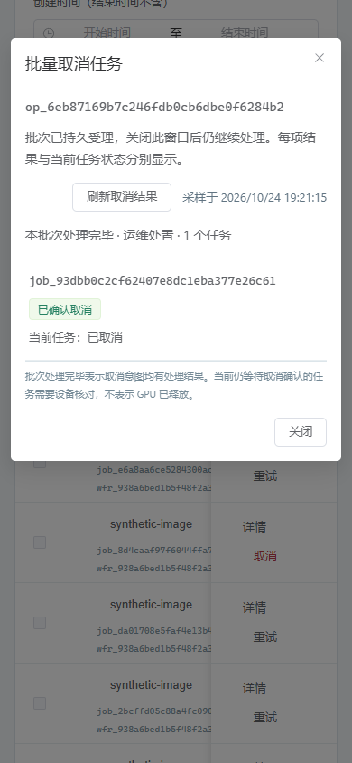

# 68 · 任务批量取消与持久逐项结果

2026-10-24。第 68 增量，设计与机器契约先冻结；本地实现及下列分层验证已完成。覆盖 ADMIN-09/11、ADMIN-TEST-13/14 和文档 07 的明确目标批量取消。图片、视频、ComfyUI Workflow 音频共用此能力；真实设备与完整首版仍未验收。

## 请求与执行

POST /admin/api/v1/job-cancellations 要求 jobs:control 管理会话、CSRF 和原 16～128 位 ASCII Idempotency-Key。请求在 [机器契约](./contracts/admin-job-cancellations.schema.json) 冻结，明确 1～50 个不重复任务 ID 和固定原因 operator_request/key_access_changed/maintenance。不能提交筛选器、全选全库、ComfyUI prompt 列表或任意命令。任务 ID 不复用，取消是对这些固定任务的持续意图，执行时按当前状态处理；不把列表采样 revision 当作可冻结的运行状态。

受理事务只保存管理幂等结果、cancel_jobs 类型 ManagementOperation、固定目标和审计/outbox，立即返回 202/operation_id。不在 HTTP 内等设备。幂等重放返回同一操作；不同正文同键拒绝。GET /admin/api/v1/job-cancellations/{id} 要求 jobs:read，用一致只读快照返回有界逐项结果、当前任务状态、固定原因和采样时间。操作中心提供直达入口，重启/页面关闭不丢失意图。

Runner 每轮最多处理 20 项且总调度预算 5 秒，每项独立事务：Operation SKIP LOCKED →既有 GatewayAdmission→分层 quota→Job→输入对象。每项只调用既有 JobRepository.cancel，不持有多个任务或多个主体配额锁。两秒语句/250ms 锁预算；数据库瞬态错误整项回滚，再以短独立事务记录失败次数，最多五次后该项明确失败；其他目标继续。进程中断前未提交的任务与结果一起回滚，已提交结果不再执行。无 HTTP、远程 shell、安装模型/节点或 ComfyUI 清队列动作。

尚未领取的 queued/admission_pending/retry_wait 可由既有状态机立即终结并原子释放相应预留；已领取/提交/生成/回传/核对中只记录取消意图，GPU、fence、未知占用和结果权继续由原协议核对。已取消仍显示 cancelled，已有取消意图仍显示 cancel_requested，其他终态返回 unchanged，不重复扣配额或结算；缺失目标逐项 not_found。批次完成表示所有目标的取消意图处理有结果，不表示所有设备已经确认停止。GET 同时显示当前任务状态，区分取消请求已记录和已确认取消。

首轮真实 PostgreSQL 测试发现既有状态图缺少 reconciling→cancel_requested/request_cancel，导致核对中的取消被拒绝。本增量补齐经授权的意图转换；不改变 attempt、未知占用、fence、过期租约或停止证据门禁，业务 API 和管理单项取消也共用这一修复。

固定目标、尝试次数和逐项结果存入 operation.summary 的私有版本化字段，普通操作列表隐藏该字段；不改变 Worker 固定命令或新增 DDL。既有操作查询不把此类型当作 Worker 指令。原始请求 ID/安全原因、原管理员身份、操作 ID、逐项结果和完成摘要均原子审计，不存提示词、凭证、素材或任意异常正文。损坏的内部记录拒绝执行且固定报错，不回显正文。

## 图形约束

继续使用蓝灰控制台、主色 #087e8b、危险色 #bb3b47、文字 #173346、背景 #f3f6f8；Bahnschrift/微软雅黑标题、Segoe UI/微软雅黑正文、Cascadia Mono 标识。任务页仅勾选当前页最多 50 项，默认空；筛选/分页变化清空未提交选择，不自动选择新出现任务。确认面板逐项列出 ID、模型和采样状态，选择固定原因，第二步明确确认提交。响应丢失保留原正文/幂等键，管理员明确核对；不自动重发写请求。

受理后展示操作链接、逐项取消处理结果与当前任务状态，五秒只读刷新并可显式刷新。操作中心可重新进入该批次。读取/写入各十秒预算；隐藏/关闭/切换批次/注销/卸载中止本次请求和定时器并隔离迟到响应。关闭界面不撤销已持久受理的意图。观察者可读取结果，无选择/写入口。390px 不出现页面级横向溢出，不依赖颜色区分处理结果。

## 验证出口

真实 PostgreSQL/HTTP 覆盖明确目标与无关任务不变、50 项边界、同键并发及异键重复不双扣、Runner 多实例 SKIP LOCKED、服务重建、提交前后崩溃原子性、瞬态故障回滚与五次上限、部分失败继续、当前终态竞争、GPU/未知占用/fence 不变、网关唯一终态结算、图片/视频/音频配额、权限/CSRF、只读安全投影。浏览器使用生产构建和原生 HTTPS/PG API，验证选择/取消/确认、丢响应原键核对、逐项结果、操作中心恢复、角色、小屏、隐藏/注销/超时和迟到隔离，finally 关闭本次浏览器/context/page。真实设备和六类实际 Workflow 不由协议替身替代。

## 实现结果与证据

| 验证层 | 实际结果与边界 |
| --- | --- |
| 契约 | 新增 16 个 fixture（2 正/14 反），JSON Schema 与严格 DTO 同时验证；共 32 份 schema/414 个 fixture（109 正/305 反）、34 份运行契约。新增 2 个管理端点；180 方法/141 路径、173 设计端点。补齐 request_cancel 的核对中意图边；Worker 0.4.0 不变 |
| PostgreSQL/HTTP | 新增 23 项集成用例：受理不先行取消、仅固定目标、50 项按 20/20/10 恢复、多 Runner SKIP LOCKED、同键并发/异正文拒绝、异键重复不双扣、部分失败继续、实际行锁等待五次上限、管理权限/CSRF/身份隔离及只读安全投影 |
| 真实进程崩溃 | 独立 Python 进程在逐项事务提交前/提交后以退出码 47 终止；重新构建 Runner 后，未提交整项重做，已提交不重复。任务终态、逐项结果、审计和唯一结算保持一致 |
| 资源与竞争 | 图片/视频/音频预留按既有终态事务退回；保留无关视频预留。真实领取并令租约过期后，批次记录取消意图但未知 GPU occupancy、attempt 与 fence 不变，不提前结算。实际音频完成/校验/发布发生在受理与执行之间时，批次返回 unchanged，原成功产物与 500ms 计量保留。DomainError 注入验证子事务全部回滚后继续其他目标；网关取消仅产生一个结算事件 |
| 图形 | 14 组桌面/390px：默认不选、明确范围与二次确认、关闭无写入、真实后台结果、操作中心恢复、筛选/分页清选择、实际提交响应丢失后原键原正文核对、十秒写/读预算、保留上次快照、隐藏/切换/注销隔离、延迟真实旧快照、只读角色及部分失败。最终私有 PG 核对 5 个唯一操作、5 个唯一终态计量、6 项结果且无关任务仍排队 |
| 回归 | 2,044 项完整 Python、713 项定向、141 个类型源文件、Ruff 和 75 项依赖锁检查通过。既有弃用提示和前端 chunk 大小提示保留，不降低时限或掩盖失败 |
| 原生协议 | 20 组、11 个合成任务含音频，由实际 API/Runner/Worker/Sub2API 进程重新验证；ComfyUI/Redis 为明确协议替身。Worker 与 Go 代码未变；Go 逐项摘要相同的 45/192 客户端与 491 项账本证据复用 |
| 候选与环境 | 精确候选离线安装 24 项、安装后浏览器 8 组通过；34 份安装契约、源码/payload 摘要核对。无 DDL；两库 head/42 业务表、Alembic 无漂移及 PG 持久化设置通过。本次上下文、临时进程/库已清理，原生开发 PG、HTTPS Admin/API、Runner 和独立 GC 保留 |

首轮 637 项验证保留两项失败：发现并修复实际的核对中取消状态边缺失，同时修正 Workflow 维护角色没有 jobs:read 的测试预期。下一轮 712 项通过，一项音频竞争测试把完成 manifest 误当作 Job 投影，修正为检查真实产物后定向 713 项通过。图形夹具先修正自身导入路径和样式隐藏 input 的定位；所有失败运行均关闭自建资源。通过后加强真实旧 HTTP 快照迟到验证，最终完整场景通过。见 [检查说明](./evidence/2026-10-24/job-cancellation-failure-notes.json)、[首轮失败](./evidence/2026-10-24/job-cancellation-initial-tests.xml) 和 [定向初轮](./evidence/2026-10-24/job-cancellation-targeted-initial-tests.xml)。没有弱化身份、GPU、租约、结算或原测试时间约束。

当前候选 rc-20261024.68.1，归档 SHA-256 `ef6892f4577cc8fd8c6f462cdef1cbde808ba10bd602b5e6ae5e51ae6ce51662`，390 个源输入、147 项 payload、57 个 wheel。构建/精确安装不是生产验收。

证据：[最终核对](./evidence/2026-10-24/job-cancellation-closeout.json)、[测试摘要](./evidence/2026-10-24/job-cancellation-test-summary.json)、[定向测试](./evidence/2026-10-24/job-cancellation-targeted-tests.xml)、[完整回归](./evidence/2026-10-24/job-cancellation-full-python-tests.xml)、[图形交互](./evidence/2026-10-24/job-cancellation-browser.json)、[原生协议](./evidence/2026-10-24/job-cancellation-native-protocol.json)、[隔离安装](./evidence/2026-10-24/job-cancellation-release-installation.json)、[发布摘要](./evidence/2026-10-24/job-cancellation-release-build.json)、[数据库](./evidence/2026-10-24/job-cancellation-database-status.json)。

图形与协议使用合成数据；真实 ComfyUI、真实六类 Workflow 质量/吞吐、私有 S3、真实 Redis、生产恢复、公网和 10～20 台实机继续独立验收。完整首版按文档 16 的出口推进。
