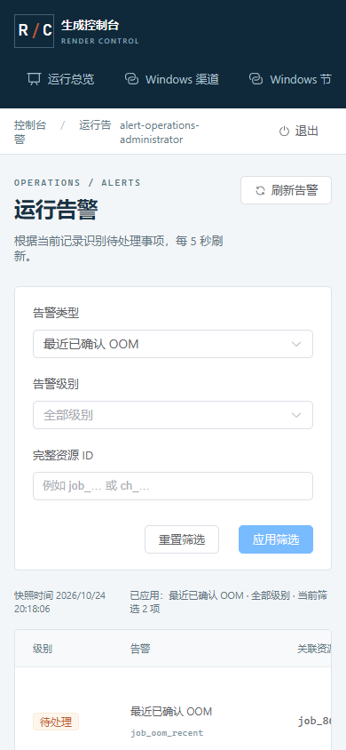

# 69 · 已确认生成失败告警与定位筛选

2026-10-24，第 69 增量。先冻结以下契约，再同步实现、客户端和分层验证。落实文档 07 操作与告警中的 OOM/无效产物、文档 15 执行维度与 DEV-07/10/15/25/26/28/32；不把协议失败当作真实 GPU OOM 或实机质量验收。

## 规则与证据

保留现有 13 类派生告警，新增 job_oom_recent 与 job_output_invalid_recent。仅由当前 Job 的 failed 终态、固定 error_code=comfy_oom/comfy_output_invalid、terminal_at 位于服务端快照前 24 小时闭区间、关联当前 Attempt 已关闭且 generation_released_at 已记录共同产生。generic comfy_execution_failed、任意包含 OOM 的文字、取消/成功/运行/核对中任务、历史非当前 attempt、未确认停止、缺失或未来时间均不能冒充已确认失败。

每个失败任务一条稳定 ID，warning，recorded_at 为终态时间；这是最近已确认失败记录，不宣称异常仍在持续。成功重试为新任务，原失败在 24 小时内仍保留。规格隔离规则独立，单次 OOM 即可告警而不提前达到隔离阈值。图片、视频和 ComfyUI Workflow 音频使用同一规则。

新增可空 failure 上下文，仅选择固定失败码、任务类型、公开模型别名、冻结 release_id、当前 attempt_id/channel_id；不读取或返回提示词、原始图、输入、traceback、错误文字、路径、渠道凭证、inventory 或账本载荷。关联任务/渠道/Workflow 链接仍由目标端点分别授权。所有管理角色沿原 operations:read 查看告警，业务 Key、Worker、网关服务身份不能进入。

GET /admin/api/v1/alerts 保留既有 page/kind，新增 severity 与精确 resource_id；四项取交集。page=1..1000、每页 50，不接受任意全文/JSON 查询、模糊 ID 或未知参数。新查询和失败上下文分别冻结机器契约。既有 kind 不改名；failure 为兼容新增字段，旧客户端仍可读取原字段。

同一 REPEATABLE READ READ ONLY 事务计算筛选总数、稳定排序分页与上下文；5 秒语句/1 秒锁预算，数据库错误固定 503，不把失败显示为空告警。只在当前页的至多 50 个 ID 上取安全上下文；不加载完整 Job 请求。容量时间戳转换先核对 JSON 数值与位数，损坏时间戳按观测未知处理，不引发无限等待或回显 SQL。

## 图形与资源约束

继续现有蓝灰控制台，#087e8b 主色、#bb3b47 危险色、#173346 文字、#f3f6f8 背景；Bahnschrift/微软雅黑标题、Segoe UI/微软雅黑正文、Cascadia Mono 标识。告警页的用途是找到具体资源和失败原因；以“已应用筛选、快照时间、最近已确认失败”表达当前数据。保留现有容量列，增加可扫描的安全失败上下文，不暴露实现细节给业务客户。

类型/级别/完整资源 ID 在明确应用后一起生效，清空与分页有界；切换筛选/页码后取消旧读，迟到结果不覆盖新快照。失败保留并注明上次成功快照；无成功快照不显示“无告警”。页面可见时五秒只读刷新，单次十秒预算，无并发堆积。隐藏/离页/注销清理请求、超时器和轮询；恢复先核对会话再重新读取。观察者只读；390px 无页面横向溢出。此次不增加确认、静默、自动恢复或自动重跑动作。

## 验证出口

真实 PG/HTTP 检查 24 小时时间边界、固定归因/当前 attempt/停止证据、图片/视频/音频、取消/运行/历史/泛化错误排除、成功重试保留历史失败、过滤交集、50 条分页与精确 ID、同一快照、只读无副作用、锁预算/安全 503 和四类身份。契约 fixture 同时校验严格 DTO 与 JSON Schema。浏览器使用实际生产构建和原生 HTTPS/PG API，检查筛选与回退、定位链接、脱敏、角色、390px、十秒读取/保留旧快照、隐藏/注销/迟到隔离，finally 关闭本次 page/context/browser。完整回归和精确候选安装不替代真实 ComfyUI、实际六类 Workflow、私有 S3/Redis 或 10～20 台设备验收。

## 实现结果与证据

| 层次 | 已完成的本地验证与边界 |
| --- | --- |
| 契约 | 新增 [admin-alert-query.schema.json](./contracts/admin-alert-query.schema.json) 与 [admin-alert-failure.schema.json](./contracts/admin-alert-failure.schema.json)，40 个 fixture（查询 6 正/18 反、失败上下文 6 正/10 反）；累计 34 份 schema、454 个 fixture（121 正/333 反）、36 份运行契约。GET 路径不变，15 种告警类型；客户端、DTO、运行契约与 OpenAPI 同步 |
| 实际事务 | 40 项新告警检查使用真实 PG。以实际领取和 Worker 事件形成已确认图片/音频/视频失败，检查固定码、24 小时闭区间、当前 attempt、未确认停止/缺失/未来/乱序证据排除。时间还须满足 accepted_at ≤ terminal_at、generation_released_at ≤ closed_at ≤ terminal_at；闭合证据不能来自终态之后 |
| 计量与历史 | 未确认 OOM 继续 reconciling、GPU uncertain、无终态计量。音频失败按独立音频资源口径结算；实际新任务重试成功、产物验证与发布后，原失败仍在窗口内可查。告警读取前后任务、attempt、审计、计量、fence 与占用不变 |
| 查询 | 类型/级别/完整 ID 交集；53 条持久记录校验 50+3 稳定分页。SQL 列投影不加载 Job.request 或渠道快照；count 后由另一真实事务修改失败码，当前事务的总数/行/上下文仍属于原一致快照，下一读取才看到变更。8 种损坏容量时间戳安全退化；实际表锁触发一秒锁预算和固定 503，释放后恢复 |
| 身份 | 四种管理角色沿 operations:read 读取；业务 Key、Worker、网关凭证均不能访问。未知参数、越界页码和非法完整 ID 拒绝且不回显提交正文；目标任务/渠道仍独立鉴权 |
| 图形 | 17 组桌面/390px，使用生产构建、实际 HTTPS/PG API。覆盖明确应用草稿、交集与空结果、非法 ID 保留旧筛选、三类媒体上下文、真实任务/渠道定位、50 条分页、503/十秒超时后保留已标注快照、旧请求迟到、隐藏恢复/离页/注销清理与观察者只读。延迟/503 和 visibilitychange 是明确测试注入；数据库预算另由实际锁验证。2 个 context/browser finally 关闭 |
| 只读后核对 | 私有测试库的 4 个任务、4 次尝试、3 条终态计量、业务操作审计及未知 GPU 占用在页面交互前后相同；另精确核对 3 次登录和 1 次注销审计。没有生成、取消、隔离或重跑写入。测试库、HTTPS 进程和私有夹具均清理 |
| 回归 | 2,164 项完整 Python、804 项定向、142 个类型源文件、Ruff 和 75 项依赖锁检查通过。既有弃用提示和前端 chunk 提示保留 |
| 协议与候选 | 20 组原生跨进程协议、11 个合成任务含音频；实际 API/Runner/Worker/Sub2API，ComfyUI/Redis 明确为协议替身。精确候选离线隔离安装 24 项、安装后浏览器 8 组通过。Worker/Go 源码未变，复用逐项摘要一致的 Go 客户端 45/192 与账本 491 项证据 |
| 数据库与资源 | 无 DDL、两库 head/42 表、Alembic 无漂移、PG 持久化设置与候选源码/运行契约摘要核对。自建测试资源清理；保留原生开发 PG、HTTPS Admin/API、Runner 与独立 GC 供继续开发 |

首轮前端类型检查发现 FastAPI 展开查询模型不会生成 components.AlertQuery；已改用生成的 GET path query 类型。浏览器夹具先后修正测试导入路径、音频/视频预设引用、样式化下拉框/页面容器定位、实际领取渠道和导航名称，以及恢复页面等待新请求的时序。17 组图形通过后，初次数据库核对误将正常登录/注销审计计为业务副作用；现按明确动作分别核对，要求 3 次登录和 1 次注销，其余业务状态/审计保持相同。每次失败均保留报告并清理自建资源。没有降低十秒预算、放宽身份或改变 GPU/结算语义，详见 [检查说明](./evidence/2026-10-24/alert-operations-failure-notes.json)。

当前候选 rc-20261024.69.1，归档 SHA-256 `23e0aba026042ceaf24632863ebc39613e75fc3c7bd3875c9910d2cb7eda343a`，393 个源输入、148 项 payload、57 个 wheel。构建和隔离安装不代表生产验收。

证据：[最终核对](./evidence/2026-10-24/alert-operations-closeout.json)、[测试摘要](./evidence/2026-10-24/alert-operations-test-summary.json)、[定向测试](./evidence/2026-10-24/alert-operations-targeted-tests.xml)、[完整回归](./evidence/2026-10-24/alert-operations-full-python-tests.xml)、[图形交互](./evidence/2026-10-24/alert-operations-browser.json)、[只读后核对](./evidence/2026-10-24/alert-operations-browser-fixture.json)、[原生协议](./evidence/2026-10-24/alert-operations-native-protocol.json)、[隔离安装](./evidence/2026-10-24/alert-operations-release-installation.json)、[发布摘要](./evidence/2026-10-24/alert-operations-release-build.json)、[数据库](./evidence/2026-10-24/alert-operations-database-status.json)。

图形与协议使用合成数据。真实 Windows/ComfyUI、六类实际 Workflow/模型与质量、S3/Redis、公网、Linux/系统服务、生产联合恢复及 10～20 台实机容量仍按文档 16 独立验收；完整目标保持进行中。
