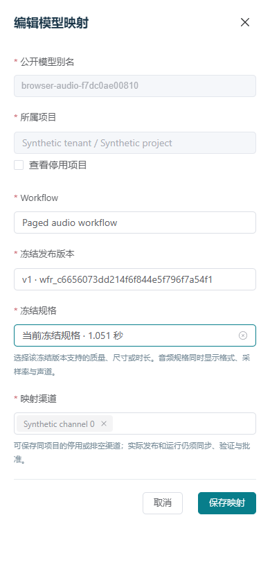

# 70 · 模型目录分页与冻结规格选择

2026-10-24，第 70 增量。先冻结设计和机器契约，再实现。落实文档 07 的模型/Workflow/渠道管理、文档 13 表单与资源预算，以及 DEV-15/25/26/28/32。原五类图片/视频能力和 ComfyUI Workflow 音频全部保留；本地元数据管理不替代真实工作流验证和 Sub2API 生产接线验收。

## 目录与选择规则

模型管理页现有 Workflow、渠道选择只读默认第一页，默认规格依赖手填，验证渠道也受第一页截断。改为服务端按项目搜索、分页和精确解析；管理员能选择后续页的 Workflow、冻结发布版本与渠道，以及冻结版本中实际存在的规格。

原 GET /admin/api/v1/public-models 增加严格查询：page=1..1000、q（1..128 字符的字面子串）、project_id、task_type、status=published/unpublished、精确 model_id，所有条件取交集；每页 50、固定排序和一致快照总数。保留原 data/page/has_more，新增 snapshot_at/total。公开模型别名、任务类型、冻结版本、渠道、受控默认值和 revision 继续使用原响应；不扩展业务生成权限。

新增 GET /admin/api/v1/model-mapping-options，要求独立管理会话和 models:read。query 的 kind 为 workflow/release/channel/preset，project_id 必填，page=1..1000，每页 50；q 为字面子串。workflow/channel/release 可用最多 50 个唯一、类型匹配的 ids 精确解析，解析模式仅第 1 页，仍按项目/父资源过滤；不返回其他项目资源是否存在。

release 浏览须指定同项目 workflow_id，精确 ids 可在未知父 Workflow 时解析；非解析列表仅展示已验证发布版本。channel 可按同项目 model_id 限定到该模型实际映射的渠道，用于验证样本选址；未删除的停用/排空渠道保留状态供管理员识别，但不因此具备运行资格。workflow 列表排除已归档项，精确解析仍可显示归档状态。task_type 只用于 workflow/release，release_id 只用于 preset，model_id 只用于 channel，workflow_id 只用于 release；不支持无父资源的全量抓取或任意 JSON/全文搜索。

preset 必须指定同项目已验证 release_id，不接受 q/ids/其他父筛选。只分页投影该版本的 quality、size、seconds，以及音频格式/采样率/声道；主图节点、输入/提示词、values、依赖文件和权重路径均不加载或返回。默认 n 固定为 1。相同 quality/size/seconds 对应多个预设时标记不可选择，要求修订并发布唯一预设，不能任选其一。预设 ID 来自不可变发布版本内的序号；图片无时长，视频有尺寸/时长，音频有时长和音频规格且无尺寸。

机器契约：admin-model-catalog-query.schema.json、admin-model-mapping-query.schema.json、admin-model-mapping-options.schema.json。GET 查询拒绝未知字段、越界数字、跨 kind 参数、错误/重复/过多 ID、控制字符及非字面搜索。原模型创建/编辑/发布与样本验证的 revision、幂等、GPU、预算、审计和准入规则不变，最终写入继续在服务端重新核对冻结预设与资源范围。

## 事务、界面与生命周期

每次目录读取使用 REPEATABLE READ READ ONLY，5 秒语句、1 秒锁预算；同一事务核对父资源、统计和分页。数据库异常固定 503；未找到同项目父资源为 404。只选择必要列，最多 51 行用于判断下一页；不读取完整 Workflow 草稿、执行图、渠道凭证/地址或 inventory。无 DDL，无调度/生成动作，无对外能力或审批状态变更。

沿用现有蓝灰控制台和字体：#087e8b 主色、#173346 文字、#f3f6f8 背景，Bahnschrift/微软雅黑标题、Segoe UI/微软雅黑正文、Cascadia Mono 标识。模型目录提供明确应用筛选、快照与匹配总数；创建/编辑依次选择项目、Workflow、冻结版本、规格和渠道。已保存的当前规格可显示为“当前冻结规格”，换版本后必须重新选择。项目/Workflow/版本切换清理下级草稿，迟到响应不覆盖新选择；后续页选项和已选项同时可识别，不静默丢弃既有渠道。

选择器在展开时按需读取，搜索防抖 250ms；每次读取十秒预算，关闭/切换/隐藏/注销/离页取消请求与定时器，隐藏时不读取。选中项目使用已解析的服务端项目归属，不把管理会话的有限 scope 列表当完整目录。列表失败保留明确标注的最后成功快照；未取得数据时不显示空目录。桌面/390px 均可操作，表格滚动限制在容器内。

写入保持明确提交，创建沿用独立幂等键，编辑沿用 revision；超时或响应未知时保留原请求正文/键供人工核对，不能因关闭/切换自动重发。样本验证沿用原 Workflow 验证接口、单次预算及独立幂等键；选择实际映射渠道可翻页搜索，停用/排空不可提交。成功受理只表示任务已创建，不能显示为生成成功或运行批准。

## 验证出口

真实 PG/HTTP 覆盖大于 50 项的模型/Workflow/渠道/发布版本/预设、字面搜索和交集、解析与跨项目排除、无私密列投影、快照一致、数据库预算、身份、原创建/编辑/发布/验证事务，以及图片/视频/音频预设。契约 fixture 同时校验 JSON Schema 和 DTO。生产构建浏览器检查后续页选择、已选项保留、改项目/版本清理、未知写入原键原正文核对、十秒预算/迟到隔离/隐藏/注销清理、角色与 390px；finally 关闭本次创建的浏览器资源。完整回归、原生协议和精确候选隔离安装按变更执行，不能作为真实 GPU/Workflow 或生产验收。

## 实现结果与证据

| 层次 | 已完成的本地验证与边界 |
| --- | --- |
| 冻结契约 | 新增 [模型查询](./contracts/admin-model-catalog-query.schema.json)、[映射选项查询](./contracts/admin-model-mapping-query.schema.json)、[映射选项响应](./contracts/admin-model-mapping-options.schema.json)，65 个 fixture（18 正/47 反）；累计 37 schema、519 fixture、39 运行契约。响应还按冻结 schema 核对显式字段，图像 seconds:null、音频 size:null 等反例拒绝；查询展开类型使用生成 GET path query |
| PG 目录 | 28 项新集成测试：53 个 Workflow/渠道/模型、103 个发布版本、54 个预设，稳定后续页及精确已选解析；字面百分号/下划线/反斜杠、筛选交集、归档/未验证/停用状态、项目/父资源范围、实际映射渠道、四种管理角色与其他三类身份隔离 |
| 安全与预算 | 只读 REPEATABLE READ，5 秒语句/1 秒锁预算。SQL 不读取完整草稿、图、渠道地址/凭证和 inventory；音频只返回格式/采样率/声道。实际表锁返回固定 503，释放后恢复；count 后并发修改仍保持当前快照一致。损坏预设不回显私密值 |
| 六类媒体 | 图像的尺寸、视频的尺寸/时长、Workflow 音频的时长/格式/采样率/声道；六类预设直接用于真实模型创建和 revision 编辑。重复预设即使跨页也标记不可选择，不以首个匹配绕过唯一性 |
| 图形交互 | 17 组桌面/390px，生产前端配合实际 HTTPS/PG。跨第 2 页 Workflow、渠道、规格与第 3 页版本；已选项保留、当前映射解析、项目/版本切换清理、旧响应隔离、503/十秒预算、隐藏后核对会话再恢复、关闭/离页/注销取消；观察者无写入控件。网络失败/延迟/409 和 visibilitychange 明确为测试注入 |
| 实际写入 | 模型创建 POST 已提交但故意丢失首响应，原键原正文核对后数据库只有一模型；真实 CAS 编辑一次后 revision=2、保持未发布、默认音频 1.051 秒；实际模型映射的第 2 页渠道用于音频验证，首个 202 丢失后原键核对仍只有一个排队任务、预算 1。精确四条业务审计各一次；没有 attempt、GPU 占用或 fence 变化 |
| 原界面兼容 | 4 组既有 Workflow 管理回归，更新合成路由夹具以提供新安全选项响应；推送、部分失败回执、验证导航、运行批准仍通过。独立实际 HTTPS 登录/PG，其余业务请求明确使用受控路由夹具；业务快照不变 |
| 回归与候选 | 完整 Python 2,322 项、定向 894 项、Ruff、mypy 144 源文件、75 项锁检查。原生 20 组/11 合成任务含音频，精确候选离线隔离安装 24 项与安装后浏览器 8 组；ComfyUI/Redis 是协议替身。Worker/Go 源码未变，摘要核对复用 Go 45/192 与账本 491 项证据 |
| 数据库与释放 | 无 DDL、两库 Alembic 无漂移、42 业务表及持久化设置保持。自建测试库、进程、私有密码/夹具和浏览器全部清理；保留原生开发 PG、HTTPS Admin/API、Runner 与独立 GC 继续开发 |

首轮夹具试图更新不可变发布版本，被真实 PG 触发器拒绝；已改为创建新版本，未停用触发器。前端修正可空默认字段与 sample_budget 字面量类型；截图复查还修正远程下拉选项元数据更新后的旧标签缓存，要求已选名称正确再截图。70.1 是标签修正前构建，70.2 随后构建；最终 70.3 还包含原界面夹具的完整兼容更新，两份早期包均未作为最终验收对象。两个显式 null 反例补齐 DTO 与原冻结 schema 的差异，因此重新跑最终完整回归。图形后核对修正测试字段与合法 job.accepted 审计数量；兼容夹具随机端口曾被浏览器限制，现使用有界高位端口分配。失败记录和资源清理均保留，见 [检查说明](./evidence/2026-10-24/model-catalog-failure-notes.json)。

最终候选 rc-20261024.70.3，归档 SHA-256 `37b33cce3b34eaabf3ce7eaae326890497dd1aaff5ce78a045dc647f18169f1f`，400 个源输入、149 项 payload、57 个 wheel。既有前端 chunk/Starlette 弃用提示仍保留。源码、运行契约、安装归档与两库状态逐项核对；本地候选通过不代表生产验收。

证据：[最终核对](./evidence/2026-10-24/model-catalog-closeout.json)、[测试摘要](./evidence/2026-10-24/model-catalog-test-summary.json)、[定向](./evidence/2026-10-24/model-catalog-targeted-tests.xml)、[完整回归](./evidence/2026-10-24/model-catalog-full-python-tests.xml)、[图形](./evidence/2026-10-24/model-catalog-browser.json)、[实际写入后核对](./evidence/2026-10-24/model-catalog-browser-fixture.json)、[原界面兼容](./evidence/2026-10-24/model-compat-browser-fixture.json)、[原生协议](./evidence/2026-10-24/model-catalog-native-protocol.json)、[精确安装](./evidence/2026-10-24/model-catalog-release-installation.json)、[发布摘要](./evidence/2026-10-24/model-catalog-release-build.json)。

全部 Workflow 为合成目录或协议替身。真实 Windows/ComfyUI、六类实际 Workflow/模型与产物质量、S3/Redis、公网、Linux/系统服务、生产联合恢复及 10～20 台实机容量仍按文档 16 独立验收；完整目标保持进行中。
