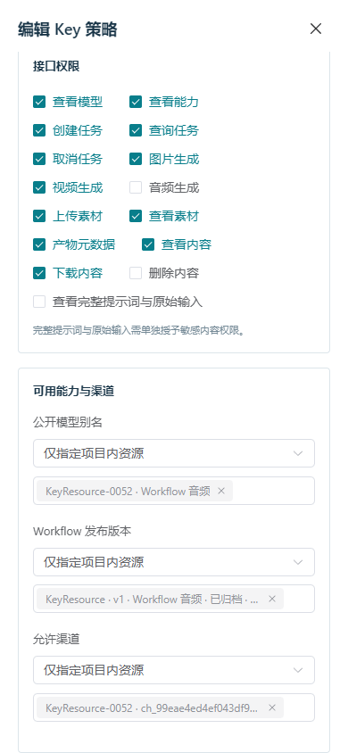

# 71 · Key 生成资源授权选择与请求核对

2026-10-24，第 71 增量。先冻结契约再实现，落实文档 08 的多 Key 图形访问控制、文档 13 的请求/秘密/生命周期约束以及 DEV-15/16/17/25/26/28/32。图片、视频和 ComfyUI Workflow 音频沿用同一 Key 策略；不改变生成准入、GPU、内容授权或计费语义。

## 授权目录与兼容

原 Key 页面通过文本输入 models、workflow_releases、channels 的 selected_ids。改为安全的按项目搜索、分页和精确解析；模型选择值继续使用公开别名，Workflow/渠道继续使用原 wfr_/ch_ ID，不能把模型 ID 写进别名列表。原 key-policy.schema.json 与创建/编辑/动作接口保持，selected 空数组明确不授予该类生成资源，all_authorized 仍是项目内全部已授权资源且提交空数组。

新增只读 POST /admin/api/v1/key-generation-options/query，要求管理会话、keys:manage 和 CSRF。正文 kind=models/workflow_releases/channels、mode=browse/resolve、project_id 必填；page 为 1..1000，q 是不超过 128 字符的字面子串（可为空），ids 是最多 1000 个唯一值。browse 不接受 ids，resolve 仅第 1 页且无搜索；resolve 空列表返回空，不能解释为全部资源。别名最长 128，版本/渠道 ID 类型严格匹配；拒绝未知字段、控制字符、越界值及混用查询模式。

每页最多 50，固定排序、snapshot_at/total/has_more。精确解析最多 1000 项，返回可核对的 data 和 unresolved_ids。所有查询先核对项目，再以该项目限制模型、版本与渠道；不同项目的值不会被解析。只投影模型别名/公开状态/类型、Workflow 名称/版本/验证及归档状态、渠道名称/启停/排空/归档状态。禁止加载或返回 Workflow 草稿、执行图、manifest/values/依赖、渠道地址/凭证、Key policy/verifier、节点 inventory。版本选择无需先选父 Workflow，支持用名称或版本搜索。

目录保留未发布、未验证、停用与归档状态，允许保存已有的历史限制；选择这些资源不发布模型、不启用渠道、不批准 Workflow。真实调用仍执行当前准入与发布/环境/容量条件。选择资源也不自动增加接口权限或额度：Workflow 音频仍须单独授予 audio:create，并放行音频最长时长与每日音频额度；图片和视频沿用各自限制。已选值失效或越项目须明确显示并阻止保存，不能静默删除或扩展为 all_authorized。

数据库使用同一 REPEATABLE READ READ ONLY 事务，5 秒语句/1 秒锁预算。父资源不存在返回 404，数据库/投影异常为固定 503，不回显正文或内部错误。读取不产生业务审计、任务、配额、GPU 或管理指令变化。无新 DDL。

机器契约为 key-generation-options-query.schema.json、key-generation-options.schema.json；运行契约、DTO、OpenAPI、客户端和 fixture 同步。原内容共享目录继续独立使用项目/创建者选择，不混入生成路由授权。

## 图形、秘密与请求生命周期

沿用蓝灰 Admin。三个指定资源选择器按需展开，250ms 搜索防抖、每页 50、最多保留一页和 1000 个已选项；已选标签在后续页保留，解析完成后必须显示正确名称/状态。空指定列表提示不授权；失效项可明确移除。项目变化立即清空指定生成资源并等待新项目归属核对；不自动提升授权模式。跨租户继续清空内容共享并回到 owner_only。

读取与写入均设十秒本地等待预算，关闭、隐藏、离页、注销取消归属该页面的请求/定时器。恢复可见先核对当前管理会话，再恢复读取，不自动重发写入。列表失败保留并标注最后成功数据，无首次数据时不误显示为空目录。关闭秘密窗口、隐藏、离页及注销清除原始 Key；不放入 URL、持久浏览器存储、日志或测试证据。

创建、编辑、启停、轮换和删除都捕获独立原请求/幂等键或 revision。超时、丢响应及 5xx 保留原请求供显式核对，锁定冲突的再次写入；不因刷新/恢复可见/关闭表单重新生成 Key。确认的 4xx 不自动提高 revision。创建/轮换重放沿原服务端规则只返回脱敏结果，secret_available=false 时解释首次秘密已不可再次显示，由管理员另行核对并选择轮换，不自动再轮换。未知编辑/删除可能因已提交而遇到原 revision 冲突，继续保留核对记录，要求查看当前策略；关闭本地记录不撤销服务器操作。

## 验证出口

真实 PG/HTTP 覆盖超过 50 的三类资源、1000 项解析边界、字面搜索/稳定分页/范围排除、状态投影、SQL 私密列排除、只读快照/锁预算、身份/CSRF，以及从目录值创建和修改 Key 后实际业务请求的模型/版本/渠道硬限制。JSON Schema 与 DTO 对正反 fixture 同验。

生产前端配合实际 HTTPS/PG，检查三类后续页选择、已选项保留/失效处理、项目切换、明确空授权、未知创建/轮换原请求核对且不重返秘密、编辑冲突、十秒预算/迟到/隐藏/注销和 390px。finally 关闭自建浏览器、进程、私有测试库和凭证；再执行适配的完整回归、原生协议、精确候选隔离安装与源码/契约核对。合成目录/协议不作为真实六类 Workflow、设备容量或生产验收。

## 实现与验证

第 71 增量完成 API Key 的模型别名、Workflow 发布版本和渠道图形选择：按项目搜索、每页 50、后续页选择及最多 1000 项精确解析；模型继续保存别名，版本/渠道保存原 ID。指定空列表不授权，历史状态清楚显示，项目切换清理旧选择，失效项须明确处理。创建/编辑/启停/轮换/删除保留原请求和版本核对；丢响应不自动重复生成凭证，重放不再次显示秘密，隐藏/关闭/离页/注销清除原始 Key。图片、视频及 ComfyUI Workflow 音频共用这些控制。完整 Python 2,483 项、定向 1,029 项、mypy 146 源文件、17 组桌面/390px、20 组原生协议、精确候选隔离安装 24 项及安装后浏览器 8 组通过。候选 rc-20261024.71.2；41 运行契约、39 schema/587 fixture（160 正/427 反）、182 API 方法/143 路径、175 设计端点。无新 DDL，两库 head 0a7d9b4e2136、42 业务表。真实六类 Workflow/Windows、S3/Redis、公网/系统服务、联合恢复与 10/20 台实机容量继续独立验收，完整目标保持进行中。

| 出口 | 已核对的证据与边界 |
| --- | --- |
| 目录与契约 | 68 份新增 fixture（21 正/47 反），Schema/DTO 同验；真实 PG 覆盖三类各超过 50、1000 项解析、空解析、字面搜索、项目排除、历史状态、SQL 私密列排除、只读一致快照/锁预算、会话/CSRF与凭证隔离。使用目录值创建 Key 后，实际音频业务请求按模型/版本/渠道限制，指定空版本列表明确拒绝 |
| 图形与实际写入 | 17 组桌面/390px；生产前端配合真实 HTTPS/PG。后续页和名称标签、失效移除、项目清理与独立内容目录均检查。实际创建丢首响应后仍只有一个逻辑 Key；编辑已提交后用原 revision 核对返回冲突并可查看当前策略；轮换与删除重放均只产生一次实际变更。启停和十秒写入预算、迟到响应、空目录/首次读取失败、最后成功快照、隐藏/关闭/离页/注销及秘密清理均检查。网络失败/延迟/visibilitychange 明确为测试注入 |
| 数据库后核对 | 两个新 Key，其中一个软删除；两次真实轮换、一次编辑、一次停用/启用和一次删除，与精确审计次数一致。只剩一个有效凭证；不产生生成任务、attempt、GPU 占用或 fence 变化。合成管理演练不代表实际生成质量 |
| 回归与候选 | Python 2,483、定向 1,029、Ruff/mypy/75 依赖锁、生产前端构建；原生 20 组/11 合成任务含音频。候选离线隔离安装 24 项与安装后浏览器 8 组通过；Worker/Go 源码不变，核对摘要后复用先前的 Go 客户端/账本证据 |
| 释放与运行 | 无 DDL，两库迁移无漂移、持久化设置保持；自建测试库、进程、浏览器与私有夹具均释放。保留原生开发 PG、HTTPS Admin/API、Runner 和独立 GC 供继续开发；不使用 Docker/WSL 或子代理 |

首轮查询反例发现末尾换行可被正则终止锚点跳过，已增加明确控制字符拒绝，未放宽契约。初始测试误用了不存在的 auditor 角色及过短的业务幂等键，已改为当前角色和合规键。文档查询/响应 fixture 名称重复已区分，正文与预期不变；只读 POST 的校验沿用现有安全目录规则。浏览器发现禁用失效选项会阻止单独移除，已保留所选失效项的移除入口并阻止保存；页面暂停时卸载选择器，回放只读标签随精确核对更新。综合浏览器验收脚本同步使用当前 Key 名称定位；71.1 已通过安装检查，最终 71.2 另包含这一脚本兼容修正并重新构建和隔离安装。失败与清理记录保留，最终结果以本节链接为准。

候选 rc-20261024.71.2，SHA-256 `c4c9614638609ef2377107d67d9697f95a2f394eb7b5ac264f16c8ddb3d33222`，406 个源输入、149 项 payload、57 个 wheel。既有 chunk/Starlette 提示保留。修正和失败清理见 [检查说明](./evidence/2026-10-24/key-generation-failure-notes.json)。此处通过的是本地候选及合成协议，真实验收边界仍按文档 16。

证据：[最终核对](./evidence/2026-10-24/key-generation-closeout.json)、[测试摘要](./evidence/2026-10-24/key-generation-test-summary.json)、[定向](./evidence/2026-10-24/key-generation-targeted-tests.xml)、[完整回归](./evidence/2026-10-24/key-generation-full-python-tests.xml)、[图形](./evidence/2026-10-24/key-generation-browser.json)、[实际写入后核对](./evidence/2026-10-24/key-generation-browser-fixture.json)、[原生协议](./evidence/2026-10-24/key-generation-native-protocol.json)、[精确安装](./evidence/2026-10-24/key-generation-release-installation.json)、[发布摘要](./evidence/2026-10-24/key-generation-release-build.json)。

