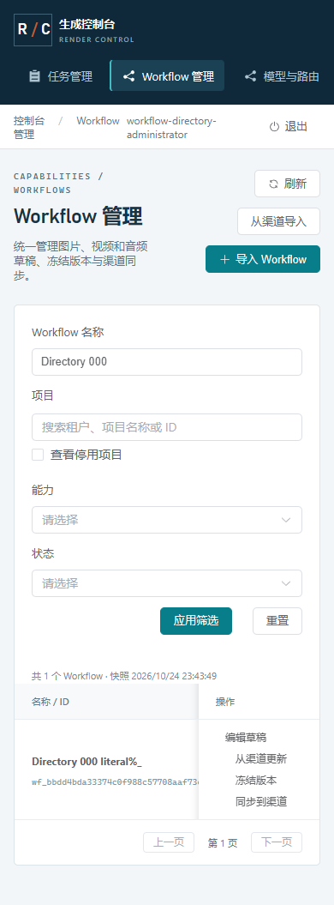

# 72 · Workflow 检索与分页同步选择

2026-10-24，第 72 增量。落实首版 Workflow 管理与批量分发（文档 07/24）、六类 ComfyUI 产物和 DEV-15/17/20/21/25/26/28/32。上一轮已完成 Key 资源选择；本轮解除 Workflow 同步对详情前 100 个版本、全量渠道加载的依赖，保持冻结、绑定、Worker 回执与运行批准语义。

## 目录与兼容

GET /admin/api/v1/workflows 保持 workflows:read，保留 data/page/has_more 并增加 snapshot_at/total/filters。查询 page=1..1000，q 最多 128 字符字面名称子串、project_id、task_type（六类）、status=active/archived 和 workflow_id 精确 ID；条件取交集。旧客户端只传 page 仍可读取原字段；不返回草稿、执行图、manifest 或验证明细。每页 50、创建时间倒序和 ID 稳定排序，统计与当前页同一只读快照。

新增 GET /admin/api/v1/workflow-sync-options，权限 workflows:publish；kind=release/channel，project_id 和 workflow_id 必填。先核对 Workflow 属于项目，两类选择都限制同项目。page=1..1000、q 为最多 128 字符字面搜索（版本号或渠道名称）、ids 最多 50 个唯一对应类型 ID。精确解析只允许第一页且不混搜索；空 ids 表示浏览。版本浏览仅结构验证通过，按版本倒序；精确解析可以标示未验证项并禁止提交。渠道只包含未删除项，按创建时间倒序；停用/排空状态清楚显示，选择不启用渠道。

响应带 kind/project_id/workflow_id/snapshot_at/page/total/has_more/data。仅版本 ID/版本号/digest/validated，或渠道 ID/名称/资源 revision/启停/排空；不读取或返回渠道地址、认证、节点 inventory、Workflow 草稿/manifest/values/validation。单页及单次精确解析均最多 50，最多 100 个同步目标可分两批解析。目录查询采用 REPEATABLE READ READ ONLY、5 秒语句/1 秒锁预算；父资源缺失返回 404，数据库/投影异常固定 503 且无内部回显。读取不写任务、配额、审计、GPU、操作或命令，无 DDL。

四份机器契约为 admin-workflow-catalog-query、admin-workflow-catalog-page、admin-workflow-sync-options-query、admin-workflow-sync-options，先冻结再同步 DTO、运行包、OpenAPI、客户端与正反 fixture。

## 图形与原请求

沿用现有蓝灰 Admin。Workflow 名称搜索、项目/能力/归档筛选显式应用与重置；每页 50，失败标示最后成功数据，无首次数据时不伪装为空目录。同步窗口按需搜索/翻页版本和目标渠道，已选名称保留并精确核对，最多 100 个目标。捕获版本 digest 与每个目标 revision 后明确提交；失效选择阻止提交，不能静默换版本或删除目标。受理后显示操作 ID 与操作中心入口，受理不表示 Worker 已同步成功或运行获批。

列表、草稿读取、选择目录与写入等待均有十秒本地预算；本地 JSON 文件最多 10 MiB，读取可取消且迟到结果不能写回已关闭草稿。关闭、隐藏、离页、注销取消归属请求/定时器，关闭敏感导入预览、清理草稿；恢复先核对管理会话，再恢复读取，不自动写入。观察者可检索和查看，不能编辑/导入/冻结/同步。

创建、编辑、冻结与推送捕获原正文、幂等键或 revision。网络中断、408、5xx、超时保留原请求并锁定冲突写入，显式原键核对；初次确认的 4xx 保留草稿并解释，未知编辑重放的 409 继续保留核对记录、允许只读查看当前版本，不自动提高 revision。冻结和同步的重放沿既有服务端幂等，不增加版本或命令。清除本地记录不撤销服务器操作。

## 验证出口

真实 PG/HTTP 检查交集筛选、超过 50 的目录和超过 100 的版本、精确解析/字面搜索/跨项目排除、安全列、只读快照和锁预算、四类身份与角色边界。使用安全目录的 digest/revision 提交真实批量同步，检查同键回放仅一个操作/每目标一命令，冲突整批回滚和原批准失效语义。六类产物同一管理规则，音频实际资源仍待联调。

生产前端配合原生 HTTPS/PG 检查后续页、已选项/失效项、草稿与文件边界、实际创建/编辑/冻结/同步丢响应核对、权限、十秒预算/迟到/隐藏/离页/注销及 390px。浏览器/上下文、临时进程/库和私密夹具 finally 清理；再运行适配的回归、候选安装和源码/契约核对。真实 Windows/六类 Workflow、存储、公网、系统服务和设备容量继续独立验收，不以本地合成证据关闭完整工作包。

## 实现与验证

第 72 增量完成 Workflow 名称/项目/六类能力/归档筛选，以及同步冻结版本与目标渠道的安全分页选择。目录每页 50，超过 100 个版本可继续翻页；最多 100 个目标分两批精确核对 digest/revision，不载入执行图、渠道地址或凭证。创建、编辑、冻结、同步保留原正文/幂等键或 CAS 版本；丢响应显式核对，不自动提高 revision。关闭、隐藏、离页、注销取消等待并清理草稿；观察者只读。音频同样是 ComfyUI Workflow 产物。完整 Python 2,664、定向 1,183、mypy 148 源文件、14 组桌面/390px、原生 20 组及精确候选安装 24 项/安装后浏览器 8 组通过。候选 rc-20261024.72.2；45 运行契约、43 schema/672 fixture（178 正/494 反）、183 API 方法/144 路径、176 设计端点。无 DDL，两库 head 0a7d9b4e2136、42 业务表。真实六类 Workflow/Windows、S3/Redis、公网/系统服务、联合恢复和 10/20 台实机容量继续独立验收，完整目标保持进行中。

| 出口 | 已核对的证据与边界 |
| --- | --- |
| 目录与契约 | 新增 85 fixture（18 正/67 反），Schema/DTO 同验。真实 PG 验证 53 条筛选结果、103 个可选冻结版本、101 个同名渠道、字面搜索、父资源/跨项目/软删除排除、100 个目标分批解析、只读一致快照和真实锁预算；管理角色独立授权 |
| 实际音频同步 | 使用安全目录返回的 digest/revision 提交两个停用渠道；冲突整批回滚，同原键重放仅一个操作/两条 Worker 命令。同步撤销原 verified_digest 与 runtime_approval，保持停用；受理不代表运行批准或设备应用成功 |
| 图形与实际写入 | 生产前端及原生 HTTPS/PG 验证后续页、局部检索、版本选择、同步及创建/冻结丢响应原键重放、编辑提交后原 CAS 冲突继续核对并只读查看当前草稿、本地文件类型/10 MiB 边界、关闭/隐藏/迟到/十秒预算、最后成功快照和观察者权限。网络失败/延迟及 visibilitychange 明确为测试注入；390px 单独检查 |
| 最终 UI 补强 | 恢复页面期间先等待管理会话响应，再启用目录；真实浏览器阻塞会话响应期间断言没有 Workflow/项目/同步目录读取。72.1 到 72.2 仅 Workflows.vue 改动，源码摘要核对后复用完整 Python/原生证据，并重新构建前端、跑 14 组图形；既有 Workflow 图形另有 4 组通过 |
| 数据库后核对 | 一个创建、一次编辑、一次冻结、一个同步操作和两条命令，与精确审计次数一致；没有新增生成任务/attempt/占用/usage，GPU fence 不变。仅合成音频 manifest，不代表真实音频模型和质量验证 |
| 回归与候选 | Ruff/mypy、75 依赖锁、生产前端、完整/定向 Python、20 组原生协议/11 合成任务含音频、候选隔离安装 24 项及安装后浏览器 8 组通过；Worker/Go 未改动，摘要核对后复用既有 Go 客户端/账本证据 |
| 释放与运行 | 所有本次浏览器/上下文与临时进程/数据库、私密 fixture 在 finally 释放；开发环境恢复 9 个登记原生进程，PostgreSQL 持久性参数开启。无 Docker/WSL/虚拟机或子代理；开发审计清理未启用 |

候选 `rc-20261024.72.2`，SHA-256 `aef4af1c55cd4a6b66ca014228a194368b8c1173b0dc002447171743c09ba6fd`，414 个源输入、149 项 payload、57 个 wheel。既有 chunk/Starlette 提示保留。

证据：[最终核对](./evidence/2026-10-24/workflow-directory-closeout.json)、[测试摘要](./evidence/2026-10-24/workflow-directory-test-summary.json)、[图形](./evidence/2026-10-24/workflow-directory-browser.json)、[实际写入后核对](./evidence/2026-10-24/workflow-directory-browser-fixture.json)、[原生协议](./evidence/2026-10-24/workflow-directory-native-protocol.json)、[精确安装](./evidence/2026-10-24/workflow-directory-release-installation.json)、[发布摘要](./evidence/2026-10-24/workflow-directory-release-build.json)。

