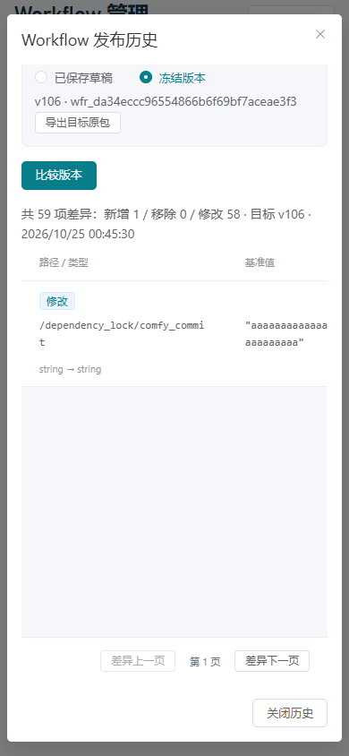

# 73 · Workflow 发布历史与版本差异

2026-10-25，第 73 增量。落实文档 07 §5.1 的冻结版本与差异查看，以及 WP-07/08、DEV-06/15/17/20/21/25/26/28/32。前轮 72 已由源码、2664 项回归、图形及精确候选验收证明取得进展；本轮继续首版开发，完整目标和真实资源出口保持原范围。

## 接口与边界

新增 GET `/admin/api/v1/workflows/{identifier}/releases`，权限 `workflows:read`。page 为 1..1000，每页 50，版本倒序和 ID 稳定排序；响应包含父 Workflow/项目、当前草稿 revision、快照时间、总数和分页，以及版本 ID/版本号/digest/结构校验状态/创建时间。先核对父 Workflow。历史包含未通过结构校验项，不能把浏览或差异查看当作运行批准。不读取或返回 manifest/草稿/validation/渠道地址与凭证。既有 POST 冻结及详情的前 100 条兼容字段保留。

新增 GET `/admin/api/v1/workflows/{identifier}/release-diff`，同为 `workflows:read`。base_release_id 必填，target_release_id 可选；缺省目标为当前已保存草稿，指定时比较两个冻结版本。两端版本必须属于该 Workflow 和项目；不接收客户提供的任意 JSON。page 为 1..1000，每页 50 条结构差异，返回精确新增/移除/修改数量、总数、has_more、草稿 revision、双方标识/版本/digest、快照和当前页。无差异必须源于完整成功比较，不能用错误或超限当作相同。

比较忽略对象键顺序，数组按位置，区分缺失和 JSON null，布尔与数字不同，JSON 数值 1 与 1.0 相同。新增/移除的整个分支算一项；相同结构递归比较。结果按键字典序/数组下标稳定遍历，分页只保留当前 50 项。每项含经过控制字符转义的显示路径、完整路径 SHA-256、变更种类、前后类型和 JSON 文本预览。路径最多 512 字符、各预览最多 2048 字符，均明确截断标记；值使用文本渲染。授权管理员本来可以读取草稿/冻结包，差异端点沿同一读取权限；不得把预览写入日志、审计、安全错误或持久缓存。原始冻结包可由用户明确导出核对。

单个存储 JSON 文档最多 10 MiB，先在 SQL 中检查大小再载入；每端结构及比较路径分别最多 100000 项、深度最多 64。超限固定 413，不返回部分比较或虚假的零差异。查询使用同次 REPEATABLE READ READ ONLY、5 秒语句/1 秒锁预算，统计/页面及比较双方在同一快照。无父/跨父资源统一 404，数据库/投影异常固定 503；无 DDL，不创建审计、任务、配额、GPU 占用、操作或 Worker 命令。

先冻结 history-query、history-page、diff-query、diff 四份机器契约，再同步 DTO、服务、OpenAPI、客户端和正反 fixture；管理角色可读范围不改变，业务 Key/Worker/网关身份不能使用这些接口。

## 图形交互

Workflow 列表增加“发布历史”，不再依赖草稿详情前 100 个版本。沿用蓝灰 Admin，提供版本号、摘要、结构状态与时间，以及“作为基准/作为目标”。已选两个版本跨历史分页保留；默认比较目标为已保存草稿，切换目标模式需明确选择。差异显示前后列、数量和逐页内容；长值与路径清楚标记省略，并允许明确导出原冻结包。查看不保存、冻结、推送或授予运行批准。

历史、差异和导出各有十秒本地预算；变化筛选/比较方向时取消旧请求，迟到结果不能覆盖新上下文。差异失败保留带标记的上次成功结果；首次失败不伪装为空差异。对草稿翻页期间若 revision 变化，重置第一页并显示重新比较提示，不混用两个草稿版本。关闭、隐藏、离页和注销取消读取、释放导出 URL 并清除预览；恢复先核对会话且不自动打开旧预览。观察者可只读查看，不能编辑、冻结或同步。390px、键盘、空历史与失败状态都须验证。

## 验证出口

真实 PostgreSQL/HTTP 覆盖超过 100 个冻结版本、稳定分页、跨父排除、JSON 语义、音频参数与图/依赖差异、超过 50 条差异及长值/路径、SQL 大小预检、遍历/深度限制、固定错误、只读一致快照/锁预算和角色/身份边界。验证前后业务表、审计、操作、命令、GPU fence 与占用保持不变。

生产前端与原生 HTTPS/PG 验证第 3 页历史、双方版本选择、草稿与冻结比较、差异后续页、导出、失败后上次结果、迟到/超时/关闭/隐藏/离页/注销、只读角色及 390px。测试浏览器/上下文及临时进程/库/私密 fixture 在 finally 清理。再运行适配回归、原生协议、精确候选隔离安装、当前源码/契约摘要及文档门禁。真实 Windows、六类 Workflow/模型/质量、存储、生产部署与实机容量仍独立验收。

## 实现与验证记录

第 73 增量完成 Workflow 发布历史与版本差异。历史每页 50，超过 100 个版本仍可选择；可比较两个冻结版本或已保存草稿，显示路径、类型及前后 JSON 值预览，差异每页 50。长值/路径标明截断并支持手动导出冻结原包。对象键序无关，数组按位置，缺失与 null、布尔与数字分别处理；10 MiB SQL 预检、100000 项/64 层预算、同次只读快照和固定安全错误均已验证。关闭、隐藏、离页、注销释放读取和预览，恢复先核对会话；观察者可读。音频仍是 ComfyUI Workflow 产物，采样率、图参数和依赖差异走同一机制。完整 Python 2,838、定向 1,357、mypy 150 文件、13 组桌面/390px、原生 20 组/11 合成任务以及精确候选安装 24 项/安装后浏览器 8 组通过。候选 rc-20261025.73.1；49 运行契约、47 schema/747 fixture（189 正/558 反）、185 API 方法/145 路径、178 设计端点。无业务表或迁移变更，两库 head 0a7d9b4e2136、42 业务表。真实 Windows/六类 Workflow/模型/质量、S3/Redis、公网及系统服务、联合恢复和 10/20 台实机容量继续独立验收，完整目标进行中。

| 验证 | 结果与界限 |
| --- | --- |
| PostgreSQL / HTTP | 104 条发布历史分页、音频契约三处实际值变化、66 项 JSON 语义差异分页、控制字符及长值、10 MiB SQL 预检、结构/遍历限制、跨父 404、四种角色和有效业务 Key 隔离、只读快照与锁预算通过；查询不产生业务审计、操作、命令、任务或占用 |
| 图形 | 原生 HTTPS/PG 和生产前端验证历史第 3 页、跨页选择、冻结/草稿差异翻页、原包导出、前后值纯文本、失败后快照、首次失败、十秒超时、关闭/隐藏/离页/注销和观察者、390px；网络故障/延迟、草稿 revision 响应变化和 visibilitychange 明确为测试注入，数据库快照变化另由真实并发事务验证；截图审查后固定标题/关闭按钮并限制差异表高度，最终前端重新构建和验证。取消测试中的 Playwright 路由取消回调有预期诊断，页面 JS 错误为零 |
| 只读后核对 | 浏览前后业务快照完全相等，Workflow 审计/操作/Worker 命令为零；所有浏览器、临时数据库/进程与私密 fixture 在 finally 清理 |
| 回归与候选 | Ruff/mypy、75 依赖锁、前端、完整/定向回归、原生协议、精确候选隔离安装及安装后浏览器通过。Go/Worker 源未变，核对摘要后复用 2026-10-24 Go 客户端/账本证明；Provider 本轮重新原生构建，原生协议重新执行 |
| 运行与未验收 | 恢复 9 个登记开发进程；诊断输出后已轮换本地开发数据库密码并验证新连接，不含生产凭证。无 Docker/WSL/虚拟机和子代理。仅合成音频 Workflow，真实模型质量与设备容量仍待资源接入 |

候选 `rc-20261025.73.1`，SHA-256 `e4521b2e2d9ad5b06b9c530e88b8c9183ea1feda79189bba2ab79ecf98707c2e`，421 源输入、149 payload、57 wheel。既有 chunk/Starlette 提示保留。

证据：[最终核对](./evidence/2026-10-25/workflow-history-closeout.json)、[测试摘要](./evidence/2026-10-25/workflow-history-test-summary.json)、[图形](./evidence/2026-10-25/workflow-history-browser.json)、[只读后核对](./evidence/2026-10-25/workflow-history-browser-fixture.json)、[原生协议](./evidence/2026-10-25/workflow-history-native-protocol.json)、[精确安装](./evidence/2026-10-25/workflow-history-release-installation.json)、[发布摘要](./evidence/2026-10-25/workflow-history-release-build.json)。

