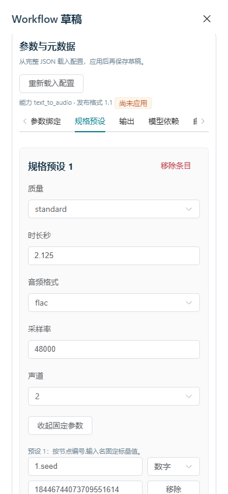

# 74 · Workflow 参数与元数据表单

2026-10-25，第 74 增量。前轮 73 的源码/候选/2838 项 Python 回归、13 组图形及原生、隔离安装证明已核对，判定为取得进展。继续落实文档 07 §5.1、13、WP-07/08 和 DEV-06/15/16/17/20/25/26/32；不缩减六类能力及真实资源验收。

## 编辑约定

在现有草稿编辑器加入参数/元数据配置表单。保留完整发布包 JSON；表单从当前 JSON 显式载入，编辑后明确“应用到本地草稿”，再通过已有创建/PATCH 保存。应用表单不创建发布、同步、任务、命令或运行批准。不新增 API、数据库字段或发布格式；冻结仍调用现有服务端 WorkflowManifest 与语义校验。任务类型/发布格式按原五类 1.0、音频 1.1 展示，不静默转换能力。

表单覆盖参数 source → 节点/输入绑定、质量/尺寸/时长及音频格式/采样率/声道预设、预设节点标量值、允许参数列表、最终输出适配/节点/数量/大小/MIME、ComfyUI 提交及模型路径/SHA-256/大小、自定义节点提交、运行画像标识/GPU/执行预算，以及独立 API-format 图编辑。不得自动下载权重、安装节点、填入假哈希或标记已验证。画像的已有测量/批准字段只读；显式改动该条预算/标识时清除该条草稿的测量和批准引用并给出提示，新的渠道批准仍单独进行。

沿用蓝灰控制台与现有字体，按配置类别组织，绑定以“参数 → 节点输入”呈现。数组每页最多 50 行，分页保留全部未显示项；允许明确添加/删除条目，不以截断代替分页。未知字段保留；结构不受表单支持的部分显示原因并允许通过完整 JSON 修正，不强制转换成空数组/空对象。空草稿或 API 图可通过明确初始化动作包装为未完成的发布包；不覆盖已有完整包，绑定/依赖/输出未补齐时不能宣称可执行。

本地配置与完整 JSON 分别保留：外部 JSON 在载入后变化，提示表单过期并阻止覆盖，重新载入须明确放弃未应用表单。保存时若仍有未应用的本地配置，要求先应用或放弃，避免用户误以为已保存。名字/任务/项目等表单继续使用现有原正文、幂等键和 revision 冲突核对；不因本地编辑自动刷新 revision。

## 数值与资源边界

ComfyUI 图可能含 64 位种子。前端读草稿/冻结包、文件导入、表单载入/应用、保存/原请求重放和导出均不得经普通 JSON.parse/JSON.stringify 丢失数值精度。使用受限 JSON 解析/序列化保存数字原词法值，并将工作流创建/PATCH 以同一精确序列化器发出。正常协议元数据（revision、时间等）单独作安全整数检查；不能把原词法数字包装对象发送给服务器。拒绝重复键、非法 JSON、非有限的原生 JS 数字及循环引用，错误不回显正文。浏览器保留服务端响应或本地导入中的数字词法；不把后端现有 Python/JSONB 浮点规范化宣称为任意精度小数协议。64 位整数在现有后端按整数存取，本轮做端到端核对；长小数/指数词法保持由前端单元验证，HTTP 同时核对可准确表示的小数。

单份草稿/本地文件最多 10 MiB，最多 100000 个值/64 层；响应/请求外层元数据留有限余量。超限明确报错，不部分导入、悄悄舍弃字段或重写未知数字。解析器保护对象原型，不把 __proto__/constructor 键当作程序配置。表单只在当前页面内存保留，不写浏览器存储/URL/日志；关闭/隐藏/离页/注销及会话变化清除，所属放弃修改确认框随组件销毁关闭；恢复遵循先核对会话。观察者可以查看但不能应用或保存； pending 原请求期间冻结编辑。

## 验证出口

真实 HTTPS/PG 浏览器覆盖六类表单、音频规格/依赖/输出和图编辑、分页保留未显示行、初始化和未知字段、JSON/表单过期、未应用保存拦截、超限/非法/重复键、64 位整数在读取/保存/冻结/导出中的保持及前端长小数/指数词法保持，以及失败后原请求重放/CAS 冲突。核对精确服务端草稿/冻结包及审计次数，确认配置编辑不触发任务、命令或 GPU 占用。检查键盘、390px、观察者、关闭/隐藏/离页/注销及浏览器 finally 释放。

前端构建和候选隔离安装重新执行。后端/Worker/Go 未改动时先对照 73 的真实执行源码摘要，再复用 2838 项回归和原生协议证明，注明执行时间与复用范围；有实现变化则运行对应新增/回归门禁。文档与当前候选、进程/两库状态逐项核对，完整目标与真实六类 Workflow/Windows/模型/质量、S3/Redis、公网/系统服务、联合恢复及 10/20 台实机容量仍独立验收。

## 实现与验证记录

第 74 增量完成 Workflow 参数与元数据可视化表单：参数绑定、规格及固定参数、输出、模型/自定义节点依赖、运行画像、允许参数和 API 图，覆盖原五类及 ComfyUI 音频。音频配置时长、格式、采样率和声道，沿用同一渠道、异步任务、Key 与内容体系。表单显式载入/应用/保存，未应用与过期状态阻止误保存；数组每页 50 保留未显示项，观察者可读，关闭/隐藏/离页/注销释放本地数据及确认框。精确 JSON 处理保护 64 位种子，导入、保存、原请求核对及冻结包导出保持整数；10 MiB、100000 值、64 层及重复键检查生效。新执行 33 项前端单元、30 组桌面/390px 表单、13 组历史回归、mypy 150 文件及隔离安装 24 项/安装后浏览器 8 组均通过。后端/Worker/Go 未改，逐文件核对摘要后复用第 73 增量 2838 项 Python、1357 项定向及 20 组原生协议/11 合成任务证明，明确不是本轮重跑。候选 rc-20261025.74.3；49 运行契约、47 schema/747 fixture（189 正/558 反）、185 API 方法/145 路径、178 设计端点均未增加。无表/迁移变更，两库 head 0a7d9b4e2136、42 业务表。真实六类 Workflow、Windows/模型/质量、S3/Redis、公网/系统服务、联合恢复和 10/20 台实机容量继续独立验收，完整目标进行中。

| 验证 | 结果与边界 |
| --- | --- |
| 表单与真实 HTTP | 六类草稿分别编辑/保存；音频将 seconds 绑定到节点 duration 输入并调整时长、编码、采样率、声道、固定值、模型/自定义节点锁、输出、允许参数和图。精确整数以 JSON 数字发送，保存/冻结/下载后核对 18446744073709551615 与 18446744073709551614。节点未知元数据及原型同名键保留且只作为数据 |
| 精度单元 | 33 项覆盖长小数/指数词法、64 位整数、重复/转义同名键、原型键、非法 JSON、UTF-8/大小/深度/数量、循环/非 JSON/非有限原生数字、未完成数字与近上限格式化。协议 revision 要求安全的整数字面量，不能将接近整数的小数舍入后接受。后端既有浮点规范化边界见上文 |
| 分页及误保存 | 55 条绑定、55 条模型依赖、56 个固定值跨页保留；未完成数值跨类别仍阻止应用。表单尚未应用时拦截保存，完整 JSON 改动使表单过期，重新载入需明确确认。空包/API 图仅经明确初始化创建草稿；不支持的节结构保留不被改写 |
| 权限/生命周期 | 桌面及 390px：观察者可读所有页和固定值，不能应用/保存；关闭、隐藏、离页、注销清除表单，隐藏同时关闭所属放弃修改确认框。失响应 PATCH 沿用同一正文/Key/revision 核对，CAS 冲突只读当前草稿 |
| 数据库后核对 | 合成配置操作实际产生 4 次创建、16 次更新、2 次冻结审计；不生成任务、尝试、计量、管理操作、Worker 命令或 GPU 占用。生成执行快照及 GPU fence 不变，Workflow 审计另行核对；13 组发布历史回归无 Workflow 写入 |
| 候选与资源 | 精确候选离线非 editable 安装及浏览器验证通过；本轮创建的浏览器、临时进程/数据库/私密 fixture 在 finally 清理。恢复 9 个登记开发进程；无 Docker/WSL/VM 与子代理。合成图不代表真实 ComfyUI/音频质量或设备容量验收 |

候选 `rc-20261025.74.3`，SHA-256 `fb3584b1eb28ffb3d108fe901748e8476961fd8a60794a3d8e99d317c48ddda0`，424 源输入、149 payload、57 wheel。既有 Vite chunk/Starlette 提示保留，未作为功能失败。

构建/环境记录：74.1 为补齐音频 seconds 绑定前的候选；74.2 归档被中断且缺少 SHA-256 文件，已标记 FAILED 并保留，禁止安装。最终仅使用 74.3。最终安装首次因本地 PostgreSQL 进程/监听缺失超时，测试资源已清理；恢复原有本地数据目录并验证认证连接后，对同一 74.3 重新执行安装。数据库进程退出原因未确立。

证据：[最终核对](./evidence/2026-10-25/workflow-manifest-form-closeout.json)、[测试摘要](./evidence/2026-10-25/workflow-manifest-form-test-summary.json)、[表单图形](./evidence/2026-10-25/workflow-manifest-form-browser.json)、[数据库后核对](./evidence/2026-10-25/workflow-manifest-form-browser-fixture.json)、[历史回归](./evidence/2026-10-25/workflow-manifest-form-history-browser.json)、[后端复用摘要](./evidence/2026-10-25/workflow-manifest-form-backend-reuse.json)、[精确安装](./evidence/2026-10-25/workflow-manifest-form-release-installation.json)、[发布摘要](./evidence/2026-10-25/workflow-manifest-form-release-build.json)、[本地数据库恢复](./evidence/2026-10-25/workflow-manifest-form-local-db-recovery.json)、[中断候选记录](./evidence/2026-10-25/workflow-manifest-form-build-interruption.json)。

