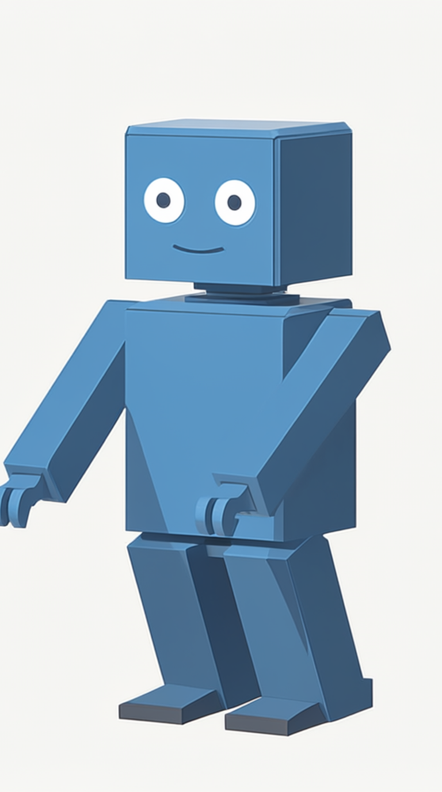

# 实际图片调用 / Actual image generation

此图来自线上普通业务 API 调用，使用本项目合成的蓝色机器人作为参考图。Qwen 编辑流程完成生成后，按已声明的交付画布使用 Lanczos 缩放与居中裁切，实际 PNG 为 **768×1376**。它是实际 GPU 结果；其他目录中的 Admin 演示仍使用明确标记的界面合成数据。

公开图片仅移除了内嵌的工作流元数据，逐像素核对一致。原始下载与公开图片分别记录 SHA-256，原始执行图保留在私有目录。

This image was generated through the production business API using a synthetic blue robot reference. The Qwen editing workflow applies the advertised Lanczos resize and center crop at delivery. The downloaded PNG is **768×1376**. This is an actual GPU result; the Admin demonstrations in other folders remain synthetic UI fixtures.

The public image removes embedded workflow metadata and preserves every pixel. The original download and public image have separate SHA-256 records; the execution graph remains private.

[调用与完整下载记录 / Generation and verified download](../../evidence/2026-11-04/image-canvas-140-runtime.json) · [文件摘要 / File hash](manifest.json)

