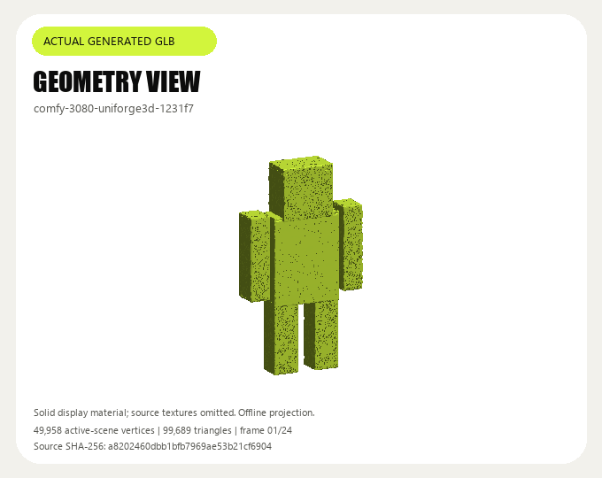
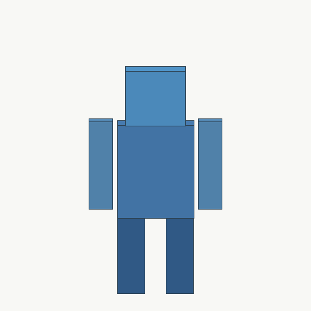
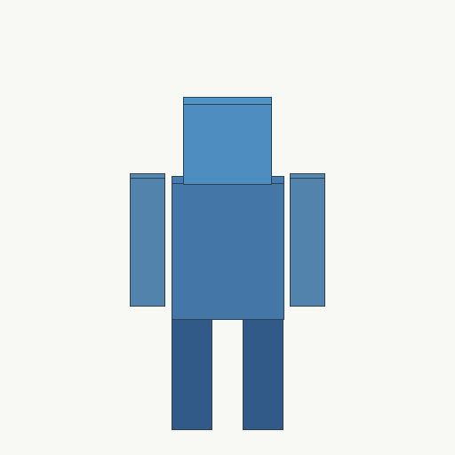
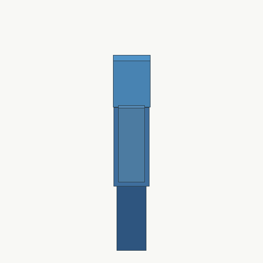
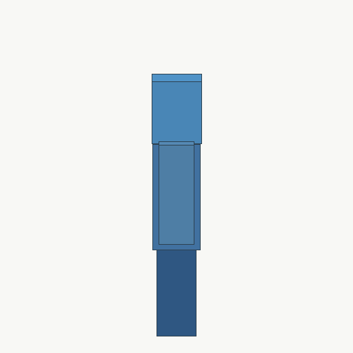

# UniForge3D 实际几何预览 / Actual generated geometry

此预览来自已发布型号 `comfy-3080-uniforge3d-1231f7` 的独立普通业务任务。该任务使用本项目自制的四张方块机器人视图；下载完整 GLB 后，校验文件字节数、SHA-256 和自包含静态三角网格结构。实际文件 **2,399,092 字节、49,958 顶点、99,689 三角形**，一个材质、没有嵌入贴图。

This preview uses the GLB from a separate ordinary business call to the published UniForge3D model, using four original synthetic robot views. The complete download passes SHA-256 and bounded static-mesh inspection. Its geometry has 49,958 vertices and 99,689 triangles; the 2,399,092-byte file contains one material and no embedded textures.

展示使用已纳入项目的原始青柠配色与字体体系：白色卡片、青柠强调色、Impact/Segoe UI。此 GIF 是本机原生 CPU 对源 GLB 全部活动场景三角形做的正交旋转投影，**24 帧、每帧 120 ms，共 2.88 秒**；它是几何预览，采用标注的纯色显示材质，没有呈现原始材质或贴图，也不是生成过程的原速录屏。GLB 未被重写；预览不能代替形状或材质质量验收。

The 24-frame GIF is an offline CPU projection of the actual active-scene geometry, with 120 ms per frame. It uses the project's checked-in Lime palette and a labelled solid display material. Original textures are not rendered, the source GLB is unchanged, and this is not an original-speed recording of inference. Generation/delivery success does not establish shape fidelity or material quality.

本次实际上传的四张参考图如下，由本项目自行绘制几何机器人视图。公开副本与业务请求所引用素材逐张核对字节数和 SHA-256，完全相同；PNG 不含内嵌工作流或其他元数据。[输入来源与校验清单](input-manifest-146.json) 将各图明确对应到该业务任务的命名槽位。

These are the four original synthetic views actually uploaded for the recorded business job. Each public PNG is byte-identical to its referenced asset and contains no embedded workflow metadata; the input manifest maps each role and hash to the preserved request.

| 正面 / Front | 背面 / Back |
| --- | --- |
|  |  |

| 左侧 / Left | 右侧 / Right |
| --- | --- |
|  |  |

- [静态预览 / Still preview](uniforge3d-geometry.png)
- [调用、任务、下载与几何证明 / Runtime and complete-download evidence](../../evidence/2026-11-04/catalog-mesh-145-first-runtime.json)
- [来源与预览文件摘要 / Preview provenance and hashes](manifest.json)
- [18 个三维候选的输入与调用说明 / 18 mesh input contracts and calls](../../139-三维模型调用与逐项验证.md)

源 GLB 的 SHA-256 为 `a8202460dbb1bfb7969ae53b21cf690468eb45d31564b5bd369844b5f0065607`。完整模型通过原任务的鉴权内容接口提供，云端成功后保留八小时；仓库只保存上述预览及脱敏调用证据。
