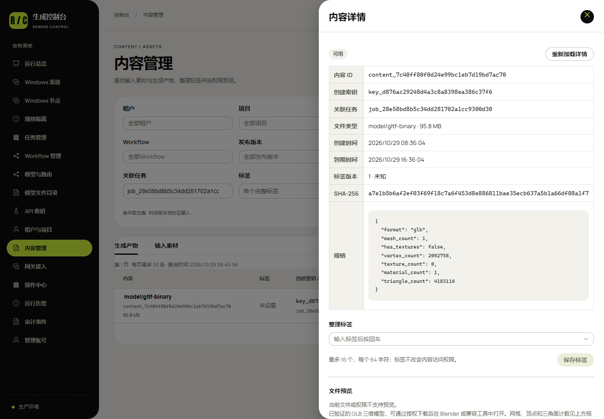

# 3D 适配实测媒体 / Actual 3D adaptation media

[方案、接口与验证记录](../../128-ComfyUI三维模型产物与3080适配.md) · [冻结工作流与源图](../../examples/model3d/README.md)

TRELLIS2 在实际 RTX 3080 上从本项目自制机器人图片生成 GLB。这里的 GIF/PNG 是从真实文件的顶点与三角面计算表面法线后制作的离线投影，采用标明的实色材质以展示几何；交付 GLB 本身未修改。这不是 Admin 内置的交互预览，也不表示纹理、拓扑或打印质量已经验收。真实文件保留 vertex colors，没有 UV/PBR 贴图承诺。

The animation is an offline geometric projection of an actual generated GLB, with depth ordering and computed surface normals under a labelled solid display material. It does not modify the delivered artifact, replace it with a generated illustration, or claim an interactive platform mesh viewer. Source input is original diagnostic artwork, not customer media. Full binary hashes, actual counts, generation and cloud-delivery scope are recorded separately in increment 128 evidence.

[原速录屏 MP4](admin-3d.mp4) · [媒体摘要与来源](provenance.json) · [浏览器验收](../../evidence/2026-10-29/model3d-ui-128/verification.json) · [实际 API 请求与响应](../../examples/model3d/responses/request.json)

录像使用已部署平台，登录完成后才开始录制，不包含密码或 Key 值；展示模型说明、GLB 输出配置、独立额度和真实业务内容。Key 表单中的修改仅在本地进行并取消，没有创建或改变生产 Key。浏览器三个上下文和本次创建的标签页均关闭，自有管理会话注销。

The recording captures the deployed Admin after login at normal speed. It includes actual usage, Workflow output controls, independent quotas and the delivered business GLB's metadata. Permission/quota edits in the new-Key form are cancelled without saving. The three owned contexts and browser are closed, and the management session is revoked.

| 页面 / View | 实际截图 / Screenshot |
| --- | --- |
| 模型使用说明 / Model usage | [model-usage](../../evidence/2026-10-29/model3d-ui-128/screenshots/model-usage.png) |
| 实际请求 / Request | [model-request](../../evidence/2026-10-29/model3d-ui-128/screenshots/model-request.png) |
| Workflow 输出 / Output | [workflow-output](../../evidence/2026-10-29/model3d-ui-128/screenshots/workflow-output.png) |
| 租户额度 / Tenant quota | [mesh-quota](../../evidence/2026-10-29/model3d-ui-128/screenshots/mesh-quota.png) |
| Key 权限 / Key permission | [key-mesh-permission](../../evidence/2026-10-29/model3d-ui-128/screenshots/key-mesh-permission.png) |
| Key 额度 / Key quota | [key-mesh-quota](../../evidence/2026-10-29/model3d-ui-128/screenshots/key-mesh-quota.png) |
| 3D 筛选 / Filter | [content-filter](../../evidence/2026-10-29/model3d-ui-128/screenshots/content-filter.png) |
| 实际几何计数 / Geometry | [content-geometry](../../evidence/2026-10-29/model3d-ui-128/screenshots/content-geometry.png) |
| 移动端 / Mobile | [model-usage-mobile](../../evidence/2026-10-29/model3d-ui-128/screenshots/model-usage-mobile.png) |

下载依赖业务 Key，正式云端产物按成功后八小时到期。完整 GLB 不随代码仓库分发，实际几何与摘要由专题及交付记录核对；不把会过期的内容 URL 作为永久示例链接。
