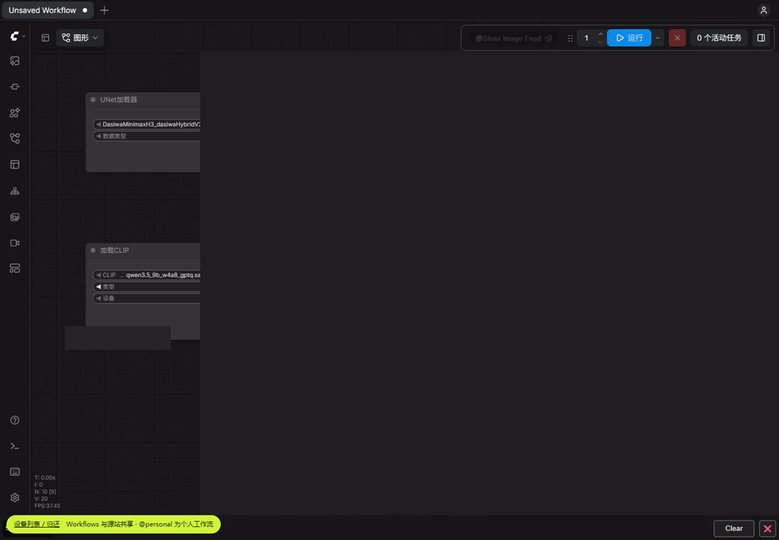

# Native Workflows: actual UI evidence

[中文](README.md) · [Implementation and rollout](../../150-原生工作流完整目录与源站操作修复.md) · [Checks and media hashes](../../evidence/2026-11-16/origin-workflows-150-browser.json)

Captured from the production-domain RTX4090 editor on 2026-11-16. The directory uses actual source folders. Clicking a newly owned Unicode workflow opens an `EmptyImage` node; this demonstration never executes a graph. The native editor retains its UI and the platform navigation uses Lime.

- [Desktop tree](workflows-tree-desktop.png), [opened graph](workflows-open-desktop.png), [390×844 viewport](workflows-open-mobile.png).
- [Original-speed recording](native-workflows-recording.mp4): 53.839 seconds, no audio, ending before the mobile transition.
- [GIF](native-workflows.gif): the recording from second 47, 10 fps and 960 pixels wide, retaining the original timing.

One source folder name is masked. The initial source/default canvas is covered until the owned test graph loads; the tree screenshot also covers that canvas. These are explicit privacy redactions, with no fabricated UI. No credentials, source graph body or customer assets are published. The public report hashes these redacted artifacts.

All 123 child blueprints load successfully; 670 observed responses contain no 5xx. Remaining unadapted extension routes and optional missing files still produce documented 403/404 responses. The test source file is removed, preexisting device ownership is preserved, test sessions are logged out and every owned browser resource is closed. No virtualization is used.
