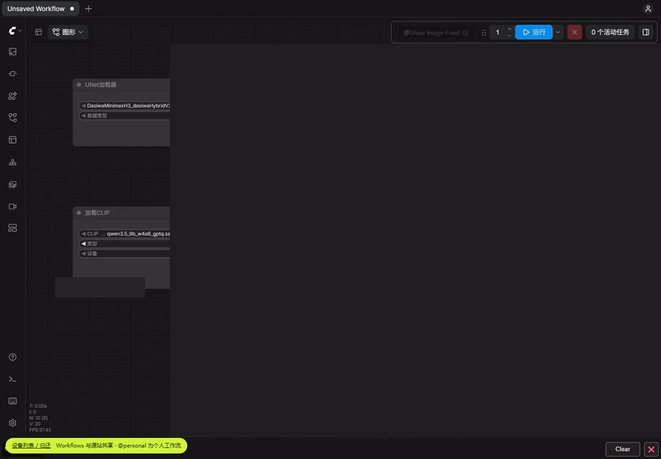

# 原生 Workflows 修复 · 实际页面与录屏

[English](README.en.md) · [方案及上线](../../150-原生工作流完整目录与源站操作修复.md) · [验证和媒体摘要](../../evidence/2026-11-16/origin-workflows-150-browser.json)

2026-11-16 从 **https://gen.sub2share.xyz/origin/rtx4090/** 实际采集。设备编辑器保留 ComfyUI 外观，平台导航使用既定青柠样式。演示只打开本轮自建的中文单节点 `EmptyImage` 流程，未点击运行、未生成图片。

| 文件 | 内容 |
| --- | --- |
| [桌面目录](workflows-tree-desktop.png) | 源机原始工作流文件夹；初始画布整体遮挡，防止泄露源图内容。 |
| [桌面打开](workflows-open-desktop.png) | 点击本轮自建中文源文件后，实际画布加载 `EmptyImage`；文件随后已删除。 |
| [移动视口](workflows-open-mobile.png) | 390×844，工作流目录和青柠导航。原生复杂画布的移动端可操作性仍由 ComfyUI 决定。 |
| [原速录屏](native-workflows-recording.mp4) | 53.839 秒、无音轨，记录真实初始化、目录搜索、打开；在移动视口切换前结束。没有加速。 |
| [GIF](native-workflows.gif) | 从录屏第 47 秒开始的实际片段，10 fps、960 像素宽；展示目录、搜索及打开，不是完整录像。 |

一处源文件夹名称已遮挡。录屏在自建流程加载完成前整体遮挡初始画布，之后显示真实测试节点；未替换或合成 UI。截图、录屏、GIF 均无 API Key、登录过程、源图正文或客户素材。录屏和截图经过隐私遮挡，因此摘要不同于私有原录像；公开摘要列于验证报告。

本次 670 个资源响应无 5xx，123 个子工作流蓝图均 200；未适配扩展接口等 403/404 如实记录在方案和报告中。测试文件清理、既有用户占用保留、会话退出和全部本次 page/context/browser 关闭完成。未调用 Docker、WSL 或虚拟机。
