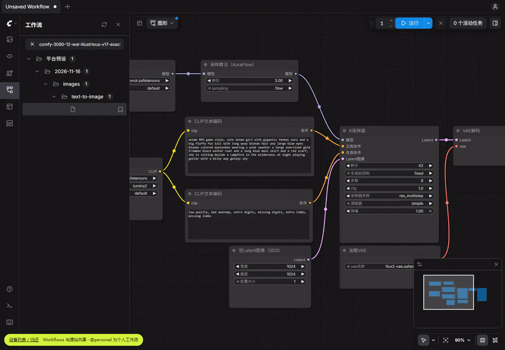

# Actual categorized preset pages

Captured from `https://gen.sub2share.xyz/origin/` with live native directory/file requests and no metadata interception. The new `平台预设/2026-11-16/` tree is read from the devices. Four saved media presets open with their canvases and embedded API graphs. Inputs are explicit placeholders; no generation was submitted.

| Media | Actual content |
| --- | --- |
| [Image](images-preset-desktop.png) / [mobile](image-preset-mobile.png) | Saved WAI preset and categorized source tree |
| [Video](videos-preset-desktop.png) | Saved RTX4090 H3 text-to-video canvas |
| [Audio](audio-preset-desktop.png) | Saved YuE2 music canvas |
| [3D](3d-preset-desktop.png) | Saved TRELLIS2 canvas; current invalid model selections remain visible |
| [MP4](preset-browsing.mp4) / [GIF](preset-browsing.gif) | Actual image → audio → 3D browsing, 7.58 seconds at original speed |

The recording includes only this task's reviewed preset browsing, excludes authentication and existing customer file listings, and runs at original speed. Current invalid model selections are shown honestly; opening a graph does not certify execution. All owned pages, contexts and browsers close in finally. Checksums and capture details: [browser evidence](../../evidence/2026-11-16/workflow-presets-151-browser.json).

