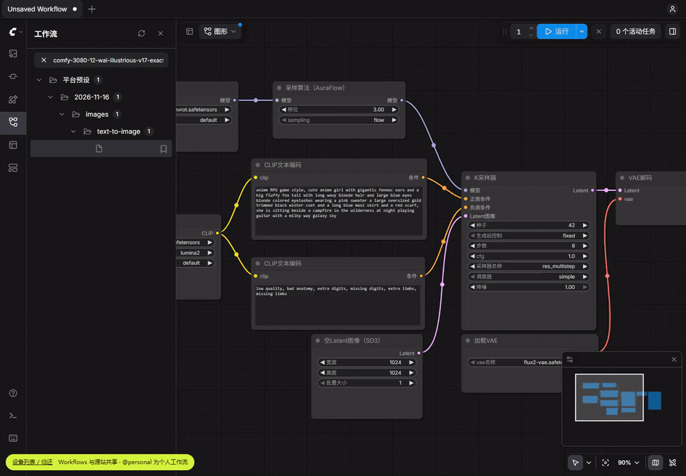

# 分类预设的真实页面记录

来自 `https://gen.sub2share.xyz/origin/` 的实际原生面板，没有使用节点元数据替身；新目录 `平台预设/2026-11-16/` 实际从设备读取。四类源文件已打开、画布与内嵌 API 图检查通过。素材输入是明确占位符，没有执行生成。

| Media | Actual content |
| --- | --- |
| [Image](images-preset-desktop.png) / [mobile](image-preset-mobile.png) | Saved WAI preset and categorized source tree |
| [Video](videos-preset-desktop.png) | Saved RTX4090 H3 text-to-video canvas |
| [Audio](audio-preset-desktop.png) | Saved YuE2 music canvas |
| [3D](3d-preset-desktop.png) | Saved TRELLIS2 canvas; current invalid model selections remain visible |
| [MP4](preset-browsing.mp4) / [GIF](preset-browsing.gif) | Actual image → audio → 3D browsing, 7.58 seconds at original speed |

录屏截取本次自己打开的已审阅预设区间，排除鉴权及原有客户工作流目录；没有改变播放速度。截图展示真实的缺失/失效模型选择，不代表模型可执行验收。全部本次 page/context/browser 均在 finally 关闭。摘要、检查及时间范围见[浏览器证据](../../evidence/2026-11-16/workflow-presets-151-browser.json)。

