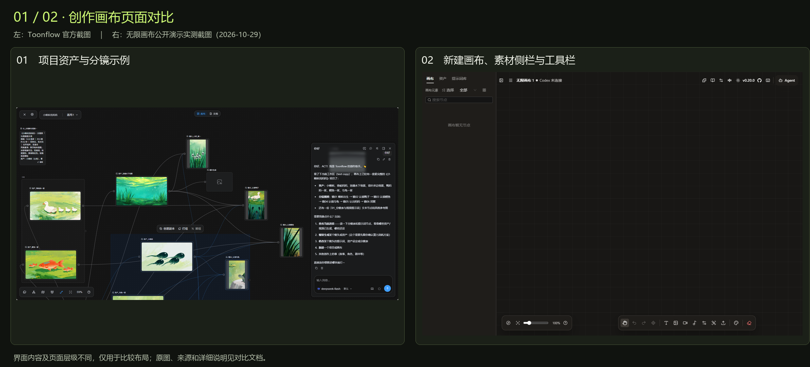
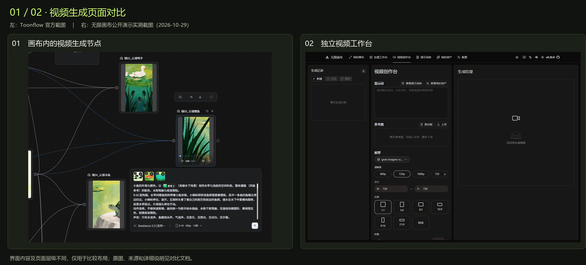
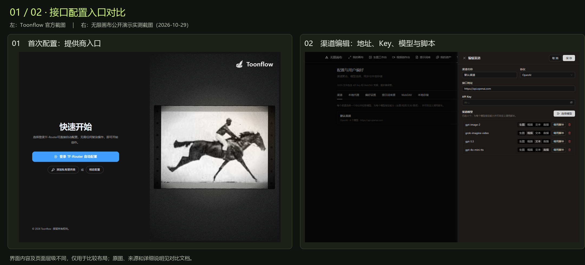
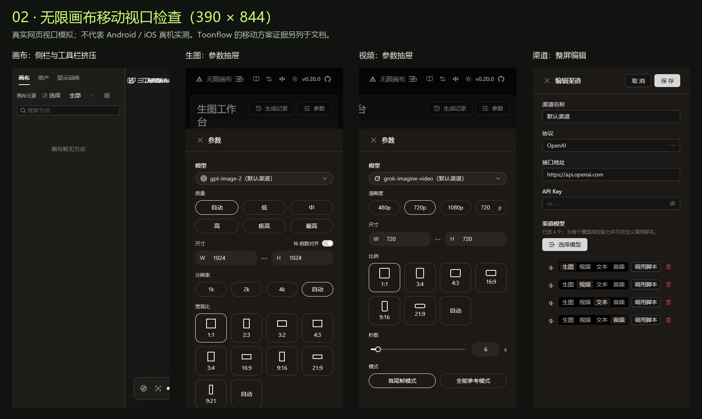

# Toonflow 与 basketikun 无限画布全面横向对比

核对日期：**2026-10-29（Asia/Taipei）**。构建时间：`2026-10-29T23:43:28.509254+08:00`。对应上一轮清单的 **01 / 02**。

**结论：轻量 Web 入口优先比较 basketikun；项目工作区、叙事创作工具和 Android 横屏应用优先比较 Toonflow。两者都有自由画布、生成节点、Agent 和插件，主要差异在执行位置、数据保存、移动形态和扩展方式。**

本次展开 **48 项**对比，另附页面原图、桌面组合图、手机视口图、接口接入验收表与离线 HTML 对比页。

## 核对范围与证据等级

- Toonflow：`af6e884c3d8cda353acaf8ef13aea8ea754a4afd`；无限画布：`9cd3deacbcc598361807afc16c059a80dd18b6f9`。源码和 API 文件已保存并核对内容哈希。
- Toonflow 页面图来自官方仓库，是官方示例截图；本轮没有安装或运行 Toonflow，也没有 Android／iOS 真机测试。
- 无限画布页面来自官方公开演示 `canvas.best`，页面显示版本 `v0.20.0`。桌面视口为 1440×1000，手机视口为 390×844；手机是浏览器视口模拟，不能代替真机触摸与后台测试。
- 公开演示仅用于页面和本地空画布检查：没有填写真实 API Key、提交付费生成或修改线上聚合服务。
- 所有浏览器检查均在独立临时上下文中进行并已关闭；没有运行本地 Docker、WSL、Android 模拟器或其他虚拟化环境。
- “未核实／待验证”表示本次没有证据确认，不能推导为项目永久不支持。轻量程度为部署组件判断，没有给出未经测量的内存、吞吐或开发工时。

## 必须修正的简化认识

1. Toonflow 当前同样是自由无限画布；它的短剧定位不代表只能走固定步骤。
2. Toonflow 已有音频生成节点和 3D 导演台。导演台输出是预演图像／视频，不等于能直接接入 ComfyUI 返回的通用 3D 模型。
3. basketikun 默认存浏览器，但已有可选 WebDAV 同步；内置视频路径保存任务 ID，支持刷新后继续查询。
4. Toonflow 有后端，但当前媒体任务登记仍是临时内存结构。不能直接将它当作可靠的持久任务队列。

## 产品与创作

| 编号 | 对比项 | 01 · Toonflow | 02 · basketikun 无限画布 | 对当前项目的影响 | 依据 |
|---|---|---|---|---|---|
| P01 | 产品定位 | 侧重短剧、漫剧、分镜和项目资产创作 | 侧重图片方案探索、参考图迭代，扩展到视频与音频 | 先明确是做叙事项目，还是提供通用生成入口 | [T1](https://github.com/HBAI-Ltd/Toonflow-app/blob/master/README.md)、[B1](https://github.com/basketikun/infinite-canvas/blob/main/README.md) |
| P02 | 画布自由度 | 自由节点、连线、分组及 AI 助手；当前版本也有无限画布 | 自由节点、连线、分组、撤销重做与画布助手 | 两者都有自由编排，不能把 Toonflow 当成固定流水线 | [T1](https://github.com/HBAI-Ltd/Toonflow-app/blob/master/README.md)、[T10](https://github.com/HBAI-Ltd/Toonflow-app/blob/master/apps/web/src/pages/workspace/panels/canvas/index.vue)、[B2](https://github.com/basketikun/infinite-canvas/blob/main/docs/content/docs/overview/features.mdx)、[B3](https://github.com/basketikun/infinite-canvas/blob/main/docs/content/docs/canvas/canvas-node-manual.mdx) |
| P03 | 文档与项目组织 | 服务端工作区、文件与画布／文档视图结合 | 多画布项目、文本节点、提示词库和素材库 | 复杂剧本与项目文件更偏向 Toonflow 的组织方式 | [T1](https://github.com/HBAI-Ltd/Toonflow-app/blob/master/README.md)、[T12](https://github.com/HBAI-Ltd/Toonflow-app/blob/master/apps/web/package.json)、[B2](https://github.com/basketikun/infinite-canvas/blob/main/docs/content/docs/overview/features.mdx)、[V1](https://canvas.best/) |
| P04 | 图片与参考图 | 独立图片生成节点；参考图片、文本及模型参数 | 文生图、图生图、参考图编辑；另有独立生图工作台 | 两者都可出图；简单生成的操作入口不同 | [T8](https://github.com/HBAI-Ltd/Toonflow-app/blob/master/packages/nodes/imageGenerationNode/readme.md)、[B3](https://github.com/basketikun/infinite-canvas/blob/main/docs/content/docs/canvas/canvas-node-manual.mdx)、[B4](https://github.com/basketikun/infinite-canvas/blob/main/web/src/services/api/image.ts)、[V1](https://canvas.best/) |
| P05 | 视频与混合参考 | 节点支持文生、单图、首尾帧、图片／视频／音频混合参考；按模型开放 | 节点及独立视频工作台，含首尾帧与全能参考模式 | 两者都有参考视频创作，具体数量与模式仍由后端模型决定 | [T7](https://github.com/HBAI-Ltd/Toonflow-app/blob/master/packages/nodes/videoGenerationNode/readme.md)、[T3](https://github.com/HBAI-Ltd/Toonflow-app/blob/master/packages/providers/types.d.ts)、[B3](https://github.com/basketikun/infinite-canvas/blob/main/docs/content/docs/canvas/canvas-node-manual.mdx)、[B5](https://github.com/basketikun/infinite-canvas/blob/main/web/src/services/api/video.ts)、[V1](https://canvas.best/) |
| P06 | 音频能力 | 已存在音频生成节点，支持模型、参考素材与生成后播放、截取、变速等 | 已有音频生成和音频节点；默认请求为 OpenAI 风格 TTS，自定义脚本可扩展 | 上一版主表低估了 Toonflow 音频；ComfyUI 音乐异步任务仍需适配 | [T5](https://github.com/HBAI-Ltd/Toonflow-app/blob/master/packages/nodes/audioGenerationNode/readme.md)、[T3](https://github.com/HBAI-Ltd/Toonflow-app/blob/master/packages/providers/types.d.ts)、[B6](https://github.com/basketikun/infinite-canvas/blob/main/web/src/services/api/audio.ts) |
| P07 | 3D 的实际含义 | 内置 3D 导演台，用低多边形人偶等预演动作与镜头，导出 PNG／MP4 | 已核对的默认生成类型为文本、图片、视频、音频，可通过节点插件扩展 | 两者均未验证直接展示聚合服务返回的 GLB／OBJ；导演台不等于 3D 模型生成接口 | [T6](https://github.com/HBAI-Ltd/Toonflow-app/blob/master/packages/nodes/director3dNode/readme.md)、[T3](https://github.com/HBAI-Ltd/Toonflow-app/blob/master/packages/providers/types.d.ts)、[B2](https://github.com/basketikun/infinite-canvas/blob/main/docs/content/docs/overview/features.mdx)、[V1](https://canvas.best/) |
| P08 | 结果再处理 | 有视频截帧、音频截取／变速及导演台预演等节点能力 | 参考素材编辑、生成重试、画布与资产管理 | Toonflow 的创作工具更成体系；不能据此假定完整剪辑成片已自动完成 | [T5](https://github.com/HBAI-Ltd/Toonflow-app/blob/master/packages/nodes/audioGenerationNode/readme.md)、[T6](https://github.com/HBAI-Ltd/Toonflow-app/blob/master/packages/nodes/director3dNode/readme.md)、[T7](https://github.com/HBAI-Ltd/Toonflow-app/blob/master/packages/nodes/videoGenerationNode/readme.md)、[B2](https://github.com/basketikun/infinite-canvas/blob/main/docs/content/docs/overview/features.mdx)、[B3](https://github.com/basketikun/infinite-canvas/blob/main/docs/content/docs/canvas/canvas-node-manual.mdx) |
| P09 | Agent 与 MCP | 开放 Agent、工具、MCP 与插件，结合后端工作区 | 画布助手，以及可选的本地 Canvas Agent／Codex／Claude Code 桥接 | 基础生成均无需先装本地 Agent；自动操作能力需分别配置 | [T1](https://github.com/HBAI-Ltd/Toonflow-app/blob/master/README.md)、[T12](https://github.com/HBAI-Ltd/Toonflow-app/blob/master/apps/web/package.json)、[B1](https://github.com/basketikun/infinite-canvas/blob/main/README.md)、[B2](https://github.com/basketikun/infinite-canvas/blob/main/docs/content/docs/overview/features.mdx) |
| P10 | 插件与自定义能力 | 节点、工具、扩展及供应商适配，含 Bun／服务端能力 | 动态节点插件、TypeScript SDK、模型调用脚本 | 需要文件处理与服务端工具时 Toonflow 更自然；浏览器扩展保持部署简单 | [T1](https://github.com/HBAI-Ltd/Toonflow-app/blob/master/README.md)、[T3](https://github.com/HBAI-Ltd/Toonflow-app/blob/master/packages/providers/types.d.ts)、[B1](https://github.com/basketikun/infinite-canvas/blob/main/README.md)、[B2](https://github.com/basketikun/infinite-canvas/blob/main/docs/content/docs/overview/features.mdx)、[B7](https://github.com/basketikun/infinite-canvas/blob/main/web/src/services/api/model-plugin.ts) |

## 移动端

| 编号 | 对比项 | 01 · Toonflow | 02 · basketikun 无限画布 | 对当前项目的影响 | 依据 |
|---|---|---|---|---|---|
| M01 | Android 客户端 | 官方提供 ARM64 APK，内置 Bun 与 WebView／备用 GeckoView | 当前已核对的主仓库以 Web 为主，未核实官方独立 APK | Android 应用形态上 Toonflow 有明显优势，但真机体验未实测 | [T1](https://github.com/HBAI-Ltd/Toonflow-app/blob/master/README.md)、[T2](https://github.com/HBAI-Ltd/Toonflow-app/blob/master/apps/mobile/readme.md)、[B1](https://github.com/basketikun/infinite-canvas/blob/main/README.md) |
| M02 | iPhone／iPad | 本轮未核实官方 iOS／iPadOS 客户端；不能把 Android 结论外推 | 浏览器路线可作为入口；Safari 的生成、下载、存储需单测 | 两者均未完成 iOS 真机兼容验证 | [T1](https://github.com/HBAI-Ltd/Toonflow-app/blob/master/README.md)、[T2](https://github.com/HBAI-Ltd/Toonflow-app/blob/master/apps/mobile/readme.md)、[B1](https://github.com/basketikun/infinite-canvas/blob/main/README.md) |
| M03 | 横竖屏策略 | Android 默认横屏，默认 75% 界面缩放，可调 50%–100%；复用完整 Web 布局 | 390px 竖屏下生图、视频参数有抽屉布局，渠道编辑为整屏面板 | Toonflow 的移动路线偏横屏工作台；basketikun 有部分竖屏表单适配 | [T2](https://github.com/HBAI-Ltd/Toonflow-app/blob/master/apps/mobile/readme.md)、[V1](https://canvas.best/) |
| M04 | 画布在窄屏的布局 | 源码针对移动设备启用拖动画布和双指缩放；完整布局的实际表现待真机测试 | 本轮 390px 默认画布视口中，左侧栏占约 280px，顶部工具有挤压 | 不能用首页或表单页适配推定整个创作画布适配完成 | [T10](https://github.com/HBAI-Ltd/Toonflow-app/blob/master/apps/web/src/pages/workspace/panels/canvas/index.vue)、[V1](https://canvas.best/) |
| M05 | 触摸编辑完整度 | Vue Flow 中有移动拖动和 pinch 配置；节点连线、长按与键盘输入未真机测 | 存在 Pointer 交互；本轮只验证视口布局，未完成真机连线／双指缩放测试 | 触摸完成一条创作流程仍是共同验收项 | [T10](https://github.com/HBAI-Ltd/Toonflow-app/blob/master/apps/web/src/pages/workspace/panels/canvas/index.vue)、[B3](https://github.com/basketikun/infinite-canvas/blob/main/docs/content/docs/canvas/canvas-node-manual.mdx)、[V1](https://canvas.best/) |
| M06 | 文件、扫码与导出 | Android 文档说明了扫码、系统文件导入导出和设备互联 | 使用浏览器文件选择、Blob 下载与本地存储 | 移动下载目录、大文件和权限交互需按 Android／iOS 分开验证 | [T2](https://github.com/HBAI-Ltd/Toonflow-app/blob/master/apps/mobile/readme.md)、[B2](https://github.com/basketikun/infinite-canvas/blob/main/docs/content/docs/overview/features.mdx)、[V1](https://canvas.best/) |
| M07 | 后台与退出行为 | Android Activity 退出会停止本地 Bun，当前没有后台长任务或前台服务 | 任务查询依赖浏览器运行；手机后台挂起后的行为尚未验证 | 手机退后台不能被承诺为持续跑批；生成应由现有聚合后端负责 | [T2](https://github.com/HBAI-Ltd/Toonflow-app/blob/master/apps/mobile/readme.md)、[T4](https://github.com/HBAI-Ltd/Toonflow-app/blob/master/apps/server/src/utils/media/tasks.ts)、[B3](https://github.com/basketikun/infinite-canvas/blob/main/docs/content/docs/canvas/canvas-node-manual.mdx) |
| M08 | 手机连接电脑 | 可扫码或手动配对远程后端，含设备令牌、撤销和在线检查 | 可选 WebDAV 同步数据；未核实同类原生设备配对通道 | Toonflow 的设备互联更直接；它不提供同画布冲突合并 | [T2](https://github.com/HBAI-Ltd/Toonflow-app/blob/master/apps/mobile/readme.md)、[T11](https://github.com/HBAI-Ltd/Toonflow-app/blob/master/apps/server/src/utils/mobileLink/index.ts)、[B8](https://github.com/basketikun/infinite-canvas/blob/main/web/src/services/webdav-sync.ts) |
| M09 | 移动媒体处理边界 | Android 版当前没有 FFmpeg，相关转码和抽帧功能受限；远程模式另行评估 | 浏览器编解码、Blob 存储和内存受终端限制，未测大型素材 | 移动端不应承担视频合成等重处理 | [T2](https://github.com/HBAI-Ltd/Toonflow-app/blob/master/apps/mobile/readme.md)、[B5](https://github.com/basketikun/infinite-canvas/blob/main/web/src/services/api/video.ts)、[V1](https://canvas.best/) |
| M10 | 安装与操作成本 | 需安装 APK 或配置远程后端，获得较完整的工作区能力 | 打开 Web 链接即可；复杂画布仍需要专门移动布局改造 | 轻量分发偏向 basketikun；Android 横屏应用可优先评估 Toonflow | [T2](https://github.com/HBAI-Ltd/Toonflow-app/blob/master/apps/mobile/readme.md)、[B1](https://github.com/basketikun/infinite-canvas/blob/main/README.md)、[V1](https://canvas.best/) |

## 接口适配

| 编号 | 对比项 | 01 · Toonflow | 02 · basketikun 无限画布 | 对当前项目的影响 | 依据 |
|---|---|---|---|---|---|
| A01 | 请求实际从哪里发出 | 媒体供应商请求主要由 Bun 后端处理 | 基础生成从浏览器直连配置的 API；本地代理为可选能力 | 浏览器和服务器的网络可达范围不同；统一走现有聚合服务最一致 | [T3](https://github.com/HBAI-Ltd/Toonflow-app/blob/master/packages/providers/types.d.ts)、[T9](https://github.com/HBAI-Ltd/Toonflow-app/blob/master/apps/server/src/utils/media/generation.ts)、[B1](https://github.com/basketikun/infinite-canvas/blob/main/README.md)、[B4](https://github.com/basketikun/infinite-canvas/blob/main/web/src/services/api/image.ts)、[B5](https://github.com/basketikun/infinite-canvas/blob/main/web/src/services/api/video.ts) |
| A02 | 模型目录与能力声明 | Provider 含模型 id、type、参考模式、尺寸／时长等能力；支持 modelsUrl | 渠道可拉取／填写模型，并为模型指定生图／视频／文本／音频及脚本 | 现有模型说明和参数范围仍须映射，不能只同步名称 | [T3](https://github.com/HBAI-Ltd/Toonflow-app/blob/master/packages/providers/types.d.ts)、[B2](https://github.com/basketikun/infinite-canvas/blob/main/docs/content/docs/overview/features.mdx)、[V1](https://canvas.best/) |
| A03 | 语言模型协议 | 供应商类型允许 OpenAI Chat、Responses、Anthropic 等协议；按实现配置 | 渠道有 OpenAI／Gemini 路线，文本及 Responses 调用按所选能力处理 | 文本协议兼容不能代替媒体协议兼容 | [T3](https://github.com/HBAI-Ltd/Toonflow-app/blob/master/packages/providers/types.d.ts)、[B2](https://github.com/basketikun/infinite-canvas/blob/main/docs/content/docs/overview/features.mdx)、[B4](https://github.com/basketikun/infinite-canvas/blob/main/web/src/services/api/image.ts)、[V1](https://canvas.best/) |
| A04 | 生图协议 | 通过 Provider 的 generateImage 转换请求；内置供应商各自实现 | 原生含 images/generations、images/edits、Responses 与 Gemini 路线 | 已有 OpenAI 风格生图接口更容易先在 basketikun 验证 | [T3](https://github.com/HBAI-Ltd/Toonflow-app/blob/master/packages/providers/types.d.ts)、[T13](https://github.com/HBAI-Ltd/Toonflow-app/blob/master/packages/providers/src/media/apiMart.ts)、[B4](https://github.com/basketikun/infinite-canvas/blob/main/web/src/services/api/image.ts) |
| A05 | 视频异步协议 | Provider 内部轮询／读取流，最终必须返回 MediaAsset 数组 | 原生含 POST /v1/videos、GET /v1/videos/{id}、GET /v1/videos/{id}/content；另有 Gemini 长任务 | 两者的适配层位置不同；异步视频通常需要核对字段和状态 | [T3](https://github.com/HBAI-Ltd/Toonflow-app/blob/master/packages/providers/types.d.ts)、[T13](https://github.com/HBAI-Ltd/Toonflow-app/blob/master/packages/providers/src/media/apiMart.ts)、[B3](https://github.com/basketikun/infinite-canvas/blob/main/docs/content/docs/canvas/canvas-node-manual.mdx)、[B5](https://github.com/basketikun/infinite-canvas/blob/main/web/src/services/api/video.ts) |
| A06 | 音频协议 | generateAudio 接口含文本、创作提示、参考音频／图片、音色与采样率等 | 默认 /v1/audio/speech 返回音频 Blob；脚本可返回音频结果 | 你的 ComfyUI 音乐工作流不能直接按同步 TTS 协议假定兼容 | [T3](https://github.com/HBAI-Ltd/Toonflow-app/blob/master/packages/providers/types.d.ts)、[T5](https://github.com/HBAI-Ltd/Toonflow-app/blob/master/packages/nodes/audioGenerationNode/readme.md)、[B6](https://github.com/basketikun/infinite-canvas/blob/main/web/src/services/api/audio.ts)、[B7](https://github.com/basketikun/infinite-canvas/blob/main/web/src/services/api/model-plugin.ts) |
| A07 | 直接接 ComfyUI | 官方说明可经自定义供应商接工作流；本轮未完成直连验证 | 自定义调用脚本或节点插件提供适配入口；未验证原生全量工作流导入 | 两者均未证实填入 8188 地址就可调用全部 workflow | [T1](https://github.com/HBAI-Ltd/Toonflow-app/blob/master/README.md)、[T3](https://github.com/HBAI-Ltd/Toonflow-app/blob/master/packages/providers/types.d.ts)、[B1](https://github.com/basketikun/infinite-canvas/blob/main/README.md)、[B7](https://github.com/basketikun/infinite-canvas/blob/main/web/src/services/api/model-plugin.ts) |
| A08 | 尺寸与生成参数 | 图片 size／ratio，视频 duration／resolution／ratio，支持模型专属表单规则 | 工作台支持 W／H、分辨率、比例、质量、数量、秒数等；生图有可切换的 16 倍数对齐 | 720×1080 等精确尺寸需连同对齐、模型限制和输出元数据一起验证 | [T3](https://github.com/HBAI-Ltd/Toonflow-app/blob/master/packages/providers/types.d.ts)、[T8](https://github.com/HBAI-Ltd/Toonflow-app/blob/master/packages/nodes/imageGenerationNode/readme.md)、[T7](https://github.com/HBAI-Ltd/Toonflow-app/blob/master/packages/nodes/videoGenerationNode/readme.md)、[V1](https://canvas.best/) |
| A09 | 参考素材数量 | Provider 模型声明各媒体的参考模式和数量约束 | 节点读上游素材；视频工作台提示最多 9 张参考图，最终仍需接口校验 | 多参考图／视频／音频需要按具体 workflow 做能力表 | [T3](https://github.com/HBAI-Ltd/Toonflow-app/blob/master/packages/providers/types.d.ts)、[T7](https://github.com/HBAI-Ltd/Toonflow-app/blob/master/packages/nodes/videoGenerationNode/readme.md)、[B3](https://github.com/basketikun/infinite-canvas/blob/main/docs/content/docs/canvas/canvas-node-manual.mdx)、[V1](https://canvas.best/) |
| A10 | 任务恢复与页面关闭 | 媒体任务在单进程内存中；约 2 分钟无查询会停止包装任务，结果缓存 5 分钟，重启不恢复 | 原生视频路径保存远程任务 ID，刷新后可继续查询；自定义脚本的恢复需另适配 | Toonflow 当前也不是持久队列；长任务可靠性必须接现有聚合任务系统 | [T4](https://github.com/HBAI-Ltd/Toonflow-app/blob/master/apps/server/src/utils/media/tasks.ts)、[B3](https://github.com/basketikun/infinite-canvas/blob/main/docs/content/docs/canvas/canvas-node-manual.mdx)、[B5](https://github.com/basketikun/infinite-canvas/blob/main/web/src/services/api/video.ts) |
| A11 | 取消与错误处理 | 使用 AbortController；Provider 决定上游请求如何取消 | 支持 AbortSignal、失败状态和脚本错误；停止请求不自动证明上游已停算 | 必须验证取消是否传到 ComfyUI，避免重复提交或误判已取消 | [T4](https://github.com/HBAI-Ltd/Toonflow-app/blob/master/apps/server/src/utils/media/tasks.ts)、[T3](https://github.com/HBAI-Ltd/Toonflow-app/blob/master/packages/providers/types.d.ts)、[B5](https://github.com/basketikun/infinite-canvas/blob/main/web/src/services/api/video.ts)、[B6](https://github.com/basketikun/infinite-canvas/blob/main/web/src/services/api/audio.ts)、[B7](https://github.com/basketikun/infinite-canvas/blob/main/web/src/services/api/model-plugin.ts) |
| A12 | 结果文件与鉴权下载 | 服务端下载媒体后写入工作区；URL 结果的下载需核对可访问性 | 浏览器取得 Blob 后保存；视频支持带 Key 的 content 路径，也有 URL 结果回退 | 返回需鉴权或短时有效的 URL 时，适配器要负责正确取文件 | [T9](https://github.com/HBAI-Ltd/Toonflow-app/blob/master/apps/server/src/utils/media/generation.ts)、[B5](https://github.com/basketikun/infinite-canvas/blob/main/web/src/services/api/video.ts)、[B6](https://github.com/basketikun/infinite-canvas/blob/main/web/src/services/api/audio.ts) |
| A13 | 渠道队列与多机调度 | 创作供应商配置不等于多 GPU 渠道管理和负载均衡 | 渠道配置也不等于完整生成集群调度器 | 继续复用现有聚合服务的设备、队列、API Key 和负载均衡 | [T1](https://github.com/HBAI-Ltd/Toonflow-app/blob/master/README.md)、[T3](https://github.com/HBAI-Ltd/Toonflow-app/blob/master/packages/providers/types.d.ts)、[B1](https://github.com/basketikun/infinite-canvas/blob/main/README.md)、[B2](https://github.com/basketikun/infinite-canvas/blob/main/docs/content/docs/overview/features.mdx) |
| A14 | 接入现有平台的工作量 | 增加聚合服务 Provider，映射模型能力、上传、轮询、下载及取消；处理页面离线租约 | 配置渠道后验证图片；扩展视频／音频脚本、任务恢复及 3D 节点 | 两者都未完成当前线上平台联调；不能承诺仅填 Base URL 全模态即用 | [T3](https://github.com/HBAI-Ltd/Toonflow-app/blob/master/packages/providers/types.d.ts)、[T4](https://github.com/HBAI-Ltd/Toonflow-app/blob/master/apps/server/src/utils/media/tasks.ts)、[B4](https://github.com/basketikun/infinite-canvas/blob/main/web/src/services/api/image.ts)、[B5](https://github.com/basketikun/infinite-canvas/blob/main/web/src/services/api/video.ts)、[B6](https://github.com/basketikun/infinite-canvas/blob/main/web/src/services/api/audio.ts)、[B7](https://github.com/basketikun/infinite-canvas/blob/main/web/src/services/api/model-plugin.ts) |

## 部署与运维

| 编号 | 对比项 | 01 · Toonflow | 02 · basketikun 无限画布 | 对当前项目的影响 | 依据 |
|---|---|---|---|---|---|
| O01 | 最小部署组件 | Bun Web／Server＋本地 data 工作区，安装说明含 FFmpeg；未要求独立数据库／Redis | Vite 构建为静态资源，基础使用只需 Web 静态服务＋已有生成 API | basketikun 的服务器部署组件更少；Toonflow 也不应被夸大为必须多服务集群 | [T1](https://github.com/HBAI-Ltd/Toonflow-app/blob/master/README.md)、[T12](https://github.com/HBAI-Ltd/Toonflow-app/blob/master/apps/web/package.json)、[B9](https://github.com/basketikun/infinite-canvas/blob/main/web/package.json)、[B10](https://github.com/basketikun/infinite-canvas/blob/main/Dockerfile) |
| O02 | 是否需要本地 GPU | 调用远程生成 API 时无需本地加载生成模型；3D 预演使用客户端图形能力 | 调用已有 API 时无需在画布服务器加载模型 | 两者的界面部署都可复用你已有 GPU 设备与聚合服务 | [T1](https://github.com/HBAI-Ltd/Toonflow-app/blob/master/README.md)、[T6](https://github.com/HBAI-Ltd/Toonflow-app/blob/master/packages/nodes/director3dNode/readme.md)、[B1](https://github.com/basketikun/infinite-canvas/blob/main/README.md) |
| O03 | 数据默认保存位置 | 服务器安装默认保存到 data 配置、插件及工作区；Android 独立模式保存在手机应用数据目录 | 浏览器 IndexedDB／本地存储；可选 WebDAV | 服务端统一项目与浏览器个人项目是主要架构差异 | [T1](https://github.com/HBAI-Ltd/Toonflow-app/blob/master/README.md)、[T2](https://github.com/HBAI-Ltd/Toonflow-app/blob/master/apps/mobile/readme.md)、[B1](https://github.com/basketikun/infinite-canvas/blob/main/README.md)、[B2](https://github.com/basketikun/infinite-canvas/blob/main/docs/content/docs/overview/features.mdx)、[B8](https://github.com/basketikun/infinite-canvas/blob/main/web/src/services/webdav-sync.ts) |
| O04 | Key 与配置管理 | 媒体供应商配置由所选后端使用；设备配对凭据与普通 API Key 用途不同 | API Key 保存在浏览器；配置导出文件包含 Key 和 WebDAV 凭据 | 现有聚合 API Key 可以继续控制生成权限，但不能替代画布项目权限 | [T2](https://github.com/HBAI-Ltd/Toonflow-app/blob/master/apps/mobile/readme.md)、[T3](https://github.com/HBAI-Ltd/Toonflow-app/blob/master/packages/providers/types.d.ts)、[B1](https://github.com/basketikun/infinite-canvas/blob/main/README.md)、[B2](https://github.com/basketikun/infinite-canvas/blob/main/docs/content/docs/overview/features.mdx)、[V1](https://canvas.best/) |
| O05 | 平台登录与权限 | standalone 主页面／API 当前无独立登录；设备互联另有配对令牌 | 没有内置云账号和云存储，浏览器各自保存配置 | 两者都不能直接视为具备多租户 Admin／项目隔离的平台 | [T1](https://github.com/HBAI-Ltd/Toonflow-app/blob/master/README.md)、[T11](https://github.com/HBAI-Ltd/Toonflow-app/blob/master/apps/server/src/utils/mobileLink/index.ts)、[B2](https://github.com/basketikun/infinite-canvas/blob/main/docs/content/docs/overview/features.mdx) |
| O06 | 多人实时协作 | 设备互联文档明确不提供同画布实时协作或冲突合并 | WebDAV 为同步能力，未核实实时多人协作 | 跨设备访问、文件同步和实时协作需要分别验收 | [T2](https://github.com/HBAI-Ltd/Toonflow-app/blob/master/apps/mobile/readme.md)、[B2](https://github.com/basketikun/infinite-canvas/blob/main/docs/content/docs/overview/features.mdx)、[B8](https://github.com/basketikun/infinite-canvas/blob/main/web/src/services/webdav-sync.ts) |
| O07 | 备份与迁移 | 备份完整 data／工作区；Android 卸载前需导出素材 | 画布／配置导出、可选 WebDAV 同步；不同浏览器数据不自动共享 | 需要明确谁负责保存最终素材及恢复项目 | [T1](https://github.com/HBAI-Ltd/Toonflow-app/blob/master/README.md)、[T2](https://github.com/HBAI-Ltd/Toonflow-app/blob/master/apps/mobile/readme.md)、[B1](https://github.com/basketikun/infinite-canvas/blob/main/README.md)、[B2](https://github.com/basketikun/infinite-canvas/blob/main/docs/content/docs/overview/features.mdx) |
| O08 | 素材副本与清理 | 成功后工作区通常增加一份素材；任务缓存 5 分钟不等于素材删除 | 成功保存 Blob 时浏览器增加副本，WebDAV 可再有同步副本；URL 回退可能仍依赖上游 | 现有“中转副本 8 小时清理”不会自动清理画布里的新增副本 | [T9](https://github.com/HBAI-Ltd/Toonflow-app/blob/master/apps/server/src/utils/media/generation.ts)、[T4](https://github.com/HBAI-Ltd/Toonflow-app/blob/master/apps/server/src/utils/media/tasks.ts)、[B2](https://github.com/basketikun/infinite-canvas/blob/main/docs/content/docs/overview/features.mdx)、[B5](https://github.com/basketikun/infinite-canvas/blob/main/web/src/services/api/video.ts)、[B8](https://github.com/basketikun/infinite-canvas/blob/main/web/src/services/webdav-sync.ts) |
| O09 | 资源占用证据 | 比静态前端多维护 Bun、插件及文件处理；未测常驻内存／并发 | 服务器可只发静态文件，但浏览器仍承担画布、媒体和存储占用 | 轻量是组件判断，不能给出未实测的 RAM 或容量数字 | [T1](https://github.com/HBAI-Ltd/Toonflow-app/blob/master/README.md)、[T12](https://github.com/HBAI-Ltd/Toonflow-app/blob/master/apps/web/package.json)、[B9](https://github.com/basketikun/infinite-canvas/blob/main/web/package.json)、[B10](https://github.com/basketikun/infinite-canvas/blob/main/Dockerfile)、[V1](https://canvas.best/) |
| O10 | 前端与二开栈 | Vue 3、Element Plus／TDesign、Vue Flow；Bun／Express 后端 | React 19、Ant Design、Tailwind、Zustand、Vite | 二开需按现有团队技术栈选择，两个项目并非可互换的组件库 | [T12](https://github.com/HBAI-Ltd/Toonflow-app/blob/master/apps/web/package.json)、[B9](https://github.com/basketikun/infinite-canvas/blob/main/web/package.json) |
| O11 | 视觉定制 | 完整工作区与多类插件界面需统一主题 | 多个工作台、画布节点及配置抽屉需统一主题 | 两者都需要改造才能全面采用你要求的青柠风格 | [T12](https://github.com/HBAI-Ltd/Toonflow-app/blob/master/apps/web/package.json)、[B9](https://github.com/basketikun/infinite-canvas/blob/main/web/package.json)、[V1](https://canvas.best/) |
| O12 | 升级与版本锁定 | 应固定发布版／提交并保留工作区备份，不能凭 Star 保证升级兼容 | README 明确提示开发阶段可能调整历史存储格式 | 选定后应维护固定版本和数据迁移策略 | [T1](https://github.com/HBAI-Ltd/Toonflow-app/blob/master/README.md)、[B1](https://github.com/basketikun/infinite-canvas/blob/main/README.md) |
| O13 | 开源许可 | 主仓库 MIT | 主仓库 MIT | 主仓库许可允许二开；后续引入插件和模型需逐项核对实际依赖 | [T1](https://github.com/HBAI-Ltd/Toonflow-app/blob/master/README.md)、[B1](https://github.com/basketikun/infinite-canvas/blob/main/README.md) |
| O14 | 社区规模与成熟度 | 上一轮同日快照 19,873 Star | 上一轮同日快照 9,378 Star | Star 用于社区规模参考，不代替移动、接口和稳定性验收 | [T1](https://github.com/HBAI-Ltd/Toonflow-app/blob/master/README.md)、[B1](https://github.com/basketikun/infinite-canvas/blob/main/README.md) |

## 页面逐项对比

[打开可筛选、放大原图的离线页面对比](03-页面对比.html)。所有图片保存在本项目 `docs/assets/comparison-01-02/`。

| 页面 | Toonflow | basketikun 无限画布 | 观察与边界 |
|---|---|---|---|
| 项目入口 | [官方原图](assets/comparison-01-02/toon-projectHome.png) | [本轮原图](assets/comparison-01-02/canvas-canvas-desktop.png) | Toonflow 展示项目与灵感入口；无限画布是轻量画布库。 |
| 创作画布 | [官方原图](assets/comparison-01-02/toon-canvasDark.png) | [本轮原图](assets/comparison-01-02/canvas-workspace-desktop.png) | 左图是已有资产的官方分镜示例；右图是本轮新建空画布，不以内容数量判定产品能力。 |
| 图片生成 | [官方原图](assets/comparison-01-02/toon-characterImageGeneration.png) | [本轮原图](assets/comparison-01-02/canvas-image-desktop.png) | 前者围绕画布节点和角色素材；后者有独立生图工作台。 |
| 视频生成 | [官方原图](assets/comparison-01-02/toon-videoGeneration.png) | [本轮原图](assets/comparison-01-02/canvas-video-desktop.png) | 前者通过节点串参考素材；后者工作台集中设置模式和参数，画布本身也可生成视频。 |
| 配置入口 | [官方原图](assets/comparison-01-02/toon-quickStart.png) | [本轮原图](assets/comparison-01-02/canvas-channel-desktop.png) | Toonflow 图是首次提供商配置入口，不能当作完整供应商编辑器截图；右图是实际渠道编辑。 |

## 移动页面的具体观察

Toonflow 官方 Android 方案复用真实 Web 前后端，默认横屏和缩放，支持配对电脑。它有可核对的实现与运行范围说明，但本次没有取得 Android 真机页面截图，因此不制作或展示伪造的手机界面。

无限画布的生图、视频参数在 390px 视口下以抽屉展开，渠道编辑为整屏表单。完整画布首屏的左侧栏占据主要宽度，顶部与底部工具被挤压；这说明其移动适配随页面不同，不能统一评价成“全部已适配”。视口检查未证明节点连线、双指缩放、长按和软键盘输入的完整可用性。

## 长任务与素材清理的关键差异

Toonflow 的 `tasks.ts` 使用进程内 `Map` 登记媒体任务，每 30 秒清理。进行中的任务如果约 120 秒没有被状态查询触达，会调用停止和 AbortController；完成结果登记保留 300 秒。服务重启或登记过期不恢复。停止包装任务后，上游是否真正停算取决于供应商适配实现。**这里的 5 分钟是任务结果查询缓存，不是素材文件删除时间。**

无限画布的内置 OpenAI／Gemini 视频路径保留远程任务 ID；官方节点说明明确刷新后可继续查询，或手动获取任务状态。自定义脚本的异步提交、ID 保存与恢复需要单独接入；不能由内置路径推定任意脚本都能恢复。

两者成功保存素材后，都可能在现有聚合层之外增加副本：Toonflow 工作区文件、无限画布浏览器 Blob，以及可选 WebDAV 副本。已有“中转副本任务完成后 8 小时删除”不会自动覆盖这些新增副本。应验证临时结果过期前的转存，并明确画布端保留与清理策略。

## 与现有聚合服务的接入方式

**basketikun 路线**：浏览器画布 → 已有聚合 API → Windows ComfyUI。配置渠道和 API Key，映射模型与能力，先验证图片，再处理异步视频／音频脚本、私有素材下载与 3D 节点。

**Toonflow 路线**：浏览器／Android → Toonflow Bun 后端和 Provider → 已有聚合 API → Windows ComfyUI。由 Provider 统一转换字段、上传参考文件、查询任务、下载并保存结果；同时修改长任务的页面离线处理和恢复机制。

两条路线都应继续复用聚合层的模型调度、Windows 渠道、队列、负载均衡、外部 API Key 和内容权限。画布项目权限、跨用户隔离及素材长期保存仍需在创作层明确实现。

| 编号 | 接入验收项 | 具体要求 |
|---|---|---|
| I01 | 模型与注释 | 从现有模型目录映射媒体类型、用法、参数范围与参考素材数量；展示模型说明。 |
| I02 | 图像与参考图 | 验证文生图、多参考图编辑、数量、精确尺寸和错误提示；检查返回真实尺寸。 |
| I03 | 异步视频 | 验证提交、排队、查询、失败、结果下载；刷新／短暂断网后继续跟踪同一个任务。 |
| I04 | 异步音频 | 通过 ComfyUI 音频 workflow 走真实异步链路；不能只用同步 TTS 样例代替。 |
| I05 | 长任务离线 | 关闭页面、手机后台超过 2 分钟、重启前端或服务；确认不重复提交，并明确是否继续执行。 |
| I06 | 3D 与附件 | 验证 GLB／OBJ 等文件、纹理／多文件打包、下载与预览；区分导演预演和模型生成。 |
| I07 | 素材生命周期 | 聚合层过期前完成需要保留素材的转存；定义工作区、IndexedDB、WebDAV 副本的清理责任。 |
| I08 | 权限和取消 | 不同 API Key 的模型／内容权限、私有结果下载、任务取消传递和重复请求处理。 |
| I09 | 移动完整流程 | Android／iOS 真机分别完成选模型、传参考图、输入参数、提交、后台恢复、预览与下载。 |
| I10 | 多机调度复用 | 前端统一调用聚合模型；设备选择、负载均衡和渠道队列仍由已有服务管理。 |

## 按目标选择

| 目标 | 建议 | 原因 |
|---|---|---|
| 最快获得轻量 Web 生成入口 | basketikun 优先 | 静态发布、现有 API 复用方便；要补移动画布布局和异步多模态适配。 |
| 短剧／漫剧项目、工作区与创作工具 | Toonflow 优先 | 文档、资产、音频节点与导演台更集中；接入长任务需要改任务租约与持久化。 |
| Android 横屏客户端与电脑互联 | Toonflow 优先试验 | 已有 APK 和配对方案；ARM64 真机、后台及无 FFmpeg 功能边界需要验证。 |
| 手机竖屏为主要创作方式 | 两者都需专项验收 | basketikun 的生成表单已适配，完整画布仍拥挤；Toonflow 当前 Android 设计偏横屏。 |
| 多用户平台、权限、计费、可靠队列 | 继续用现有聚合后端并补项目权限 | 两者的创作页面都不能替代已有管理后台与多机调度。 |
| ComfyUI 音乐和通用 3D 文件 | 两者均需适配 | 音频默认协议、任务生命周期、GLB／OBJ 预览和多文件下载需明确实现。 |

## 来源与交付文件

- **T1**：[ Toonflow 定位、安装与访问说明 ](https://github.com/HBAI-Ltd/Toonflow-app/blob/master/README.md)
- **T2**：[ Android 运行范围与限制 ](https://github.com/HBAI-Ltd/Toonflow-app/blob/master/apps/mobile/readme.md)
- **T3**：[ 供应商与媒体协议类型 ](https://github.com/HBAI-Ltd/Toonflow-app/blob/master/packages/providers/types.d.ts)
- **T4**：[ 媒体任务内存登记与超时 ](https://github.com/HBAI-Ltd/Toonflow-app/blob/master/apps/server/src/utils/media/tasks.ts)
- **T5**：[ 音频生成节点说明 ](https://github.com/HBAI-Ltd/Toonflow-app/blob/master/packages/nodes/audioGenerationNode/readme.md)
- **T6**：[ 3D 导演台输入输出 ](https://github.com/HBAI-Ltd/Toonflow-app/blob/master/packages/nodes/director3dNode/readme.md)
- **T7**：[ 视频生成节点说明 ](https://github.com/HBAI-Ltd/Toonflow-app/blob/master/packages/nodes/videoGenerationNode/readme.md)
- **T8**：[ 图片生成节点说明 ](https://github.com/HBAI-Ltd/Toonflow-app/blob/master/packages/nodes/imageGenerationNode/readme.md)
- **T9**：[ 媒体下载与工作区保存 ](https://github.com/HBAI-Ltd/Toonflow-app/blob/master/apps/server/src/utils/media/generation.ts)
- **T10**：[ Vue Flow 画布交互 ](https://github.com/HBAI-Ltd/Toonflow-app/blob/master/apps/web/src/pages/workspace/panels/canvas/index.vue)
- **T11**：[ 设备配对与令牌管理 ](https://github.com/HBAI-Ltd/Toonflow-app/blob/master/apps/server/src/utils/mobileLink/index.ts)
- **T12**：[ Toonflow 前端依赖 ](https://github.com/HBAI-Ltd/Toonflow-app/blob/master/apps/web/package.json)
- **T13**：[ 供应商适配示例 ](https://github.com/HBAI-Ltd/Toonflow-app/blob/master/packages/providers/src/media/apiMart.ts)
- **B1**：[ 无限画布定位与使用说明 ](https://github.com/basketikun/infinite-canvas/blob/main/README.md)
- **B2**：[ 功能、同步与账号边界 ](https://github.com/basketikun/infinite-canvas/blob/main/docs/content/docs/overview/features.mdx)
- **B3**：[ 节点、参考素材与视频任务恢复 ](https://github.com/basketikun/infinite-canvas/blob/main/docs/content/docs/canvas/canvas-node-manual.mdx)
- **B4**：[ 图片请求实现 ](https://github.com/basketikun/infinite-canvas/blob/main/web/src/services/api/image.ts)
- **B5**：[ 视频异步请求实现 ](https://github.com/basketikun/infinite-canvas/blob/main/web/src/services/api/video.ts)
- **B6**：[ 音频请求实现 ](https://github.com/basketikun/infinite-canvas/blob/main/web/src/services/api/audio.ts)
- **B7**：[ 模型调用脚本运行器 ](https://github.com/basketikun/infinite-canvas/blob/main/web/src/services/api/model-plugin.ts)
- **B8**：[ WebDAV 同步实现 ](https://github.com/basketikun/infinite-canvas/blob/main/web/src/services/webdav-sync.ts)
- **B9**：[ Vite 构建及前端依赖 ](https://github.com/basketikun/infinite-canvas/blob/main/web/package.json)
- **B10**：[ 静态发布构建入口 ](https://github.com/basketikun/infinite-canvas/blob/main/Dockerfile)
- **V1**：[ 官方演示页面的本轮视口截图 ](https://canvas.best/)

- [完整对比 CSV](research/toonflow-vs-infinite-canvas-2026-10-29.csv)
- [结构化 JSON、图片与证据清单](research/toonflow-vs-infinite-canvas-2026-10-29.json)
- [本轮源码证据目录](research/toonflow-vs-infinite-canvas-2026-10-29/)

本报告核对的是当前公开版本和本轮页面观察；未完成两项目对现有线上生成平台的真实调用验证。
