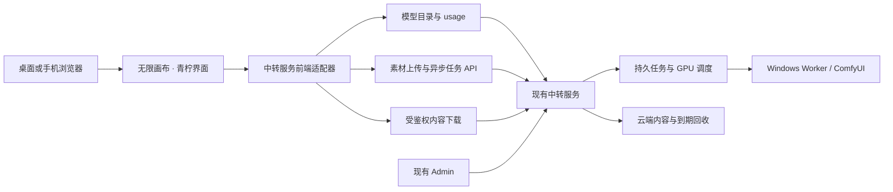

# 04 · 本地源码与中转服务融合方案

本文件记录初次源码下载和静态设计。以下“拟新增”“目标”“验收”均为后续开发内容，不代表适配已经上线。实际差异与验收编号见 [05](05-中转服务接口映射与开发验收清单.md)，原下载证据见 [核对记录](research/aggregator-integration-audit-2026-10-30.json)。后续完整评估、契约和原生验证已补充到 [06](06-融合可行性评估与上线约束.md)、[07](07-融合实现契约与故障恢复.md)、[08](08-可用性验证与发布验收.md)，当前运行与发布状态以 08 为准。

## 1. 已下载内容

| 项目 | 本地状态 |
| --- | --- |
| 上游 | `basketikun/infinite-canvas`，MIT，保留原作者与许可证 |
| 路径 | `E:\dev\sandbox\无限画布\infinite-canvas\` |
| 版本 | `VERSION=v0.20.0`；`9cd3deacbcc598361807afc16c059a80dd18b6f9` |
| 下载方式 | HTTPS Git 浅克隆；当前提交完整源码，历史深度 1 |
| 工作区 | 原版工作副本保持干净；未向上游提交或推送 |
| 原版状态 | 标准 npm ci 已尝试并失败；修复探针在独立副本，不改变此原版 |
| 中转服务基线 | 相邻仓库 `f522ee0d70b74db137c9f858446ba58c2f508a50`，本轮只读核对 |

本机已检测到原生 Node.js `v22.14.0`、npm `10.9.2`。依赖和页面实际结果见 08；不能据版本命令宣称应用可运行。原版仓库中的容器配置只是已下载文件，本方案使用原生工具链。

## 2. 目标形态与职责

采用“创作前端 + 现有中转服务”的组合。首期增加一个前端适配器，静态部署画布，不另建一套生成后端。

| 层次 | 职责与约束 |
| --- | --- |
| 画布 | 输入提示、连接参考素材、选择模型/规格、展示任务与媒体、保存画布 |
| 前端适配器 | 发现与校验能力、上传引用、记录提交意图、幂等提交、恢复查询、鉴权下载 |
| 中转服务 | Key 授权与配额、Workflow 发布、任务权威状态、GPU 排他与负载调度、内容校验与回收 |
| Admin | 管理设备源、渠道、Workflow、模型、Key、全局/分渠道队列；继续使用独立管理身份 |
| ComfyUI | 执行已发布 Workflow；浏览器通过中转服务调度，不需要获知其私网地址 |

画布中的“渠道”表示一个 API 服务入口及用户自己的业务 Key，不能与中转 Admin 的 Windows 物理渠道混为一谈。同一个公开模型下的设备选择交给现有调度器；画布不按设备自己轮询派单。现有调度可以复用符合条件的多渠道绑定，但不承诺严格轮询或各设备任务数相等。

React 画布与 Vue/Element Plus Admin 分别构建，通过接口、同一视觉令牌和站点导航整合。首期保留原来的画布、图片工作台、视频工作台和本地素材能力；Agent、MCP、额外本地请求代理属于可选能力。

## 3. 为什么需要专用适配器

原版虽然有 OpenAI 调用方式，实际请求字段与本服务的冻结契约并不完全一致：

| 原版行为 | 中转服务现状 | 处理方向 |
| --- | --- | --- |
| 图片固定发送 `output_format`，可带 `background`，批量 `n` 可大于 1 | DTO 拒绝未声明字段；当前每任务 `n=1` | 专用适配器仅构造模型 Schema 允许的参数 |
| 图片同步等待 | 同步入口只等待 60 秒，超时后原任务继续执行 | 使用 `/v1/jobs`，保留任务 ID，避免重复生成 |
| 多参考图片直接传多个文件 | 需要准确参考数量和显式槽位/语义角色 | 同 Key 上传为 `asset_id`，按 `usage.references` 组装 |
| 视频 FormData 带 `mode`、`resolution_name`、`generate_audio`、`watermark` 等字段 | 当前兼容入口只接受声明字段；文件入口是 `input_reference` | 使用统一任务 JSON，按发布能力选择规格和参考角色 |
| 音频默认调用 `/v1/audio/speech` | 当前没有该入口；音频来自 ComfyUI Workflow | 走 `text_to_audio`，显示该流程的真实说明和参数 |
| 默认没有 3D 模型类型 | 中转已支持 `image_to_3d` 和自包含 GLB | 增加 3D 能力分类、结果节点和鉴权附件下载 |
| 拉模型只提取 `id` | 服务已提供完整 `usage`、Schema、规格、说明 | 完整读取，动态生成参数与引用表单 |
| 模型脚本自己提交和轮询 | 部分结果仅在内存中，不能覆盖刷新恢复要求 | 正式路径使用类型化适配器和持久任务记录 |

原版“自定义模型调用脚本”可用于局部协议试验，但正式方案需要同时满足页面刷新、网络异常和多媒体任务恢复。保留原有 OpenAI/Gemini 通道，新增明确的中转服务类型，不通过放松服务端严格校验来隐藏这些差异。

## 4. 完整使用流程

1. 用户进入画布，配置中转服务地址和自己的业务 API Key。可用同源地址，也可使用已有高位 HTTP 入口；服务已配置任意源 CORS。
2. 读取 `/v1/access-policy`、`/v1/models`、`/v1/capabilities`。按 `usage.task_type` 分类，显示名称、注释、输出类型与所需权限；缺少生成或下载权限时明确显示。
3. 从完整 `usage.presets` 选择规格组合，使用 `request_schema` 和 `parameter_details` 生成表单。720×1080 等尺寸只在模型实际支持时开放，禁止悄悄对齐、换规格或混用预设。
4. 需要参考图时，以同一 Key 向 `/v1/assets` 上传静态图片。`image_to_image`、多参考、首帧、3D 分别按模型说明绑定，保留顺序和角色；不将浏览器文件路径传给服务器。
5. 提交前在 IndexedDB 写入不可变请求、摘要、连接身份关联、画布/节点 ID 和 `Idempotency-Key`；记录成功后才向 `/v1/jobs` POST。
6. 收到任务 ID 后立即保存并查询该 ID。刷新或重新打开画布后继续查询；提交响应丢失时，以原 Key、原请求和原幂等键核对，不创建新请求意图。
7. 根据服务器真实阶段展示排队、执行、收集、上传、核验、成功或失败。客户端暂停等待只暂停查询，不能据此宣称 GPU 已停止。轮询遵循服务 `Retry-After`；客户端等待预算等新增行为边界在实现前明确。
8. 成功后从 `artifacts[].id` 读取内容元数据，用原业务 Key 下载 Blob，核对长度、摘要与 MIME，再交给原有本地素材存储和节点渲染。
9. 用户明确取消时调用 `/v1/jobs/{id}/cancel` 并继续核对终态；删除本地节点、关闭页面和中断 fetch 不自动等于取消远程生成。

模型目录有列出条目不代表当前有空闲 GPU或准入必定成功；服务端仍是权限、资源和终态的权威源。

## 5. 各媒体的适配边界

| 媒体 | 统一任务类型 | 画布行为 |
| --- | --- | --- |
| 文生图 | `text_to_image` | 文本输入、发布规格、单任务单图；明确的批量操作拆为多个独立任务 |
| 图生图 | `image_to_image` | 按 Schema 提供源图、可选遮罩与确实支持的参数 |
| 多参考生图 | `references_to_image` | 展示准确槽位与顺序，不自动增删引用或静默降级 |
| 文生视频 | `text_to_video` | 时长/大小/质量采用完整合法组合，保留异步状态 |
| 参考生视频 | `references_to_video` | 单参考的 `first_frame` 或模型声明的多图槽位；不自行解释为任意首尾帧模型 |
| Workflow 音频 | `text_to_audio` | 提示词与发布的音频规格，支持真实格式播放/下载；不强制改为 mp3 |
| 单图生 3D | `image_to_3d` | 上传源图、质量/seed 等已声明参数，返回 GLB 下载卡；交互预览单列开发与验收 |

当前参考上传契约支持 PNG/JPEG/WebP，最大 20 MiB、2500 万像素；不据画布有视频/音频参考控件就宣称中转支持这些输入。现有 YuE2 的歌词来自冻结 Workflow，不能把风格 prompt 误写成可编辑歌词或 TTS。当前 3D 仅承诺已实现的自包含 GLB；OBJ、FBX 等需独立适配。

3D 下载卡应先支持元数据、到期时间和附件保存。大 GLB 的浏览器解析与旋转预览后续使用延迟加载和按需请求，单独评估手机内存；不直接将最大允许文件全部作为 base64 塞进 Zustand 或 JSON。

## 6. 身份、任务和素材的保存逻辑

首期沿用用户自带业务 Key：该 Key 仅用于用户授权范围内的生成和内容接口，不提供 Admin 登录、云端画布账号或多人实时协作。

- 原版会在浏览器本地保存 Key，配置导出也包含凭证。正式适配需提供明确的本机保存选择和不含凭证的导出；不把管理凭证或全局共享生产 Key 编进静态包。
- 任务意图与恢复记录使用 `localforage`，以连接身份、画布和节点区分；Key/服务地址切换后不将旧请求自动发往新身份。已知任务仅查询，提交未知时保留原请求与幂等键，过期的幂等窗口不能默认为可安全重提。
- 同源不同路径并不隔离 IndexedDB/localStorage。多 Key 共用同一浏览器时，画布、任务、素材和预览都要按连接身份分区，退出时释放内存 URL；“项目”字段不构成新的服务器授权。
- 原始画布/本地素材继续由浏览器保存，WebDAV 是可选同步。若后续需要服务器端账号、跨设备画布持久化或实时协作，需单列工作包、数据模型与授权验证。
- 生成产物云端仍按成功后 **8 小时** 到期；本地已下载文件和 WebDAV 副本有独立生命周期，不受云端 GC 自动删除。界面须区分“仅云端、已存本机、已失效、缓存失败”，显示真实 `expires_at`。
- 本地缓存失败不能展示“已保存”，单纯保留远端 URL 也不能视为永久素材。使用原有引用扫描/缓存管理机制整理本地副本，删除画布节点不自动删除其他引用或云端内容。

本轮没有改变云端八小时规则、Worker 暂存策略或 ComfyUI 原始输出清理。后者在中转项目文档 121 仍是待实现设计，不能据本次前端接入声称已经上线。

## 7. 页面、移动端与青柠视觉

| 页面/交互 | 首期改动与验收 |
| --- | --- |
| 接入设置 | “中转服务”渠道类型；地址、用户 Key、连接检测与权限说明；手机采用抽屉/全屏表单 |
| 模型选择 | 按媒体分类，显示名称、注释、合法预设、引用数量和输出格式；用 `usage`，不靠模型名称猜类型 |
| 生成参数 | 同一模型数据驱动画布和工作台；隐藏不支持的 TTS、视频混合参考、任意尺寸等控件 |
| 任务面板 | 显示当前业务身份的任务、真实状态、恢复查询、取消和明确的重新生成动作 |
| 输出节点 | 图片、视频、音频、3D 分别渲染；到期提示、本地保存状态和再次作为参考的可用性分开 |
| 手机画布 | 侧栏可收起/抽屉化，底部工具栏按实际可用宽度布局；修正原版 `left: 300` 等桌面假设 |
| 触控与键盘 | 单指拖动/选中与页面滚动、双指缩放、节点连线、长按菜单、软键盘遮挡分别验证 |
| 后台恢复 | 浏览器切到后台/锁屏后依靠服务继续执行，返回时查原 ID；不承诺浏览器常驻轮询 |
| 管理入口 | 有管理权限的人使用原 Admin 的全局/各渠道队列；普通用户只看获准任务，不获得物理渠道信息 |
| 统一视觉 | 从既有来源锁定的青柠 CSS、字体和令牌建立 Ant Design / Tailwind / Canvas 适配，覆盖 Drawer、Modal、菜单和状态 |

上一轮公开演示的 390px 视口已观察到侧栏与底栏拥挤；这不是本地应用或手机真机验收。本轮未启动浏览器。后续至少验证桌面、390px 竖屏和平板横屏布局，再补 Android Chrome/iOS Safari 真机触控、输入、后台恢复与下载；验收不能只检查“页面能打开”。

青柠源文件已在中转项目保存，复用其固定摘要与字体许可证，原始文件不改，React 适配独立维护。保留上游作者标识；不将 Vue/Element Plus 组件直接复制成 React 组件，也不仅修改一个主题按钮就宣称全面完成。

## 8. 部署组织

拟在现有 HTTP 高位入口增加 `/studio/` 静态创作前端，`/admin/` 保留管理后台，`/v1/` 继续走原 API。用户自行处理外层域名和反代，本站部署不新增 HTTPS 验收条件。

部署前需要同时处理：

1. Vite 的 `VITE_BASE=/studio/` 只设置资源路径；原版 `createBrowserRouter` 没有 basename，必须同步加 basename 并检查资源、插件和深链地址，不能只改环境变量。
2. Nginx 为 `/studio/` 增加静态目录与 SPA 回退；深链刷新回到该应用的 `index.html`，不能落入 Admin 或 API。已有 `/internal/` 拦截保持生效。
3. 前端独立构建和版本化，部署包包含来源提交、依赖锁、资产摘要和回滚版本。首期无需增加 PostgreSQL、Redis 或另一套生成队列。
4. 本地开发仅监听 `127.0.0.1`；服务端仍沿用现有高位端口和任意源 CORS。跨源时使用 `credentials: omit` 的业务 Bearer 请求，不依赖 Admin cookie。
5. CORS 当前已暴露 `Retry-After`、ETag、Range 相关头，但没有 `Location`；客户端以响应 JSON 的任务 ID 为主，不依赖跨源读取 `Location` 才能恢复。

现有中转入口配置位于 `app/deploy/native-linux/nginx.conf.example`，画布原版配置位于 `web/vite.config.ts` 和 `web/src/router.tsx`。本轮只形成方案，尚未修改或部署这些文件。

## 9. 实施顺序与交付边界

| 阶段 | 开发内容 | 完成条件 |
| --- | --- | --- |
| 已完成 | 下载原版、锁定提交、核对 API/源码、整理方案与清单 | 干净源码副本、Git 完整性核对、版本化静态证据 |
| P1 | 专用渠道、模型/权限/规格发现、通用异步任务与恢复 | 异常提交不重复生成，页面刷新可恢复，同 Key 鉴权下载 |
| P2 | 全媒体节点与引用、工作台统一接入、3D 下载卡 | 七种任务类型按实际发布模型逐条验证；模型缺失明确标记不可用 |
| P3 | 青柠全覆盖、移动端布局/触控、本地素材与过期提示、同源部署 | 页面截图、真机范围、异常路径、构建部署与回滚证据 |
| 后续独立工作包 | 3D 交互预览、云端画布账号/协作、更完整编辑器集成 | 分别设计并验收，不隐含在下载完成状态内 |

P1～P3 共同组成融合版首期交付，不能把 P1 单独当作最终全媒体产品。具体开发文件与编号验收见 [05](05-中转服务接口映射与开发验收清单.md)。
