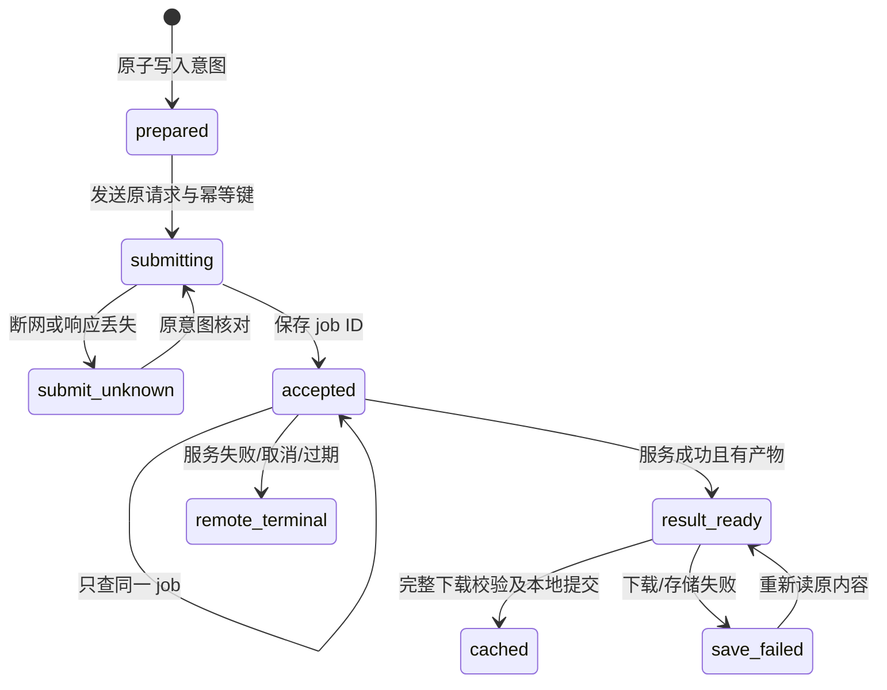

# 07 · 融合实现契约与故障恢复

本文是下一步开发契约，所述新增实现均未上线。架构与编号范围见 [06](06-融合可行性评估与上线约束.md)，验收状态见 [08](08-可用性验证与发布验收.md)。

## 1. 模型与参数

适配器读取 `/v1/access-policy`、`/v1/models` 和 `/v1/capabilities`，保存服务源站、模型别名、usage schema_version、release digest 与完整能力数据。没有说明、未知 Schema 版本或缺少调用权限的条目明确不可生成；不回退为按名称猜测能力。

- `usage.task_type` 决定媒体与输入类型；`request_schema` 决定可提交字段，使用 JSON Schema 2020-12 校验器，包含 prefixItems、条件与组合约束。
- 从完整 preset 选择质量、尺寸与时长的组合；不会自动改尺寸、帧率或切换模型。只将 Schema 允许的字段投影为 `parameters`。
- `audio_format/sample_rate/channels` 可能只描述输出，不因出现在 preset 就一律提交。文件最终使用元数据的实际 MIME，不根据下拉框改扩展名。
- `exact_reference_count` 只描述 references 数组；`source_image`、mask 和必填槽位分别以 slots/Schema 为准。单图生 3D 即使 count=0，仍要求源图。
- `image_to_3d` 的首批发布不接收 prompt、size、seconds；界面不生成随后被服务拒绝的隐藏默认值。
- 模型注释是纯文本，不能当 HTML、可执行脚本、Agent 系统指令或“自动安装节点”的命令。

Schema 校验只解析受支持版本和本地定义的引用，不根据模型说明自动加载外部 `$ref`、任意脚本或远端校验代码。目录存在表示当前授权/发布声明，不证明设备立即空闲或当前硬件健康；界面不能据此显示虚假的“在线可立即完成”或确定 ETA。

## 2. 连接和身份

每个配置有本机 profile ID、规范化服务源站和凭证指纹。指纹用来关联恢复记录，明文 Key 仅在本机用户选择的会话/保存范围中取用。`GET /v1/access-policy` 当前只返回 policy，没有稳定的身份 ID；不能把 profile ID 当作服务端 tenant/key 身份证明。

已知任务轮换 Key 后，须由服务查询确认新凭证有权读取该任务，才建立新关联；提交结果未知时不自动更换凭证。当前服务只允许同逻辑 Key 读取自己的 job，内容下载则以实际共享授权为准。

业务 fetch 使用固定源站、Authorization 和 `credentials: omit`，拒绝把管理 cookie 作为业务鉴权兜底。下载地址由固定接口与已验证 ID 构造，不向模型返回的任意 URL 发送 Key，遇重定向不得无条件携带授权跳转。

托管模式禁用 `?apiKey=...` 导入方式，避免 Key 进入访问日志和浏览历史；默认导出不包含业务 Key、WebDAV 密码、管理会话和脚本。退出时清理页面内存和 Object URL，本机文件保留/删除由明确操作控制。

浏览器内按 profile 分区是防串用措施，不是可抵抗同源任意 JS 或本机其他人的安全沙箱。需要多人账号时必须增加真正的用户授权和服务器持久化工作包。

## 3. 七类任务的请求构造

| task_type | input | 关键约束 |
| --- | --- | --- |
| text_to_image | prompt，模型允许时 negative_prompt | 参数来自合法图片 preset |
| image_to_image | prompt、source_image，可选已声明 mask | 同 Key 上传；遮罩不是默认必填 |
| references_to_image | prompt、有序 references | 数量精确，role 显式，weight 仅绑定支持时传 |
| text_to_video | prompt | 不添加未声明 mode、水印、generate_audio 等字段 |
| references_to_video | prompt、references | 单图 first_frame；多图 role 不改变数组槽位含义 |
| text_to_audio | prompt | 音频流程说明决定文本含义，不自动翻译成 TTS voice/input |
| image_to_3d | source_image | 当前首批不传 prompt；仅已声明质量/seed/n |

每项输入上传都有独立幂等键及字节摘要，`POST /v1/assets` 已支持 `Idempotency-Key`。上传响应未知时只重放同一文件与键；记录 asset ID 后校对来源、hash、可用状态和身份。

生成意图冻结后包含确切 asset ID 和内容摘要。上传过期或身份变化需要用户重新整理请求，不能在未知生成请求的恢复过程中自动重新上传替换 ID，否则同一幂等键的正文会变化。

## 4. 独立提交日志

原版画布 Zustand 自动保存经过 400ms 防抖，不能充当生成前的可靠日志。新增小型独立日志库，采用 IndexedDB 原子事务及唯一意图键；现有 UI store、画布和素材继续复用 Zustand/localforage，不引入第二套全局状态方案。

日志写入必须返回真实 commit 成功；不可在失败时静默回退到 localStorage 后仍然发送生成。若 IndexedDB 不可用或无法提交日志，界面说明无法保证恢复并阻止创建新任务，已知 job 的受权查询可继续。

| 记录 | 必要内容 |
| --- | --- |
| IdentityRef | profile、源站、凭证指纹；不存明文 Key |
| GenerationIntent | 唯一 action ID、原始不可变 JSON、规范摘要、Idempotency-Key、模型/能力快照、画布/节点关联 |
| InputRecord | 上传幂等键、文件 hash、asset ID、用途/顺序/角色、源引用 |
| RemoteRecord | job ID、最后权威状态、updated_revision、查询错误与取消意图 |
| ResultRecord | content ID、bytes、sha256、MIME、expires_at、实际元数据 |
| LocalRecord | 本地 storageKey、校验结果、已存/未存/失败状态，不能仅存内存 blob URL |

不把“画布节点已保存”推断为“生成意图已经提交”。输出文件与结果关联分步提交时，先保留可核对的 pending 状态，崩溃恢复后检查本地对象再更新状态，避免成功文件成为不可追踪孤儿或 UI 把未保存文件标成功。

## 5. 客户端状态和提交顺序

客户端状态不冒充服务端任务状态：

`query_paused`、页面后台、网络离线和停止等待属于客户端观测，不修改服务器状态；内容过期也不把原成功任务改成生成失败。

顺序固定为：核对表单/身份 → 固定输入 → 原子写入意图 → 发送 POST → 立即记录 job ID → 统一查询 → 读取产物元数据 → 完整传输校验 → 本地存储并关联节点。

服务收到稳定幂等键后能阻止重复创建，但前端仍要让双击、同一意图恢复和多标签共享同一个键。使用 IndexedDB 唯一键/事务处理竞争；BroadcastChannel 只做通知，不能把消息广播当锁或把失去 leader 当作 GPU 空闲。

复制节点默认复制内容/关联，不自动创建新的 GPU 任务。真正“重新生成”是明确的新动作，使用新的 action ID 与幂等键；批次中的每项独立可恢复，成功项不因其他项失败重跑。

## 6. 发布摘要前置条件

当前 `/v1/jobs` 只按模型别名读取当时的发布，公开 DTO 没有 expected release。拟在已有创建接口新增可选 `X-Expected-Release-Digest` 头，来自 `/v1/capabilities` 的 `release.digest`；原客户端未传时保持原行为，新画布必须发送。

这是待开发的接口加固，**目前该头尚无服务端强制效果**。不能仅在前端加 header 就声称已经防止竞态。

实现约束：

1. 新创建在服务端同一事务中锁定/核对模型与发布；摘要不同返回结构化 `409 model_release_changed`，不创建任务或占用生成额度。
2. 幂等意图同时绑定正文、输入 hash 和该预期摘要。相同幂等键改正文、输入或摘要均冲突。
3. 已经创建成功的幂等重放先查既有意图和 job，即使模型后来换版仍返回原任务，不重新执行新发布。
4. 前端遇发布变化刷新能力，提示用户重新确认规格/参考输入；不静默更新请求并复用旧键。
5. 未带新头的请求保留旧幂等规范和摘要算法，已有旧客户端的重放不因升级全部冲突；带头的新意图显式版本化并绑定摘要，不能重用旧键后静默改变指纹。
6. 同步机器契约/OpenAPI、服务端、客户端、旧入口回归及发布说明；中转项目的验证/推送规则继续适用。

## 7. 轮询、频控和取消

服务端 business 鉴权会调用 `consume_business_rates`，所以目录、任务和内容请求也会消耗 RPM。前端用同一连接范围的查询调度器去重：同一个 job 在工作台和画布出现时共享查询，前台/后台切换协调，避免每个节点自行发请求。

遵循服务 `Retry-After`，结合可见任务和授权预算调度。具体等待/重试/预加载上限在实现时依据现有服务和实测明确，不把本评估中的案例数量变成新的运行限制。预算用尽显示“查询暂停，可继续”，不是把远端任务改为失败。

| 服务状态 | 界面含义 |
| --- | --- |
| admission_pending / queued / leased | 正在准入、排队或分配，显示原状态 |
| preparing / submitting / running | 准备、提交或执行；不伪造百分比 |
| collecting / uploading / verifying | 结果收集、上传和校验，不能提前标可下载 |
| reconciling / retry_wait | 服务正在核对或已安排内部重试，客户端继续查询同 job |
| cancel_requested | 已请求取消，尚未确认停止 |
| succeeded / failed / cancelled / expired | 按服务终态展示，并单独记录内容/本地保存状态 |

用户点击取消调用已有 `/v1/jobs/{id}/cancel`，继续核对终态；移除节点只影响画布。取消和成功竞争按服务最终提交为准，界面不得覆盖迟到的权威状态。

## 8. 下载、内存和八小时期限

任务成功后从 `artifacts[].id` 查元数据，固定内容路径受鉴权下载。比对实际 Blob/流的字节数与元数据，不把可能经过压缩的 HTTP Content-Length 当成文件长度真值；SHA-256 与真实 MIME 通过后才标“已保存”。

高位 HTTP 部署不能依赖 `crypto.subtle`、`crypto.randomUUID`、Service Worker 或文件系统写入 API 必然存在。ID 沿用 nanoid；哈希采用成熟的增量实现并可放入按需 Worker，分别验证 plain HTTP 和 localhost。参考：[MDN Crypto](https://developer.mozilla.org/en-US/docs/Web/API/Crypto)、[noble-hashes 的增量哈希](https://github.com/paulmillr/noble-hashes)。不新增 HTTPS 验收条件。

避免把视频/GLB 转 base64 放全局状态；只给当前需要显示的媒体创建 Object URL，退出/删除/替换后释放。预览不同时解码全部视频或解析全部网格。GLB 先下载卡，交互预览另行懒加载和能力检查。

内容成功后 8 小时到期，以服务元数据 `expires_at` 为准。未下载的过期文件显示不可再获取；已有本地副本仍可读。到期不自动创建新生成，也不延长服务 TTL。用户清理浏览器、配额不足和存储回收的场景要有备份/导出说明；`navigator.storage.persist()` 不一定可用或获准，不能据此承诺永不丢失。参见 [MDN persist](https://developer.mozilla.org/en-US/docs/Web/API/StorageManager/persist)。

副本链路保持：01 ComfyUI 原输出 → 02 同设备 Worker 的可靠暂存 → 03 云端对象 → 04 用户本机画布/下载目录。WebDAV 是用户另行选择的附加副本。原要求的 01 清理触发点是 **02 完整校验并持久接管之后，立即请求删除 01**，无需等待 03；该自动化仍待原服务实现。02 在云端 complete 确认后按原规则保留一小时，未确认不自动删除；03 成功后八小时，04 与 WebDAV 独立管理。不能把云端 TTL 当作全部副本同时删除。

对于服务端允许但手机无法可靠处理的最大文件，界面仍应可管理任务、查看元数据并说明保存方式，不能卡死或谎报已下载。若产品后续要求原生浏览器下载超大受保护文件而不经 Blob，需独立设计短期受限下载票据或流式交付；当前服务没有该票据接口，不能把业务 Key 放查询字符串当替代。

## 9. 托管模式与任意代码

托管版的生成通过业务 API 完成，默认入口不展示或自动打开“安装 Codex 插件/运行 npx/连接本地 Agent”的引导。管理者无需为普通创作用户安装 Agent。可选文本助手使用独立的 Sub2API 连接配置；本地 Agent 的 URL/fragment 自动连接与运行入口在托管模式关闭，不能只隐藏按钮后继续处理 URL bootstrap。原版独立工具的 Agent 能力不作为融合首期依赖。

首期采用托管创作模式：保留内置画布、媒体、工作台和明确审阅的本地组件，拒绝用户模型脚本、远程插件、开发插件和可执行配置导入。普通文本/参考素材及已授权 API 地址不因此改变业务使用方式。

强制点必须覆盖：

- 模型请求分派：托管模式不执行 `new Function` 的脚本分支，即使旧配置包含 script。
- 插件启动：在 `ensurePluginsLoaded`、本地发现、远程安装、启用/更新、开发 URL 等入口执行模式判断；不能只隐藏设置按钮。
- 配置/画布/WebDAV 导入：验证数据版本与字段，不激活导入脚本；未知插件节点可显示“缺少受信组件”，不自动下载执行。
- 原版 HTML 节点的 iframe 有 `allow-scripts allow-forms` 且没有 allow-same-origin，属于另一个机制；不能据此把整个插件加载器称为沙箱。SVG/其他 HTML 展示也要按实际实现审查。
- 托管路径的 CSP 不能为兼容任意模型脚本而加入 unsafe-eval。动态样式、Blob 媒体、Worker 等必要权限按真实构建验证。

浏览器请求 `credentials: omit` 只能约束适配器自己的请求，不能限制同源恶意插件直接 fetch Admin。因此禁止未受信代码是运行边界的一部分；仅把画布换端口/子域也不能未经验证就视为解决了任意源 CORS 下的全部身份问题。

## 10. 路由、版本和运维

`/studio/` 的资源 base、React Router basename、插件静态目录、Worker URL、favicon/下载链接和 SPA 回退必须一起验证。原版绝对 `/plugins/index.json` 需要改为基于应用 base 构造。`/admin/`、`/v1/` 和被拦截的 `/internal/` 不能被 studio 的 fallback 接管。

前端包包含来源提交、补丁清单、锁文件、静态资源摘要和适配契约版本；不包含任何生产 Key。任务日志自有版本单独管理，升级前备份，未知/损坏结构拒绝覆盖。回滚旧静态包前核对其能否读取新日志；不能为了回滚成功直接清空用户画布/意图。

可观测性至少关联客户端 action ID、服务 X-Request-ID、job ID、状态及耗时；错误上报脱敏，不上传 Key、提示词正文、源图或恢复日志。发布说明分别列接口模拟、真实服务、GPU、页面、真机和容量范围。
