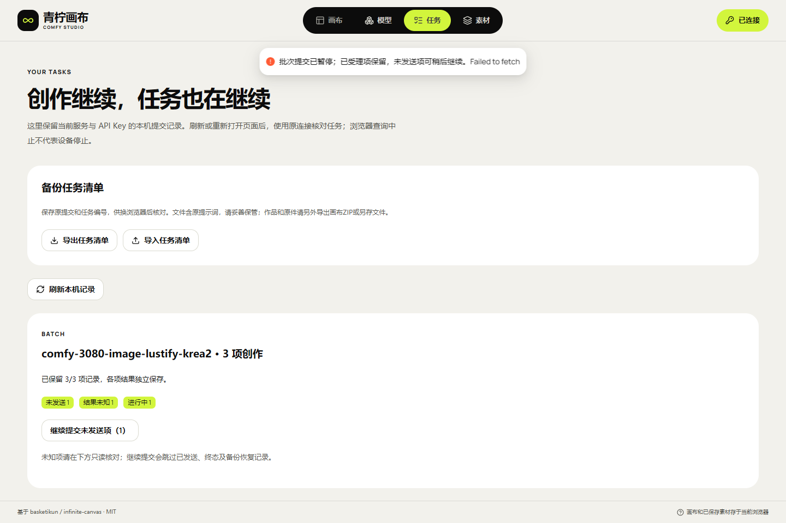

# 批量创作与部分失败恢复

本增量实现 F-23。以现有单任务 API 和 IndexedDB 提交日志为权威，不新增生成队列。当前实现及验收结果追加于文末；本方案本身不代表已上线。

用户在“新建创作”选择数量，默认一项，范围沿用原画布已有的 1～15 项。每项使用相同模型、完整规格和参考素材，独立冻结请求、任务 ID 和幂等键；固定种子会得到相同或相近的结果，不暗改种子。后端每个请求仍为 n=1，逐项经过既有权限、频控和配额。

先保存画布，再将全部成员写入一个严格持久事务。任一冲突、配额不足或事务中止，整批不留部分记录，也不发送生成。节点在日志中保留重建信息，浏览器自动保存未完成时可以恢复。批次只关联同一原服务、Key、项目和模型；分组信息不能改变鉴权或授权范围。

首次提交按顺序调用已有单项提交入口。任一提交报错即停止本次发送，后面的成员保持“已保存，待提交”；已受理、未知和终态分别保留，不取消已受理任务。页面关闭后不自动补发。用户可明确“继续提交未发送项”，仅处理本机原生、prepared、无任务 ID 的成员；跳过未知、已受理、成功、失败及备份恢复记录。多个页面仍通过单项写事务占用首次发送。

任务页保留每项详情，补充批次汇总：已完成、失败、已取消、已过期、进行中、提交结果未知、未发送及备份待核对。缺少成员时显示实际保留数量，不伪造整体完成。部分失败不触发成功项重跑；重新生成须单独创建新的明确动作。停止本页等待与远端取消仍分开。

任务清单格式升级为 v2，新增可选批次关联，继续读取 v1。v1 不允许偷带批次字段，旧客户端应拒绝 v2 文件。分组 ID、成员序号和总数严格校验，不允许额外凭证字段、重复成员或相互矛盾的组信息。导入仍整批原子、只恢复记录且不请求服务；即使备份成员写成 prepared 也不能用于新生成。分组不赋予信任，状态须原服务查询后确认。浏览器数据库继续 v3，无新增对象仓库或数据降级。

验证须覆盖全部记录先提交、事务失败零 POST、双页竞争、第二项响应丢失、部分成功/失败、重新打开页面、只继续未发送项、换 Key、导入后禁止补发、v1/v2 往返和手机汇总操作。合成 HTTP、真实浏览器/IndexedDB、线上普通 HTTP 与真实 GPU 分开记载；所有自建浏览器和临时服务在 finally 关闭。保持青柠原样式与字体，生产八小时保留规则不变。

## 当前实现与验证

静态133.1已部署至[公网画布](http://43.165.167.179:39443/studio/)，继续复用后端132.2。当前前端提交423aa95，冻结源码56adcf8f…；[完整证据索引](research/studio-implementation/batch-validation-notes-1331.json)绑定具名报告、构建包及555个后端运行源码与其原冻结Git的逐项核对。本轮未新增GPU任务，未重启原Worker，未重新启用任何停用Key。

| 编号 | 已验证内容 | 结果与边界 |
| --- | --- | --- |
| B-01 | 前端单元、类型和生产构建 | 147项/类型/构建通过，同一冻结源码 |
| B-02 | 批次15组专项 | 原生严格IDB、第二写入配额失败、活跃节点冲突、15项上限、七类Schema、双页发送、错Key、普通HTTP、响应体中断、重启、只发未发送项、实际v2导入、三任务卡原ID查询通过 |
| B-03 | 当前包既有回归 | 页面18、存储22、任务清单25、只读核对15组通过，96个实际静态文件摘要一致 |
| B-04 | 公网发布与数据 | 四入口200、四服务active、任意来源两预检及旧数据/重启/深链三项通过；DB仍v3、原Worker不变 |
| B-05 | 截图与录像 | 桌面/390px，原速MP4/GIF完整解码；合成HTTP，不是GPU或物理手机 |

[批次专项回执](research/studio-implementation/batch-2026-10-30T01-37-58-914Z.json) · [静态发布](research/studio-implementation/static-upgrade-1331.json) · [当前健康](research/studio-implementation/live-final-health-1331.json) · [公网保留重启](research/studio-implementation/public-storage-after-2026-10-30T01-40-27-775Z.json)。

[原速MP4](media/studio-131/studio-batch.mp4) · [GIF](media/studio-131/studio-batch.gif) · [完整解码及文件摘要](media/studio-131/studio-batch-manifest.json)。

原失败四份保留：首个注入在响应头前关闭复用连接，Chromium在传输层重发相同Key，后改为中断已受理响应体；第二次用按钮消失判断异步完成过早，改等实际成功信号；后两次暴露通用加载/失败占位覆盖任务卡的产品问题，现已修正并验证原ID查询。没有延长产品超时、放宽门禁或改写旧报告。

真实GPU批次混合失败、长时间离线、手机真机及10～20台容量继续验收，整体状态仍HOLD；图像/视频/Workflow音频/GLB的历史八模式证据不扩充为本轮批次实测。
