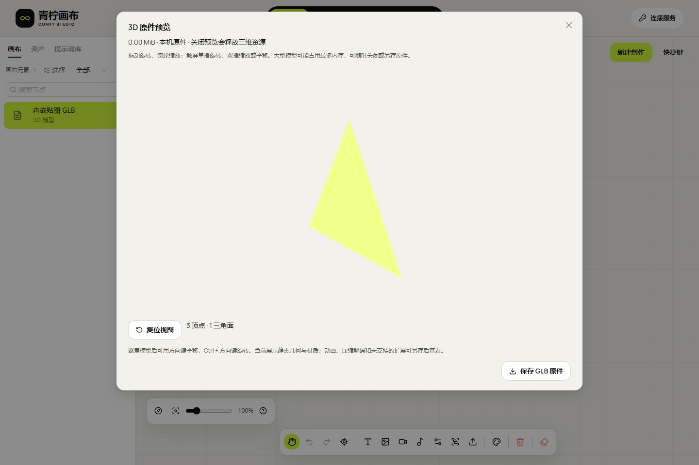

# GLB 交互预览与资源释放

本增量落实 F-14 的静态三维预览。模型仍由 ComfyUI Workflow 生成，经原中转任务、内容鉴权与摘要校验后保存本机；画布不新增生成队列，也不把预览视为再次生成。动态图、更多格式、物理手机与峰值内存验收继续单独记录。

## 使用路径

在任务中“载入产物”后，GLB 继续生成模型卡。点击卡片或“素材”库中的“交互预览”，才读取本机文件并加载本项目打包的 Three.js 组件。预览支持拖动旋转、滚轮缩放、右键平移、聚焦后的方向键平移、Ctrl 加方向键旋转及复位视图；触屏使用单指旋转、双指缩放或平移。弹窗独立滚动，原件保存和关闭按钮保持可操作。长内容 ID 在素材卡内换行。

服务产物仍须连接原服务和业务 Key 才可读取对应本机结果，换身份会关闭预览；含原件的离线画布副本使用独立本机键，断开连接也能展示。预览和另存不重新上传文件，不改变原件字节、云端八小时期限或浏览器保留规则。截图中的小三角形是可公开的内嵌 PNG 合成样本，机器人是此前授权生成并校验保存的真实 ComfyUI GLB。

## 加载和释放

Three.js 0.186.1 / MIT、GLTFLoader、OrbitControls 以锁定版本构建为本地延迟加载资源，没有 CDN、远程解码器或常驻渲染服务。可见几何与材质显示，动画暂不播放。预检只做文件封装与资源边界检查，正式解析交给成熟的 GLTFLoader，不自行实现三维格式解码器。

只接受 GLB 2.0、内嵌二进制及允许的 base64 资源；PNG/JPEG/WebP/AVIF 还取决于浏览器解码能力。外链、相对资源、file/blob/javascript URI、SVG 贴图、未知必要扩展以及 Draco/Meshopt/KTX2 等未内置解码器明确拒绝。可选未知扩展显示说明，不宣称已经完整展示。预检后，LoadingManager 仍拦截外链；加载器自己生成的同源贴图 blob 地址会被跟踪和撤销。

界面文档 CSP 仅在 Studio 的 connect-src 加入 blob:，使原生 ImageBitmapLoader 可读取内嵌贴图；脚本仍限同源，Schema Worker 仍禁止网络。此项不改变业务 Bearer、Cookie 隔离或任意来源 CORS。生产仅校验并重载本项目专用 Nginx，API/原 Worker 不因预览重启。

渲染按首次展示、视口变化和用户操作触发，不启用自动旋转、惯性或常驻动画循环。关闭、卸载、身份变化或预览失败时，断开 ResizeObserver、移除控制器监听、释放几何/材质/纹理/骨骼，关闭 ImageBitmap、撤销贴图地址，dispose 渲染器并主动丢弃 WebGL 上下文。依赖异步完成也被跟踪；用户在贴图解析中关闭时，晚到的资源直接清理，不再创建渲染器。

浏览器没有 WebGL、上下文被系统回收、组件加载失败、贴图损坏或模型不可读时，会显示原因并保留“保存 GLB 原件”。不自动重试、降质、截断或下载解码器；大型模型可能占用较多内存，用户可关闭或保存后使用外部工具。完整峰值/泄漏、极端文件与手机容量仍是 F-25/F-37，不以一次关闭回执替代。

## 验证边界

原生 Chromium 在普通非 localhost HTTP 和严格 CSP 下验证真实渲染、像素变化、内嵌贴图、原件保存、关闭释放、晚到解析、WebGL 丢失、不支持 WebGL和组件缺失。真实原件为 76,942,864 字节，1,597,077 顶点、3,217,656 三角面；验证另存摘要与原件相同。本轮没有新增 GPU 生成、业务 Key 或重新启用停用 Key。

390px 的触屏事件模拟覆盖旋转、双指缩放和弹窗布局，仍不算 Android/iOS 真机验收。合成异常样本和已有真实文件分别记录；全 46 项仍保留，整体签收继续 HOLD。

技术依据：[GLTFLoader](https://threejs.org/docs/pages/GLTFLoader.html)、[OrbitControls](https://threejs.org/docs/pages/OrbitControls.html)、[LoadingManager](https://threejs.org/docs/pages/LoadingManager.html)。MIT 原文随构建保留于 web/public/licenses/three-MIT.txt。

[可公开的小型内嵌贴图GLB样本](assets/studio/model3d-fixture.glb) · [合成贴图](assets/studio/model3d-fixture-texture.png)。真实76.94MB GLB保留在忽略的私有目录，不随文档发布。

## 当前发布与证据

静态studio-20261030.134.1已部署至[公网画布](http://43.165.167.179:39443/studio/)，后端继续linux-20261030.132.2。前端提交8affc24a4271562a38216c878722d1f37029ee68；冻结源码065f97b7196bc2e37d35afd40b7684c5aa6c202e438e45217b3b5627f6a0c022。101文件共4,843,414原始字节，归档1,524,064字节、SHA e9587cce5d62e2a6fccf2eb35b3c6b23137b0469c1aa0c2c3e45a15a6cc75d10。

| 编号 | 通过内容 | 证据与边界 |
| --- | --- | --- |
| D-01 | 159单元、类型及生产构建 | 同一冻结源码；必要扩展须一致声明，原文件不可变 |
| D-02 | 17组三维专项 | 实际WebGL像素交互、真实76.94MB文件/原件、外链/压缩/损坏/空几何/坏贴图、晚到解析、上下文丢失、离线副本、触屏模拟、无WebGL及缺失组件 |
| D-03 | 13关闭场景释放 | 原生上下文isContextLost、位图关闭、贴图URL撤销及观察器断开；不等于持续峰值/泄漏证明 |
| D-04 | 其余95组原生浏览器回归 | 18界面、22存储、25清单、15只读恢复及15批次，实际101文件摘要相同 |
| D-05 | 公网三维4项与旧数据3项 | 实际HTTP/CSP内嵌贴图、原件、关闭、刷新；原JSON/PNG/预算及深链保留；无业务Key或新生成 |
| D-06 | 发布与后台 | 四入口200、四服务active、任意源两预检；只校验重载专用Edge，原Worker未变；555运行源码同原Git，沿用112/1,486后端结果 |

[14份回执及摘要索引](research/studio-implementation/model3d-validation-notes-1341.json) · [三维专项](research/studio-implementation/model3d-2026-10-30T02-24-32-253Z.json) · [公网三维](research/studio-implementation/public-model3d-2026-10-30T02-27-32-469Z.json) · [数据保留重启](research/studio-implementation/public-storage-after-2026-10-30T02-27-32-482Z.json) · [当前健康](research/studio-implementation/live-final-health-1341.json)。

[390px触屏模拟截图](assets/studio/model3d-2026-10-30T02-24-32-253Z/mobile-touch-glb.png) · [原速MP4](media/studio-131/studio-model3d.mp4) · [GIF](media/studio-131/studio-model3d.gif) · [完整解码及摘要](media/studio-131/studio-model3d-manifest.json)。

四份失败报告保留：初次可空状态类型判定、错误PNG样本、未等异步目录载入，以及批次脚本在连接恢复时绕过禁用按钮直接设置隐藏输入。分别修正类型与样本、等待真实目录和使用实际文件选择按钮；未放大产品超时。截图/像素比较先完成有限界面过渡，避免动画透明度冒充模型变化。原始青柠CSS/字体未改。
