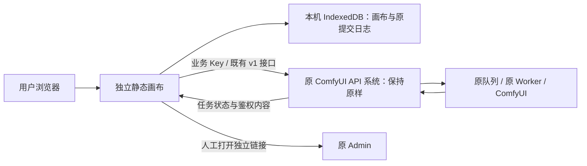

# 20 · 独立画布与既有 API 的融合边界及可用性评估

2026-10-30 用户明确：“无限画布独立出来只跟原有的 api 系统做请求，而不能修改原有的我们的 comfyuiapi 请求转发。”本文件按此重新约束后续实现。历史文档中的中转层扩展不再是画布的开发任务；尚未部署的 138 环境锁候选已撤回。

## 交付形态

画布是独立的 React/Vite 静态应用，有自己的源码、构建、版本、静态发布目录与回滚。用户在连接页填写**原 API 地址和业务 Key**，浏览器直接请求原 `/v1/`。不要求同源，不要求把画布安装进 API 项目，也不需要画布后端、数据库、队列、Worker 或 GPU 代理。

边界内允许：画布界面、青柠样式、前端参数映射、API 客户端、媒体节点、本机缓存、提交恢复、批量操作、静态部署和相关文档。边界外禁止：为画布改转发路由、改 API 响应、升级 Worker、改调度/数据库/manifest、创建新管理端、替换线上 API 包或通过其他后端转发一遍业务请求。

云同步/WebDAV与可选文本助手的历史待办不授权新增其他后端连接。若原API没有相应既有能力，标为外部依赖，不能通过直接连接另一家服务或修改转发来补齐。画布自身作品/任务备份继续使用本机ZIP/JSON。

## 横向分层评估

| 编号 | 层面 | 采用方案 | 现状及可用性边界 |
| --- | --- | --- | --- |
| E-01 | 源码 | `infinite-canvas/web/` 独立应用；原 API 两个工作区只读 | 画布已有独立 Git 工作区；旧交付镜像属于历史，不再继续写入 API 仓库 |
| E-02 | 部署 | 只交付 `dist/`，静态服务支持 SPA 回退与正确 MIME | 独立画布已上线39445，单独目录、指针和Nginx单元；原API指针与进程保持不变 |
| E-03 | 接口地址 | 连接页显式填写原 API 源站，可跨域部署 | 已有 `VITE_AGGREGATOR_ORIGIN` 构建默认值和用户配置；部署地址与 API 地址分开，不靠同源假设 |
| E-04 | API Key | 浏览器直接使用业务 Key；所有业务请求 `credentials: omit` | 不使用 Admin cookie，不暴露 Key 到 URL/静态配置/公开证据；是否在本机记住由用户选择 |
| E-05 | 模型发现 | 读取现有模型列表、用法及能力 Schema | 参数、尺寸、秒数、参考槽位按接口声明；不能按名称推断模型能力 |
| E-06 | 生图 | 原异步任务接口与发布预设 | 先前一项真实720×1080图片编辑完成，丢上传/生成响应恢复同一素材和任务；八种媒体模式的历史结果另列 |
| E-07 | 视频 | 原文生视频、首帧/多参考任务及内容下载 | 历史真实 MP4 已验证；新增视频模型仍要由原 API 管理者发布，画布不安装模型 |
| E-08 | 音频 | ComfyUI Workflow 音频产物 | 历史 FLAC 已交付；不能自动解释成语音合成、克隆或任意编码均已支持 |
| E-09 | 3D | 既有 GLB 交付与前端交互预览 | 已有真实 GLB 与原生浏览器测试；其他 3D 格式、动画和手机性能仍待验 |
| E-10 | 提交 | 先持久化原正文/Key 身份/幂等键/发布摘要，再发请求 | 已有 IndexedDB 事务和不重复提交逻辑；本机记录不成为第二个远程队列 |
| E-11 | 恢复 | 有任务 ID 查原 ID；未知提交调用服务已支持的原提交核对 | 旧服务不声明核对能力时明确保留未知，不换 Key、幂等键或设备重新生成 |
| E-12 | 调度 | 使用原 API 的公开模型别名 | 画布不选 GPU、不均衡、不接管 ComfyUI 队列。同 Workflow 多机均衡是否可用完全取决于原 API 已有配置 |
| E-13 | 异构设备 | 由原 API 维护模型/Workflow 的设备兼容性 | 本轮发现 4090 原生锁与 5070 API 锁不同；画布不能修协议。现有独立模型仍按原发布能力使用，不承诺两机已合为一个模型 |
| E-14 | 内容完整性 | 原鉴权下载，核对类型/长度/SHA-256 后落本机 | 已有下载校验及 GLB 文件头检查；损坏内容不当作已保存 |
| E-15 | 保留/清理 | 云端到期规则来自原系统；本机保存单独管理 | 原云端完成后八小时到期；画布可保存本机副本。ComfyUI 原件移交即清理尚未实现，属于原 API 外部限制，不在画布中补后门 |
| E-16 | 显存/内存 | 完全由原 API/Worker 执行已有空闲策略 | 原十分钟空闲释放不由浏览器触发；关闭网页也不等于终止 GPU 任务 |
| E-17 | 移动端 | 响应布局、触控/键盘/媒体预览分别验收 | 已有 390px 页面和浏览器自动化记录；不冒充 Android/iOS 真机验收 |
| E-18 | 轻量性 | 独立静态文件与本机存储 | 当前143.1共107文件，压缩包1,530,386字节；425旧资源单列保留；GPU耗时另验 |
| E-19 | 视觉 | 复用已下载的 04·青柠 CSS、字体与令牌，原始文件不改 | 已有桌面/窄屏页面、MP4/GIF；新页面继续同一组件风格 |
| E-20 | 许可与上游 | 保留 basketikun/infinite-canvas 的 MIT 许可和原作者声明 | 画布功能分支独立维护；原 API 的许可、部署和发布责任分开。字体/样式来源说明继续随静态包保留 |
| E-21 | HTTP/CORS | 沿用用户指定 HTTP 高位端口和原 API 的任意源 CORS | 不加 HTTPS 验收门槛；普通 HTTP 缺少的浏览器能力明确显示未知/不可用，不伪装站点配额或自动剪贴板已支持 |
| E-22 | 发布回滚 | 画布静态包/源码/页面独立冻结 | 当前143.1仅切自身指针；原API、静态服务和配置不变，旧资源保留，DBv4不降级 |
| E-23 | 跨源本机数据 | 每个画布源站拥有独立浏览器数据库 | 新端口/域名不会自动继承旧画布的项目、素材、连接和任务日志；先从原站导出项目/素材与任务清单，再在新站导入，重新填写 Key，并保留原站数据直到核对完成 |

这里的“独立”指独立静态部署。构建仍用 `VITE_STUDIO_MODE=managed`，保留现有业务 API、禁用上游脚本/插件/本地 Agent；不能改成上游名为 `standalone` 的开放模式来代替本次隔离要求。`VITE_BASE=/studio/`，`VITE_AGGREGATOR_ORIGIN=http://43.165.167.179:39443` 只设置公开 API 默认地址，不携带 Key。其他环境未配置默认 API 时，连接页留空并要求用户填写，不猜测画布自身源站。

## 已下载原件的离线读取

139.2将本机读取身份与在线客户端分开。原Key与规范化源站匹配时可读已下载原件；API不可用或401不授予远端权限。退出/错Key/换源站继续隔离，内存Key刷新不自动恢复；云端撤销不追溯删除已保存副本。实际离线刷新、素材预览/另存与错Key恢复通过，完整证据和边界见[文档24](24-真实故障恢复与离线素材验收.md)。这不是全站离线安装缓存或操作系统级多用户隔离。

## 已知性能问题

历史真实任务 `job_44f4b4c44f63489c88d4afab8d18d51b` 的 720×1080 图像端到端约 1,483 秒。通过原 Admin 的只读任务详情得到：领取后的准备约 **115.283 秒**、提交约 **1.117 秒**、生成及采集约 **1,363.003 秒**、上传核验约 **1.023 秒**。模型加载没有独立计量，状态为 `unknown/unmeasured`；不能把全部生成时间归因于画布、排队或模型加载。画布负责显示原进度、避免重复提交和让用户可离开恢复；本轮不改 API/GPU 执行策略来缩短时间。

## 可用性结论与放行要求

**独立静态画布调用既有 API 的方案可行，现有核心路径已具备分层证据；完整首期仍未全部验收。** 历史八种真实媒体模式、179 项前端单元、171 组浏览器专项以及已部署137.1/静态136.1只代表相应范围；不是本轮重新跑过，也不代表所有模型、手机或20台设备可用。

后续发布须同时满足：原 API 源码/版本/转发配置未变化；画布可从独立源站加载并使用显式 API 地址；真实请求仅流向现有业务接口；已知任务不重复生成；图片/视频/音频/GLB按已有授权模型分别验证；权限、离线、到期、损坏下载、移动布局失败均有可见反馈；所有自建浏览器标签和临时服务及时关闭。完整待办仍按 [F-01～F-46](10-开发进度与交付记录.md) 保留，但 F-29 原件删除、F-41 后端设备池扩展等中转层改造改列为**外部依赖/不在画布实施范围**。

## 本轮范围纠正

138 的 API/Worker/协议候选未部署，16 个已跟踪文件已恢复到 API 分支 `843aac47791f23755e71f976a00cf592380ddf99`，新增候选与测试证据归档于本机私有目录。API 工作区恢复干净。原生测试 PG 已停止，Admin 候选构建及其子进程已停止，未开启浏览器；不要求用户为这些候选升级 Windows 服务。

独立静态138.1已在39445上线：179单元、类型/生产构建、11组合成双源浏览器、107文件公网摘要与2组真实API目录浏览器检查通过。验收只读Key已禁用；自建浏览器和本机夹具已关闭。本轮未发起GPU生成。原API源码基线、配置、发布指针与服务PID保持不变，详见[部署与使用](21-独立画布部署与使用.md)。新增API能力不能作为该画布交付的隐含前提；缺失能力通过原API已公开的范围限制界面或提示说明。

前轮141.1进一步修复本机ZIP整批导入、凭证过滤和本机图片恢复；两次各10组原生/公网页面检查不访问业务API，不创建Key或任务。详见[文档26](26-画布ZIP整包导入与备份边界.md)。早期138/139/140条目保留为历史。

前轮142.1补齐仅存在于历史参考列表的本机原件备份、导入键重映射与实际再导出，并验证双页冲突后的完整未保存备份。14本机/14公网页面组通过；原API继续只读，详见[文档27](27-历史素材引用备份与跨页面冲突.md)。

当前143.1将历史引用纳入本机删除/保存事务保护，精确旧索引补齐保留正文并递增修订；15本机+15公网原生组通过。仅独立静态交付，原API只读，详见[文档28](28-历史引用原件删除保护与索引升级.md)。
