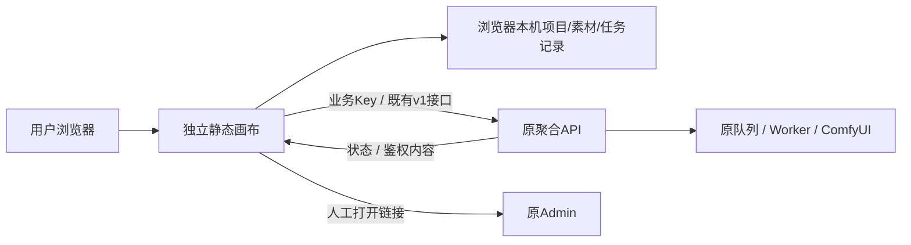

# 20 · 独立画布与既有 API 的边界

在 basketikun/infinite-canvas 现有仓库上二次改造，复用原画布交互与项目能力，增加现有聚合 API 的前端适配。当前核心清单见[文档37](37-交付范围纠正与核心适配现状.md)。历史融合文档中允许扩展原 API 的内容不再适用。

| 内容 | 本项目的责任 |
| --- | --- |
| 画布 | 复用拖拽、缩放、节点、连线和项目；必要位置增加创作表单、任务和产物节点 |
| 模型与Workflow | 读取原API当前授权目录、用法、Schema、完整preset和参考槽位；不在画布安装模型/节点 |
| 调用 | 上传参考 → 显式提交 → 查询原任务 → 下载校验 → 用户载入/另存；不建立第二套生成队列 |
| 身份 | 使用业务Bearer Key，业务fetch为credentials: omit；管理页面为外链，不借Admin会话鉴权 |
| 素材 | 图片、视频、ComfyUI Workflow音频及GLB按实际类型处理；云端期限来自API，本机副本单独管理 |
| 样式 | 复用下载的04·青柠，原始参考文件不改；持久明暗切换和八类可编辑案例 |
| 部署 | 独立React/Vite静态应用；当前39445，原API39443；只交付静态文件，无画布业务后端 |
| 原系统 | 转发、Worker、调度、数据库、Admin、设备/队列/显存及服务器配置均不改 |

`aggregator-service/` 与相邻原 API 仓库只读。画布只调用现有 `/v1/`；不直连ComfyUI，不经另一家代理中转，不为缺少功能补后门，也不向原 API 仓库镜像画布。

构建使用 `VITE_STUDIO_MODE=managed`。这里的managed表示只开放既有业务API、禁用上游自定义脚本/插件/本地Agent，仍为独立部署。不能用上游名为standalone的开放模式替代此边界。`VITE_BASE=/studio/`；API默认地址是公开源站，不携带Key；未配置时让用户填写，不猜测画布源站。

## 保留的正确性要求

参数来自API声明，不能按名称猜能力、随意混搭规格或把Workflow音频当TTS。提交前持久化原请求；已知任务查原ID，未知提交保留并只读核对，不静默换Key/模型/幂等键重提。下载使用固定业务接口，核对MIME、长度和SHA；播放或预览失败保留原件下载。

已有本机事务、引用保护、ZIP/任务清单备份、安全清理和兼容发布工具保留。修改这些链路时保护当前用户数据，不清空/降级日志v5；这不授权继续建设迁移框架、跨站同步或灾备系统。

本机数据受浏览器源站与配置文件约束，更换域名/端口不会自动迁移。Key默认仅页面内存，用户可选择可信浏览器记住；已下载副本与云端授权/八小时期限分别说明。当前浏览器存储不是服务端账号或云同步。

## 验证与部署约束

只考虑Web，响应式页面属于范围，原生客户端/应用商店不属于范围。窄屏模拟不当作真机触控；Windows WebKit不当作实际Safari。真实失败和未支持范围持续披露，不将合成API或历史媒体误报为当前全模型真实成功。

使用现有高位HTTP端口，域名反代由用户处理，不新增HTTPS门槛；原API任意源CORS保持现状。禁止Docker、WSL、虚拟机。若用浏览器自动化，使用自有隔离页面并在finally关闭全部自建page/context/browser和临时服务，不影响用户标签。

功能改动仅验证受影响流程，纯文档修正不重新构建/部署/录屏。旧46项中的扩展测试不再统一作为交付门禁；具体问题、可选增强和外部依赖见文档37。原件移交即删、多机负载均衡、10～20台容量及空闲资源释放继续归原API的独立目标，不计画布开发量。

[部署与使用](21-独立画布部署与使用.md) · [当前进度](10-开发进度与交付记录.md) · [更新记录](23-独立画布更新记录.md)
