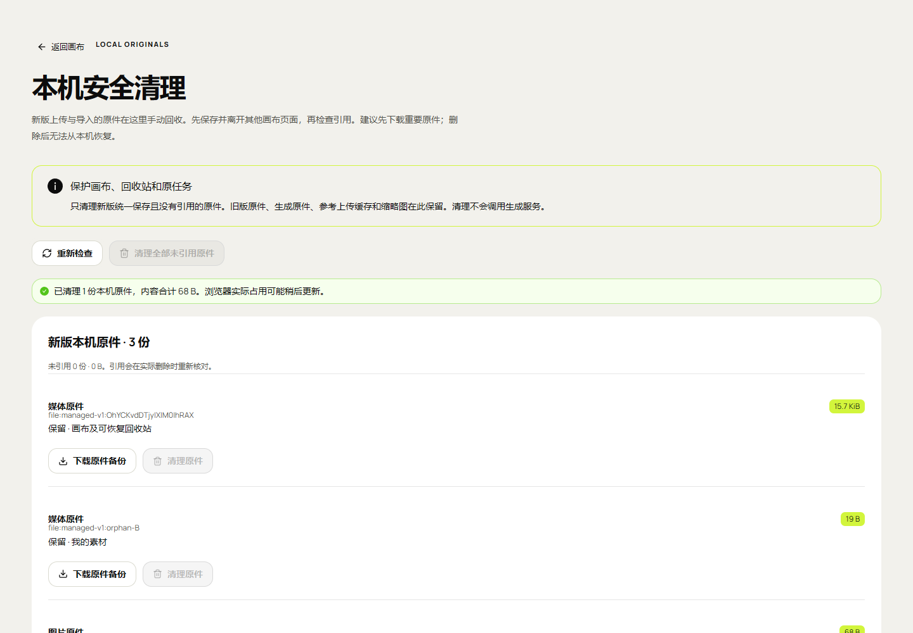

# 21 · 独立画布部署与使用

<!-- independent151:start -->
当前独立静态版本 `canvas-20261031.153.1`：[明暗切换与预设案例](36-明暗主题与预设创作案例.md)。[画布](http://43.165.167.179:39445/studio/)右上角切换主题；“案例”页打开可编辑模板，确认后才请求原API。218单元及本轮页面检查通过，完整Web签收HOLD。
<!-- independent151:end -->

<!-- independent150:start -->
**当前150.1已部署**：[参考创作与生成表单](35-画布参考创作与生成表单.md)。目录 `/opt/infinite-canvas/releases/canvas-20261031.150.1/`，编译源码 `8e5deee70699721221da1ee0d9b2d893755b4907`；包1,549,053字节，SHA `95c848fe1dd816eae1ec28891563be4dca23560b79c96a9516304aea97b97b23`。115当前/818旧资源与20路由通过，兼容150.0准备完成，未新增实际回退演练。207单元及69组表单通过；一次真实视频准备传输失败，临时Key已停用。原API/配置/指针和所有服务PID不变，Firefox公网未签收，完整Web验收HOLD。下方149及更早记录均保留原时点。
<!-- independent150:end -->


<!-- independent149:start -->
**历史149.1交付记录**：[文档34](34-Web媒体原件下载与播放失败处理.md)给出原件格式、失败提示、图层操作及72组/78下载/18截图的使用与验收。当前目录`/opt/infinite-canvas/releases/canvas-20261031.149.1/`，包1,546,601字节、SHA `f8ffc46484d08c88e04f74116976cd34802ffdbeb624fe572d702538002e992b`，编译源码`2b04d500c3f914304d3af9228f417e67b32e29b8`。114当前/779旧资源、20路由通过；兼容恢复149.0复用146.1应用并保留新旧资源，未重新演练149实际回退。原API137.1与所有服务/配置不变。WebKit解码/Cookie及完整Web人工门禁HOLD。下方146发布表与V-01～V-10保留原时点，不作为当前149的构建证据。
<!-- independent149:end -->


[证据148 · Web混合媒体跨浏览器备份恢复](33-Web混合媒体跨浏览器备份恢复.md)：保持146.1冻结产品；四步实际ZIP互导34组、九节点/五连线/八原件完整。Windows WebKit四音视频解码失败未签收，最终Firefox载入正常；普通WebM另存命名待完善。完整Web签收仍HOLD，原API/服务不改。

补充[证据147：Web浏览器兼容性](32-Web浏览器兼容性与验证边界.md)：继续同一146.1冻结产品；Firefox38组、Windows WebKit本机功能27组通过，Cookie隔离未签收。此后续证据不重写下方原发布回执，也不增加原生客户端范围。

历史146交付 **canvas-20261030.146.1**，画布入口 **http://43.165.167.179:39445/studio/**；原API **http://43.165.167.179:39443**，原管理入口为该API的 `/admin/`。浏览器直接请求原有业务接口，画布没有业务转发后端。原API仍为linux-20261030.137.1，代码、配置、数据库、调度、Worker及发布指针保持原样。完整签收为 **HOLD/pending-test**。

## 使用流程

1. 打开画布连接页，API地址填写原39443源站，使用管理员分配的业务Key。不要填写画布39445、Admin路径或ComfyUI8188。
2. 默认Key只在页面内存使用。需要刷新自动连接时可勾选可信浏览器保存；Key在浏览器本机数据库中，不进入构建、URL或导出。退出连接移除当前连接保存的Key。
3. 读取模型目录/注释及实时Schema。仅显示当前Key有权限且已发布的能力；尺寸、时长、参考槽位和输出格式按完整preset选择，不按模型名称猜测。
4. 新建画布并新建创作。单图编辑、首帧视频与多参考分别处理；音频是ComfyUI Workflow产物，GLB有原件、交互预览及内嵌动画控制。
5. 提交前保存冻结原请求日志。收到job ID后只查询原ID；响应丢失先只读核对，不换Key、正文、参考图、发布摘要或幂等键盲目重提。不支持核对的服务保留未知记录。
6. 成功后校验内容类型、长度与SHA-256，再载入画布/素材库或另存原件。失败下载不标作已保存。停止本页等待不等于取消远端GPU任务。
7. 云端完成后8小时到期，本机副本独立保存。原Key可在API不可用时打开已保存副本；生成、云端查询或取消仍需在线权限。默认内存Key刷新需重新输入，只有明确保存的Key会自动恢复本机身份。
8. 浏览器清理、配额或设备丢失会影响本机数据。重要作品另存原件或导出ZIP；任务JSON仅保存原请求与编号，不含媒体或连接Key。关闭网页不等于停止GPU。
9. 渠道、Workflow、模型、Key、全局/渠道队列到原Admin管理。画布只提供外链，不用Admin会话代替业务Key，不直连ComfyUI，也不发清理原件或释放显存命令。

新增[本机原件安全清理](30-新版原件安全清理与页面占用保护.md)：保存并离开编辑页后，仅回收新版受控普通原件；旧库及缩略图保留。本机引用检查与GLB动画的逐步使用见[文档29](29-本机原件引用检查与GLB动画.md)。普通图片/媒体自动回收未启用；缺件清单不能替代完整作品备份。

换端口/域名属于新浏览器源站，**不会继承旧IndexedDB**。从旧39443画布导出作品ZIP、必要原件与任务JSON，到39445导入并重新填写Key。ZIP中的任务转为说明，导入不重新生成；任务清单需主动查询原ID。确认新副本可用前保留旧站数据。当前日志v5不能降级或清空，也不能回退仅支持v4的144.1；兼容146.0恢复包及实际回退/恢复已验，详细操作与剩余故障范围见文档31；不得任意回退未知契约版本。

## 原生构建

独立仓库应用在 `web/`，已验证Node22.14.0/npm10.9.2。进入仓库根目录后执行：

```powershell
Set-Location web
npm ci
$env:VITE_BASE='/studio/'
$env:VITE_STUDIO_MODE='managed'
$env:VITE_AGGREGATOR_ORIGIN='http://43.165.167.179:39443'
npm run typecheck
npm run build
```

只交付 `web/dist/`。`managed` 是禁用上游脚本/插件/Agent并使用既有业务API的功能模式，仍然独立部署；不要为了“独立”改成上游 `standalone` 开放模式。默认API是公开源站，不含Key；未设置时连接页留空。不调用Docker、WSL或虚拟机。

## 历史146服务器与静态发布

| 项目 | 当前值 |
| --- | --- |
| 公网端口 | 39445，独立原生Nginx |
| 发布目录 | `/opt/infinite-canvas/releases/canvas-20261030.146.1/` |
| 画布指针 | `/opt/infinite-canvas/current` |
| 画布配置 | `/etc/infinite-canvas/nginx.conf` |
| 单元/运行目录 | `infinite-canvas-static.service`；`/var/lib/infinite-canvas/` |
| 当前包 | 1,545,721字节；114文件；SHA `3a715648f2edfbf1ce23f9ccee1dfb1192b622f4631ae11f97387493761cddd9` |
| 编译源码 | `db56cae3634da0361074e84024ccd5b428d189fa`；后续提交只补文档/证据 |
| 旧页面兼容 | 当前目录另保留688项前版哈希资源，有独立清单，不替换当前同名文件 |
| 原API目录 | `/opt/comfyui-aggregator/releases/linux-20261030.137.1`，不随画布切换 |

将验证过的静态文件安装到新的画布release目录，逐文件核对摘要，再原子切换画布自己的current。旧包保留；回退须先核对完整存储契约、清单和全部资源，只有已验证兼容目标才可切画布指针，不能回退API或本机数据库。146.0恢复包复用145.1应用字节并保留新资源；不能把仅保留旧目录当作可回退。不要立即删除旧哈希资源：已打开标签可能还会加载其懒加载模块。当前保留不是无限期清理策略，后续删除需明确兼容窗口并另行评估。

[当前Nginx样本](deployment/nginx.conf)与[systemd单元](deployment/infinite-canvas-static.service)仅用于独立画布。`/studio/assets` 和 `/studio/assets/` 两条精确匹配返回SPA入口；带文件名的资源走静态文件规则，缺失JS仍404，不能回退成HTML。其余页面深链按SPA处理。Worker单独有Schema编译所需CSP，主文档不开放任意脚本；配置保留服务器BT发行版已有Lua依赖路径。

画布端口不提供 `/v1/`、`/admin/`、`/internal/` 或Agent代理，探测均404。业务请求直达39443、Bearer鉴权、`credentials: omit`。原API任意源CORS仅检查未改写。HTTP高位端口供用户自行反代，不添加HTTPS验收条件。

146.1及兼容恢复146.0只切换自己的静态目录，全部服务PID和配置均与发布前相同，零重启/配置改写。139.1、139.2静态包切换也未重启任何服务。139.2随后修复素材路由，仅对独立静态主进程发送HUP重载；单元文件、主PID及全部原API状态保持不变。部署前逐文件回执和之后配置修复回执分别保留，不将两个时点混作同一快照。

## 历史146 Web验证

当前范围仅Web端。原生客户端/应用商店不属于开发或门禁；网页响应式、浏览器键盘/触控、下载与后台行为单独验收。Chromium已验证；Firefox/WebKit本机自动化未完成并已关闭，不计兼容通过。

| 编号 | 结果 | 范围 |
| --- | --- | --- |
| V-01 | [203单元、类型和冻结构建](research/studio-implementation/clean-build-2026-10-30T13-52-01-248Z.json) | 同锁空目录安装回执复用，未重新npm ci；源码/副本摘要一致 |
| V-02 | [18原生协议](research/studio-implementation/managed-cleanup-protocol-2026-10-30T13-55-25-766Z.json) / [12发布守卫](research/studio-implementation/safe-release-guard-20261030T140855512985.json) | 旧版门禁、全部引用、页面占用与归档/完整契约拒绝 |
| V-03 | [10本机清理](research/studio-implementation/managed-cleanup-ui-2026-10-30T13-59-55-033Z.json) / [10公网清理](research/studio-implementation/managed-cleanup-ui-public-2026-10-30T14-38-50-017Z.json) | 实际文件输入、保存、占用、原件SHA、确认/迟到引用/390px及保存失败 |
| V-04 | [14本机ZIP](research/studio-implementation/archive-import-2026-10-30T14-02-24-166Z.json) / [14公网ZIP](research/studio-implementation/archive-import-public-2026-10-30T14-40-06-901Z.json) | 坏包、原件/历史引用、再导出、配额注入与双页冲突 |
| V-05 | [11双源](research/studio-implementation/independent-browser-2026-10-30T14-02-09-772Z.json) / [14媒体回归](research/studio-implementation/media-tools-2026-10-30T14-02-23-040Z.json) | Bearer/noCookie、Schema Worker、只读清单与GLB资源释放 |
| V-06 | [145.1复现](research/studio-implementation/cleanup-refresh-baseline-2026-10-30T13-59-25-749Z.json) / [146.1公网3组](research/studio-implementation/cleanup-refresh-public-2026-10-30T14-40-06-009Z.json) | 最新快照不被较晚到达的旧结果覆盖，真实原生连接与事务 |
| V-07 | [实际兼容回退与恢复8项](research/studio-implementation/safe-rollback-Web-2026-10-30T14-37-15-637Z.json) | 两节点/两引用先明确保存；切换期间原始记录一致，重新载入严格区分渲染字段 |
| V-08 | [114当前/688旧资源、15路由](research/studio-implementation/independent-delivery-1461.json) | 逐项SHA/MIME/CSP、维护HTML和新旧页延迟资源，所有服务/配置不变 |
| V-09 | [API工作区前](research/studio-implementation/independent-api-boundary-0f7db77257f34145bc5b9b0880e5ae56.json) / [后](research/studio-implementation/independent-api-boundary-fe97cee4690a4a7e9797cc5a7d4234a2.json) | 两API仓库只读基线不变，原API137.1未改动 |
| V-10 | [四个MP4/GIF完整解码](research/studio-implementation/independent-media-1461.json) | 自有合成文件，完整所选页面录像，无本轮业务Key或GPU生成 |



[Web范围、兼容回退命令与完整证据](31-Web交付范围与兼容静态回退.md)；[安全清理使用](30-新版原件安全清理与页面占用保护.md)。先前真实GPU见文档24/25。本轮静态包1,545,721字节、SHA `3a715648f2edfbf1ce23f9ccee1dfb1192b622f4631ae11f97387493761cddd9`。完整Web人工/故障验收仍HOLD；原API10～20台容量是外部事项。

138.1首次独立上线及BT Lua/PID故障记录保留于[历史静态回执](research/studio-implementation/independent-delivery-1383.json)及[历史只读目录验收](research/studio-implementation/independent-public-browser-1381.json)。历史失败不会被新版成功覆盖。

[最终架构边界](20-独立画布与既有API融合最终边界.md) · [全部F-01～F-46与本轮编号](10-开发进度与交付记录.md) · [独立更新记录](23-独立画布更新记录.md)。源码/文档推送仅限授权远端的 `feat/independent-canvas`，不更新原API分支、main或basketikun上游。
