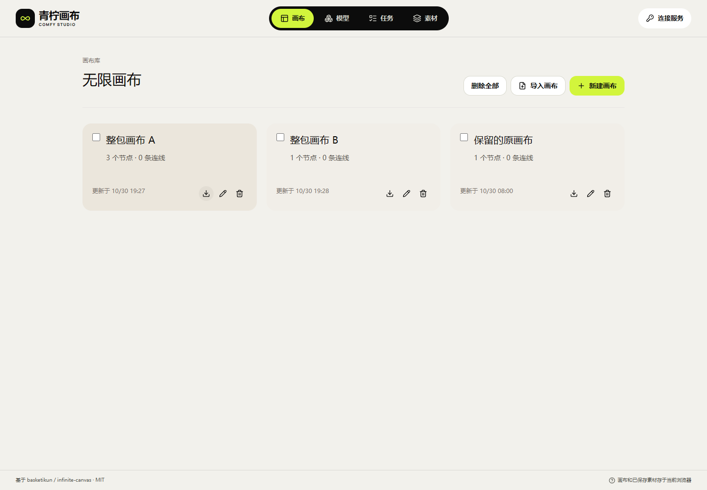

# 21 · 独立画布部署与使用

当前交付 **canvas-20261030.142.1**，画布入口 **http://43.165.167.179:39445/studio/**；原API **http://43.165.167.179:39443**，原管理入口为该API的 `/admin/`。浏览器直接请求原有业务接口，画布没有业务转发后端。原API仍为linux-20261030.137.1，代码、配置、数据库、调度、Worker及发布指针保持原样。完整签收为 **HOLD/pending-test**。

## 使用流程

1. 打开画布连接页，API地址填写原39443源站，使用管理员分配的业务Key。不要填写画布39445、Admin路径或ComfyUI8188。
2. 默认Key只在页面内存使用。需要刷新自动连接时可勾选可信浏览器保存；Key在浏览器本机数据库中，不进入构建、URL或导出。退出连接移除当前连接保存的Key。
3. 读取模型目录/注释及实时Schema。仅显示当前Key有权限且已发布的能力；尺寸、时长、参考槽位和输出格式按完整preset选择，不按模型名称猜测。
4. 新建画布并新建创作。单图编辑、首帧视频与多参考分别处理；音频是ComfyUI Workflow产物，GLB有原件及静态交互预览。
5. 提交前保存冻结原请求日志。收到job ID后只查询原ID；响应丢失先只读核对，不换Key、正文、参考图、发布摘要或幂等键盲目重提。不支持核对的服务保留未知记录。
6. 成功后校验内容类型、长度与SHA-256，再载入画布/素材库或另存原件。失败下载不标作已保存。停止本页等待不等于取消远端GPU任务。
7. 云端完成后8小时到期，本机副本独立保存。原Key可在API不可用时打开已保存副本；生成、云端查询或取消仍需在线权限。默认内存Key刷新需重新输入，只有明确保存的Key会自动恢复本机身份。
8. 浏览器清理、配额或设备丢失会影响本机数据。重要作品另存原件或导出ZIP；任务JSON仅保存原请求与编号，不含媒体或连接Key。关闭网页不等于停止GPU。
9. 渠道、Workflow、模型、Key、全局/渠道队列到原Admin管理。画布只提供外链，不用Admin会话代替业务Key，不直连ComfyUI，也不发清理原件或释放显存命令。

换端口/域名属于新浏览器源站，**不会继承旧IndexedDB**。从旧39443画布导出作品ZIP、必要原件与任务JSON，到39445导入并重新填写Key。ZIP中的任务转为说明，导入不重新生成；任务清单需主动查询原ID。确认新副本可用前保留旧站数据。当前DBv4不能因静态回退降级或清空。

## 原生构建

独立仓库应用在 `web/`，已验证Node22.14.0/npm10.9.2。进入仓库根目录后执行：

```powershell
Set-Location web
npm ci
$env:VITE_BASE='/studio/'
$env:VITE_STUDIO_MODE='managed'
$env:VITE_AGGREGATOR_ORIGIN='http://43.165.167.179:39443'
npm run typecheck
npm run build
```

只交付 `web/dist/`。`managed` 是禁用上游脚本/插件/Agent并使用既有业务API的功能模式，仍然独立部署；不要为了“独立”改成上游 `standalone` 开放模式。默认API是公开源站，不含Key；未设置时连接页留空。不调用Docker、WSL或虚拟机。

## 服务器与静态发布

| 项目 | 当前值 |
| --- | --- |
| 公网端口 | 39445，独立原生Nginx |
| 发布目录 | `/opt/infinite-canvas/releases/canvas-20261030.142.1/` |
| 画布指针 | `/opt/infinite-canvas/current` |
| 画布配置 | `/etc/infinite-canvas/nginx.conf` |
| 单元/运行目录 | `infinite-canvas-static.service`；`/var/lib/infinite-canvas/` |
| 当前包 | 1,530,787字节；107文件；SHA `61e524c193bd7424d4cf61ec57b2dbf8ade1737bde8b3eab58867261d532284c` |
| 编译源码 | `4e724075f5bd1f540a9c5fbd223c6666d5eb9fb7`；后续提交只补文档/证据 |
| 旧页面兼容 | 当前目录另保留340项前版哈希资源，有独立清单，不替换当前同名文件 |
| 原API目录 | `/opt/comfyui-aggregator/releases/linux-20261030.137.1`，不随画布切换 |

将验证过的静态文件安装到新的画布release目录，逐文件核对摘要，再原子切换画布自己的current。旧包保留，回退仅切画布指针，不能回退API或本机数据库。不要立即删除旧哈希资源：已打开标签可能还会加载其懒加载模块。当前保留不是无限期清理策略，后续删除需明确兼容窗口并另行评估。

[当前Nginx样本](deployment/nginx.conf)与[systemd单元](deployment/infinite-canvas-static.service)仅用于独立画布。`/studio/assets` 和 `/studio/assets/` 两条精确匹配返回SPA入口；带文件名的资源走静态文件规则，缺失JS仍404，不能回退成HTML。其余页面深链按SPA处理。Worker单独有Schema编译所需CSP，主文档不开放任意脚本；配置保留服务器BT发行版已有Lua依赖路径。

画布端口不提供 `/v1/`、`/admin/`、`/internal/` 或Agent代理，探测均404。业务请求直达39443、Bearer鉴权、`credentials: omit`。原API任意源CORS仅检查未改写。HTTP高位端口供用户自行反代，不添加HTTPS验收条件。

142.1只切换自己的静态目录，全部服务PID和配置均与发布前相同，零重启/配置改写。139.1、139.2静态包切换也未重启任何服务。139.2随后修复素材路由，仅对独立静态主进程发送HUP重载；单元文件、主PID及全部原API状态保持不变。部署前逐文件回执和之后配置修复回执分别保留，不将两个时点混作同一快照。

## 当前验证

| 编号 | 结果 | 范围 |
| --- | --- | --- |
| V-01 | [184单元、类型和冻结构建](research/studio-implementation/clean-build-2026-10-30T11-20-13-436Z.json) | 原锁/正常安装脚本依赖复用，未重新npm ci，前后及副本源码/产物一致 |
| V-02 | [11组双源](research/studio-implementation/independent-browser-2026-10-30T11-24-23-006Z.json) | 合成目录、桌面/390px、Bearer且无Cookie，零真实生成 |
| V-03 | [14组本机原生](research/studio-implementation/archive-import-2026-10-30T11-24-23-538Z.json) | 12类坏档、历史引用原件、导出失败、再导出、保存故障及双页冲突 |
| V-04 | [14组公网原生](research/studio-implementation/archive-import-public-2026-10-30T11-27-51-775Z.json) | 实际142.1静态摘要一致，同样14组；原生IDB、零业务API/Key/GPU |
| V-05 | [107当前/340旧文件、14路由](research/studio-implementation/independent-delivery-1421.json) | MIME/CSP/SHA、隔离路径、原API健康/CORS及服务/配置/指针不变 |
| V-06 | [两个API工作区](research/studio-implementation/independent-api-boundary-c8140954fac749eb89d0527850bde0e2.json) | HEAD/状态/摘要符合只读基线 |
| V-07 | [回归前后](research/studio-implementation/archive-regression-142.json) | 8专项中2失败→0失败，184项含相同专项，原日志摘要保留 |
| V-08 | [两MP4两GIF完整解码](research/studio-implementation/independent-media-1421.json) | 引用恢复与双页冲突为合成ZIP/原生事务验收，不冒充GPU/真机 |



[双页冲突](media/studio-142/archive-2026-10-30T11-27-51-775Z/public-archive-cross-page-conflict.png) · [390px](media/studio-142/archive-2026-10-30T11-27-51-775Z/public-archive-restored-canvas-390.png) · [引用恢复MP4](media/studio-142/synthetic-archive-recovery.mp4) · [GIF](media/studio-142/synthetic-archive-recovery.gif) · [冲突MP4](media/studio-142/synthetic-cross-page-conflict.mp4) · [GIF](media/studio-142/synthetic-cross-page-conflict.gif)。[历史引用与冲突使用逻辑](27-历史素材引用备份与跨页面冲突.md)，前轮整包事务见文档26。

先前139.2的真实GPU编辑、离线原件7项、证据140的两项真实批次/实际任务备份保留于[文档24](24-真实故障恢复与离线素材验收.md)和[文档25](25-轮询取消与真实批次验收.md)，不冒充142.1本轮重测。本轮不创建Key、不发生成请求。完整故障、真磁盘/配额、物理手机、大文件及10～20台容量继续HOLD。

138.1首次独立上线及BT Lua/PID故障记录保留于[历史静态回执](research/studio-implementation/independent-delivery-1383.json)及[历史只读目录验收](research/studio-implementation/independent-public-browser-1381.json)。历史失败不会被新版成功覆盖。

[最终架构边界](20-独立画布与既有API融合最终边界.md) · [全部F-01～F-46与本轮编号](10-开发进度与交付记录.md) · [独立更新记录](23-独立画布更新记录.md)。源码/文档推送仅限授权远端的 `feat/independent-canvas`，不更新原API分支、main或basketikun上游。
