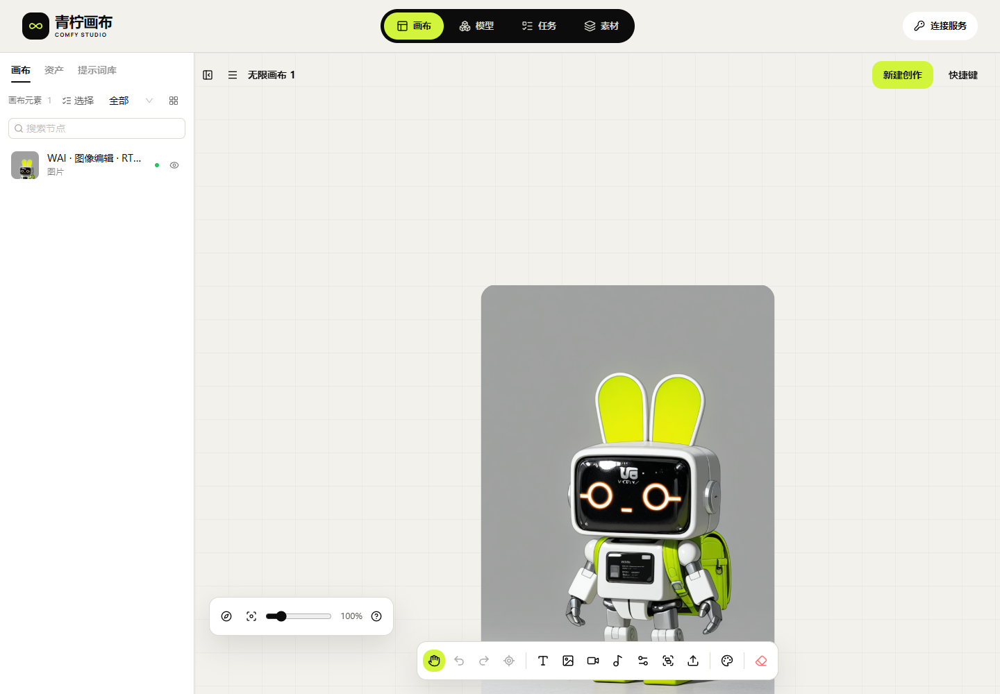
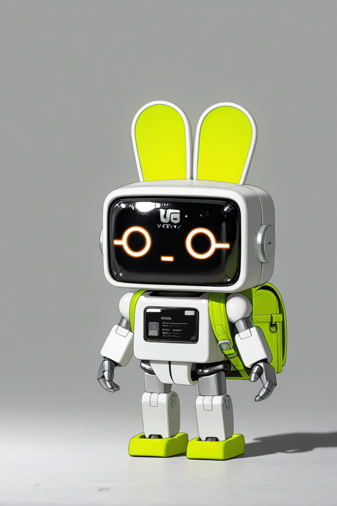

# 24 · 真实故障恢复与离线素材验收

当前独立画布为 **canvas-20261030.139.2**，入口 [39445/studio/](http://43.165.167.179:39445/studio/)。本轮只修改前端与自己的静态配置，原 API137.1 的源码、配置、指针、API/Runner/Worker/Edge 进程保持原样。完整项目仍为 **HOLD/pending-test**。

## 实际调用与恢复链路

通过画布使用现有 `comfy-3080-image-edit-wai` 公开模型，源图是本项目此前生成的玩具机器人测试图片。按照当前 Schema 选择720×1080、种子139；共创建一项实际GPU任务 `job_b3d89a5d08ab420694905358e439771b`。创建至完成约559秒，含排队、准备、生成和回传，不表示纯推理速度或延迟承诺。

| 编号 | 操作和观察 | 结果与边界 |
| --- | --- | --- |
| R-01 | 原API接收参考上传后，在验收浏览器丢弃响应 | 没有发送生成；用户再次明确提交，沿用原上传幂等键，返回同一asset ID和SHA |
| R-02 | 本机事务保存冻结正文/Key身份/幂等键/发布摘要后，原API接收生成；浏览器丢弃响应 | 刷新后只读核对找回同一job；该验收Key可见任务恰好一项，生成POST只有一次 |
| R-03 | 同一任务最终成功 | 真实PNG720×1080、634,923字节，完成后云端期限恰为8小时 |
| R-04 | 对实际原件下载响应先注入等长错误字节，再截短正文并缩短响应Content-Length | 两种均被拒绝，results库保持零；原任务不变。第三次正常下载才保存原件 |
| R-05 | 载入画布、关闭/重开自有浏览器、刷新、任务页另存原件 | 原件长度和SHA相同；390px文档不横向溢出，仅视口模拟 |
| R-06 | 在139.1阻断原API后刷新 | 发现原件读取依赖在线连接成功，验收失败。139.2修复本机身份后，同一GPU原件在离线启动/刷新时恢复 |
| R-07 | 直接打开独立素材库 | 发现assets页面与资源目录冲突404；仅为独立静态配置增加两条精确SPA规则并重载。14条页面/静态隔离路由通过 |
| R-08 | 在139.2阻断API，打开素材库、预览、另存原件、输入错误Key、恢复原连接 | 七项实际UI复查通过：原件长度/SHA一致，错误Key不显示原件，联网后重连，零生成POST |

丢响应和下载损坏由本机浏览器路由注入，服务器实际处理真实上传/生成/下载，未修改原API或服务器原件。此证据不能替代物理断电、真实链路截断、所有媒体或所有设备故障测试。提交发生于138.1，取件/负测发生于139.1，最终离线复查绑定139.2的index摘要；不是三个版本各生成一遍。

[390px离线画布](media/studio-139/real-offline-fixed-390-attempt4.png) · [素材库原件预览](media/studio-139/real-offline-library-attempt4.png) · [联网后恢复](media/studio-139/real-restored-online-attempt4.png) · [MP4录像](media/studio-139/real-offline-resume.mp4)。录像展示同一已生成原件的离线恢复，不是第二次生成。

实际原件SHA-256为 `f200bc866915dae22c7f234d6e89dfaab74123cd75a0128cd4df0ece1cddb59a`。公开样片剔除PNG文本等辅助元数据、保持压缩像素数据不变，其字节/SHA单独记录；原件保留在私有验收目录，不能拿样片摘要替代下载校验。

## 本机身份和远程权限

前端先从用户提供的原Key计算现有fingerprint，并与规范化API源站组合，作为内存中的本机读取身份；成功读取原API目录后才建立在线客户端。API不可用或401时，本机身份仅允许读取该身份已经下载保存的原件，不能发生成、上传、取消或获得新的云端权限。Key本身不进URL、日志或构建。

默认Key只保存在页面内存，刷新后需重新输入；只有用户勾选可信浏览器保存时才自动恢复。单有已保存fingerprint而没有Key不会解锁本机原件。错误Key/不同API源站、退出连接、读取期间切换身份都要隔离并回收旧blob URL。画布、素材库及GLB预览共用这一读取规则，保留现有归属和数据完整性校验。

云端Key撤销或素材到期不追溯删除用户已下载的副本；原Key仍可打开对应本机副本，这是本机保存语义，不是绕过服务器鉴权。同一浏览器源站的IndexedDB并非操作系统级多用户保险箱；需要隔离使用者时应使用独立浏览器配置。断网时静态页面仍需可访问；本版没有新增Service Worker全站离线安装缓存。

## 具名证据及失败保留

| 证据 | 结果 | 范围 |
| --- | --- | --- |
| [实际提交](research/studio-implementation/independent-generation-submit-1391.json) | 通过5项 | 原上传/生成丢响应，同一job；实际运行静态138.1 |
| [实际取件原报告](research/studio-implementation/independent-generation-collect-1391.json) | 总体失败，前6项通过 | 原件成功、两种损坏拒绝；最后离线刷新暴露产品缺陷，不能计为整体通过 |
| [本机身份专项](research/studio-implementation/offline-identity-1392.json) | 通过10项 | 原生浏览器/IndexedDB及合成协议；含过期、401、错Key/源站、退出、竞态和内存Key |
| [离线复查首次](research/studio-implementation/independent-offline-resume-1392.json) | 失败 | 画布恢复前三项通过；素材库直达404导致停止 |
| [复查第二次](research/studio-implementation/independent-offline-resume-1392-attempt2.json) | 失败 | 素材库已显示，脚本未匹配AntD双字按钮的插入空格；修正定位，不改产品文案或等待时间 |
| [复查第三次](research/studio-implementation/independent-offline-resume-1392-attempt3.json) | 失败 | 原件预览成功，自动化下载接收上下文关闭；显式配置自有下载接收目录后复查 |
| [最终实际复查](research/studio-implementation/independent-offline-resume-1392-attempt4.json) | 通过7项 | 同一真实原件、当前139.2index摘要、离线/错Key/联网恢复；无POST |
| [构建](research/studio-implementation/clean-build-2026-10-30T08-21-55-487Z.json) | 179单元/类型/生产构建通过 | 复用已有原生锁定干净安装，不声称重新npm ci |
| [双源检查](research/studio-implementation/independent-browser-2026-10-30T08-24-37-388Z.json) | 通过11项 | 两个原生HTTP源站、合成目录协议；桌面/390px |
| [静态交付](research/studio-implementation/independent-delivery-1392.json) | 107当前文件+170旧哈希文件通过 | 独立静态目录/指针；原API未改动；此回执早于路由修复 |
| [素材路由修复](research/studio-implementation/independent-static-route-1392.json) | 14路由通过 | 仅重载画布配置，主PID和原API不变；缺失静态资源仍404 |
| [样片/录像](research/studio-implementation/independent-media-1392.json) | 已核验 | 原件/公开样片分别记录；MP4和GIF完整解码 |
| [凭证收尾](research/studio-implementation/independent-live-1392.json) | Key禁用后401 | 仅关闭自有验收Key/会话/浏览器，不更改用户现有业务Key |

## 仍待完成

本轮只重测一项图片编辑，不把历史八种PNG/MP4/FLAC/GLB模式当成本轮重跑。Android/iOS真机、后台/长离线、大文件/泄漏、完整权限/故障组合及10～20台物理设备仍需验收。ComfyUI原件移交即删、异构设备合并与执行优化属于原API外部依赖，画布不修改转发来补足。完整编号见[全部F-01～F-46](10-开发进度与交付记录.md)。
