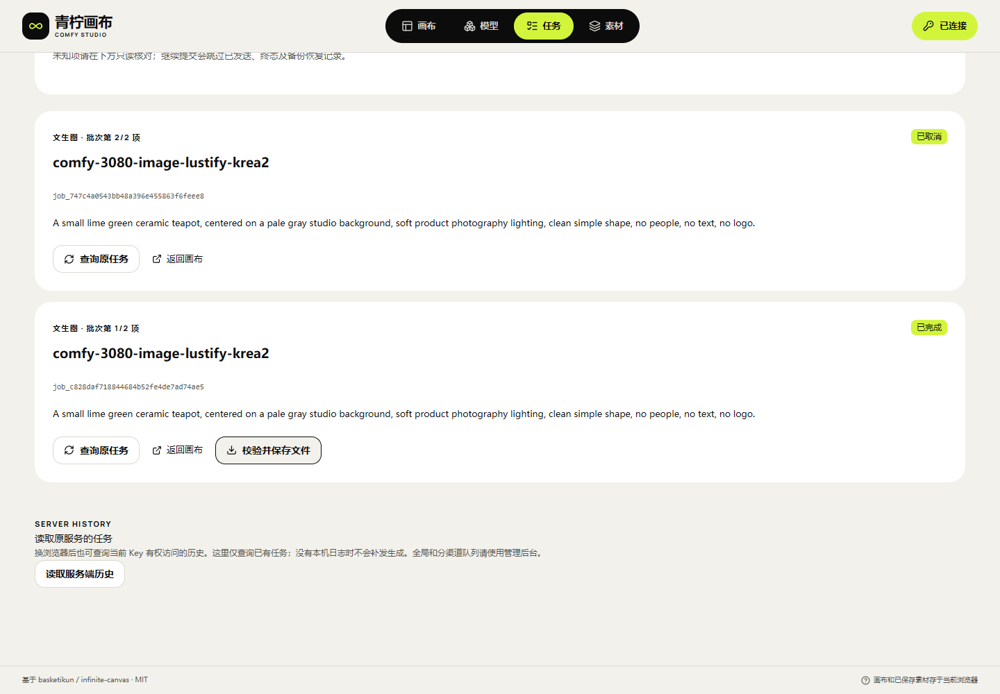

# 25 · 轮询、取消与真实批次验收

2026-10-30。证据批次140继续使用已部署的`canvas-20261030.139.2`，编译源码`dda138adf9408f10f3bf366a6e590e057cbe1c63`。本轮未修改产品源码或重新部署静态文件，原API137.1是只读依赖。画布与API分别位于39445和39443，业务请求直接调用原有`/v1/`，使用Bearer且不发送Cookie。

## 本轮范围

| 编号 | 验收对象 | 结果与边界 |
| --- | --- | --- |
| V-140-01 | 原生HTTP/IndexedDB故障矩阵 | 14组通过，含4种原状态×9种查询异常；没有真实GPU请求 |
| V-140-02 | 冻结139.2页面轮询 | 6组通过；双页面、限流、暂停、隐藏/离线信号和恢复；没有生成POST |
| V-140-03 | 真实两项批次提交 | 两项各一次POST，全部本机意图先提交；第二项受理响应丢失后只读找回原ID |
| V-140-04 | 真实排队取消 | 第二项取消响应丢失，随后用原ID查到服务器`cancelled`；第一项独立成功 |
| V-140-05 | 原Key规格权限 | 原策略仅允许standard；512×512 draft在实际页面禁用，最终使用720×1080 standard，未改权限或限额 |
| V-140-06 | 原API边界 | 两个本地API仓库只读；线上API指针、配置、四服务PID及画布自身配置/服务保持原样 |
| V-140-07 | 真实批次清单备份/恢复 | 4项通过；实际UI导出v2、独立浏览器配置导入、先不信任状态再主动查原ID，零生成POST |
| V-140-08 | 空画布单次冷加载观测 | 桌面/390px各一份新浏览器配置；FCP704/716ms，浏览器报告传输各447,948字节；不是性能SLA |
| V-140-09 | 实际产物与原画布恢复 | 720×1080 PNG、720,638字节、SHA/完整解码和8小时到期通过；3项实际UI复查，零生成POST |
| V-140-10 | 取证及凭证收尾 | 临时Key禁用401，所有自有浏览器/夹具关闭；两段MP4、两段GIF完整解码，公开样片去元数据 |

这不是完整首期签收。真实运行中取消、完成瞬间取消的更多设备组合、失败兄弟项、其他媒体、长离线、物理Android/iOS及10～20台容量仍未完成，整体继续`HOLD/pending-test`。

## 查询与取消的行为

查询401/403/404/429/503、非JSON错误或连接丢失时，本机保留原任务ID、正文、幂等键、身份和发布摘要，也保留最后确认的`queued/preparing/running/reconciling`状态；不把查询失败写成任务失败。有服务端Retry-After的429/503按提示等待，共享预算跨页面生效；没有提示时暂停自动查询，用户可明确查询原任务。

停止本页等待仅中止本页GET。远端取消须用户明确发出，并以服务端返回为准：`cancel_requested`仍是等待确认；响应丢失保留取消意图，之后查询原ID。低版本晚到GET/取消响应不能覆盖新状态，同版本矛盾及与已确认终态冲突的响应会被拒绝。尚无确认ID的未知提交禁止发取消。

当前生产页面测试先收到429与0.8秒提示，再收到无提示503：页面继续显示原任务“排队中”，并暂停自动查询。第二页恢复该记录不触发新查询。明确查询后转为运行；两页注入隐藏/离线信号时暂停，恢复可见但仍离线时也不查询，联网后只查询同一ID并进入成功终态，随后停止轮询。390px页面没有横向溢出。

上述隐藏/离线由测试夹具注入，不能证明操作系统挂起或真机后台行为。原生矩阵14组和页面6组分别统计，不算作20项GPU测试，也不重新计算179项单元为本轮重跑。

## 页面加载观测

| 新浏览器配置 | TTFB | 首次内容绘制FCP | 观测时JS堆 | 报告的传输字节 |
| --- | ---: | ---: | ---: | ---: |
| 桌面1440×1000 | 133.6ms | 704ms | 7,753,952 | 447,948 |
| 390×844模拟视口 | 129.5ms | 716ms | 7,732,315 | 447,948 |

来自本Windows主机经公网HTTP打开空画布，每配置只观测一次，未限速；22个resource条目，零API调用/生成。字节是浏览器Performance API报告的已加载资源传输量，不能等同完整发布包；堆为观测点、不是进程内存峰值。没有横向文档溢出。设备、网络、数据规模、已开页面和首次创作按需模块都影响结果，持续性能/泄漏/吞吐与物理手机仍待验。GPU任务端到端耗时单独记录，不能由本页面FCP推断。

## 真实批次与调用逻辑

模型：`comfy-3080-image-lustify-krea2`。两项使用相同非私人测试提示词、720×1080、standard、种子140，每项`n=1`，各有独立`client_request_id`、幂等键和job ID。全部意图在同一严格本机事务提交后逐项POST，画布不创建第二套后端队列。

| 成员 | 原任务ID | 当前结果 |
| --- | --- | --- |
| 1 | `job_c828daf718844684b52fe4de7ad74ae5` | succeeded，720×1080 PNG，720,638字节，端到端1,458秒 |
| 2 | `job_747c4a0543bb48a396e455863f6feee8` | 服务端确认cancelled，无产物 |

第二项实际被原API受理后，浏览器故意丢弃响应；重开任务页，用冻结的原正文、原幂等键、原发布摘要调用既有只读lookup找回同一ID。服务器该临时Key可见任务恰好两项。随后只对第二项发一次取消，取消响应也故意丢弃，再查原ID确认取消。未补发生成、未切换Key、模型或设备。

第一项原件SHA-256为`1c453619d9ad8d0754c5002d2e2302027c36eee0739422fa7117e9e604a81066`；API鉴权下载、本机浏览器另存与完整PNG解码相符，云端到期减完成时刻为28,800秒。原件已载入原画布并在刷新后保持，720×1080尺寸正确；第二项仍为cancelled、无产物。24分18秒是端到端观察，未拆分排队/加载/采样，不承诺时延SLA，也不为取证改原API性能参数。

取消一项不会删除另一项或重新生成成功项。完整批次不是一个原子GPU作业；不同成员各自消耗原API额度并拥有独立状态。真实验证Key完整复制已有策略，未扩大draft权限、并发、额度、重试或超时。

实际页面导出的任务JSON保留两项原正文、幂等键、发布摘要、原身份、批次编号和job ID，包含提示词、不含保存的API Key或媒体原件。文件本体私有保留，公开回执只记录长度与摘要。在独立浏览器配置中用原Key导入后，两项均先标记为备份待核对，不自动查询、不允许继续提交或取消；用户逐项主动查询原ID后才建立已核对状态。第二项仍为cancelled，原提交字段和分组保持一致。该4项是实际任务备份UI测试，不是新GPU任务或跨操作系统验收。

## 保留的测试失败

旧脚本误把点击禁用draft项当成选中，截图和冻结正文实际为720×1080 standard。路由断言在转发前中断，留下`submitting/prepared`本机记录。现有只读lookup返回`not_observed`、服务器该Key列表为空；这些记录保持原样，没有重发。`not_observed`本身不能证明任务从未执行。

第二次预检在保存任何意图前发现规格未选中并停止。修正的是测试脚本：核对Key策略、禁用状态、实际选中值和冻结正文，并捕获路由断言以保证finally关闭浏览器。产品正确阻止了未授权draft，未因此修改产品或API。旧证据保留，新验证另建明确的测试批次。

取原件时另有两次浏览器退出。最小复现表明：本机原生Chromium使用中文持久profile路径时，PNG另存触发`0xC0000005`原生退出；关闭录像仍复现。同一PNG在临时配置可下载，同一持久profile经既有ASCII联接访问也可下载。使用前realpath确认联接指向本工程`.local/studio140`，实际文件和原任务记录不移动、不重建，联接不删除。后续实际产品UI复查成功另存原件、载入画布与刷新，零生成POST。此为本机取证环境诊断，不将其写成产品修复或其他浏览器已验收。

本轮临时Key已停用并确认401，原业务Key未改；所有自建页面/context/browser及合成夹具关闭。公开PNG只去除附属元数据，像素数据保持，原始720,638字节文件私有留存并按原SHA核对。

## 页面与回执

[去元数据样片](media/studio-140/actual-batch-first-display.png) · [结果390px](media/studio-140/verified-actual-batch-result-390.png) · [实际批次恢复MP4](media/studio-140/actual-batch-recovery.mp4) · [合成轮询MP4](media/studio-140/synthetic-polling-recovery.mp4)。实际录像是原批次恢复/保存，未录制完整24分钟GPU执行；合成录像只展示HTTP与隐藏/离线信号，二者分开标注。

[真实390px页面](media/studio-140/verified-actual-batch-after-cancel-390.png)是视口模拟；[合成查询暂停页面](media/studio-140/synthetic-polling-paused-desktop.png)和[合成恢复页面](media/studio-140/synthetic-polling-reconciled-390.png)属于冻结产品UI与合成HTTP测试。

[真实批次导入待核对](media/studio-140/actual-batch-backup-import-unverified.png) · [导入并主动核对后的390px页面](media/studio-140/actual-batch-backup-import-390.png)。

| 类型 | 回执 |
| --- | --- |
| 原生故障14组 | [通过](research/studio-implementation/task-faults-2026-10-30T09-35-22-232Z.json)；[旧夹具环境定义失败](research/studio-implementation/task-faults-2026-10-30T09-35-00-159Z.json) |
| 页面轮询6组 | [通过](research/studio-implementation/polling-ui-2026-10-30T09-41-29-131Z.json) |
| 旧中断批次只读核对 | [保留原记录](research/studio-implementation/independent-batch-interrupted-140.json)；[恢复前置检查失败](research/studio-implementation/independent-batch-resume-prepared-140.json) |
| 禁用规格预检 | [意图/POST前停止](research/studio-implementation/independent-batch-verified-submit-140.json) |
| 真实批次提交与取消 | [两项原任务](research/studio-implementation/independent-batch-verified-resume-prepared-140.json) |
| 真实批次JSON备份/恢复 | [4项通过](research/studio-implementation/independent-batch-backup-140.json) |
| 原件协议/解码 | [720,638字节及1,458秒](research/studio-implementation/independent-original-140.json) |
| 同一原批次实际UI交付 | [3项通过](research/studio-implementation/independent-batch-verified-collect-140-attempt3.json)；[原失败](research/studio-implementation/independent-batch-verified-collect-140.json)、[再次失败](research/studio-implementation/independent-batch-verified-collect-140-attempt2.json) |
| 本机原生下载诊断 | [3个隔离场景](research/studio-implementation/independent-native-download-140.json) |
| 素材/GIF/MP4 | [原件与去元数据样片、四份完整解码](research/studio-implementation/independent-media-140.json) |
| 临时Key及浏览器收尾 | [停用401](research/studio-implementation/independent-live-140.json) |
| 线上原API与静态服务 | [只读核对](research/studio-implementation/independent-host-unchanged-140.json) |
| 空画布单次冷加载 | [两份观测](research/studio-implementation/independent-load-140.json) |

完整剩余范围见[全部F-01～F-46](10-开发进度与交付记录.md)。本机副本保留与云端完成后8小时到期分开，ComfyUI移交即删和异构多设备容量仍属于原API外部依赖。
