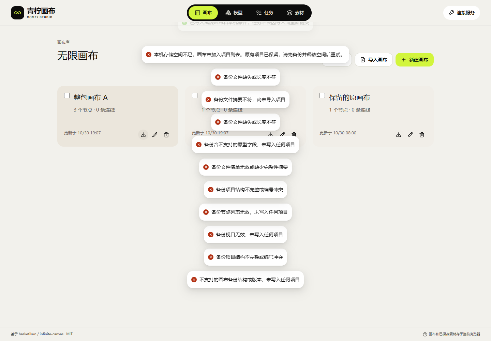

# 26 · 画布 ZIP 整包导入与备份边界

对应 F-15、F-31、F-33、F-34、F-36 和 F-43。本增量仅修改独立画布，继续由浏览器直接请求原 API；导入和导出本机项目本身不需要 API 请求、Key 或 GPU。

## 本轮修复

原导入代码逐个写入项目。如果第二个项目的文件写入失败，第一个项目可能已经加入项目列表。原结构校验也会接受对象类型的标题、零缩放视口、错误的图片列表、重复项目/连线/文件路径。导出凭证过滤还遗漏 Cookie、X-Api-Key 和 URL 片段中的凭证。新增回归在原实现上三组失败，修复后通过；保留原失败日志，不把它改为成功。

原生页面进一步发现：导入清除失效的旧 `blob:` 地址后，图片恢复逻辑因内容为空提前返回，即使文件已经写入也无法显示。本轮同时修复顶层图片和嵌套图片变体按各自新本机键恢复，不依赖旧页面的临时地址。发现该缺陷的候选浏览器失败保留，该候选没有部署。

1. 解压后校验整个版本 3 清单、项目/节点/视口/媒体字段、唯一标识及文件路径；拒绝原型字段、缺失原件、长度或 SHA 不符。所有项目和文件都通过预检后才开始写入。
2. 每份导入原件分配全新的本机键，不覆盖同名的旧文件，不借用原任务或其他身份的结果键。
3. 先等待全部原件写入，再一次加入完整项目列表；列表通过既有严格 IndexedDB 文档事务保存。没有新增数据库版本、服务器表或生成队列。
4. 文件中途失败时，整个项目批次都不加入列表。旧项目和原件保留；已经暂存的新文件可能仍占空间。普通文件跨库回收仍待单独实现与验收，不在失败处理里盲删。
5. 文档事务失败时，旧的已提交文档保留；整批新项目继续显示为尚未保存，提供“重试保存”。明确重试保存同一个本机文档，不重新导入文件，不重新生成。用户可先备份当前可见内容。
6. 导入操作期间禁用重复选择；其他既有编辑仍按原有保存冲突规则处理。未保存的旧文档先处理，不能以新导入掩盖保存错误。

## 凭证与执行边界

项目 ZIP 导出移除结构化 Key、鉴权头、Cookie、会话令牌，以及 HTTP(S) URL 用户信息、查询参数和片段参数中的凭证。普通锚点与不含凭证的参数保留；源文档不改变。提示词和普通文字仍是用户原文，可能含私人信息，不进行猜测性内容替换，备份需由用户妥善保管。

ZIP 导入是离线画布副本，不是连接配置或任务接管。历史任务节点转为说明，移除运行关联；聊天会话不恢复。文本中的脚本样式原文不会作为脚本执行。托管功能模式继续拒绝任意脚本、插件和 Agent，生成仍只能由用户在当前授权目录中明确发起。任务 JSON 的只读恢复契约另见文档 25，不因本次 ZIP 修复变化。

没有新增文件大小、并发、超时、重试次数或保留时间限制。本地配额与实际磁盘故障分别说明；注入 QuotaExceededError 不等于真实设备磁盘耗尽。桌面 Chromium 和 390px 视口也不等于 Android/iOS 真机。

本轮测试原件是合成的1×1白色PNG，因此截图中的图片卡显示白色；以实际图片载入、原件摘要、尺寸和刷新后的恢复共同核对，不把截图白块当作真实生成样片。历史编辑引用组合及跨浏览器/版本灾备仍待完整验收。

## 验证与发布

当前已独立发布 **canvas-20261030.141.1**。冻结源码 `9b2a76c3878e8f57d885a8fe033b56e803e8eeb6`，静态包 1,529,591 字节/SHA `c472e19144f9143659c2f5ec0971333bfdad5aa5d5eefc55526af4fc2d71c5e0`，107当前文件及255旧哈希资源、14路由逐项公网验证。API与画布服务PID/配置均未改动，原API指针、两个源码工作区保持只读基线。

| 层次 | 具名证据 | 解释 |
| --- | --- | --- |
| 回归 | [修复前后](research/studio-implementation/archive-regression-141.json) | 原六测试3失败，修复后0失败；最终182亦包括这六项 |
| 构建 | [182单元、类型与冻结构建](research/studio-implementation/clean-build-2026-10-30T10-55-36-118Z.json) | 正常锁/脚本安装复用，源码前后与隔离副本相同 |
| 目录隔离 | [11组双源浏览器](research/studio-implementation/independent-browser-2026-10-30T11-04-54-197Z.json) | 合成双源，不调用真实生成 |
| 本机页面 | [10组本机原生验收](research/studio-implementation/archive-import-2026-10-30T11-04-55-115Z.json) | 真IndexedDB，10类坏档，文件故障/文档中止/重试及图片显示刷新 |
| 公网页面 | [10组公网原生验收](research/studio-implementation/archive-import-public-2026-10-30T11-07-33-852Z.json) | 收到的线上静态摘要与冻结包相同，同样10组通过，零业务请求 |
| 发布 | [静态包](research/studio-implementation/independent-package-1411.json)、[逐文件与服务核对](research/studio-implementation/independent-delivery-1411.json) | 只切画布自己的current，不写原API，不重启服务 |
| 只读边界 | [原API两个工作区](research/studio-implementation/independent-api-boundary-3773df1e19aa460b9a20b127162311f2.json) | HEAD、状态及摘要均不变 |
| 演示 | [媒体完整解码](research/studio-implementation/independent-media-1411.json) | 自建浏览器finally关闭后编码合成录屏，桌面/390px，不等于真机 |

[恢复图片](media/studio-141/archive-2026-10-30T11-07-33-852Z/public-archive-restored-canvas-desktop.png) · [390px](media/studio-141/archive-2026-10-30T11-07-33-852Z/public-archive-restored-canvas-390.png) · [中途文件失败](media/studio-141/archive-2026-10-30T11-07-33-852Z/public-archive-second-file-failed.png) · [文档失败的整批未保存](media/studio-141/archive-2026-10-30T11-07-33-852Z/public-archive-document-aborted.png) · [完整MP4](media/studio-141/synthetic-archive-recovery.mp4) · [GIF](media/studio-141/synthetic-archive-recovery.gif)。

导入前在本机“画布”页面导出ZIP，迁移到新源站后选择导入。失败提示时先保留旧站数据；文件写入失败后可处理配额再明确导入，文档未保存时使用“重试保存”，不要以重新生成代替恢复。没有连接业务Key也能做本机作品备份。

以下候选失败完整保留，均未用作正式部署：收尾源码变化使[首次冻结一致性失败](research/studio-implementation/clean-build-2026-10-30T10-28-45-254Z.json)；[原生夹具旧数据守卫](research/studio-implementation/archive-import-2026-10-30T10-42-03-468Z.json)拒绝不一致种子，修正夹具后发现[顶层图片恢复缺陷](research/studio-implementation/archive-import-2026-10-30T10-43-48-579Z.json)，修复后进一步发现[嵌套主图恢复缺陷](research/studio-implementation/archive-import-2026-10-30T10-50-23-649Z.json)。后两次为实际产品问题，本轮已修复并在最终冻结源码复验；每次自有页面、context、浏览器和临时服务均关闭，不提高等待时间掩盖失败。

整体验收继续 HOLD。跨浏览器/版本灾备、普通媒体跨库安全清理、真实磁盘/配额恢复、真机软键盘/后台和完整媒体矩阵仍在全部 F-01～F-46 待办中；不因本次 ZIP 改善关闭这些范围。
