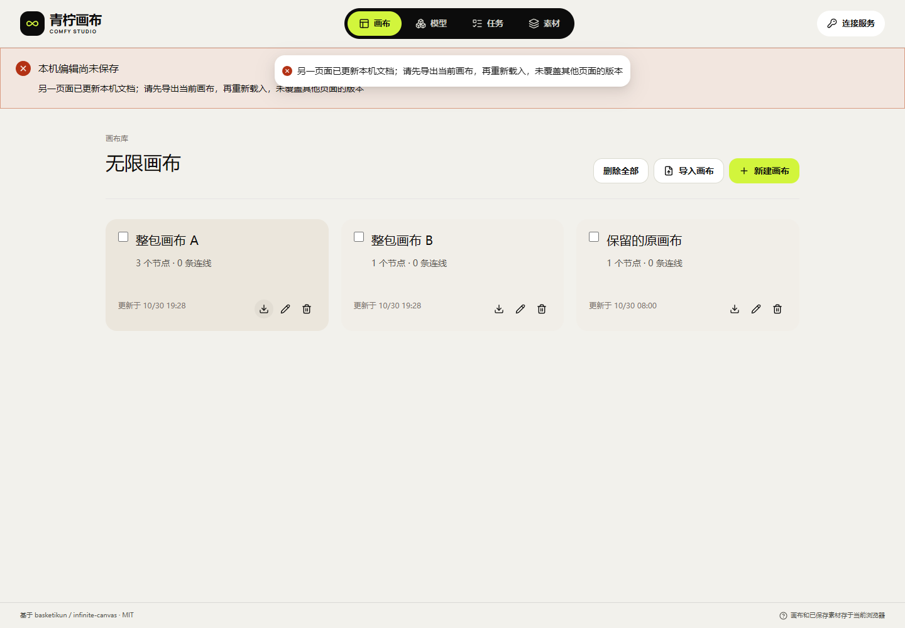

> 本文为142.1备份交付的历史记录。当前143.1及删除保护补充见[文档28](28-历史引用原件删除保护与索引升级.md)；下方回执按原版本保留。

# 27 · 历史素材引用备份与跨页面冲突

独立画布 **canvas-20261030.142.1**，对应F-15、F-31、F-34、F-42～F-45。原API仍为137.1，画布只调用原有接口；本轮仅修改画布本机备份代码与独立静态交付。

## 修复的实际问题

旧代码只收集对象中的storageKey字段。历史编辑参考图如果仅存在metadata.references列表里，ZIP会漏带其原件；导入也只替换storageKey，不替换列表里的旧键。新回归在原实现上2项失败，修复后8项全通过，最终184项单元测试包含相同专项。失败日志保留在私有取证目录，公开[前后计数、源码与日志摘要](research/studio-implementation/archive-regression-142.json)。

现在导出、预检共用明确的本机引用收集：storageKey字段，以及references列表中的image:/file:/studio:键。原件清单按键去重；参考列表不去重、不重排，避免改变素材位置含义。导入为各原件分配新键，并同步替换参考列表。提示词等普通文本保持原文，不凭相同字面量猜文件。外部URL不主动抓取，已有凭证过滤继续生效。

| 字段 | 导入前示例 | 导入后的含义 |
| --- | --- | --- |
| storageKey | image:source-a | 新分配的image:import-Y |
| references | [image:reference-only, image:source-a, image:reference-only] | [image:import-X, image:import-Y, image:import-X]，保留顺序/重复项 |
| prompt | image:reference-only | 原文保留，不替换成文件键 |

原件清单缺项、ZIP缺文件、长度/SHA不符均在写入前拒绝。导出时参考原件不可读则提示备份未完成，不下载残缺包，也不重新生成原件。旧版ZIP若已漏掉历史参考文件，新版会拒绝；应回原浏览器源站，在更新后的画布中重新导出完整作品。已经丢失的字节不能由键名或提示词恢复，原站数据应保留到核对结束。

## 双页面冲突的使用逻辑

两个页面从同一版本载入后，页面A先保存；页面B继续编辑或导入时，既有文档版本检查会拒绝覆盖A。B保留其完整未保存作品并显示冲突提示，不提供针对过期版本的盲目重试。先从B导出重要作品，再重新载入并核对A的已提交版本；需要保留B分支时，可在核对后明确导入其完整ZIP。不会自动合并两个页面的编辑，也不会调用生成API解决本机保存冲突。

本轮实际验证B在冲突后导出的项目ID与A已提交项目不同，原件、参考列表及摘要完整，导出前后A的文档不变。该保存冲突机制已有实现，本轮补充的是带历史引用原件的实际页面验收。DB仍v4、作品ZIP仍v3；未改数据库格式或其他项目的清理策略，暂存孤儿原件仍待安全回收。

[再次导出页面](media/studio-142/archive-2026-10-30T11-27-51-775Z/public-archive-reference-reexport.png) · [390px模拟](media/studio-142/archive-2026-10-30T11-27-51-775Z/public-archive-restored-canvas-390.png) · [引用恢复MP4](media/studio-142/synthetic-archive-recovery.mp4) · [引用恢复GIF](media/studio-142/synthetic-archive-recovery.gif) · [双页面冲突MP4](media/studio-142/synthetic-cross-page-conflict.mp4) · [冲突GIF](media/studio-142/synthetic-cross-page-conflict.gif)。主图是1×1白色合成PNG，独立历史参考是1×1青柠PNG，实际长度与SHA分别核对；这些素材不是真实GPU生成。

## 当前证据与交付

| 编号 | 本轮已实现 | 验证与边界 |
| --- | --- | --- |
| I-104 | ZIP统一收集storageKey及references中的明确本机键 | 仅历史引用的原件纳入包，重复引用只保存一份原件；不抓取外部URL |
| I-105 | 预检拒绝未声明或缺失的参考原件 | 12类非法/损坏包均在写入前拒绝，旧文档和原件不变 |
| I-106 | 导入按新键重映射参考列表 | 引用顺序/重复项保留，提示词字面量不变；刷新和实际再次导出核对原件SHA |
| I-107 | 引用原件不可读时拒绝导出残缺ZIP | 实际UI报错且零下载；恢复自有测试原件后文档和原件不变 |
| I-108 | 既有双页面保存冲突和未保存备份验收 | 旧页面不覆盖已提交新版本，不提供盲目重试；未保存项目可导出完整原件/引用 |
| I-109 | 独立142.1冻结构建、页面与静态交付 | 184单元/类型/构建、11双源、14本机+14公网原生组；107当前/340旧资源及14路由 |
| I-110 | 文档27、双语README、截图及两MP4两GIF | 全部媒体完整解码，全46项保留；浏览器/夹具finally关闭，原API只读，无服务重启 |

| 层次 | 证据 | 具体范围 |
| --- | --- | --- |
| 冻结构建 | [184单元、类型/构建](research/studio-implementation/clean-build-2026-10-30T11-20-13-436Z.json) | 复用原生干净锁定安装，源码前后/隔离副本摘要一致，非重新npm ci |
| 目录隔离 | [11组双源](research/studio-implementation/independent-browser-2026-10-30T11-24-23-006Z.json) | 原生HTTP合成目录，业务不带Cookie，无真实生成 |
| 本机页面 | [14组原生检查](research/studio-implementation/archive-import-2026-10-30T11-24-23-538Z.json) | 12类坏档、引用原件、失败导出、重映射/再导出、文件/文档故障、双页冲突 |
| 公网页面 | [14组公网检查](research/studio-implementation/archive-import-public-2026-10-30T11-27-51-775Z.json) | 收到的线上冻结静态摘要一致，同样14组通过，零业务API请求 |
| 包与HTTP | [静态包](research/studio-implementation/independent-package-1421.json)、[逐文件/14路由](research/studio-implementation/independent-delivery-1421.json) | 107当前/340旧哈希资源，SHA/MIME/CSP与原API健康/CORS只读核对 |
| API边界 | [两个工作区](research/studio-implementation/independent-api-boundary-c8140954fac749eb89d0527850bde0e2.json)、[发布前线上基线](research/studio-implementation/independent-host-unchanged-142-preflight.json) | 原源码/状态/配置/发布指针/进程保持不变；静态服务也未重启或改配置 |
| 演示 | [两MP4两GIF完整解码](research/studio-implementation/independent-media-1421.json) | 自建四个页面/三个context均关闭后编码，合成故障不代替GPU/真机验收 |

源码 `4e724075f5bd1f540a9c5fbd223c6666d5eb9fb7`；当前包 1,530,787 字节，SHA `61e524c193bd7424d4cf61ec57b2dbf8ade1737bde8b3eab58867261d532284c`。只切换画布自己的current，原API/Worker/调度/数据库/Admin不改，未创建业务Key或生成任务。没有新增大小/并发/超时/重试/保留时间限制，也不启用普通文件自动清理。

完整签收仍HOLD：跨浏览器/版本灾备、真实磁盘与配额、长后台/离线、普通媒体跨库安全回收、Android/iOS和10～20设备容量继续逐项验收。[部署与使用](21-独立画布部署与使用.md) · [全部46项](10-开发进度与交付记录.md) · [前轮整包事务修复](26-画布ZIP整包导入与备份边界.md)。
