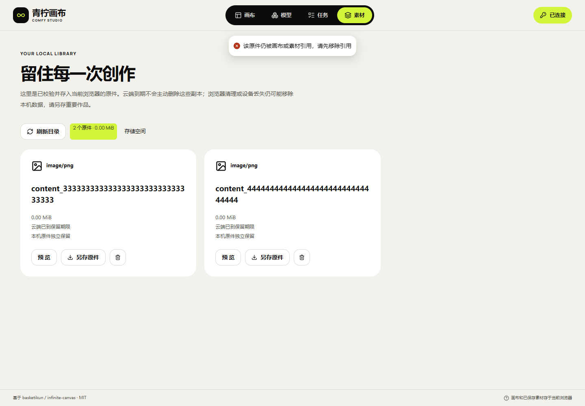

# 28 · 历史引用原件删除保护与索引升级

本轮修复独立画布的本机原件删除保护。仅存在于 `references` 历史参考列表中的 `studio:` 原件也必须受到保护，不能因为它没有出现在当前节点的 `storageKey` 中而被素材库删除。画布、素材文档以及可恢复回收站统一使用与 ZIP 备份相同的引用收集规则。

原 API 转发、Worker、数据库、Admin、云端期限与 ComfyUI 均不改动。本轮不提交真实生成任务，不建立清理后端，也不启用普通图片/媒体的自动回收。

## 使用方式

1. 在“本机素材”点击删除原件，确认后先等待当前文档保存。
2. 当前页面或已保存文档仍引用该原件时，显示保留原因，原件和文档均保留。历史参考列表、素材附加信息和可恢复回收站的引用同样有效。
3. 要删除原件，先移除全部相关引用。移入可恢复回收站仍保留引用；清理前先导出重要作品的完整 ZIP。
4. 确认已经没有引用后，再主动删除。删除只作用于当前浏览器的原件，不取消任务、不删除云端或 ComfyUI 文件，不延长云端保留期。
5. 若出现另一页面已更新或引用记录损坏，保留当前数据，先备份并重新载入。不要清空本机数据库来消除提示。

## 保存与删除的同一事务约束

删除操作重新从完整已保存正文计算引用，不依赖当前页面是否打开过对应画布。检查和删除共享 `documents/results/intents` 原生读写事务。保存新增历史引用时，在同一 `documents/results` 事务中确认原件仍然存在。

| 同时发生的操作 | 允许的结果 |
| --- | --- |
| 保存引用先提交，随后删除 | 原件保留，删除拒绝 |
| 删除先提交，随后新增引用 | 原件已删除，新增引用保存拒绝，旧文档保留 |
| 原件只出现在普通提示词中 | 不猜测为文件引用，不因此阻止明确的无引用删除 |
| 已保存文档索引未知或损坏 | 保留原件与文档，拒绝删除和覆盖 |

普通 `image:`/`file:` 原件分布在其他数据库，跨库安全回收仍属于 F-27 剩余事项；本次没有把上述同库事务保证扩展为跨库保证。

## 已有文档索引处理

之前的索引只记录 `storageKey`。新版仅接受两种精确状态：当前完整索引，或与上一版算法完全相符的旧索引。已识别的旧索引从完整正文补齐，事务提交后修订号递增一次；正文字符串、旧副本、原件、上传缓存及任务不改写。两个页面同时初始化也只能提交一次升级。

未知索引拒绝修复，不根据长度或“看起来完整”选择副本。升级中止保留原记录；再次打开可以重新执行同一次索引补齐。旧页面持有旧修订号时不能覆盖新版本，上一版删除函数也不能通过新的完整索引校验。

数据库仍为 DBv4，文档记录版本仍为 1，ZIP 仍为 v3。这里补齐的是由正文派生的索引，不降级数据库，不重新生成素材，不切换原 API。

## 本轮证据

当前独立静态版本 **canvas-20261030.143.1**，编译源码 `e2a6d31ed25ed197ff290ba829e5f504e06785e3`，源码摘要 `2b53abe3a3949799f8e42dd25b3d4bcf7e2af9f0beb664d5b9ca546543679468`。包 1,530,386 字节，SHA-256 `9c5777bbc9606b7b1c3be5827662d43add2e3444eb6b27db384a9278fb268003`；107当前文件及425保留资源、14路由逐项通过。

| 编号 | 结果 | 范围 |
| --- | --- | --- |
| V-01 | [188单元、类型和冻结构建](research/studio-implementation/clean-build-2026-10-30T11-44-14-789Z.json) | 复用相同锁及正常脚本的原生空目录安装依赖，未重跑npm ci；源/副本前后摘要一致 |
| V-02 | [11组双源浏览器](research/studio-implementation/independent-browser-2026-10-30T11-52-14-109Z.json) | 原API协议的合成夹具，Bearer/no Cookie；无真实生成 |
| V-03 | [14组原生ZIP回归](research/studio-implementation/archive-import-2026-10-30T11-52-14-920Z.json) | 12类坏包、引用原件、再导出、文档故障及双页冲突；当前冻结构建 |
| V-04 | [15组本机原件保护](research/studio-implementation/reference-deletion-2026-10-30T11-54-01-157Z.json) / [15组公网原件保护](research/studio-implementation/reference-deletion-public-2026-10-30T11-55-07-246Z.json) | 原生事务、索引升级中止、实际前版函数、双页竞争及真实UI；合成素材，非真磁盘/手机 |
| V-05 | [107当前/425旧资源、14路由](research/studio-implementation/independent-delivery-1431.json) | 公网SHA/MIME/CSP及原API健康/CORS；原API和全部服务/配置不变，无重启 |
| V-06 | [发布前API工作区](research/studio-implementation/independent-api-boundary-9136281d2c6345e1913daca280645ad1.json) / [发布后API工作区](research/studio-implementation/independent-api-boundary-e5e623715a044a12811f68ddb71bdec7.json) | 两个API工作区HEAD/差异/状态均与只读基线一致 |
| V-07 | [4专项回归前后](research/studio-implementation/reference-regression-143.json) | 3失败→0失败；同样4项纳入188项完整测试，原日志摘要保留 |
| V-08 | [MP4/GIF完整解码](research/studio-implementation/independent-media-1431.json) | 实际公网页面、合成本机原件及浏览器内API夹具；无实际API/GPU任务 |

[390px删除无引用原件后，历史参考原件保留](media/studio-143/references-2026-10-30T11-55-07-246Z/public-unreferenced-deleted-protected-remains.png) · [MP4](media/studio-143/synthetic-reference-protection.mp4) · [GIF](media/studio-143/synthetic-reference-protection.gif)。390px为桌面模拟；合成素材、浏览器内协议夹具和故障注入不等于真实GPU、真磁盘耗尽或物理手机。

首次探针设置遗漏TypeScript解析选项，在打开浏览器前失败，见[设置失败记录](research/studio-implementation/reference-probe-setup-failed-143.json)。之后两次390px检查在桌面确认框退出动画期间切换视口，分别保留[首次失败](research/studio-implementation/reference-deletion-2026-10-30T11-52-46-814Z.json)和[定位回执](research/studio-implementation/reference-deletion-2026-10-30T11-53-26-725Z.json)。探针改为等待确认框实际关闭后切换，并另验打开窄屏确认框；没有改产品样式、扩大超时或重建产品包。所有已打开的自有浏览器/页面/夹具均在finally关闭。

完整签收仍为 **HOLD/pending-test**，全部F-01～F-46在文档10保留。原API两个工作区、线上API配置/指针/服务及静态服务/配置均未改写或重启。

[架构边界](20-独立画布与既有API融合最终边界.md) · [部署与使用](21-独立画布部署与使用.md) · [ZIP 历史引用](27-历史素材引用备份与跨页面冲突.md) · [本轮实现与全部 F-01～F-46](10-开发进度与交付记录.md)。
