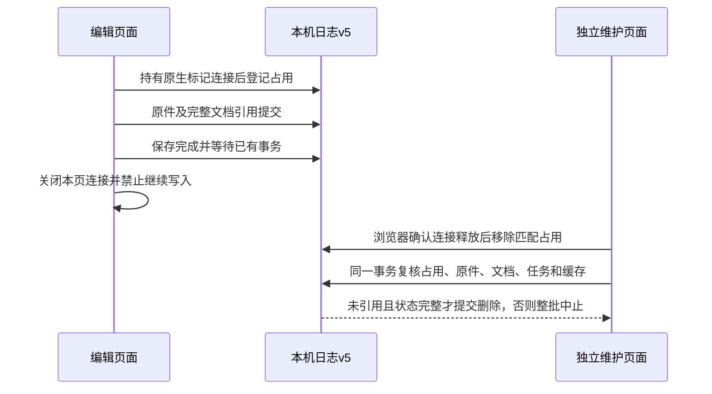

# 30 · 新版原件安全清理与页面占用保护

145.1 将**新上传和新导入的普通原件**保存到画布文档所在的本机日志数据库，增加独立维护入口和显式回收。旧普通原件继续保留；这不改变原 API 的内容保留、Worker、ComfyUI 清理或生成流程。上线结果以本文末尾的冻结回执为准，整体签收仍为 **HOLD/pending-test**。

## 使用方式

1. 在画布中完成当前编辑，等待上传、ZIP 导入和原件保存结束。重要作品先导出完整作品 ZIP；核对清单不包含原件，不能替代备份。
2. 打开连接页的“查看本机存储空间”，点击“保存并进入安全清理”。文档未保存、发生冲突或本机写入失败时，会停留在编辑页并保留错误提示。
3. 清理页位于同一静态站点的 `/studio/maintenance.html`。如果其他页面仍占用文件，请在那些页面保存并离开，或关闭包含画布历史页的标签。不会因等待时间较长而强制解除保护。
4. 检查原件的引用分类。仍被画布、可恢复回收站、素材、冻结任务或参考缓存引用的原件保留；未知或损坏记录也会阻止清理。可以先下载原件备份，再逐个或整批确认删除未引用原件。
5. 实际删除会再次在原生数据库事务中核对。清单过期、文件变化、新页面进入或引用变化时，整批拒绝；重新检查后再决定。返回画布会创建新的编辑页面保护。

没有增加自动删除时间、心跳期限、默认重试或文件大小上限。只在用户明确确认时删除。浏览器提供的存储占用可能延迟下降；被其他 Blob 句柄持有的内容也可能延后释放，内容字节数不等于设备立即腾出的物理空间。

## 保存位置与保护范围

| 内容 | 保存位置 | 本次维护清理 |
| --- | --- | --- |
| 新上传/新 ZIP 导入普通原件 | 当前源站 IndexedDB 日志 v5 的 `local_media`，独立不可覆盖的 `image:managed-v1:` / `file:managed-v1:` 键 | 无编辑页占用、全部引用完整核对且未被引用时，用户确认后删除 |
| 当前画布、可恢复回收站、我的素材 | 同一日志库 `documents` | 只读取保护引用；不删除文档或清空回收站 |
| 冻结原请求、任务、参考上传缓存 | 同一日志库 `intents` / `uploads` | 读取明确引用；不改原正文、幂等键、任务或缓存 |
| 已下载的生成原件 | 同一日志库 `results` | 在原素材管理入口处理，本维护入口保留 |
| 旧普通图片/媒体 | 旧 `infinite-canvas` 库 `image_files` / `media_files` | 保留并继续读取；不跨库猜测删除、不静默搬迁 |
| 派生缩略图 | 旧库 `image_previews` | 保留；不能用缩略图替代原件，衍生缓存回收另验 |
| 编辑页保护 | 同一日志库 `editors` 和各页独立原生占用标记库 | 仅经浏览器连接释放证明解除；缺失/未知标记保留 |
| 云端内容、ComfyUI 文件 | 原系统已有存储 | 不访问清理接口、不改变原生命周期 |

图片、视频、音频的普通上传使用同一保存规则。ZIP 原件全部预检后以新键暂存，再一次发布完整项目列表；中途失败留下的**受控暂存原件**可以在页面离开后按相同引用规则回收。旧库的暂存文件不在此范围。

## 为什么使用独立维护页

普通 HTTP 下不依赖安全上下文的 Web Locks。每个编辑页面先持有自己标记库的 v1 原生连接，再提交 `editors` 记录，最后才允许读取或写入文档、任务及受控原件。所有这些操作都持有同一 `editors` 事务锁。

维护页请求标记库的 v2：仍有 v1 连接时，浏览器原生返回 blocked，页面继续受保护；仅当连接真正释放且标记内容完全匹配，才能完成升级并删除对应占用记录。缺失标记的创建事务中止，不能凭“没找到”推定页面已关闭。排队探测不阻塞界面、不设超时、不按记录年龄删除。未知标记没有自动强制修复入口。

一般离开时关闭连接；浏览器把仍可恢复的页面放入返回缓存时继续保留保护。明确“保存并进入安全清理”会先等待文档提交及已启动事务，再关闭本页保护、禁止旧页继续读写并进入维护页；被恢复的已关闭编辑页会重新载入，不能在删除后用旧内存直接覆盖文档。

## 开发约束

| 编号 | 必须满足的约束 |
| --- | --- |
| GC-01 | 只针对新键和已知版本的受控普通原件，不删除旧库原件 |
| GC-02 | 写入采用 add，重复键拒绝覆盖；字节数、类型和 kind 与 Blob 核对 |
| GC-03 | 文档新增受控引用时，在原生文档/原件事务中确认原件仍存在 |
| GC-04 | 删除持有 `editors/local_media/documents/intents/uploads/results` 同一原生读写事务 |
| GC-05 | 包含 `storageKey` 和历史 `references`，保留回收站及迁移前文档引用，不猜提示词字面量 |
| GC-06 | 未保存编辑通过整个编辑页面占用保护；不采用 TTL、心跳缺席或 sessionStorage 猜测存活 |
| GC-07 | 任何未知/损坏文档、任务、上传、原件、索引、引用形状或占用标记均保留，缺失受控引用阻止清理 |
| GC-08 | 新页面登记、文档保存与删除共享事务锁；实际删除复核最新状态，整批中止不能部分删除 |
| GC-09 | 原件下载备份使用实际 Blob；维护入口不加载连接配置、不持有业务 Key、不请求任何生成/API/ComfyUI |
| GC-10 | 旧 v4 调用被 v5 版本门禁阻止，不降级/清空数据库；前后原 API 源码、配置、指针和服务保持原样 |

## 升级和回退

升级增加两个本机 store，保留原文档正文/修订、原件、原任务正文/编号/幂等键、上传及预算。文档记录版本仍为 1，ZIP 版本仍为 3。确切旧引用索引可从未改动正文补齐；未知索引拒绝覆盖。升级被旧页阻塞时报告错误，已放弃的迟到升级会中止。

**升级后的客户端不能回退到仅支持日志 v4 的 144.1 代码。** v4 函数会得到 VersionError，而不是清空或降级 v5。兼容回退包必须同样支持 v5；本轮首个 v5 发布尚无已验收的兼容静态回退版本，因此 F-44 仍保留。上线前保存并关闭旧画布页，必要时先导出完整作品和任务备份。静态旧资源保留只保障资源可读取，不代表旧客户端仍能操作新版库。

换域名或端口仍属于新的浏览器源站，不自动复制本机数据。完整作品 ZIP 负责原件和画布恢复，任务 JSON 负责原任务编号/正文恢复；业务 Key 需重新填写。原 API、Worker、调度与云端库均不迁移。

## 当前证据

当前已独立部署 **canvas-20261030.145.1**。编译源码 `ae0ca22e996c16c137b2ed35ceab7c1c3e492044`；源码摘要 `0e1ca194a7728a3bf576dc8f86901b16ca743b1d1d235fba725944e9cd95dc05`。归档 1,546,722 字节，SHA-256 `085a60d6e7ad461bccc26ff83f3b718c25e0745e20a671f7fb938de0df90fd36`。114当前文件、598旧哈希资源与15路由通过公网逐项核对。

| 编号 | 结果 | 范围 |
| --- | --- | --- |
| V-01 | [203单元、类型和冻结构建](research/studio-implementation/clean-build-2026-10-30T13-11-25-574Z.json) | 原生隔离副本，同锁空目录正常安装回执复用，未重新npm ci；源码/副本前后摘要一致 |
| V-02 | [18组原生占用/删除协议](research/studio-implementation/managed-cleanup-protocol-2026-10-30T13-17-46-730Z.json) | v4→v5数据保留、实际旧函数门禁、原件不可覆盖、悬空保存拒绝、刷新/关闭/未知标记和并发事务 |
| V-03 | [10组本机清理界面](research/studio-implementation/managed-cleanup-ui-2026-10-30T13-23-48-377Z.json) / [10组公网清理界面](research/studio-implementation/managed-cleanup-ui-public-2026-10-30T13-29-54-752Z.json) | 实际图片/音频输入、保存跳转、另一页保护、原件下载SHA、取消确认、迟到引用拒绝、实际删除、旧库保留、390px及保存失败 |
| V-04 | [14组本机ZIP](research/studio-implementation/archive-import-2026-10-30T13-20-28-269Z.json) / [14组公网ZIP](research/studio-implementation/archive-import-public-2026-10-30T13-25-48-240Z.json) | 12类坏包、新键原件、历史参考、实际再导出、文件配额注入、文档中止和双页冲突 |
| V-05 | [11组双源浏览器](research/studio-implementation/independent-browser-2026-10-30T13-20-27-808Z.json) / [14组引用扫描与GLB回归](research/studio-implementation/media-tools-2026-10-30T13-22-57-483Z.json) | Bearer/no Cookie/Schema Worker；原生只读扫描、动画及资源释放；合成夹具 |
| V-06 | [114当前/598旧资源、15路由](research/studio-implementation/independent-delivery-1451.json) | 维护HTML单独核对，逐文件SHA/MIME/CSP；原API及静态服务/配置不改，无重启 |
| V-07 | [发布前API工作区](research/studio-implementation/independent-api-boundary-739d89068f734fbca7e08805df798127.json) / [发布后API工作区](research/studio-implementation/independent-api-boundary-9f978344c3a7467f8dfa6badb316da41.json) | 两个API仓库HEAD/状态/差异与只读基线相同 |
| V-08 | [MP4/GIF完整解码](research/studio-implementation/independent-media-1451.json) | 公网合成本机原件与实际清理，全段自有录像；无实际业务Key/GPU任务，390px不是物理手机 |

| 页面 | 证据 |
| --- | --- |
| 其他页面仍在编辑 | [保留占用与禁用删除](media/studio-145/cleanup-2026-10-30T13-29-54-752Z/public-desktop-other-editor-protected.png) |
| 页面连接释放后的原件清单 | [清单和备份入口](media/studio-145/cleanup-2026-10-30T13-29-54-752Z/public-desktop-ready-to-clean.png)；截图保留操作过程中的禁用状态，实际启用和确认删除见回执及录像 |
| 仅未引用原件被清理 | [桌面](media/studio-145/cleanup-2026-10-30T13-29-54-752Z/public-desktop-cleaned-and-retained.png) / [390px模拟](media/studio-145/cleanup-2026-10-30T13-29-54-752Z/public-390-cleaned-and-retained.png) |
| 窄屏滚动到清单底部 | [底部原件和备份按钮](media/studio-145/cleanup-2026-10-30T13-29-54-752Z/public-390-bottom-original-controls.png)；实际滚动后再返回顶部入口 |
| 文档保存失败时阻止离开 | [错误和未保存编辑保留](media/studio-145/cleanup-2026-10-30T13-29-54-752Z/public-desktop-save-failure-retained.png) |

[完整MP4](media/studio-145/synthetic-safe-local-cleanup.mp4) · [完整GIF](media/studio-145/synthetic-safe-local-cleanup.gif)。合成本机图片/音频和夹具暂存文件；实际公网静态包、浏览器原生数据库和确认删除，零实际业务API/GPU请求。真实磁盘耗尽、物理手机和旧库迁移未以这些证据代替。

录像与编码摘要绑定[首次公网10组回执](research/studio-implementation/managed-cleanup-ui-public-2026-10-30T13-25-48-623Z.json)。上表截图绑定补充公网回执：内部滚动位置先回到顶部，以视口截图取代早期不完整的整页截图，并在同一窄屏用例补验底部按钮和返回顶部。两次均为同一冻结静态包的10组用例，重复通过不累加；早期截图和回执继续保留。

工具失败回执仍保留：首次使用精确“保留”名称，漏掉Ant Design插入空格；第二次选中了已隐藏的旧确认弹层；第三次在第二页打开同一个编辑器，未能到达维护入口。工具改为等待可见弹层的关闭，并将第二页固定在不写项目的作品库，以单独验证占用；真实双页文档冲突仍由ZIP专项独立验证。没有提高超时、修改产品代码或重建冻结包，失败不计入通过数。[1](research/studio-implementation/managed-cleanup-ui-2026-10-30T13-20-28-181Z.json) [2](research/studio-implementation/managed-cleanup-ui-2026-10-30T13-21-46-241Z.json) [3](research/studio-implementation/managed-cleanup-ui-2026-10-30T13-22-13-550Z.json)

原生工具早期预期文档顺序与IndexedDB主键排序不同的失败也[保留](research/studio-implementation/managed-cleanup-protocol-2026-10-30T13-07-30-085Z.json)，随后按原生键序核对；没有修改产品处理顺序。前期同源重复通过不累加。所有自有页面、context、浏览器和夹具服务在finally关闭，视频在浏览器关闭后编码并完整解码。原API两个工作区、线上指针/配置/服务和独立静态服务/配置均保持原样。

## 仍需完善

F-27 的旧库安全迁移、旧暂存孤儿、派生缩略图回收、不确定占用恢复和真实配额耗尽仍保留。F-43/F-44 的跨浏览器/平台升级、已开旧页及兼容回退矩阵继续验收。390px 只代表视口模拟，不能代替 Android/iOS 真机。云端八小时保留及 ComfyUI 产物删除仍由原 API 系统管理。本轮不增加任何生成后端或清理后门。
