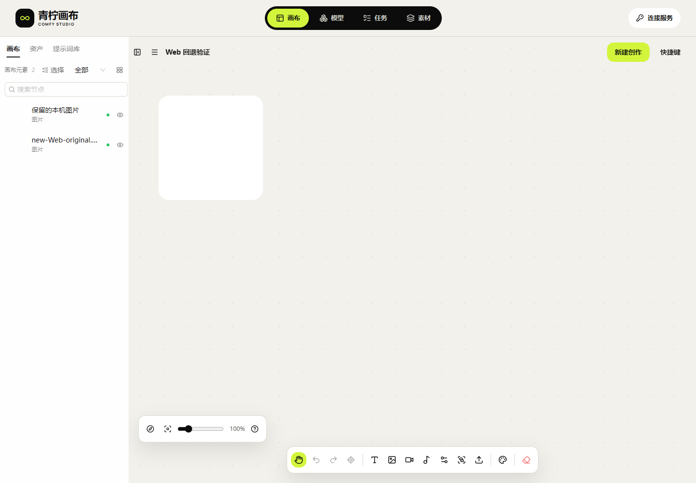

# 31 · Web交付范围与兼容静态回退

<!-- independent149:start -->
**149.1补充**：[文档34](34-Web媒体原件下载与播放失败处理.md)已修复普通WebM/批次图片后缀并实现原生播放失败提示、缺件拒绝及替换恢复；三引擎本机/公网共72组。Windows WebKit解码与Cookie仍未签收。仅独立静态更新，原API不改；下方保留各自历史证据，当前部署见文档21。
<!-- independent149:end -->


补充[证据147：Web浏览器兼容性](32-Web浏览器兼容性与验证边界.md)：继续同一146.1冻结产品；Firefox38组、Windows WebKit本机功能27组通过，Cookie隔离未签收。此后续证据不重写下方原发布回执，也不增加原生客户端范围。

交付对象为独立 **Web应用**：浏览器直接操作画布，静态网页部署在39445，业务请求仅发送给原API的既有`/v1/`。原生手机/桌面应用及应用商店发布不在范围。浏览器响应式、键盘/触控、保存/下载与后台行为分别验证；已有视口模拟不宣称为物理设备结果。

原API的代码、数据库、调度、Worker、Admin、服务和配置继续只读。Web发布工具只写独立静态目录和自己的发布记录，不使用浏览器Key，不发生成/取消/内容删除请求，不迁移或降级本机数据库。全46项编号保留，外部API事项与网页验收分开记录。

## 为什么增加回退保护

145.1首次把本机日志升级到v5，144.1只支持v4。旧发布工具失败时直接恢复上一目录，不能证明旧页面还能访问已升级数据。因此仅保留旧静态文件不足以构成兼容回退。

146.1正式包已独立发布，并准备146.0兼容恢复包。恢复包复用**已经验证的145.1应用字节**，保留其源提交和摘要；146.0是恢复交付编号，不冒充另一套产品实现。145.1原发布目录、原清单和旧证据保持原样。

## 开发契约

| 编号 | 必须满足 |
| --- | --- |
| RB-01 | 源码声明完整存储契约：日志名称/版本、文档、任务、上传、结果、普通原件、页面占用、标记版本和ZIP版本。日志打开版本直接读取该声明 |
| RB-02 | 发布清单绑定源码、构建/浏览器证据、每个文件的字节长度/SHA及存储契约；包内不含API或业务后端 |
| RB-03 | 恢复包的应用文件逐项等于原145.1清单，原清单摘要和原生v5证据绑定；不得修改历史包以补写声明 |
| RB-04 | 先完整校验两包，再准备独立目录；任一成员损坏、重复路径、链接、路径逃逸或摘要冲突即拒绝，不解压半个包 |
| RB-05 | 正式与恢复目录均保留新旧已发布页面所需的哈希JS/CSS，索引HTML不混用；同路径不同字节拒绝 |
| RB-06 | 原子切换前检查预期当前指针、完整契约、清单和保留资源清单摘要；未知/不兼容目标拒绝，不能只比较数据库数字 |
| RB-07 | 使用原生非阻塞文件锁串行控制发布；重复或不确定操作先查原记录，不按时间猜失效、不盲目重试 |
| RB-08 | 失败恢复只能选择已校验且兼容v5的恢复包；不得自动切回v4代码，不执行浏览器库清空/降级 |
| RB-09 | 切换后核对实际HTTP主入口和维护入口；原API工作区、发布指针、配置及所有API/静态服务PID保持一致 |
| RB-10 | 同一浏览器源站保留作品、回收站、原件字节、任务正文/ID/幂等键和预算，实际完成发布→回退→恢复，并核对旧页延迟资源及新页保存 |

## 清理页并发读取

145.1会把较晚返回的旧快照覆盖到新状态：两个实际编辑页依次关闭，第一次检查的已提交结果延后返回，就可能重新显示已经不存在的页面占用。删除事务本身仍会重新检查，问题在界面快照顺序。

146.1只接受最后一次检查的结果和错误；每个新的释放事件仅触发一次刷新，不把历史“已释放”状态反复当作新事件。不新增计时器、重试或限制，不改变删除契约。专项使用真实原生事务和页面连接，只延迟一份已提交只读事务结果；旧版基线和修复版分别核对。

## 操作与证据

当前独立静态版本为 **canvas-20261030.146.1**；源码 `db56cae3634da0361074e84024ccd5b428d189fa`。正式包 1,545,721 字节，SHA `3a715648f2edfbf1ce23f9ccee1dfb1192b622f4631ae11f97387493761cddd9`；恢复包146.0的114份应用文件逐字节复用145.1，另绑定完整契约和来源，未改写原145.1包。

| 编号 | 实际结果 | 证据与限制 |
| --- | --- | --- |
| W-01 | 203单元、类型与冻结构建通过 | [冻结构建](research/studio-implementation/clean-build-2026-10-30T13-52-01-248Z.json)；复用同锁空目录安装回执，本轮未重新npm ci |
| W-02 | 18原生协议与12发布守卫检查通过 | [原生数据库协议](research/studio-implementation/managed-cleanup-protocol-2026-10-30T13-55-25-766Z.json) / [归档路径、摘要及完整契约](research/studio-implementation/safe-release-guard-20261030T140855512985.json)；包含布尔值冒充版本数字的拒绝 |
| W-03 | 旧界面问题复现，修复后本机/公网各3组通过 | [145.1基线](research/studio-implementation/cleanup-refresh-baseline-2026-10-30T13-59-25-749Z.json) / [146.1本机](research/studio-implementation/cleanup-refresh-2026-10-30T14-02-09-820Z.json) / [146.1公网Chromium](research/studio-implementation/cleanup-refresh-public-2026-10-30T14-40-06-009Z.json)；真实事务及两页连接，只延迟已提交读取的完成回调 |
| W-04 | 实际公网恢复→回退→恢复8项通过 | [同源原生浏览器演练](research/studio-implementation/safe-rollback-Web-2026-10-30T14-37-15-637Z.json)；保存两节点/两引用后才取提交快照，所有浏览器已关闭 |
| W-05 | 本机/公网各10组清理、各14组ZIP通过 | [本机清理](research/studio-implementation/managed-cleanup-ui-2026-10-30T13-59-55-033Z.json) / [公网清理](research/studio-implementation/managed-cleanup-ui-public-2026-10-30T14-38-50-017Z.json) / [本机ZIP](research/studio-implementation/archive-import-2026-10-30T14-02-24-166Z.json) / [公网ZIP](research/studio-implementation/archive-import-public-2026-10-30T14-40-06-901Z.json)；合成文件，不代表真实磁盘耗尽 |
| W-06 | 11双源与14本机媒体回归通过 | [直连API且不带Cookie](research/studio-implementation/independent-browser-2026-10-30T14-02-09-772Z.json) / [只读扫描与WebGL动画](research/studio-implementation/media-tools-2026-10-30T14-02-23-040Z.json)；本轮未创建业务Key或GPU任务 |
| W-07 | 114当前文件、688保留资源及15路由通过 | [实际HTTP交付](research/studio-implementation/independent-delivery-1461.json)；原API137.1、配置、发布指针与所有服务PID不变，无服务重启 |
| W-08 | 两个API工作区保持只读基线 | [变更前](research/studio-implementation/independent-api-boundary-0f7db77257f34145bc5b9b0880e5ae56.json) / [变更后](research/studio-implementation/independent-api-boundary-fe97cee4690a4a7e9797cc5a7d4234a2.json)；不以Web测试修改原转发 |
| W-09 | 两段所选页面MP4/GIF完整解码 | [媒体摘要及完整解码](research/studio-implementation/independent-media-1461.json)；完整保留所选页面录像，不冒充全部多页面切换录屏 |

静态指针切换及只读页面期间，六类业务记录与旧原件逐项原始比较：回退后摘要 `64ee914739cb2affe6015e8a3e3aefa20c26b325be11eb8eb6fd4501a446d055` 与提交快照完全一致；恢复前后摘要 `c352f2b57aca0fd65d04a4fc1094e646ad42d06f1ae3055a83c1407f42b55145` 完全一致。重新打开可写画布会按既有代码更新Blob临时地址、当前作品updatedAt、单调递增的画布文档修订，并把缺省图片变体列表补为空数组。演练只精确允许这四项渲染保存变化，其余文档字段、所有节点/顺序/引用、回收站、原件SHA、原任务正文/ID/幂等键、上传/结果Blob、旧文件及预算逐项一致。语义摘要 `08e973a6f15ddc4cef61f063140cf05fb83b4c4f0844b6cd3b346447a9713747` 前后一致；不声称重新渲染后的原始JSON字节完全不变。



上述为1像素合成PNG的完整性测试，左栏两节点可见；没有宣称新GPU出图。 [恢复正式版本](media/studio-146/rollback-2026-10-30T14-37-15-637Z/restored-Web-project.png) · [最新快照不被旧结果覆盖](media/studio-146/refresh-2026-10-30T14-40-06-009Z/latest-snapshot-ready.png) · [390px浏览器视口](media/studio-146/cleanup-2026-10-30T14-38-50-017Z/public-390-bottom-original-controls.png)。

[安全清理MP4](media/studio-146/synthetic-Web-local-cleanup.mp4) / [GIF](media/studio-146/synthetic-Web-local-cleanup.gif)；[兼容恢复页面MP4](media/studio-146/synthetic-Web-compatible-recovery.mp4) / [GIF](media/studio-146/synthetic-Web-compatible-recovery.gif)。素材均为自有合成文件；390px为Web视口模拟，不新增原生App或应用商店门禁。

两次早先的验证失败保留：[原始文档过严比较](research/studio-implementation/safe-rollback-Web-2026-10-30T14-15-53-328Z.json)、[缺省变体列表差异](research/studio-implementation/safe-rollback-Web-2026-10-30T14-34-55-364Z.json)。它们未计为通过；随后通过的脚本增加显式UI保存屏障、确认两节点/两引用，并按源码收窄渲染变化比较。Firefox/WebKit另一次自动化未到达首项断言并被明确中止，原WebKit回执和[中止说明](research/studio-implementation/cleanup-refresh-cross-engine-interrupted-1461.json)保留；相关自建主/子进程及夹具已查验退出，未签收这两个引擎。工具已分引擎命名输出并保留关闭错误，不据此修改产品或宣称原因已定位。

## Web运维方式

控制器只操作已准备且摘要固定的146.1/146.0静态包。先查看 `status`；一次操作使用全新明确编号，已尝试或不确定时先查原记录，不重复编号、不按时间推定失败。实际机器上已经安装的控制器为 `/var/lib/infinite-canvas-deploy/146-safe-release/control-v2/studio_safe_release_host.py`，通过SSH按以下方式执行；不需要浏览器Key：

```bash
sudo -n python3 -B /var/lib/infinite-canvas-deploy/146-safe-release/control-v2/studio_safe_release_host.py status
# 仅当current为146.1，明确回到兼容146.0；编号示例尚未执行
sudo -n python3 -B /var/lib/infinite-canvas-deploy/146-safe-release/control-v2/studio_safe_release_host.py rollback web-manual-001
# 仅当current为146.0，恢复正式146.1；编号示例尚未执行
sudo -n python3 -B /var/lib/infinite-canvas-deploy/146-safe-release/control-v2/studio_safe_release_host.py restore web-manual-001
```

任一前置条件或摘要不符就停止，不删除浏览器数据、不切原API、不强行改指针。控制器原安装副本和每次记录保持不变；[独立控制器升级回执](research/studio-implementation/safe-release-control-v2-1461.json)显示仅增加独立操作编号支持，未切指针或重启服务。后续发布须另准备并验证对应新包，不能把此控制器当作任意版本回退器。

可审阅的源码：[完整契约守卫](tools/studio_release_guard.py)、[12项原生守卫测试](tools/test_studio_release_guard.py)、[服务器静态控制器](tools/studio_safe_release_host.py)、[恢复包打包](tools/package_studio_v5_recovery.py)、[实际浏览器演练](tools/verify_studio_safe_rollback.mjs)、[快照竞态验证](tools/verify_studio_cleanup_refresh_race.mjs)、[媒体编码](tools/record_studio_web_release_media.py)。本机工具从融合工作区根目录执行，依赖忽略的私有连接资料；文档镜像用于审阅，不含凭证或独立业务后端。


## 剩余范围

旧普通原件迁移、派生缩略图、不确定占用恢复与真实配额耗尽继续在F-27跟踪。跨浏览器/历史版本故障矩阵继续在F-43/F-44跟踪；不因本轮v5同契约演练宣称任意版本可回退。完整Web人工与故障验收仍为 **HOLD/pending-test**；原API的10～20台物理容量及ComfyUI删除策略仍属外部事项。

[交付复查工具](tools/review_studio_web_release_delivery.py)核对冻结源码、完整契约、所有回执和截图/媒体摘要、文档链接、全部F编号与已知测试凭证排除；它不提交生成或修改原API。完整校验依赖规范工作区中的构建包与私有回执，不是浏览器业务入口。
