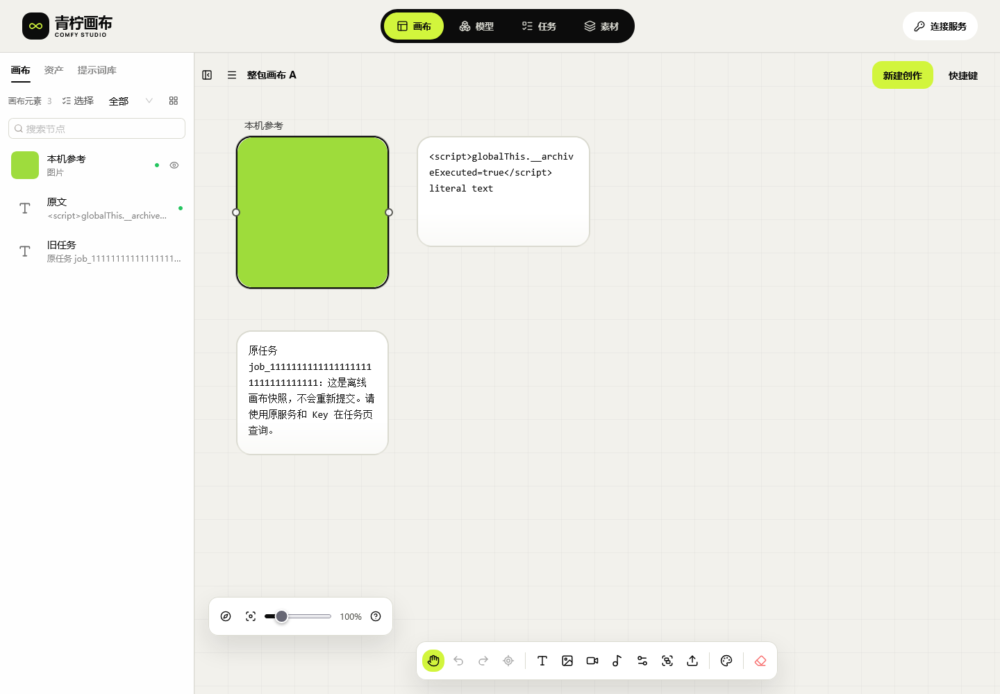

# 32 · Web浏览器兼容性与验证边界

[证据148 · Web混合媒体跨浏览器备份恢复](33-Web混合媒体跨浏览器备份恢复.md)：保持146.1冻结产品；四步实际ZIP互导34组、九节点/五连线/八原件完整。Windows WebKit四音视频解码失败未签收，最终Firefox载入正常；普通WebM另存命名待完善。完整Web签收仍HOLD，原API/服务不改。

当前网页继续使用 **canvas-20261030.146.1**，源码 `db56cae3634da0361074e84024ccd5b428d189fa`；[打开独立画布](http://43.165.167.179:39445/studio/)。本次是证据147与文档更新，没有新的产品版本、构建、部署或数据库变更。只考虑Web端，原生客户端与应用商店不在范围。原API137.1保持原样；完整Web签收仍 **HOLD/pending-test**。

## 已验证到什么程度

| 编号 | Windows原生浏览器引擎 | 本轮完成的专项 | 当前结论 |
| --- | --- | --- | --- |
| WB-01 | Chromium153.0.8010.12 | 沿用146.1已发布的203单元/类型/构建、原生/公网与兼容回退证据；新增最小Cookie对照 | 已有Web基线保留，本轮没有重跑整套构建 |
| WB-02 | Firefox155.0 / revision1543 | 公网3组最新快照、10组清理、14组ZIP；本机双原生HTTP源11组目录/Schema/请求隔离，共38组 | 这些操作通过，包含实际文件输入/下载和390px视口；未覆盖全部媒体/后台/故障 |
| WB-03 | WebKit26.6 / revision2359 | 公网3组最新快照、10组清理、14组ZIP，共27组 | 本机原件/恢复功能通过；跨源Cookie隔离失败，不能视为完整浏览器支持 |
| WB-04 | macOS/iOS Safari及其他实际浏览器平台 | 本轮未运行 | Windows WebKit不等同于实际Safari；网页触控、键盘/后台及更多媒体继续验收，不增加原生App需求 |

以上65组是新增专项通过数，三个最小Cookie诊断不混入功能通过数。390px是网页视口模拟，没有据此宣称实际触控设备通过。公网用例读取当前静态应用；目录用例使用本机两个不同端口的原生HTTP服务和合成既有API协议，未请求生产业务API、未创建Key或GPU任务。

| 编号 | 本轮已实现 | 验证与边界 |
| --- | --- | --- |
| I-142 | 原生Web浏览器验收工具 | SDK与浏览器revision匹配、独立持久profile、ASCII路径realpath核对和finally关闭；仅测试工具变化 |
| I-143 | 修正损坏的测试PNG | 旧样片IDAT CRC损坏；两份69字节RGB样片经Pillow校验/解码，Firefox实际恢复图片通过；产品不改 |
| I-144 | Firefox新增38组通过 | 公网快照3、实际清理10、ZIP14；本机原生双HTTP源目录/Schema/无Cookie11；含390px视口 |
| I-145 | Windows WebKit新增27组通过 | 公网快照3、实际清理10、ZIP14；真实文件输入/下载/刷新及并发引用保护通过，鉴权Cookie隔离未签收 |
| I-146 | Cookie差异最小对照 | 不加载产品的两端口fetch、协议/HTTP两种Cookie来源、include正对照：Chromium/Firefox omit正常；Windows WebKit仍携带Cookie |
| I-147 | 页面证据和完整所选页录屏 | 新增Firefox/WebKit截图，两MP4两GIF完整解码；合成文件、零生产业务API/生成请求，旧失败保留 |
| I-148 | 冻结产品与线上只读复查 | 继续146.1/db56cae；原API137.1源码/配置/指针/全部服务PID及静态服务/入口摘要未变，无重部署/重启 |
| I-149 | 双语说明与完整待办同步 | 文档32、README、更新说明、四份待办/待测及F-01～F-46同步，发布独立功能分支；完整Web验收HOLD |

## 为什么调整测试方式

此前工具使用的SDK1.62.1与本机已安装的Firefox1543/WebKit2359不匹配。现在使用已有、只读的Playwright Core1.63.0，逐项核对其browser revision与原生可执行文件并记录元数据SHA。SDK需要匹配浏览器二进制，见[Playwright官方说明](https://playwright.dev/docs/browsers)。未安装或启动Docker、WSL、虚拟机，也未在其他工程写文件。

WebKit临时上下文写入IndexedDB的Blob/File出现UnknownError，换成独立持久profile后完成写入。官方问题也确认临时会话中的这一限制，并列出了持久profile的验证结果，见[Playwright问题42795](https://github.com/microsoft/playwright/issues/42795)。本次没有将Blob改成字符串、降低事务持久性或添加产品超时。

测试profile及临时文件实际位于本根目录的忽略`.local/studio147/`。使用既有ASCII目录联接前，核对它与`.local`的realpath相同。Firefox需要先创建测试页，再关闭启动时的空白页，以保留其浏览器窗口；所有自建页、context、浏览器和夹具最终关闭，不操作用户标签。20秒只是工具的单步观察窗口，不是产品超时、重试或大小限制。

旧1×1测试PNG含损坏IDAT校验码，Firefox拒绝解码。新普通/参考样片均为有效RGB PNG，独立长度/SHA与Pillow校验、解码保留；使用同一份冻结产品后，恢复图片及刷新检查通过。原件保存仍核对原始字节，不通过重编码掩盖产品损坏。[样片校验](research/studio-implementation/Web-fixtures-147.json)。

## Cookie隔离的未完成项

产品请求仍明确使用`credentials: omit`、Bearer、禁止自动重定向；没有借用Admin会话。新增目录验收先在独立测试浏览器安装合成Cookie，再以服务器实际接收的请求头核对。Firefox的11组全部通过；Windows WebKit的页面操作完成，但GET与预检均出现Cookie，所以整份目录回执判为失败。

为判断差异是否来自产品，另运行不导入产品代码的两HTTP端口`fetch`最小对照：分别通过自动化协议、HTTP Set-Cookie设入合成Cookie；同时检查无鉴权头/带Bearer的omit以及include正对照。Chromium与Firefox的omit不带Cookie，Windows WebKit仍带Cookie。诊断回执的`passed`只表示对照完整运行，**WebKit的`omit_cookies_absent=false`明确不等于隔离通过**。

该观察定位到当前Windows WebKit运行环境，不能推导所有Safari版本有相同问题，也不能签收Safari。没有清理用户Cookie、放宽断言、改原API或增加代理。后续在实际Safari网页环境核对F-30/F-37/F-38；产品协议保持既有边界。

| 编号 | 实际回执 | 性质 |
| --- | --- | --- |
| WB-05 | [回执](research/studio-implementation/cleanup-refresh-public-firefox-2026-10-30T15-08-31-963Z.json) / [回执](research/studio-implementation/cleanup-refresh-public-webkit-2026-10-30T15-08-49-722Z.json) | 各3组真实事务及两个编辑页连接，晚到旧快照不覆盖最新状态 |
| WB-06 | [回执](research/studio-implementation/managed-cleanup-ui-public-firefox-2026-10-30T15-16-14-970Z.json) / [回执](research/studio-implementation/managed-cleanup-ui-public-webkit-2026-10-30T15-16-15-025Z.json) | 各10组有效PNG/音频文件输入、备份下载、引用复核、确认保留、原生占用及配额注入保护 |
| WB-07 | [回执](research/studio-implementation/archive-import-public-firefox-2026-10-30T15-14-12-158Z.json) / [回执](research/studio-implementation/archive-import-public-webkit-2026-10-30T15-14-32-718Z.json) | 各14组、12类坏ZIP；整包提交、原件SHA、新键/有序重复引用、刷新/显式重试/双页冲突保留 |
| WB-08 | [回执](research/studio-implementation/independent-browser-firefox-2026-10-30T15-11-49-620Z.json) | 本机两个原生HTTP源、11组目录/真实Schema Worker/390px/无Cookie请求，不是生产API实测 |
| WB-09 | [Windows WebKit目录失败](research/studio-implementation/independent-browser-webkit-2026-10-30T15-11-49-620Z.json) | 完成10组页面操作，最终请求头断言失败；不计入通过数 |
| WB-10 | [回执](research/studio-implementation/Web-credentials-diagnostic-chromium-4e6c7acd-8b7d-41ae-82dc-709eea744781.json) / [回执](research/studio-implementation/Web-credentials-diagnostic-firefox-a5c0f973-6509-432b-a4c8-8e0e85940372.json) / [回执](research/studio-implementation/Web-credentials-diagnostic-webkit-d0be86c8-d35c-48dc-a07a-a81ecb6f25c6.json) | 各7次最小fetch对照，omit与include分别判定，不加载产品代码 |
| WB-11 | [回执](research/studio-implementation/independent-host-unchanged-147.json) / [回执](research/studio-implementation/independent-api-boundary-7e9011900cab4219a77220bbd46d6acf.json) | 原服务/静态服务/配置/源码/指针和入口摘要只读核对；零部署和重启 |
| WB-12 | [回执](research/studio-implementation/Web-compatibility-media-147.json) / [交付复查](research/studio-implementation/independent-review-147.json) | 截图/MP4/GIF、源摘要、链接、全部F编号及已知私有Key排除 |

## 页面、录像及保留的失败

| 网页操作 | Firefox | Windows WebKit |
| --- | --- | --- |
| 桌面页面 | [合成作品恢复](media/studio-147/archive-firefox-2026-10-30T15-14-12-158Z/public-archive-restored-canvas-desktop.png) | [仅清理未引用原件](media/studio-147/cleanup-webkit-2026-10-30T15-16-15-025Z/public-desktop-cleaned-and-retained.png) |
| 390px视口 | [恢复的网页画布](media/studio-147/archive-firefox-2026-10-30T15-14-12-158Z/public-archive-restored-canvas-390.png) | [滚动到底部下载控制](media/studio-147/cleanup-webkit-2026-10-30T15-16-15-025Z/public-390-bottom-original-controls.png) |
| 完整所选测试页录像 | [MP4](media/studio-147/Firefox-Web-project-restore.mp4) / [GIF](media/studio-147/Firefox-Web-project-restore.gif) | [MP4](media/studio-147/WebKit-Web-local-cleanup.mp4) / [GIF](media/studio-147/WebKit-Web-local-cleanup.gif) |



录像保留完整所选页面时间段并完整解码；它们没有涵盖全部并行页面，不展示真实生成，也不代表WebKit鉴权隔离通过。

先前失败保持原样：[临时WebKit Blob失败](research/studio-implementation/Web-engine-diagnostic-webkit-ascii-d943c6d5-11ac-4a23-945a-8e437fe23678.json)、[Firefox启动空窗口失败](research/studio-implementation/cleanup-refresh-public-firefox-2026-10-30T15-07-56-788Z.json)、[旧PNG恢复失败](research/studio-implementation/archive-import-public-firefox-2026-10-30T15-11-29-918Z.json)及WB-09的Cookie失败。其他诊断/已替代回归也保留，不覆盖失败、不重复累计通过数。

## 复现与后续

在规范融合工作区根目录运行工具，依赖已有冻结构建与原生SDK/浏览器。工具镜像用于审阅；不会安装浏览器或执行后端生成。`--sdk`可指定与已装原生引擎匹配的现有Playwright Core目录。工具提前核对revision，不能以更换二进制掩盖失败。

```powershell
node docs/tools/verify_studio_cleanup_refresh_race.mjs docs/research/studio-implementation/clean-build-2026-10-30T13-52-01-248Z.json --public --evidence-version=147 --browser=firefox
node docs/tools/verify_studio_managed_cleanup_ui.mjs docs/research/studio-implementation/clean-build-2026-10-30T13-52-01-248Z.json --public --evidence-version=147 --browser=webkit
node docs/tools/verify_studio_archive_import.mjs docs/research/studio-implementation/clean-build-2026-10-30T13-52-01-248Z.json --public --suite=147 --browser=firefox
# 目录与最小Cookie对照需显式指定本机现有的非回环IPv4；不修改系统hosts/防火墙。
```

源码：[原生浏览器工具](tools/studio_web_browser.mjs)、[启动/Blob诊断](tools/diagnose_studio_web_engines.mjs)、[文件清理界面](tools/verify_studio_managed_cleanup_ui.mjs)、[ZIP界面](tools/verify_studio_archive_import.mjs)、[快照竞态](tools/verify_studio_cleanup_refresh_race.mjs)、[双源目录](tools/verify_independent_canvas.mjs)、[最小Cookie对照](tools/diagnose_studio_web_credentials.mjs)、[媒体编码](tools/record_studio_web_compatibility_media.py)、[样片与浏览器关闭核对](tools/record_studio_web_compatibility_fixtures.py)、[文档整理](tools/finalize_studio_web_compatibility_docs.py)、[只读宿主复查](tools/verify_independent_host_unchanged.py)、[交付复查](tools/review_studio_web_compatibility.py)。

F-15/F-27/F-34/F-36/F-37/F-38补入上述有限证据；真实配额/跨进程、长后台/离线、更多媒体和实际Safari网页仍有待验收。旧普通原件迁移/暂存孤儿、派生预览及不确定占用恢复保留F-27；完整剩余事项见[全部46项](10-开发进度与交付记录.md)。原API的设备容量、01移交即删和可选助手能力继续按外部依赖处理，不以Web兼容工作改写转发系统。
