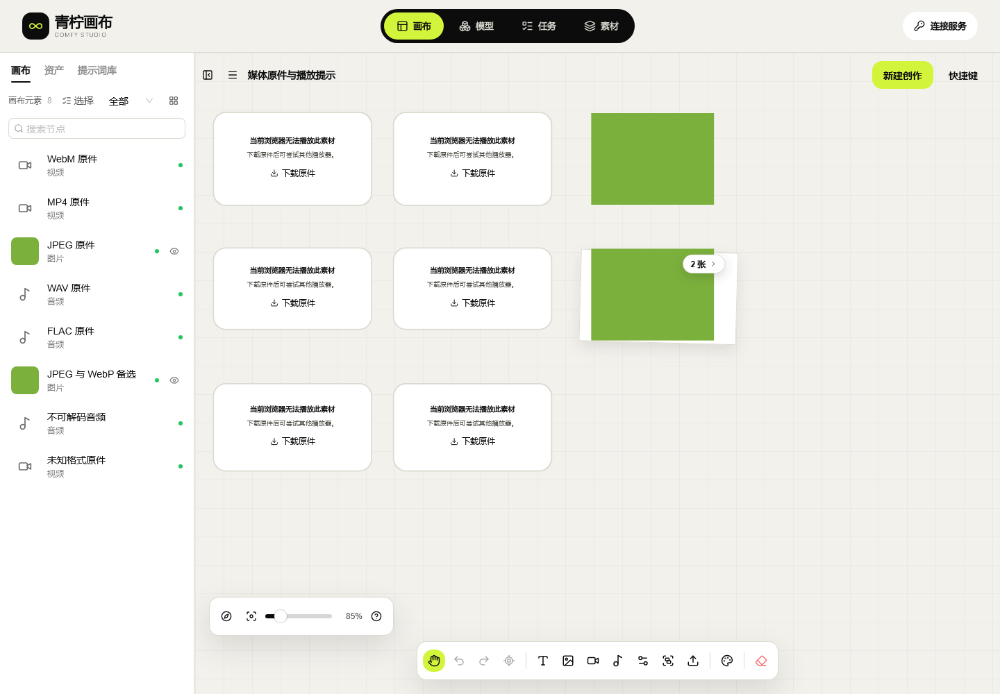

# 34 · Web媒体原件下载与播放失败处理

当前版本 **canvas-20261031.149.1**，入口 [Studio](http://43.165.167.179:39445/studio/)。只交付Web前端，原API仍137.1；不增加转发、队列、原生客户端或ComfyUI连接。完整Web验收 **HOLD/pending-test**。

## 用户操作

1. 在图层列表定位目标图片、视频或音频，确认操作栏属于当前节点，再选择下载。批次图片可展开后分别下载。
2. 原件保留本机保存的字节，后缀优先按Blob的MIME选择：JPEG为`.jpg`、WebP为`.webp`、WebM为`.webm`、MP4为`.mp4`，WAV/FLAC同理。未知类型保留`.bin`，不伪装成MP4；MIME映射不是内容嗅探或解码器。
3. 浏览器原生解码失败时，节点显示“当前浏览器无法播放此素材”和“下载原件”。可以另存后使用支持该格式的播放器。提示仅说明本机播放问题，不改变已成功任务，也不提交新生成请求。
4. 替换音频/视频后按新来源重新判断播放；旧来源的错误不会覆盖新素材。Windows WebKit仍不能解码本轮四个有效音视频样片，替换后的原件仍可保存、下载。
5. 有本机存储键却缺少原件时明确拒绝下载；不会从残留Blob URL凑出“成功”副本。重新载入原件或从完整ZIP恢复后再操作。API结果仍核对原连接身份，不绕过Key分区。

云端八小时到期、本机保留及安全清理规则不变。普通原件下载不重新编码，也不主动清除源文件；下载不是ZIP备份、云同步或服务端任务取消。

## 实现及边界

| 编号 | 实现 | 约束 |
| --- | --- | --- |
| M-01 | 普通节点与主/备选批次图片共用原件下载逻辑 | 读取受控本机/既有旧库/API结果存储，优先真实Blob MIME；已知键缺件则拒绝 |
| M-02 | 原生video/audio错误触发可见提示和下载按钮 | 不注入虚假播放事件，不改生成状态，不添加计时器/重试/新限制 |
| M-03 | 错误按当前来源识别，实际替换文件后重新载入 | 支持的浏览器恢复解码；不支持的浏览器继续提示，原件保留 |
| M-04 | 图层定位同步选择、操作栏及对应面板 | 不再残留上一节点操作栏；下载按钮阻止鼠标拖动入口，不额外打开编辑面板 |
| M-05 | 保留04·青柠原始CSS/字体和令牌 | 提示卡复用现有节点色彩，原始样式文件不改 |

编译源码 `2b04d500c3f914304d3af9228f417e67b32e29b8`，源摘要 `11b3ddca5eb904d1e5afc302830ad9193518e980595b4ad24a86929174041f67`。只发布独立静态目录；原API工作区、协议、Worker、调度、数据库、Admin、配置、发布指针及服务PID均未改变。

## 验证

| 编号 | 结果 | 实际范围 |
| --- | --- | --- |
| V-01 | [203单元/类型/生产构建](research/studio-implementation/clean-build-2026-10-30T16-35-35-334Z.json) | 相同依赖锁的原生隔离安装回执复用；本轮重跑源码检查，未再次npm ci |
| V-02 | [本机三引擎36组](research/studio-implementation/media-actions-acceptance-149.json) / [公网三引擎36组](research/studio-implementation/media-actions-public-acceptance-149.json) | 每引擎12组/13次实际下载；合计78次下载逐份长度/SHA/后缀一致，18张通过截图 |
| V-03 | [六份有效/两份故意无效样片](research/studio-implementation/media-actions-fixtures-149.json) | 16×12 JPEG/WebP、1秒WAV/FLAC/MP4/WebM；两份85字节无效内容用于真实原生错误，不是GPU结果 |
| V-04 | [18原生协议](research/studio-implementation/managed-cleanup-protocol-2026-10-30T16-36-40-539Z.json) / [11双HTTP源](research/studio-implementation/independent-browser-chromium-2026-10-30T16-57-20-402Z.json) / [12发布守卫](research/studio-implementation/safe-release-guard-20261030T162413411755.json) | 数据保护/完整契约、Bearer/noCookie、Schema Worker；鉴权专项仅Chromium，不外推Windows WebKit |
| V-05 | [14本机ZIP](research/studio-implementation/archive-import-chromium-2026-10-30T17-05-37-164Z.json) / [14公网ZIP](research/studio-implementation/archive-import-public-chromium-2026-10-30T17-14-01-662Z.json) / [10本机清理](research/studio-implementation/managed-cleanup-ui-chromium-2026-10-30T17-05-36-981Z.json) / [10公网清理](research/studio-implementation/managed-cleanup-ui-public-chromium-2026-10-30T17-14-01-405Z.json) | 实际文件输入、下载、刷新/引用/占用保护；合成故障不是实际配额耗尽 |
| V-06 | [全部静态字节与路由](research/studio-implementation/independent-delivery-1491.json) | 当前114文件、保留779资源、20路由；发布只读检查原API健康/CORS |
| V-07 | [兼容恢复包准备](research/studio-implementation/media-actions-release-prepare-149.json) / [静态指针切换](research/studio-implementation/media-actions-release-promote-149.json) | 149.0精确复用146.1应用字节并保留新旧资源；完整v5契约相同。149未重新演练实际回退，历史146演练保留 |
| V-08 | [两MP4/两GIF](research/studio-implementation/media-actions-media-149.json) / [浏览器关闭](research/studio-implementation/media-actions-process-cleanup-149.json) | 两个完整所选公网页面录像，全部文件完整解码；自有page/context/browser/HTTP夹具已关闭 |
| V-09 | [API源码前](research/studio-implementation/independent-api-boundary-d2b5a997db3f4882a89ae938d97efd02.json) / [API源码后](research/studio-implementation/independent-api-boundary-7322aa6619ff46d290f04a5a5a7004cd.json) | 两个原API仓库只读基线保持一致，未创建业务Key或GPU任务 |

旧版146.1实际下载把WebM命名为MP4的[失败回执](research/studio-implementation/media-actions-baseline-chromium-2026-10-30T16-26-31-823Z.json)保留。[首轮TS类型检查失败](research/studio-implementation/clean-build-2026-10-30T16-03-32-219Z.json)、测试静态根路径/节点选择/冷页面观察、旧操作栏问题及早期Firefox下载等待超时也保留，不算通过；中间构建不冒充最终构建。Windows WebKit首次390px检查在布局完成前观察到930px，后续使用同一严格宽度条件等待并复测通过；这是测试观察修正，不是放宽产品断言。

Windows WebKit的四份有效音视频仍不可解码，Cookie隔离仍沿用证据147的未签收结论；本轮仅证明正确失败提示和原件保存。实际Safari、完整播放/声音/后台、键盘触控、大文件及全部Web人工/故障门禁继续，不能用迁移/下载通过代替。

[Chromium完整所选页MP4](media/studio-149/Chromium-original-download-and-replacement.mp4) / [GIF](media/studio-149/Chromium-original-download-and-replacement.gif) · [WebKit完整所选页MP4](media/studio-149/WebKit-native-failure-and-original-download.mp4) / [GIF](media/studio-149/WebKit-native-failure-and-original-download.gif)。录像为合成样片交互，不是GPU生成或Safari播放验收。

## English

Release 149.1 fixes original media filenames, main/alternate batch-image downloads and native playback-error handling. Stored Blob MIME selects the extension; a missing keyed original is refused instead of using a cached URL. Native decoder errors show an original-download action without changing successful task state or submitting generation. Real file replacements reset source-specific errors; layer focus now updates the correct action bar and closes an unrelated panel. Downloads do not open an editor.

Three native Windows engines passed 36 local and 36 public UI groups, verifying 78 actual original downloads and 18 screenshots. Chromium/Firefox load the four valid audio/video samples; Windows WebKit still cannot decode them and is accepted only for explicit failure handling and byte-identical originals. Its previously observed Cookie issue is unresolved; actual Safari, full playback, keyboard/touch/background, large files and full Web acceptance remain HOLD. The original API and every service/configuration remain unchanged; only independent static files were promoted with a compatible 149.0 recovery package. Earlier failed observations are preserved separately. This release has no native app, virtualization, new business Key or GPU generation.

[全部46项](10-开发进度与交付记录.md) · [独立部署](21-独立画布部署与使用.md) · [最终复查](research/studio-implementation/independent-review-149.json)
