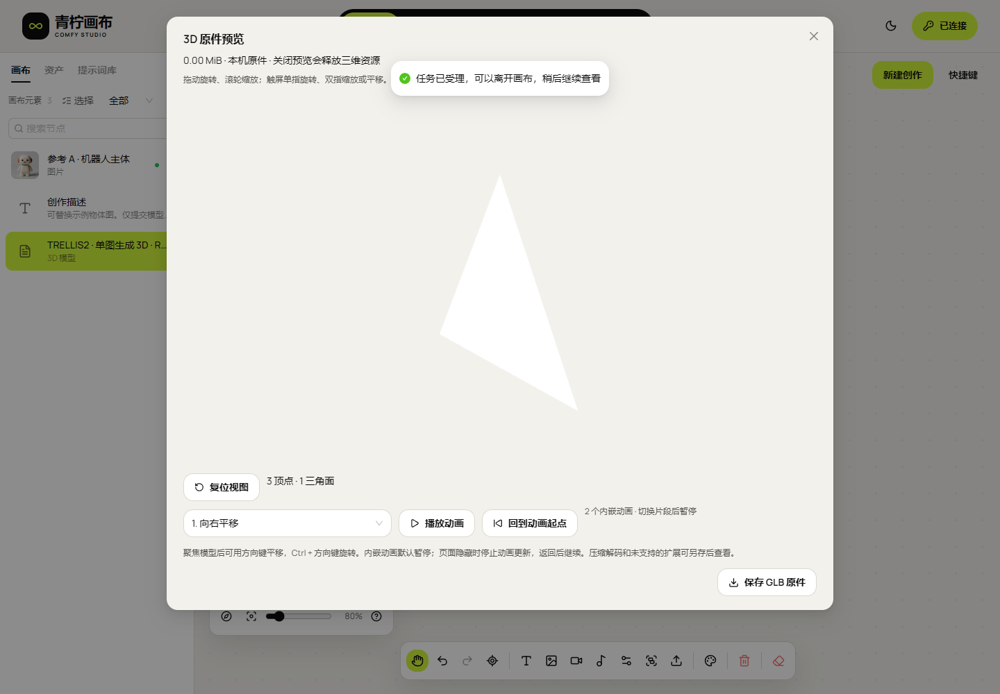
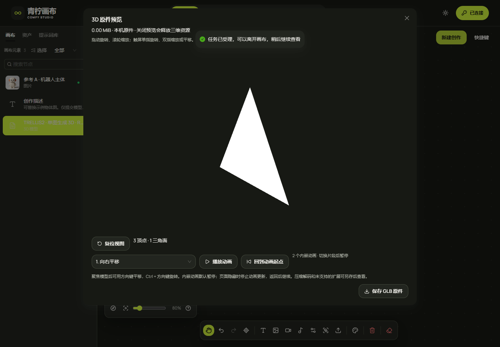

# 36 · 明暗主题与预设创作案例

<!-- independent151:start -->
## canvas-20261031.153.1 · 已部署 / pending-test

源码 `3f55f431032b96345eafd9f7bd53d728c2844918`，摘要 `6d4174ad64c92a8742189441edad2dffa40fa048ec3222262e98e829cbab4a85`。218单元、类型和生产构建通过。完整通过的主题/案例页面检查69组、43截图；Firefox本机通过。各次完整流程均明确提交8项合成任务；公网测试明确转送自有合成API，不作为生产鉴权/CORS或GPU成功证明。源码未冻结的中间构建、修正链接键盘焦点期间主动中止的自有类型检查，以及早期测试脚本漏等渲染/漏点“载入产物”的失败回执均单列保留，未用于发布。修正最终样式前通过的案例流程仅作为基线记录；151.1为未部署候选包，最终153.1增加图片上标签的实色背景。截图结束有限CSS过渡后取证；完整录像保留整段实际操作，取截图时的过渡结束动作也保留，未剪裁重组。

中间151.2在公网暴露了业务路由与图片目录重名的问题：`/studio/examples`返回301，尾斜杠返回403。该失败回执保留，不计为公网签收。最终153.1使用`/studio/library`，额外检查直接打开、刷新和尾斜杠；保留旧图片路径，不修改任何服务配置。

Firefox的重载流程暴露了Ant Design选项同时处于selected与active时，后者覆盖背景但保留深色文字的问题；两次失败均保留。最终版本在青柠全局作用域修正重叠状态，并用键盘进入该状态后实际检查颜色与对比度。152.1准备曾被恢复来源守卫拒绝，未切换指针。最终153.0恢复包精确复用当前151.2，保留该旧版已知路由/样式限制；中间151.2的HTTP原件核对仅用作恢复来源证明，不表示其页面问题已修复。本轮没有执行实际回退。

静态包3,473,450字节，124当前文件、1007保留资源和23路由逐项核对；153.0兼容恢复包精确复用151.2应用字节，本轮未执行实际回退。完整v5契约、原API工作区/配置/指针、全部服务PID保持一致，零服务重启。完整Web签收仍HOLD。

| 浅色案例页 | 深色案例页 |
| --- | --- |
|  |  |

| 浅色三维预览 | 深色三维预览 |
| --- | --- |
|  |  |

[390px浅色](media/studio-151/gallery-public-chromium-2026-10-30T20-57-06-617Z/examples-light-390.png) / [390px深色](media/studio-151/gallery-public-chromium-2026-10-30T20-57-06-617Z/examples-dark-390.png)为网页视口模拟，不代表实体触控设备验收。

主题对比图另在同一公网静态版本等待授权目录和全部延迟加载封面完成解码后拍摄；该补充流程没有上传或生成请求。完整案例流程的原始截图仍保留。

[完整所选公网页面MP4](media/studio-151/themes-and-examples-public.mp4) / [GIF](media/studio-151/themes-and-examples-public.gif)。录像为实际页面操作和合成接口结果，示例输入不标作本轮GPU产物。所有自建浏览器与临时服务均已关闭。

| 内容 | 回执 |
| --- | --- |
| early_build | [证据](research/studio-implementation/clean-build-2026-10-30T19-33-18-455Z.json) |
| assets | [证据](research/studio-implementation/example-assets-151.json) |
| boundary_before | [证据](research/studio-implementation/independent-api-boundary-5d3ca2cc102343248f7ed35f4539a6c8.json) |
| boundary | [证据](research/studio-implementation/independent-api-boundary-71b0e69d24aa44b9a34f319d2ea495b6.json) |
| failed_chromium_initial | [证据](research/studio-implementation/theme-examples-chromium-2026-10-30T20-12-56-177Z.json) |
| superseded_build | [证据](research/studio-implementation/clean-build-2026-10-30T19-49-43-276Z.json) |
| failed_chromium_load_step | [证据](research/studio-implementation/theme-examples-chromium-2026-10-30T20-19-41-824Z.json) |
| baseline_chromium | [证据](research/studio-implementation/theme-examples-chromium-2026-10-30T20-20-56-374Z.json) |
| superseded_build_stopped | [证据](research/studio-implementation/clean-build-2026-10-30T20-22-06-356Z.json) |
| candidate_build | [证据](research/studio-implementation/clean-build-2026-10-30T20-24-00-951Z.json) |
| candidate_chromium | [证据](research/studio-implementation/theme-examples-chromium-2026-10-30T20-27-09-772Z.json) |
| candidate_package | [证据](research/studio-implementation/independent-package-1511.json) |
| intermediate_build | [证据](research/studio-implementation/clean-build-2026-10-30T20-30-06-137Z.json) |
| intermediate_local_chromium | [证据](research/studio-implementation/theme-examples-chromium-2026-10-30T20-32-00-088Z.json) |
| intermediate_local_firefox | [证据](research/studio-implementation/theme-examples-firefox-2026-10-30T20-32-42-915Z.json) |
| intermediate_package | [证据](research/studio-implementation/independent-package-1512.json) |
| intermediate_recovery | [证据](research/studio-implementation/independent-package-1510.json) |
| failed_public_route | [证据](research/studio-implementation/independent-route-failure-1512.json) |
| candidate_route_build | [证据](research/studio-implementation/clean-build-2026-10-30T20-39-16-554Z.json) |
| candidate_route_local_chromium | [证据](research/studio-implementation/theme-examples-chromium-2026-10-30T20-40-49-198Z.json) |
| candidate_route_package | [证据](research/studio-implementation/independent-package-1521.json) |
| candidate_route_recovery | [证据](research/studio-implementation/independent-package-1520.json) |
| failed_firefox_selected_active | [证据](research/studio-implementation/theme-examples-firefox-2026-10-30T20-42-08-160Z.json) |
| failed_firefox_selected_active_wait | [证据](research/studio-implementation/theme-examples-firefox-2026-10-30T20-43-29-438Z.json) |
| intermediate_static_provenance | [证据](research/studio-implementation/independent-delivery-1512.json) |
| failed_recovery_preparation | [证据](research/studio-implementation/independent-recovery-refused-1521.json) |
| recovery | [证据](research/studio-implementation/independent-package-1530.json) |
| build | [证据](research/studio-implementation/clean-build-2026-10-30T20-48-07-010Z.json) |
| local_chromium | [证据](research/studio-implementation/theme-examples-chromium-2026-10-30T20-49-49-443Z.json) |
| boundary_mid | [证据](research/studio-implementation/independent-api-boundary-c9ba13c41ad646468c968211948359cd.json) |
| package | [证据](research/studio-implementation/independent-package-1531.json) |
| local_firefox | [证据](research/studio-implementation/theme-examples-firefox-2026-10-30T20-50-35-308Z.json) |
| delivery | [证据](research/studio-implementation/independent-delivery-1531.json) |
| public_chromium | [证据](research/studio-implementation/theme-examples-public-chromium-2026-10-30T20-53-21-834Z.json) |
| media | [证据](research/studio-implementation/theme-examples-media-151.json) |
| gallery | [证据](research/studio-implementation/theme-examples-gallery-public-chromium-2026-10-30T20-57-06-617Z.json) |

[交付复查](research/studio-implementation/independent-review-151.json)。交付工具：[冻结构建](tools/verify_studio_clean_build.mjs)、[页面验证](tools/verify_studio_theme_examples.mjs)、[兼容恢复包](tools/package_studio_v5_recovery.py)、[静态发布](tools/studio_static_release.py)、[静态逐项核对](tools/verify_studio_media_release.py)、[完整录屏](tools/record_studio_theme_examples_media.py)、[文档整理](tools/finalize_studio_theme_examples_docs.py)、[复查](tools/review_studio_theme_examples_delivery.py)。
<!-- independent151:end -->

独立 Web 画布继续在原 `basketikun/infinite-canvas` 仓库上二次开发。明暗主题与案例均属于前端；生成仍通过原聚合 API 的 `/v1/` 业务接口完成。

## 明暗主题

点击页面右上角的月亮 / 太阳按钮，在浅色与深色之间切换。按钮支持键盘聚焦和 Enter 操作，并明确读出将切换到的主题。

- 默认沿用 04·青柠浅色：暖白画布、白色卡片、深色文字和青柠强调色。
- 深色使用炭色画布、略浅的面板和明亮文字，保留同一青柠强调色、字体、圆角与组件体系。
- 页面、画布网格与节点、工具栏、表单、选择弹层、抽屉、弹窗和 GLB 预览使用对应主题。青柠底上的文字保持深色。
- 主题只保存为当前浏览器源站的极小偏好配置。切换不改变 API 地址、Key、任务、原件或项目；不同源站 / 浏览器分别保存。
- 刷新时由同源 `theme-init-v1.js` 在应用模块之前恢复主题，适配已有 `script-src 'self'`，不依赖允许内联脚本。
- 未知主题值回到受支持的默认浅色。没有新增自动跟随系统的模式。

04·青柠原始参考 CSS 和字体保持原件；深色适配独立维护在主题令牌、应用主题及画布适配样式中。

## 预设案例

顶部“案例”和画布列表的“预设案例”均进入案例页。每次“打开案例”创建独立、可编辑的本机画布，不覆盖旧项目。未连接服务时也能打开；连接后按当前 Key 重新发现模型。

案例库的网页入口为 `/studio/library`，支持直接打开及刷新。示例图片存放在独立静态素材目录；工程验收须同时核对本次和保留旧资源，避免业务路由与真实目录重名。

| 案例 | 发布的任务类型 | 示例输入 | 使用方式 |
| --- | --- | --- | --- |
| 产品摄影 | `text_to_image` | 一段描述 | 修改主体和画面要求，再选择合法规格 |
| 换一个场景 | `image_to_image` | 一张图片和描述 | 替换源图，描述需要修改的环境 |
| 双图创作 | `references_to_image` | 两张有序参考图 | 先核对服务公布的参考角色和顺序 |
| 让场景动起来 | `text_to_video` | 一段镜头描述 | 核对模型支持的完整尺寸 / 时长组合 |
| 首帧动画 | `references_to_video` | 一个参考槽位 | 仅匹配明确公布单参考输入的模型 |
| 双参考视频 | `references_to_video` | 两个参考槽位 | 核对两个角色；实际设备可用性以任务结果为准 |
| 创作一段配乐 | `text_to_audio` | 一段音频描述 | 通过已发布 ComfyUI Workflow 生成，不假定为 TTS |
| 物体转 3D | `image_to_3d` | 一张物体图 | 按 Schema 仅提交源图，获取并按需预览 GLB |

案例中的两张机器人图片为此前已公开、已授权的测试素材副本，属于**示例输入**。页面插画和合成测试结果不能作为本次真实 GPU 生成效果。素材来源、尺寸及原件摘要见[案例素材记录](research/studio-implementation/example-assets-151.json)。

### 从案例到生成

1. 打开案例，查看 / 修改画布中的创作描述和参考图片。
2. 在创作抽屉核对当前模型、完整规格、输入图片、参考角色与顺序。
3. 点击表单的生成提交按钮后，才执行原件预检、上传和既有异步任务提交。
4. 沿用原任务 ID 查询；成功结果回到画布，可以另存原件或继续创作。
5. 从画布列表重新打开时，点击“新建创作”继续。没有显式选择其他节点时，识别案例原始输入，不把后生成的图片自动加入参考。

案例不固定设备地址、模型 ID、尺寸、时长或参考角色。模型匹配依赖实时发布的任务类型、参考槽位、可用状态和 Key 获准的完整规格。没有匹配模型时明确提示，仍可编辑画布；不会静默替换为不同任务类型或不同参考数量。

### 保存和素材

- 案例原件先完整读取 / 解码，再写入既有本机素材存储；所有输入写入后才把案例加入项目列表，并等待文档保存提交。
- 多次打开同一案例会创建不同项目和新的本机素材键。修改互不覆盖；没有为案例新增后台云同步或自动生成。
- 节点的可选 `studioExampleId` 只标识本机内置案例，供继续创作识别输入。它不是脚本、Workflow 或执行指令；未知值不会匹配案例。
- 原有项目 / 节点保存与 ZIP 结构继续使用现有完整契约，日志版本仍为 v5。既有原件引用、备份与清理规则保持适用。
- 静态服务保留公共示例文件；打开后保存本机副本。只有用户确认提交时，才会出现既有 API 的上传副本与生成产物，其到期规则不变。

## 验收边界

自动化工具：[主题与案例 Web 流程](tools/verify_studio_theme_examples.mjs)。检查范围包括主题保存、严格 CSP 启动、键盘切换、输入与按钮对比度、页面及弹层、八类案例、原件输入、当前权限匹配、明确提交和合成产物回填。原生浏览器、线上静态页面、合成 API 和真实 GPU 证据分别记录。

本轮不会修改原 API、ComfyUI、Worker、调度、数据库、Admin、服务配置或 CORS。前一轮真实双参考视频的 `preparation_transport_failure`、公网 Firefox 未完成和其他 F-01～F-46 差距仍保留；主题与案例验证不能代替这些项目的签收。
