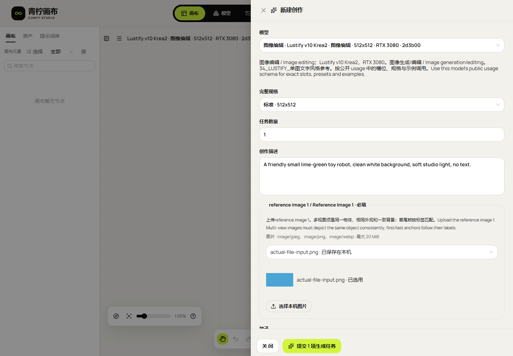
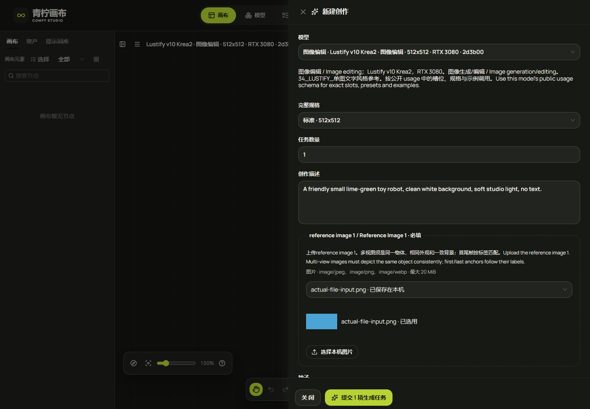
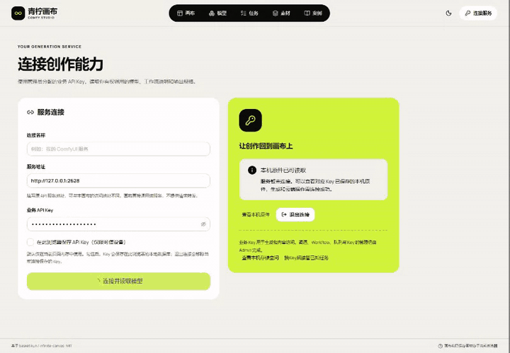

# 38 · 现有 API 新版输入适配与整轮验收

后续状态：本文保留154.1实现及初次失败时点；设备恢复后的五类真实生成、画布回填和原件复验已通过，见[文档39](39-设备恢复与真实生成补充验收.md)。原失败JSON不改写。

本轮继续在原开源画布上适配现有 API。原 API、Worker、数据库、调度、Admin 与部署配置均只读；不增加画布后端或队列。旧文档37描述153.1的历史状态，不代表后续 API 新模型已经适配。

## 已确认的缺口与完整实现清单

只读读取当前业务 Key 的目录：45个已发布模型，其中34个使用 usage 1.1，11个使用1.0。现有画布只接受1.0，且只处理旧图片参考槽；这是实际兼容缺口，不是追加平台建设。

| 编号 | 本轮全部代码 TODO | 完成条件 |
| --- | --- | --- |
| A-01 | 接受1.0/1.1用法；统一旧参考槽与命名图片/视频/音频/GLB素材槽；根据实际槽位完成文件选择、原件校验、kind上传、持久恢复及请求映射 | 同时保留旧 source_image/mask/references；命名输入严格生成 media 的 slot/asset_id；完整表单与全部原件检查在第一次远程上传前完成 |
| A-02 | 支持命名文本及续拍父任务 | texts按公开名称及长度填写；不默认发送示例脚本；context只提交经原Key读取并确认成功、兼容及未到期的父任务ID；不上传上下文文件 |
| A-03 | 模型详情、模型选择与案例使用新版能力 | 显示实际输入角色、文本、声音策略、续拍要求；按完整输入需求匹配案例，避免把多视角/音频克隆等误配给旧示例 |
| A-04 | 补齐本轮契约、页面及实际调用验证代码、双语说明与交付记录 | 全部产品及验证代码写完后，统一进行类型检查、构建、契约测试、明暗页面检查及授权真实调用；合成与GPU证据分别记录 |

## 本轮执行约束

1. 先完成A-01～04全部代码与验证脚本，再开始统一测试。实现前的代码阅读、模型目录与Schema读取属于需求核对。
2. 保留当前本机日志v5、旧上传记录、任务幂等与取件校验；只追加兼容字段，不重建存储。未知或已受理提交不得换Key、模型、素材或幂等键重提。
3. 文件类型、大小、文本长度及规格来自当前模型说明。服务端独立验证完整媒体；浏览器不支持某种播放编码不能阻止该合法文件作为模型输入。
4. 所有新增控件沿用现有青柠全局主题和明暗令牌。原始参考样式不改。
5. 本轮真实调用只使用用户明确提供的业务Key；凭证和原始响应保留在忽略目录，不写入公开回执、截图、录像或Git。
6. 目录覆盖不等于45个模型全部实时生成成功。设备故障、未发布视频/续拍模型与历史失败单独报告，不修改API来掩盖。

## 实现与实际验收

A-01～A-03产品代码及A-04验证代码已在首次测试前集中完成；统一验收发现测试素材缺少MP3、冷启动观察窗不足及文本计数压住说明，分别修正验收素材/观察设置和一处CSS间距后，再统一验证。没有改动原API、Worker或调度。

| 编号 | 实际结论 |
| --- | --- |
| A-01 | usage 1.0/1.1共45个模型、50组规格映射通过；命名四类素材的kind、字节、MIME、摘要、幂等与原件保护通过；旧图片参数保留 |
| A-02 | 命名文本显式填写、Unicode长度、父任务状态/Key/兼容摘要/到期检查及仅传job_id通过；当前没有可用的已发布续拍模型，页面用合成契约验证 |
| A-03 | 模型目录、说明、槽位及案例匹配通过；八类旧案例、青柠明暗和新版表单已复验 |
| A-04 | 279单元、类型和生产构建；Chromium12次命名表单提交/回填；Firefox新版命名输入页面通过；独立静态154.1已上线。真实原任务排队后到期，未取得新GPU产物，不能签收全部真实链路 |

静态源码摘要：`437d1970d4da3f78d0ac00af8f88c42e606398da379869bfc5b5c418b3770cec`；源码提交：`ff02ecb54e824e49786b3987b2865f4fbbf0d563`。本轮先冻结源码再打包；回执绑定同一构建和产物摘要。原本机日志v5及记录版本保留，未清空/降级数据库。154.0兼容恢复包精确复用153.1应用，回退会失去新版输入界面；只完成准备与校验，没有宣称实际回退演练。

当前真实生图的原任务为 `job_2e8c72346a6d4d22b6e30764fbf4d2a3`，首次浏览器提交由本轮初次构建发出；随后只修正计数间距及默认API地址构建参数，没有补发或替换原请求。10分钟观察仍为queued，之后只读复查为expired且无产物。服务器API服务在线，三个ComfyUI端口可达；这些端口检查不能证明实际调度成功；进一步只读调度检查见下文。参考编辑/音频的本轮真实设备验收未完成；历史多参考视频准备失败继续保留。所有合成提交只进入独立测试接口，不能算作真实生成。尚未发布的命名视频/续拍只声明前端已按契约适配，不声明该服务现已提供此类模型。

| 证据 | 回执 | 状态 |
| --- | --- | --- |
| build | [clean-build-2026-11-05T22-00-59-732Z.json](research/studio-implementation/clean-build-2026-11-05T22-00-59-732Z.json) | 通过 |
| chrome | [inputs-154-synthetic-chromium-2026-11-05T22-06-19-914Z.json](research/studio-implementation/inputs-154-synthetic-chromium-2026-11-05T22-06-19-914Z.json) | 通过 |
| firefox | [inputs-154-synthetic-firefox-2026-11-05T22-06-19-916Z.json](research/studio-implementation/inputs-154-synthetic-firefox-2026-11-05T22-06-19-916Z.json) | 通过 |
| legacy | [theme-examples-chromium-2026-11-05T22-09-19-537Z.json](research/studio-implementation/theme-examples-chromium-2026-11-05T22-09-19-537Z.json) | 通过 |
| package | [independent-package-1541.json](research/studio-implementation/independent-package-1541.json) | 通过 |
| recovery | [independent-package-1540.json](research/studio-implementation/independent-package-1540.json) | 通过 |
| delivery | [independent-delivery-1541.json](research/studio-implementation/independent-delivery-1541.json) | 通过 |
| boundary | [independent-api-boundary-b90eb32dda5e47d391b997a3e77f0991.json](research/studio-implementation/independent-api-boundary-b90eb32dda5e47d391b997a3e77f0991.json) | 通过 |
| media | [named-input-media-154.json](research/studio-implementation/named-input-media-154.json) | 通过 |
| public | [inputs-154-live-chromium-2026-11-05T22-13-25-058Z.json](research/studio-implementation/inputs-154-live-chromium-2026-11-05T22-13-25-058Z.json) | 通过 |
| live_original | [inputs-154-live-chromium-2026-11-05T21-48-22-499Z.json](research/studio-implementation/inputs-154-live-chromium-2026-11-05T21-48-22-499Z.json) | 未通过/待完成，保留原记录 |
| live_terminal | [inputs-154-recovery-text-image-20261105T221248329360Z.json](research/studio-implementation/inputs-154-recovery-text-image-20261105T221248329360Z.json) | 未通过/待完成，保留原记录 |
| initial_fixture_failure | [inputs-154-synthetic-chromium-2026-11-05T21-44-13-468Z.json](research/studio-implementation/inputs-154-synthetic-chromium-2026-11-05T21-44-13-468Z.json) | 未通过/待完成，保留原记录 |
| initial_firefox_failure | [inputs-154-synthetic-firefox-2026-11-05T21-48-50-234Z.json](research/studio-implementation/inputs-154-synthetic-firefox-2026-11-05T21-48-50-234Z.json) | 未通过/待完成，保留原记录 |
| initial_public_inspection_failure | [inputs-154-live-chromium-2026-11-05T22-11-45-861Z.json](research/studio-implementation/inputs-154-live-chromium-2026-11-05T22-11-45-861Z.json) | 未通过/待完成，保留原记录 |

最终只读边界复查见[回执](research/studio-implementation/independent-api-boundary-dbd28f072e154df2a033415cdf33d853.json)，真实执行未通过的事实和设备端口检查见[阻塞记录](research/studio-implementation/inputs-154-execution-blocker.json)。原API代码及部署边界保持原状。后续只读事务确认原任务执行尝试为0，并查明当前路由阻塞，见下文；较早的占用及缺失验证状态为何没有恢复仍待原服务侧排查。

公网只读表单检查初次因验收脚本未关闭抽屉而中止，修正后已通过；对应失败与通过回执都保留。没有为此改动产品代码或发送新的生成任务。

## 真实任务的只读调度检查

本轮代码、文档与交付的最终核对见[交付核对回执](research/studio-implementation/independent-review-154.json)：67张截图、MP4/GIF、双语说明、306条本地文档链接及源码/发布包摘要通过；公开文件未检出本次业务Key，自有浏览器与临时服务均已关闭。该回执只签收其声明的交付检查，真实生成验收仍为未通过。

[后续只读回执](research/studio-implementation/inputs-154-dispatch-readonly.json)读取固定验收任务及唯一候选路由，不读取提示词或凭证，事务明确为只读。原任务在UTC 2026-11-05 22:03:47到期，执行尝试数为0；没有到达GPU执行或产物收集阶段。

| 编号 | 实际状态 | 对验收的影响 |
| --- | --- | --- |
| R-01 | 3080 GPU仍被UTC 2026-11-04 06:46:49取得的旧执行占用，标记uncertain，旧任务为reconciling，执行尚未关闭 | 原有调度要求GPU无占用；该占用早于本次验收任务，必须走原服务恢复流程确认旧执行结果 |
| R-02 | 唯一路由的渠道verified_revision为空，Workflow binding的确认摘要也未全部齐备 | 不满足原调度的渠道和绑定验证条件；不能因为ComfyUI端口可达而跳过 |
| R-03 | 三个Worker有近期心跳，3080容量报告为ready | 设备在线不等于该模型有可调度路由；本次失败不能归因于画布未发送请求 |

以上是当前可证实的阻塞项，并未查明较早的不确定执行和验证状态为何没有恢复。应先在原系统恢复这两个状态，再安排单独的真实生成验收；本轮没有删除占用、强行释放、改数据库、改配置、重启服务或补发任务。原始较早的“原因未定位”失败回执保持不变，时间顺序由本条后续证据补充。

## 使用逻辑

1. 在连接页填原API地址与业务Key，读取Key可见的模型、权限、Schema和完整规格。
2. 从模型页新建画布。按照input_slots的名称、角色、类型和大小选择文件或画布素材；text_slots为实际要生成的文本，不会自动发送示例台词。
3. 续拍模型填写同Key下已成功的兼容父任务并核对；父任务缺失、失败、过期或不兼容时阻止提交。前端不获取或上传内部上下文文件。
4. 显式提交前先校验整份请求及全部原件，按原幂等身份上传到既有POST /v1/assets，命名素材生成input.media数组，文本生成input.texts，父任务仅生成input.context.job_id。
5. POST /v1/jobs后查询原任务；成功后鉴权取得内容并校验长度/MIME/SHA后回填。排队、失败或观察结束不意味着可以重新生成。

## 页面与演示

| 浅色 | 深色 |
| --- | --- |
|  |  |

[完整MP4](media/studio-154/named-inputs.mp4)。录制为独立合成接口的完整所选页流程，不含真实业务Key或新GPU产物；原始含凭证会话保留于忽略目录，不对外发布。浏览器、页面、临时服务和SSH会话的关闭结果见各回执。
